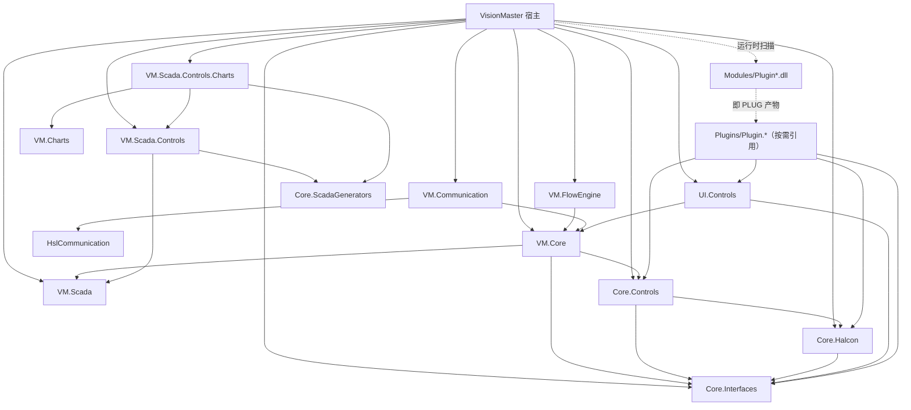

# VisionMaster 项目全景说明

> **文档性质**：面向新加入的开发者、维护者、集成与交付工程师的“从零开始”项目说明书。
> **代码快照**：2026-10-20 的 `D:\C#\VM` 工作区（以磁盘代码为准）。
> **阅读顺序建议**：先读第 1～4 章建立全局观，再按角色选读第 5～10 章，最后用第 13 章的知识结构制定学习计划。
> **重要说明**：仓库内 `docs/ProjectOverview.md`、`docs/ArchitectureGuide.md`、`docs/ProjectDetailedModules.md` 成文于 2026-10-05，部分内容已被后续改造推翻（例如启动自检链、Core 分层、SCADA 模块）。本文以当前代码为准；旧文可作历史参考，不应作为现状依据。

## 30 秒速览

- **是什么**：Windows 上的工业视觉检测上位机（WPF + Prism + HALCON），用可视化流程 + 插件算子搭检测流程。
- **怎么跑**：`dotnet build VisionMaster.sln` → 运行 `VisionMaster` → 打开 `.vms` 方案 → 拖算子/连线/编译/运行。
- **核心分层**：`Shard/Core.Interfaces`（契约）→ `VM.Core`（模型/服务）→ `VM.FlowEngine`/`VM.Communication`/`Scada.*`（子系统）→ `VisionMaster`（宿主）；插件在 `Plugins/`，运行时从 `Modules/` 扫描。
- **关键机制**：设计/编译/运行分离；端口即字段；显式栈执行器；变量镜像；方案 `.vms` 多态序列化 + 白名单。
- **怎么交付**：`pack.ps1 -Zip -Smoke` 生成目录式交付包；目标机需 .NET 9 Desktop Runtime + HALCON 原生库。
- **怎么验证**：`FlowCanvasChecks` / `ScadaChecks` / `CommChecks` / `IoChecks` / `UIThemeSmokeTest` / `HelpProbe`。

---

## 目录

- [0. 信息可信度与标注约定](#0-信息可信度与标注约定)
- [1. 项目概述](#1-项目概述)
- [2. 技术栈与依赖](#2-技术栈与依赖)
- [3. 目录结构](#3-目录结构)
- [4. 架构设计](#4-架构设计)
- [5. 核心模块说明](#5-核心模块说明)
- [6. 关键流程](#6-关键流程)
- [7. 数据模型](#7-数据模型)
- [8. 接口与契约](#8-接口与契约)
- [9. 配置说明](#9-配置说明)
- [10. 使用、运行与部署](#10-使用运行与部署)
- [11. 常见问题（FAQ）](#11-常见问题faq)
- [12. 维护与扩展建议](#12-维护与扩展建议)
- [13. 知识结构大纲](#13-知识结构大纲)
- [14. 待补充项](#14-待补充项)
- [附录 A. 关键文件索引](#附录-a-关键文件索引)
- [附录 B. 常用命令速查](#附录-b-常用命令速查)
- [附录 C. 术语表](#附录-c-术语表)

---

## 0. 信息可信度与标注约定

本文的事实来源分三类，正文中用方括号标注：

| 标注 | 含义 | 示例 |
|---|---|---|
| `[代码]` | 直接阅读当前磁盘源码/工程文件确认 | `App.xaml.cs` 的启动顺序 |
| `[文档]` | 来自仓库内现行文档或历史记录，尚未逐行复核 | `AGENTS.md` 中的 42 个工具箱条目口径 |
| `[待补充]` | 仓库内信息不足，不能从代码或文档确认 | 正式产品版本号、许可证 |

**特别提醒**：

1. 本仓库的“文档”数量很大（`docs/code-changes` 已有 257 份记录），但文档会滞后于代码。涉及具体行为时，**以代码和可执行断言为准**。
2. 仓库根目录没有 `README.md`、`LICENSE`、`CHANGELOG.md`，也没有发现 CI 配置（`.github`、`Jenkinsfile`、`azure-pipelines.yml` 等）。这些属于 `[待补充]`。
3. 仓库内存在大量以 `_` 开头的探针/临时工程（`_ChartProbe5`、`_ResProbe`、`_ToolboxProbe` 等）和临时日志（`_*.out`、`*.log`）。它们是开发过程产物，**不属于正式交付物**，阅读源码时应排除。

---

## 1. 项目概述

### 1.1 一句话定位

VisionMaster 是一套运行在 Windows 上的**工业机器视觉在线检测上位机平台**：用户通过可视化流程画布把相机采集、图像处理、定位/测量/检测、脚本、数据记录、运动控制等**插件算子**串成检测流程，由内置流程引擎编译并执行，再通过通信/IO/运控模块与 PLC、伺服、现场设备交换数据；同时提供 SCADA 组态画面作为操作员界面。

### 1.2 解决的核心问题

| 问题 | VisionMaster 的解法 |
|---|---|
| 视觉检测流程经常变化，硬编码成本高 | 可视化流程 + 插件化算子，拖拽/连线/配参即可搭建 |
| 不同项目、不同相机/PLC/运动卡组合多 | 设备驱动插件化 + 方案级配置（`.vms` 随方案走） |
| 算法工程师不熟悉软件工程 | 统一插件契约、端口模型、自动参数面板、帮助手册 |
| 现场需要操作员界面 | SCADA 组态：画面、图元、变量绑定、报警、权限、审计 |
| 设备与 UI 耦合导致卡顿 | 变量镜像 + 后台轮询 + UI 只读镜像 |
| 流程需要暂停、单步、断点、并行 | 显式栈执行器 + 会话状态机 + 并行分支隔离 |

### 1.3 核心能力清单

1. **流程编辑**：流程栏（树）+ Nodify 画布（节点/连线/小地图）+ 工具箱拖放 + 撤销/重做 + 复制粘贴。
2. **插件算子**：31 个插件工程（截至当前快照），覆盖采集、预处理、ROI、匹配、卡尺、Blob、颜色、OCR/码、YOLO/分类、标定/坐标变换、几何、脚本、数据记录/导出/上传、结果显示、运控、流程调用等。
3. **编译执行**：把 `StepModel` 树编译为 `CompiledNode` 图，支持 If/Case/While/For/Parallel/Wait/Break/Continue/Return，支持暂停/继续/单步/断点/停止。
4. **变量系统**：本地变量、网络变量（PLC 镜像）、系统变量（运动/IO 派生）、全局变量写入器。
5. **通信**：Modbus TCP、Modbus RTU、Siemens S7、三菱 MC（含基恩士/松下变体）、欧姆龙 FINS、自由协议（通用 TCP 文本）为真实实现；OPC UA 目前只有配置模型，未注册连接工厂（`[代码]` `ConnectionFactory.RegisterDefaults`）。
6. **硬件**：海康相机、网络相机、文件/文件夹取图；虚拟运动卡、正运动 ZMotion；Modbus/S7/仿真 IO。
7. **SCADA 组态**：画面/图层/图元/变量绑定/动画/事件/报警/用户权限/操作审计/基座画面。
8. **外部接口**：HTTP 收图服务（`POST /flow/{flowName}`）、网络相机推流服务。
9. **工程化**：方案持久化（`.vms`）、自动草稿、崩溃现场、日志、布局、帮助手册、主题体系。
10. **验证体系**：多个无 GUI 断言宿主（FlowCanvasChecks、ScadaChecks、CommChecks、IoChecks 等）和 UI 冒烟工程。

### 1.4 目标用户与典型场景

| 角色 | 关注点 | 主要入口 |
|---|---|---|
| 视觉工程师 | 搭流程、调算法参数、看图像与结果 | 流程栏、画布、工具箱、属性面板、图像页 |
| 设备集成工程师 | 配相机/PLC/IO/运动卡、变量映射 | 相机设置、通讯设置、IO 设置、运动板卡、全局变量 |
| 现场操作员 | 运行画面、报警、登录/权限 | SCADA 运行窗口、报警历史、状态栏 |
| 软件开发者 | 插件开发、引擎/UI 维护 | `Plugins/`、`Engine/`、`VisionMaster/`、断言工程 |
| 交付/售后 | 打包、部署、排障 | `pack.ps1`、`Logs/`、`crash_reports/`、`Autosave/` |

### 1.5 关键术语

| 术语 | 含义 | 代码锚点 |
|---|---|---|
| **方案（Solution）** | 一个完整工程：多个流程 + 通信/相机/运动/IO 配置 + 变量 + SCADA + 布局，落盘为 `.vms` | `Core/Models/SolutionModel.cs` |
| **流程（Flow）** | 运行的最小单元，包含一棵步骤树；有 Home/Main/End 强制角色 | `Core/Models/FlowModel.cs` |
| **步骤（Step）** | 流程树中的一个节点；可以是插件算子，也可以是内置控制节点 | `Core/Models/ProcessStep/StepModel.cs` |
| **分支（StepCollection）** | If/Else、Case、循环体、并行分支的容器，持有 `Steps` 与 `Expression` | `Core/Models/ProcessStep/StepCollection.cs` |
| **插件 / 算子** | 实现 `IVisionPlugin`、继承 `VisionPluginBase` 的 DLL 类型 | `Shard/Core.Interfaces/IVisionPlugin.cs` |
| **端口（Port）** | 插件的输入/输出数据成员，`InputPort<T>` / `OutputPort<T>` | `Shard/Core.Interfaces/DataPort/` |
| **连线（Link）** | 端口之间的数据依赖；`LinkKind` 区分上游输出/全局变量/运行时变量/常量 | `Shard/Core.Interfaces/LinkReference.cs` |
| **编译（Compile）** | 把步骤树实例化为可执行节点图，并解析连线/表达式/类型 | `Engine/FlowCompiler.cs` |
| **会话（Session）** | 一条流程的一次运行上下文，持有插件实例、CTS、暂停锁、编译版本 | `Core/Models/FlowSession.cs` |
| **本地变量** | 流程内/方案内的内存变量 | `Core/Models/Variable/LocalVariableModel.cs` |
| **网络变量** | 映射到 PLC/设备地址的变量，值是轮询镜像 | `Core/Models/Variable/NetworkVariableModel.cs` |
| **系统变量** | 由运动/IO 等系统能力派生的只读或受控变量 | `Core/Models/Variable/SystemVariableModel.cs` |
| **组态（SCADA）** | 操作员画面编辑与运行体系 | `Scada/Models/ScadaDocument.cs` |
| **图元（Element）** | SCADA 画面上的控件（按钮、指示灯、仪表、泵、管道等） | `Scada.Controls/Descriptors/BuiltInElements.cs` |
| **基座画面** | 跨页复用的公共底板层，页面通过 `BasePageId` 引用 | `Scada/Models/ScadaPage.cs` |
| **运行态** | SCADA 运行窗口 + 变量绑定 + 报警/权限/审计 | `VisionMaster/Services/ScadaRuntimeHost.cs` |

### 1.6 项目边界（非目标）

- 不是 Web/云端平台：主程序是 Windows 桌面 WPF 应用，没有服务端多租户。
- 不是通用低代码平台：流程模型、插件契约、变量系统都是视觉/工控领域专用。
- 没有内置数据库：方案用 JSON，日志/审计/报警用文本/CSV，报表导出用 Excel/CSV。
- 没有安装器/服务：交付形态是“目录 + 双击 exe”，升级靠覆盖程序文件、保留用户数据。
- 没有发现单元测试框架：验证主要靠自定义断言宿主（见第 5.10 节）。

---

## 2. 技术栈与依赖

### 2.1 运行时与语言

| 项 | 版本/说明 | 依据 |
|---|---|---|
| 操作系统 | Windows（WPF + HALCON + 原生 DLL） | `[代码]` |
| .NET | 主程序/大多数工程 `net9.0-windows`；部分契约/生成器为 `netstandard2.0`/`net9.0`；`Demo` 为 `net8.0`；`tools/DeviceSimulator` 为 `net48` | `[代码]` 各 `.csproj` |
| 语言 | C#（`LangVersion=preview`），XAML | `[代码]` `VisionMaster.csproj` |
| 构建 | .NET SDK 9、MSBuild、`dotnet` CLI；脚本以 Windows PowerShell 5.1 为主 | `[代码]` + `AGENTS.md` |
| 架构 | x64（HALCON/原生库/相机 SDK 约束；具体以现场为准） | `[待补充]` 未见显式 `PlatformTarget` |

### 2.2 主要 NuGet / 第三方库

| 库 | 版本 | 用途 | 使用位置 |
|---|---|---|---|
| Prism.Core / Prism.Wpf / Prism.Unity | 9.0.537 | MVVM、依赖注入、导航、弹窗 | `VisionMaster`、多个插件 |
| Dirkster.AvalonDock / Themes.VS2013 | 4.74.1 | 可停靠面板布局 | `VisionMaster` |
| Nodify | 7.3.0 | 流程画布节点/连线 | `VisionMaster` |
| AvalonEdit | 6.3.1.120 | C#/图像脚本编辑器 | `Plugin.CSharpScript`、`Plugin.ImageScript` |
| gong-wpf-dragdrop | 4.0.0 | 工具箱/流程栏拖放 | `VisionMaster`、`VM.Core` |
| DynamicExpresso.Core | 2.19.3 | If/While 条件表达式解析 | `VM.Core` / `VM.FlowEngine` |
| Newtonsoft.Json | 13.0.4 | `.vms`、配置、剪贴板序列化 | 全局 |
| NLog | 6.0.4 | 在 `VM.Core` 中引用；当前 `LogService` 使用自建后台队列写文件，NLog 是否实际启用 `[待补充]` | `VM.Core.csproj` |
| System.Drawing.Common | 9.0.x | 图像/绘图辅助 | 多个图像插件 |
| Microsoft.CodeAnalysis.CSharp.Scripting | 4.12.0 | C# 脚本编译执行 | `Plugin.CSharpScript` |
| MiniExcel | 1.46.0 | Excel 导出 | `Plugin.ExcelExport` |
| ScottPlot.WPF | 5.1.59 | 趋势曲线 | `Charts/VM.Charts` |
| WatsonWebserver | 7.2.0（离线 DLL） | HTTP 收图服务 | `VisionMaster` |
| HslCommunication | 12.1.2（随仓源码） | Modbus/S7 等通信 | `DLL/HslCommunication`、`VM.Communication` |

### 2.3 视觉与原生依赖

| 依赖 | 版本/位置 | 说明 |
|---|---|---|
| HALCON .NET | `DLL/Halcon/halcondotnet.dll`，文件版本 23.5.0.0 | 图像算法核心 |
| HALCON 原生库 | `DLL/Halcon/halcon.dll`、`hcanvas.dll`、`hdevenginedotnet.dll`，版本 23.05 | 必须随交付目录放到 exe 同级 |
| ONNX Runtime | `DLL/OnnxRuntime/` | YOLO / DL 分类插件 |
| ZMotion SDK | `Plugins/Plugin.Motion.ZMotion/Sdk/` | 正运动卡驱动 |
| Hikvision SDK | 插件工程引用（具体版本 `[待补充]`） | 海康相机 |
| SkiaSharp / HarfBuzz / GLFW | 由 ScottPlot.WPF 传递，`publish` 带出 `runtimes/win-x64/native` | 曲线渲染 |

### 2.4 技术选型的关键理由（来自代码注释与设计文档）

1. **WPF + Prism**：桌面工控场景成熟、MVVM 与 DI 完整、弹窗/导航基础设施齐全。
2. **AvalonDock**：主界面需要可拖拽、可保存/恢复的停靠布局；布局随方案和用户习惯保存。
3. **Nodify**：流程画布需要节点、端口、连线、缩放/平移/小地图，自己实现成本高。
4. **DynamicExpresso**：条件表达式需要“安全白名单”执行，不能直接 `CSharpScript` 执行任意代码。
5. **HALCON**：工业视觉算子成熟，.NET 封装可用；代价是原生 DLL 与授权。
6. **Newtonsoft.Json + `TypeNameHandling.Auto` + 白名单 Binder**：方案中存在多态配置（通信协议、变量、步骤），需要 `$type` 还原；白名单防止恶意文件构造任意类型。
7. **插件 DLL 扫描 + 反射**：新增算子不需要改主程序，只需把 DLL 投递到 `Modules/`。
8. **源生成器**：`[StepConfig]` 的样板属性（后备字段、`SetProperty`、钩子）由 `Core.PluginGenerators` 编译期生成；`[ScadaProperty]` 的依赖属性由 `Core.ScadaGenerators` 生成。

---

## 3. 目录结构

### 3.1 顶层目录职责

| 目录 | 职责 | 是否正式交付 |
|---|---|---|
| `VisionMaster/` | WPF 主程序：App、Shell、Views、ViewModels、Services、Modules、Lifetime、Help、资源 | 是 |
| `Core/`（`VM.Core`） | 领域模型（`VisionMaster.Models`）、方案/日志/设置服务、通信契约、变量模型、工具库 | 是（DLL） |
| `Engine/`（`VM.FlowEngine`） | 流程编译器、执行引擎、插件扫描/缓存、自动触发、试运行 | 是（DLL） |
| `Communication/`（`VM.Communication`） | 通信管理器、连接工厂、Modbus/S7/串口连接、轮询调度 | 是（DLL） |
| `Scada/`（`VM.Scada`） | SCADA 领域模型：文档/页面/图元/绑定/动画/报警/权限/撤销 | 是（DLL） |
| `Scada.Controls/` | SCADA 图元控件库、画布、运行态绑定器 | 是（DLL） |
| `Scada.Controls.Charts/` | 曲线图元（`Hmi.ChartTrend`），依赖 `Charts/VM.Charts` | 是（DLL） |
| `Charts/VM.Charts/` | ScottPlot 图表封装库 | 是（DLL） |
| `Shard/Core.Interfaces/` | **最底层契约**：插件、端口、相机、运动、IO、结果、配置上下文 | 是（DLL） |
| `Shard/Core.Controls/` | 共享 WPF 控件：`LinkableValueEditor`、事件总线、图像预览等 | 是（DLL） |
| `Shard/Core.PluginGenerators/` | `[StepConfig]` 源生成器（`netstandard2.0`） | 否（Analyzer） |
| `Shard/Core.ScadaGenerators/` | `[ScadaProperty]` 源生成器（`netstandard2.0`） | 否（Analyzer） |
| `UI/Controls/`（`UI.csproj`） | 主题、样式、通用控件（Fluent 设计系统） | 是（DLL） |
| `Services/Core.Halcon/` | HALCON 基类、图像控件、标注烘焙、几何/颜色辅助 | 是（DLL） |
| `Services/Service.Identity/` | 用户/角色/登录契约（`net8.0`） | `[待补充]` 未被主程序引用 |
| `Services/Services.Logger/` | 日志契约（`net9.0`） | `[待补充]` 未被主程序引用 |
| `Plugins/` | 31 个插件工程（算子、相机驱动、运动驱动、工具） | 是（DLL） |
| `Modules/` | 插件构建产物投递目录（37 个 DLL + `PluginCache/manifest.json`） | 是（运行时） |
| `DLL/` | 离线第三方依赖：HALCON、HslCommunication、Watson、OnnxRuntime、ZMotion 等 | 是（部分随包） |
| `FlowCanvasChecks/` | 流程画布/引擎/插件/资源契约断言宿主（无 GUI） | 开发验证 |
| `ScadaChecks/` | SCADA 领域/绑定/运行态断言宿主 | 开发验证 |
| `CommChecks/`、`CommStress/`、`CommPerf/`、`CommTest/` | 通信契约、压力、性能、实机联调 | 开发验证 |
| `IoChecks/` | IO 契约/驱动/健康监控断言 | 开发验证 |
| `UIThemeSmokeTest/` | UI 主题/布局/模板冒烟 | 开发验证 |
| `HelpProbe/` | 帮助目录/渲染/字体/图标断言 | 开发验证 |
| `tools/` | 设备模拟器、虚拟相机客户端、方案探针、图标烘焙、资源审计脚本 | 开发/交付辅助 |
| `docs/` | 设计文档、插件专题、变更记录、UI 基线、归档 | 文档 |
| `学习笔记/` | 视觉算子学习手册（ROI/卡尺/匹配/颜色/Blob/标定） | 学习资料 |
| `解决方案/` | 示例 `.vms` 方案 | 示例 |
| `Image/` | 图片/截图素材（体量大，非代码） | 素材 |
| `packages/` | 本机 NuGet 包缓存（被 `.gitignore` 忽略） | 否 |
| `_*`、`*.out`、`*.log` | 开发探针/临时输出 | 否 |

### 3.2 解决方案工程分组

`VisionMaster.sln` 共登记 **49 个工程**（另有 8 个解决方案文件夹，合计 57 条 `Project` 记录）`[代码]`。按用途分组：

| 分组 | 工程 |
|---|---|
| 宿主 | `VisionMaster` |
| 核心契约 | `Core.Interfaces` |
| 核心模型/服务 | `VM.Core` |
| 流程引擎 | `VM.FlowEngine` |
| 通信 | `VM.Communication`、`HslCommunication` |
| SCADA | `VM.Scada`、`VM.Scada.Controls`、`VM.Scada.Controls.Charts`、`VM.Charts` |
| UI | `UI`、`Core.Controls`、`Core.Halcon` |
| 源生成器 | `Core.PluginGenerators`、`Core.ScadaGenerators` |
| 插件 | **32 个 `Plugin.*` 工程全部在 sln 内**（盘上 32 个目录，一一对应；注意 `Plugins\Plugin.Utility\` 里的工程名是 `Plugin.Util`）。2026-10-22 之前 `Plugin.Camera.Network`、`Plugin.ImageAssign`、`Plugin.DlClassify` 未登记 |
| 验证 | `FlowCanvasChecks`、`ScadaChecks`、`CommChecks`、`CommStress`、`IoChecks`、`Demo` |
| 未入 sln 的验证/工具 | `CommPerf`、`CommTest`、`HelpProbe`、`UIThemeSmokeTest`、`tools/*`、`_*` 探针 |

> **注意**：未入 sln 的工程不会被 `dotnet build VisionMaster.sln` 构建。`Plugin.Camera.Network`、`Plugin.ImageAssign`、`Plugin.DlClassify` 三个已于 2026-10-22 补进 sln——此前它们只能靠 `FlowCanvasChecks` 的 `ProjectReference` 顺带重建，**VS「生成解决方案」完全不编它们**，DLL 会永久停在旧版且无任何报错。仍未入 sln 的是验证/工具工程，见下一行。`[代码]` `AGENTS.md` R62 也记录了这一坑。

### 3.3 关键目录树（精简）

```
D:\C#\VM
├─ VisionMaster.sln
├─ VisionMaster/                     # WPF 宿主
│  ├─ App.xaml / App.xaml.cs         # PrismApplication、DI、启动自检、退出链
│  ├─ Shell.xaml / Shell.xaml.cs     # 主窗口、停靠布局、菜单、状态栏
│  ├─ ShellViewModel.cs              # 命令总线、方案/运行/系统命令
│  ├─ Views/                         # 流程栏、画布、图像、日志、监控、SCADA、对话框
│  ├─ ViewModels/                    # 对应 VM；DialogViewModels 为弹窗 VM
│  ├─ Services/                      # 方案、变量、布局、帮助、相机/运动/IO、SCADA、健康
│  ├─ Modules/                       # IAppModule 实现（通信/引擎/收图/相机/运动/IO）
│  ├─ Lifetime/                      # Splash、启动检查
│  └─ Help/                          # 宿主内置手册（EmbeddedResource）
├─ Core/                             # VM.Core：模型 + 服务 + 通信契约
│  ├─ Models/ProcessStep/            # StepModel/StepCollection/控制步骤
│  ├─ Models/Compileds/              # CompiledNode 家族
│  ├─ Models/Variable/               # 变量模型
│  ├─ Binding/                       # 变量注册表、全局变量写入、系统变量
│  ├─ CommunicationContracts/        # 通信配置/地址/接口
│  ├─ Lifetime/                      # 启动/退出/异常分级/崩溃报告
│  ├─ Toolkit/                       # 队列、定时器、性能、重试等
│  └─ SolutionService.cs             # .vms 读写
├─ Engine/                           # 编译器、执行引擎、插件服务/缓存
├─ Communication/                    # 通信实现
├─ Scada/                            # SCADA 领域模型
├─ Scada.Controls/                   # 图元/画布/运行态绑定
├─ Scada.Controls.Charts/            # 曲线图元
├─ Charts/VM.Charts/                 # ScottPlot 封装
├─ Shard/
│  ├─ Core.Interfaces/               # 最底层契约
│  ├─ Core.Controls/                 # 共享控件
│  ├─ Core.PluginGenerators/         # [StepConfig] 生成器
│  └─ Core.ScadaGenerators/          # [ScadaProperty] 生成器
├─ UI/Controls/                      # 主题/控件库
├─ Services/Core.Halcon/             # HALCON 控件/工具
├─ Plugins/                          # 31 个插件工程
├─ Modules/                          # 插件 DLL 投递目录
├─ DLL/                              # 离线第三方依赖
├─ docs/                             # 文档体系
├─ 学习笔记/                          # 视觉算子教材
├─ 解决方案/                          # 示例 .vms
└─ tools/                            # 模拟器/探针/脚本
```

### 3.4 运行时目录（exe 同级）

| 路径 | 内容 | 生成/维护 |
|---|---|---|
| `AppConfig.json` | 软件级配置 | 首次修改设置时写入；缺失用默认值 |
| `communications.json` | 机器级通信配置 | 通讯设置弹窗/方案绑定写入 |
| `Layout.xml` | 当前停靠布局 | 关闭时/保存布局时写入 |
| `DefaultLayout.xml` | 出厂布局快照 | 每次启动从 `Shell.xaml` 捕获 |
| `ScadaUsers.json` | SCADA 账号/角色 | 用户管理；首次播种 `admin/admin123` |
| `Logs/yyyy-MM-dd.log` | 运行日志 | 后台队列按天写，保留 30 天 |
| `Audit/Audit-yyyy-MM-dd.csv` | 操作审计 | 保留天数取 `AppConfig.AuditRetentionDays` |
| `Alarms/AlarmHistory-yyyy-MM-dd.csv` | 报警历史 | 保留天数取 `AppConfig.AlarmHistoryRetentionDays` |
| `Autosave/*.vms` | 未保存草稿 | 退出时逐字比较内存/磁盘后写入 |
| `Autosave/recovered/` | 已提示过的草稿归档 | 下次启动提示后归档 |
| `crash_reports/*.txt` | 崩溃现场 | 保留最近 20 份 |
| `AlarmFrames/` | 报警时图集落盘 | `ImageGallery.SaveFramesOnAlarm` 开启时 |
| `Modules/` | 插件 DLL | 构建插件时投递；打包时整目录复制 |

---

## 4. 架构设计

### 4.1 分层架构（以真实工程引用为准）

> **重要纠正**：旧文档说“Core 不反向依赖任何上层”，这只对 `Shard/Core.Interfaces` 成立。`Core/VM.Core` 实际引用了 `Scada/VM.Scada` 与 `Shard/Core.Controls`，因此它不是最底层；真正的最底层契约是 `Shard/Core.Interfaces`。

```
┌──────────────────────────────────────────────────────────────────────┐
│                        交付/运行形态                                  │
│  VisionMaster.exe + Modules\Plugin*.dll + HALCON/原生 DLL + 用户数据   │
└──────────────────────────────────────────────────────────────────────┘
                                  ▲
┌──────────────────────────────────────────────────────────────────────┐
│  宿主层  VisionMaster（WPF + Prism）                                  │
│  App / Shell / Views / ViewModels / Services / Modules / Lifetime     │
└───────────────┬───────────────────────────────┬──────────────────────┘
                │                               │
┌───────────────▼──────────────┐  ┌─────────────▼──────────────────────┐
│  子系统层                     │  │  UI 基础层                          │
│  VM.FlowEngine（编译/执行）   │  │  UI.Controls（主题/控件）            │
│  VM.Communication（通信）     │  │  Core.Controls（共享控件）           │
│  VM.Scada.Controls（图元）    │  │  Core.Halcon（HALCON 控件/工具）     │
│  VM.Scada.Controls.Charts     │  │                                     │
└───────────────┬──────────────┘  └─────────────┬──────────────────────┘
                │                               │
┌───────────────▼───────────────────────────────▼──────────────────────┐
│  模型/服务层  VM.Core（VisionMaster.Models / Services）               │
│  方案、流程/步骤、变量、通信契约、日志、生命周期、工具库                │
└───────────────┬──────────────────────────────────────────────────────┘
                │
┌───────────────▼──────────────┐  ┌────────────────────────────────────┐
│  SCADA 领域层  VM.Scada       │  │  最底层契约  Shard/Core.Interfaces  │
│  文档/页面/图元/绑定/报警     │  │  插件/端口/相机/运动/IO/结果        │
└──────────────────────────────┘  └────────────────────────────────────┘
                                  ▲
┌──────────────────────────────────────────────────────────────────────┐
│  插件层  Plugins/Plugin.*  →  Modules/Plugin*.dll                     │
│  只依赖 Core.Interfaces（UI 插件另依赖 Core.Halcon/Core.Controls/UI）  │
└──────────────────────────────────────────────────────────────────────┘
```

**依赖规则**：

1. `Shard/Core.Interfaces` 不依赖任何第一方工程，是插件与宿主之间的唯一契约面。
2. `Core.Halcon`、`Core.Controls`、`VM.Core`、`VM.Scada`、`Engine`、`Communication`、`UI` 之间按上图单向依赖；`VM.Core → VM.Scada` 是当前的真实依赖（`SolutionModel.Scada` 字段）。
3. 插件**不引用** `VisionMaster`、`VM.Core`、`VM.FlowEngine`，只引用契约与（按需）UI 基础库；宿主通过反射加载插件。
4. `VisionMaster` 是唯一把所有子系统装配起来的工程；它引用 `VM.Communication`、`VM.Core`、`VM.FlowEngine`、`VM.Scada`、`VM.Scada.Controls`、`VM.Scada.Controls.Charts`、`Core.Halcon`、`Core.Controls`、`Core.Interfaces`、`UI`、`HslCommunication`。
5. `Core.PluginGenerators` / `Core.ScadaGenerators` 只以 `Analyzer` 方式挂接，**不进入**任何输出目录。

### 4.2 模块关系图



### 4.3 模块装配与生命周期

`IAppModule` 是子系统的自装配契约（`VisionMaster/Lifetime/IAppModule.cs`）：

```csharp
public interface IAppModule
{
    string Name { get; }
    void Register(IContainerRegistry registry);              // 容器构建期
    void Initialize(IContainerProvider container,
                    AppLifetimeService lifetime);            // 容器就绪后、自检前
}
```

`App.RegisterTypes` 中按以下顺序创建模块：

| 顺序 | 模块 | 主要职责 | 初始化动作 |
|---|---|---|---|
| 1 | `CommunicationModule` | 通信管理器 | 加载 `communications.json`、`StartAll`；退出 `StopAll/DisconnectAll` |
| 2 | `FlowEngineModule` | 编译器/插件/引擎/自动触发 | 注入 `FlowInvoker`、启动定时/变量触发、注册退出任务 |
| 3 | `HttpImageServerModule` | HTTP 收图 | 启动 Watson 服务；退出 Dispose |
| 4 | `CameraModule` | 相机 Provider/网络相机服务 | 自动连接相机、启动收图；退出先停服务再断相机 |
| 5 | `MotionModule` | 运动 Provider/轴注册/状态发布 | 轴解析、自动连接、启动发布器；退出先停发布器/执行器再断卡 |
| 6 | `IoModule` | IO Provider/驱动/变量投影 | 应用方案 IO 配置、200ms 状态发布、订阅方案切换；退出释放 |

**顺序即启动/退出顺序**：退出任务按注册逆序执行，因此 IO/运动/相机先于收图/引擎/通信收尾。

### 4.4 关键架构决策

| 决策 | 目的 | 代价/注意 |
|---|---|---|
| **设计 / 编译 / 运行三层分离** | 画布只存轻量 `StepModel`，不实例化重资源插件；编译时才创建插件与节点图 | 修改后必须重新编译；版本号必须可靠 |
| **端口即字段 + 反射发现** | 插件只声明 `InputPort<T>`/`OutputPort<T>`，宿主自动生成参数面板与连线 | 只支持 public 属性；字段无效 |
| **`LinkKind` 显式区分四类来源** | 上游输出、全局变量、运行时变量、常量各有明确语义，避免“按显示名猜” | 旧档需要 `NormalizeKind` 迁移 |
| **显式栈执行器** | 避免深层嵌套递归爆栈；统一支持暂停/取消/单步 | 控制流节点必须严格实现 `RunAndGetNext` |
| **`CurrentFlowState` 控制旗** | Break/Continue/Return 统一表达 | 循环节点必须消费并复位，否则状态泄漏 |
| **并行分支影子变量** | 分支内变量写入隔离，汇合时按声明序合并 | 并行步骤必须标 `[ParallelSafe]`；调试退化为顺序 |
| **变量镜像** | UI 只读内存镜像，避免高频读设备卡顿 | 网络变量写设备要显式 `TryWriteToValue` |
| **方案 `TypeNameHandling.Auto` + 白名单 Binder** | 多态配置可还原，同时防恶意 `$type` | 新增可序列化子类要进白名单/命名空间 |
| **插件 DLL 扫描** | 新增算子零改主程序 | 必须投递到 `Modules/`；依赖 DLL 不能误命名为 `Plugin*.dll` |
| **源生成器** | 消除 `[StepConfig]`/`[ScadaProperty]` 样板 | 改生成器必须重建全部引用工程 |
| **目录式交付** | 无安装器、升级覆盖、用户数据保留 | 必须补齐 HALCON 原生库/插件目录/脚本资源 |

---

## 5. 核心模块说明

### 5.1 `Shard/Core.Interfaces`：最底层契约

**职责**：定义插件、端口、相机、运动、IO、结果、配置上下文等跨程序集契约，**不依赖任何第一方工程**。

关键类型：

| 类型 | 作用 |
|---|---|
| `IVisionPlugin` | 插件生命周期：`Initialize()`、`Execute(IExecutionContext)`、`Dispose()`；`Inputs/Outputs`、`LastError` |
| `VisionPluginBase` | 插件基类：端口反射、`Success`/`ErrorMessage`、默认成功/显式失败、输出资源回收 |
| `IPort` / `IInputPort` / `IOutputPort` | 端口统一契约；`InputPort<T>` 有手动值与 `LinkedSource`，`ActualValue` 链接优先 |
| `IExecutionContext` | 执行上下文：日志、取消令牌、`CurrentFlowState`、全局变量、相机、运动、IO、流程调用器、局部变量 |
| `LinkReference` | 连线引用：`Kind`（StepPort/GlobalVariable/RuntimeVariable/Constant）、目标步骤/端口/变量、显示地址 |
| `ICameraDevice` / `ICameraProvider` | 相机驱动与仓库 |
| `IMotionDevice` / `IMotionProvider` | 运动卡驱动与仓库 |
| `IIoDevice` / `IIoProvider` | IO 设备与仓库 |
| `IPluginCustomViewProvider` / `IPluginConfigView` | 插件自带配置视图 |
| `IPluginHelpProvider` | 插件帮助章节 |
| `IPluginConfigContextProvider` | 插件配置所需的宿主快照（变量/相机候选等） |
| `StepConfigAttribute` / `StepConfigOptionsAttribute` | 配置属性标记；由 `Core.PluginGenerators` 生成实现 |

### 5.2 `Core/VM.Core`：模型与服务

**职责**：

- 领域模型：`SolutionModel`、`FlowModel`、`StepModel`/`StepCollection`、`CompiledFlow`、变量模型、`AppConfigModel`、`SolutionConfig`。
- 服务：`SolutionService`（`.vms` 读写）、`SolutionDraftService`（草稿）、`AppSettingsService`（`AppConfig.json`）、`LogService`（日志）、`AppLifetimeService`（启动/退出/异常）。
- 通信契约：`CommunicationConfig`、`ConnectionConfigBase` 及各协议配置、`ICommunicationManager`、`ICommunicationConnection`。
- 变量：`IVariable`/`IWritableVariable`、`LocalVariableModel`、`NetworkVariableModel`、`SystemVariableModel`、`VariableRegistry`、`GlobalVariableWriter`。
- 工具库：`BlockingQueue`、`HighPrecisionTimer`、`RetryPolicy`、`PerformanceMonitor`、`WatchPortWrapper` 等。

**注意**：`VM.Core` 的命名空间并不全是 `Core.*`：`SolutionModel`/`FlowModel` 在 `VisionMaster.Models`，`SolutionService` 在 `VisionMaster.Services`。阅读时不要按工程名找命名空间。

### 5.3 `Engine/VM.FlowEngine`：编译与执行

**职责**：

| 类 | 作用 |
|---|---|
| `FlowCompiler` | 把 `StepModel` 树编译为 `CompiledNode` 图；解析连线、表达式、类型、结构合法性 |
| `CompiledFlow` | 编译产物：根节点、`PluginLookup`、`NodeLookup`、`DependencyMap` |
| `CompiledNode` 家族 | `CompiledPluginNode`、`CompiledIfNode`、`CompiledWhileNode`、`CompiledForNode`、`CompiledParallelNode`、`CompiledWaitNode`、`CompiledBreakNode`、`CompiledContinueNode`、`CompiledReturnNode` |
| `FlowEngineService` | 会话运行/暂停/继续/单步/停止；资源锁；事件回传 |
| `FlowSessionFactory` | 按 FlowID+Version 确保会话新鲜；创建 `FlowSession` |
| `FlowSession` | 运行上下文：CTS、PauseLock、FocusedStep、Debug 门 |
| `PluginService` | 扫描 `Modules/Plugin*.dll`、注册内置节点、生成工具箱条目 |
| `PluginCache` | 插件清单缓存（指纹失效） |
| `PluginProvider` | 模块/相机/激光/运动插件注册表 |
| `PluginTestRunner` | 单步试运行：按依赖图跑上游链，再执行目标插件 |
| `FlowAutoRunner` / `FlowTimerScheduler` / `FlowVariableTriggerService` | 自动触发（手动/定时/变量/子程序/HTTP） |
| `FlowInvoker` | 子流程调用 |
| `ResourceLockService` | 会话锁/资源锁，防止同一流程并发跑 |

**编译产物归属**：`FlowSession` 持有 `CompiledFlow` 与 `PluginLookup`，`Dispose` 时统一释放插件实例。运行前若 `flow.Version > session.CompiledVersion` 或 FlowID 变化，会重新编译。

### 5.4 `Communication/VM.Communication`：通信子系统

**结构**：

```
Communication/
├─ CommunicationModule.cs
└─ Communications/
   ├─ Address/        ModbusAddress, S7Address, PollAddressResolver
   ├─ Connection/     ModbusTcpConnection, SerialConnection, SiemensS7Connection
   ├─ Core/           HslHelper
   └─ Manager/        AdvancedCommunicationManager, ConnectionFactory,
                      ConnectionWorker, PollScheduler, PollBatchPlanner
```

**职责**：

- `AdvancedCommunicationManager`：连接/配置/Worker/变量注册表的统一门面；读写 `communications.json`；状态/故障事件（5 秒限流）。
- `ConnectionFactory`：按协议创建连接。**当前真实注册**：Modbus TCP、Modbus RTU、Siemens S7、三菱 MC（含基恩士/松下变体）、欧姆龙 FINS/TCP、自由协议（通用 TCP 文本）`[代码]`。OPC UA 只有配置类，未注册。
- `ConnectionWorker`：每连接一条专属线程；读/写分队列（写优先）；心跳按“最后成功通信时间”；指数退避重连（5s 起、30s 上限；ConnectionRefused 固定 1s）。
- `PollScheduler`：多扫描组；默认组周期取 `ReadCycleMs`；最多 8 个自定义组（50ms–1h）；按周期升序优先级。
- `PollBatchPlanner`：按协议/存储区合并连续地址段；Modbus 单请求上限 120 寄存器/2000 位，S7 110 字节；无法结构化解析的地址回退单读。**MC/FINS 已接字区批量**（MC 960 字 / FINS 500 字；位区单读，见 `docs/通信协议矩阵.md`）。
- `NetworkVariableBridge`（宿主侧）：把 `NetworkVariableModel` 绑定到通信管理器，注册 `CommunicationVariable`，支持改名/增删/方案切换 `RebindAll`。

**与 IO 层的区别**：通信层面向“PLC 地址 + 网络变量”；IO 层是独立的“设备/点位（DI/DO/AI/AO）”抽象，走 `IIoDevice`/`IoProvider`，不经过 `AdvancedCommunicationManager`。两者最终都可以投影为系统变量。

### 5.5 SCADA：组态与运行态

| 子层 | 工程 | 职责 |
|---|---|---|
| 领域模型 | `Scada/VM.Scada` | `ScadaDocument`、`ScadaPage`、`ScadaElement`、`ScadaBinding`、`ScadaAnimation`、`ScadaAlarmEngine`、`ScadaRuntime`、`ScadaEditHistory`、`ScadaRole` |
| 控件/画布 | `Scada.Controls` | 21 个内置图元（矩形/椭圆/文本/按钮/位按钮/指示灯/进度条/数值域/灯/时钟/仪表/阀/泵/电机/管道/报警条/底板/图片/轴控台/轴面板/轴点位表）、`ScadaCanvas`、`ScadaRuntimeBinder` |
| 曲线 | `Scada.Controls.Charts` + `Charts/VM.Charts` | `Hmi.ChartTrend`，ScottPlot 5 封装 |
| 编辑器 | `VisionMaster/ViewModels/Scada*` + `Views/Scada*` | 画面/图元/属性/图层/工具箱/事件/报警/用户/登录/运行窗口 |
| 运行态 | `VisionMaster/Services/Scada*` | `ScadaRuntimeHost`、`ScadaNavigator`、`ScadaActionDispatcher`、`ScadaValueWriter`、`ScadaAccessPolicy`、`ScadaAlarmHistoryWriter`、`ScadaAuditWriter` |

**关键概念**：

- `ScadaDocument` 随 `.vms` 落盘，包含 `Pages`、`Alarms`、`VariableEvents`、`StartupPageId`、`BasePages`。
- `ScadaPage` 有 `PageId`、`Width/Height`、`Background`、网格/吸附、`Elements`、`Layers`、`EventHooks`、`Version`、`BasePageId`。
- `ScadaElement` 有 `ElementId`、`TypeKey`、几何、`Properties` 属性袋、`LayerId/GroupId/ParentId`、`RequiredRole`、`Bindings`、`EventHooks`、`Animations`。
- 绑定以 `VariableId` 为权威键，`VariableName` 仅作展示/旧档兜底。
- 动画仅四类：外观变化、水平移动、垂直移动、可见性。
- 报警引擎支持激活延时、回差、通信超时、确认状态机；内存历史 2000 条，宿主按天写 CSV。
- 撤销/重做是静态单栈双向，上限 50；所有模型写入走 `BeginEdit`/`ScadaChangeScope`。
- 权限三档：Operator / Engineer / Administrator；账号 `ScadaUsers.json`，PBKDF2-SHA256；审计 CSV。
- 基座画面：`BasePages` + `BasePageId`，基座是普通页但只能一层、不可导航；渲染为“基座压底 + 本页”。

### 5.6 `UI/Controls` 与主题体系

- `UI.csproj` 输出 `UI.dll`，包含主题资源与通用控件。
- `App.xaml` 合并：`Core.Halcon/Generic.xaml`、`UI/Themes/Generic.xaml`、`PresentationFramework.Fluent/Themes/Fluent.xaml`。
- `UI/Controls/Themes/Generic.xaml` 按域合并：颜色/图标令牌 → 控件分册（Button/Input/Selection/List/GridView/DataGrid/Navigation/Layout/Misc）→ 自定义控件（LogConsole/NumericBox/StatusIndicator/PropertyGrid）→ 对话框分册（Dialog.*）。
- `FluentTokens.xaml` 是视觉唯一事实来源（强调色/表面/圆角/间距/动效）；`FluentControls.xaml` 定义样式；`FluentAliases.xaml` 把旧键转发到 Fluent。
- 已知红线：`ListView + GridView` 必须挂 `GridListViewStyle` 且行模板用 `GridViewRowPresenter`；资源分册之间不能互相 `StaticResource` 引用（见 `AGENTS.md` 第 6、9 节）。

### 5.7 `VisionMaster` 宿主

| 子目录 | 职责 |
|---|---|
| `App.xaml.cs` | Prism 应用入口、DI 注册、模块装配、启动自检、异常/退出链、后台诊断 |
| `Shell.xaml` / `ShellViewModel.cs` | 主窗口、菜单、停靠布局、命令总线、状态栏 |
| `Views/` | 流程栏、画布、图像、日志、监控、SCADA、全部对话框 |
| `ViewModels/` | 对应 VM；`DialogViewModels/` 为弹窗 VM |
| `Services/` | 方案/变量/布局/帮助/相机/运动/IO/SCADA/健康/收图 |
| `Modules/` | `IAppModule` 实现 |
| `Lifetime/` | Splash、启动检查 |
| `Help/` | 宿主内置帮助页（编进 DLL） |
| `Commands/` | 布局保存/加载/重置、显示面板 |
| `Helpers/` | 值编辑、类型名缩短、工具箱配色、变量候选等 |

**主界面面板**（`Shell.xaml` 的 `ContentId`）：

- 左栏：`Panel_FlowListView`（程序）、`Panel_ProcessView`（流程栏）
- 中央文档：`Panel_ImageView`（视觉图像）、`Panel_FlowCanvasView`（流程画布）、`Panel_ScadaEditorView`（组态画面）
- 底部：`Panel_LogView`（日志）、`Panel_MonitorView`（监控）、`Panel_DeviceStateView`（设备状态，占位）
- 右侧：`Panel_ScadaPropertyView`（属性）、`Panel_ScadaLayerView`（图层）、`Panel_ToolView`（工具箱）、`Panel_ScadaToolboxView`（图元工具箱）

**布局机制**：`LayoutHelper` 负责 `Layout.xml`/`DefaultLayout.xml`、`CurrentLayoutSchemaVersion`、`ContentFactories` 回填、`ApplyScadaPanelMode` 组态/非组态面板收敛。恢复隐藏面板必须走 `ShowAnchorable`，不能直接 `IsVisible = true`（AvalonDock 4.74.1 索引 -1 崩溃）。

### 5.8 插件体系

**插件工程清单（31 个）**：

> 按 `AGENTS.md`（2026-10-14）口径，31 个插件程序集对应约 **42 个工具箱条目**（一个程序集可包含多个插件类，如 `Plugin.Utility`、`Plugin.Motion.Steps`）。下表按功能分类列出代表工程。

| 分类 | 工程 | 代表插件/说明 |
|---|---|---|
| 图像采集/相机 | `Plugin.ImageAcquisition`、`Plugin.Camera.Hikvision`、`Plugin.Camera.Network` | 文件/文件夹取图；海康相机；网络相机 |
| 预处理 | `Plugin.PreProcessing` | 滤波/形态学/阈值等 |
| ROI | `Plugin.CreateRoi` | 动态输出端口（`IDynamicOutputProvider`） |
| 匹配 | `Plugin.Matching` | 模板匹配/定位 |
| 卡尺 | `Plugin.CaliperMeasure` | 尺寸测量 |
| Blob/缺陷 | `Plugin.BlobDetect`、`Plugin.BeadInspect` | 缺陷检测、胶路检测 |
| 颜色 | `Plugin.ColorCheck`、`Plugin.ColorRegion` | 颜色检查、区域颜色 |
| OCR/码 | `Plugin.Ocr`、`Plugin.CodeReader` | OCR、码读取 |
| 深度学习 | `Plugin.Yolo`、`Plugin.DlClassify` | YOLO 检测、分类 |
| 标定/坐标 | `Plugin.Calibration`、`Plugin.PoseTransform` | 标定、坐标变换 |
| 几何 | `Plugin.GeometryFinder`、`Plugin.GeometryRelation` | 几何查找/关系 |
| 脚本 | `Plugin.CSharpScript`、`Plugin.ImageScript` | C# 脚本、HALCON 图像脚本 |
| 数据 | `Plugin.DataRecord`、`Plugin.ExcelExport`、`Plugin.ResultUpload` | CSV 记录、Excel 导出、结果上传 |
| 结果显示 | `Plugin.ResultDisplay` | 把结果烧进图像 |
| 运控 | `Plugin.Motion.Steps`、`Plugin.Motion.Virtual`、`Plugin.Motion.ZMotion` | 运动步骤、虚拟卡、正运动卡 |
| 流程调用 | `Plugin.RunFlow` | 调用子流程 |
| 图像赋值/工具 | `Plugin.ImageAssign`、`Plugin.Utility` | 图像赋值、比较/转换/延时/逻辑/数学/变量赋值 |

**插件契约与加载**：

- 插件类：继承 `VisionPluginBase`，标 `[Display(Name, GroupName, Description, ShortName)]`。
- 端口：public `InputPort<T>` / `OutputPort<T>` 属性；`EnsurePortsDiscovered` 反射发现。
- 配置：`[StepConfig, DefaultValue(...)] public partial T X { get; set; }`；生成器生成后备字段与钩子。
- 自带视图：实现 `IPluginCustomViewProvider.GetConfigView(...)`；否则宿主用 `AutoPortConfigView` + `PluginConfigShell` 自动生成。
- 加载：`PluginService.InitPlugins` 扫描 `AppDomain.BaseDirectory\Modules\Plugin*.dll`（DEBUG 回退到仓库根 `Modules`）；只加载 `Plugin*.dll`，跳过 Roslyn/MiniExcel 等依赖。
- 注册：模块插件进 `ModulePlugins`；相机/运动驱动分别进 `CameraPlugins`/`MotionPlugins`，不混入算子列表。
- 缓存：`Modules/PluginCache/manifest.json`；`SchemaVersion=1`、`ContractVersion`、每个 DLL 的 `Length+LastWriteTimeUtcTicks`；多出未登记 DLL 也会全量重扫；命中仍 `LoadFrom` 全部插件，只跳过 `GetTypes`/`Activator`。

**插件帮助**：每个插件 csproj 挂 `<EmbeddedResource Include="Help\**\*" />`；单插件用 `Help/01-xxx.md`，多插件程序集用 `Help/{类名}/NN-xxx.md`；开发页用 `NN-dev-xxx.md`；页数/行数有档位要求（L/M/S）。

### 5.9 `Services/Core.Halcon`：HALCON 基础能力

- `HalconBase`：HALCON 窗口控件基类，处理 ROI 绘制/拖拽/命中测试；包含 R51-R55 的手势与容差修复。
- `ImageDisplay` / `ImageEdit` / `ImageReadOnly` / `ImageGallery`：图像显示、编辑、只读、图集控件。
- `AnnotationBaker`：离屏标注烘焙的唯一实现（全仓只允许这里 `OpenWindow`，另有一处 `Plugin.ImageScript/HDevDisplayBackend.cs` 永久豁免）。
- `ColorMarks` / `ColorSampler` / `ColorThresholds` / `ColorVocabulary`：颜色工具。
- `CameraDistortion`、`ImageExporter`、`PathEditor`、`HistogramPlot` 等。

### 5.10 验证工程与工具

| 工程 | 验证内容 | 运行 |
|---|---|---|
| `FlowCanvasChecks` | 流程模型/编译/执行/控制流/并行/变量/资源契约/插件/UI 静态扫描等；默认全量即“常规 gate” | `dotnet run --project FlowCanvasChecks` |
| `ScadaChecks` | SCADA 变量身份/持久化/注册表/绑定/画面/图元/编辑器/运行态/事件/动画/报警/权限/审计 | `dotnet run --project ScadaChecks`（可 `--stress`） |
| `CommChecks` | 通信契约、扫描组、调度、批量、超时、串口字节序、S7 长度、坏段、写优先/背压、KeepAlive、JSON 隔离、拒绝退避 | `dotnet run --project CommChecks` |
| `CommStress` | 自带 HSL Modbus/S7 服务端，真连真读压力 | `dotnet run --project CommStress` |
| `CommPerf` | 对接 `tools/DeviceSimulator` 的性能阶段测试 | `dotnet run --project CommPerf` |
| `CommTest` | 实机联调（127.0.0.1:502 Modbus / :108 S7） | `dotnet run --project CommTest` |
| `IoChecks` | IO 契约/描述符/配置/系统变量/Modbus/S7/RTU 驱动/健康监控/视图冒烟 | `dotnet run --project IoChecks` |
| `UIThemeSmokeTest` | 按 App.xaml 合并资源、实例化 `ShellCopy.xaml`、布局/面板模式/GridView/硬编码颜色/FlowCanvas/LogConsole | `dotnet run --project UIThemeSmokeTest` |
| `HelpProbe` | 帮助目录合并、渲染、代码字体字形、窗口图标 | `dotnet run --project HelpProbe` |
| `tools/DeviceSimulator` | Modbus 10010–10019 + S7 10000–10009 模拟器 | `dotnet run --project tools/DeviceSimulator` |
| `tools/VirtualCameraClient` | HTTP 推图虚拟相机 | `dotnet run --project tools/VirtualCameraClient` |
| `tools/SolutionProbe`、`tools/BeadProbe` | 方案生成/验证探针 | 按需 |

> **注意**：没有统一的测试 runner；每个断言宿主自己输出 PASS/FAIL 与退出码。`UIThemeSmokeTest` 的退出码可能因 vendored GridView 既有红灯恒为 1，应以日志行为准 `[文档]`。

### 5.11 模块职责速查

| 问题 | 先看哪个模块 |
|---|---|
| 流程为什么编不过？ | `Engine/FlowCompiler.cs`、`CompilationResult` |
| 流程为什么跑错分支？ | `CompiledIfNode`/`CompiledWhileNode`/`CompiledParallelNode`、`CurrentFlowState` |
| 插件为什么不出现在工具箱？ | `Engine/PluginService.cs`、`Modules/`、`[Display]`、`PluginCache` |
| 参数改了不生效？ | `FlowModel.Version`、`FlowSessionFactory`、`ApplyConfigValues` |
| 变量写不进 PLC？ | `NetworkVariableModel.TryWriteToValue`、`AdvancedCommunicationManager`、`NetworkVariableBridge` |
| 相机没图？ | `CameraProvider`、`NetworkCameraServer`、`HttpImageServer`、`ImageHub` |
| 组态画面打不开？ | `ScadaRuntimeHost`、`ScadaAccessPolicy`、`LayoutHelper`、资源字典 |
| UI 样式不对？ | `UI/Controls/Themes/Fluent/*`、`App.xaml`、`UIThemeSmokeTest` |
| 打包缺 DLL？ | `pack.ps1`、`Modules/`、`DLL/Halcon` |

---

## 6. 关键流程

### 6.1 启动流程

```
VisionMaster.exe
  → WPF 创建 App（PrismApplication）
  → RegisterTypes()
       ├─ 基础服务：ILogService、IPerformanceMonitor、AppSettingsService、AppLifetimeService、IUserNotifier
       ├─ 模块 Register：Communication → FlowEngine → HttpImageServer → Camera → Motion → IO
       ├─ 方案/工作区：SolutionService、SolutionDraftService、WorkspaceContext、NetworkVariableBridge、ImageCollectionService
       ├─ 视图/对话框：Shell、Log/Process/Monitor/Tool、SCADA、各 Dialog
       └─ 单例接口映射：IWorkspaceManager、IScadaValueSource/Writer、IScadaActionDispatcher、IScadaAccessPolicy 等
  → CreateShell()
       ├─ 解析 AppLifetimeService，注册全局异常处理器与崩溃现场提供器
       ├─ 注册退出任务：日志落盘（最先注册→最后执行）、未保存草稿转存
       ├─ 挂接通信日志到 UI 日志
       ├─ 逐个 module.Initialize()（通信启动、引擎触发、收图、相机、运动、IO）
       ├─ 强制构造 ImageCollectionService（订阅先于首次运行）
       ├─ ScadaChartElements.Register()（曲线图元显式注册）
       ├─ 注册启动自检：SingleInstance → Config → Halcon → PluginScan
       ├─ 创建 Splash，RunWithPump 执行自检（Dispatcher 帧泵防假死）
       │    ├─ Error 级失败 → 显示阻塞原因 → Exit(2)
       │    └─ 成功 → 停留 900ms 展示警告/完成
       └─ 返回 Shell
  → OnInitialized()
       ├─ 关闭 Splash
       ├─ HookGlobalActivity（空闲自动登出输入源）
       ├─ 空闲时提示崩溃现场/未保存草稿
       ├─ 空闲时提示 HALCON 不可用
       ├─ 后台跑通讯连通性检查（只写日志）
       └─ 后台构建帮助目录（只写日志；HelpViewModel 有懒构建兜底）
  → 主界面显示
  → OnExit()
       ├─ _postStartupCts.Cancel()
       ├─ ExecuteExitChainBlocking（逆序、单项超时、30s 看门狗）
       ├─ 释放单实例 Mutex
       └─ base.OnExit
```

**启动自检项**：

| 检查 | 级别 | 超时 | 作用 |
|---|---|---|---|
| `SingleInstanceCheck` | Error | 默认 30s | 防双开 |
| `ConfigCheck` | Error | 默认 30s | `AppConfig.json` 可读、`Logs` 可写 |
| `HalconCheck` | Warning | 内部探测 10s（启动链项超时默认 30s） | HALCON 引擎探测；失败只提示，不禁用视觉入口 |
| `PluginScanCheck` | Error（超时 Warning） | 120s | 扫描 `Modules/`；冷启动可能很慢，超时按 Warning 放行 |

> 帮助手册合并与通讯连通性检查已移出启动链，改为 `OnInitialized` 后台执行（`[代码]` `App.xaml.cs:106-120, 470-474`）。

### 6.2 方案打开/保存流程

**打开**：

1. `SolutionService.LoadAsync` 读取 JSON，使用 `TypeNameHandling.Auto` + `SafeSerializationBinder` 白名单反序列化。
2. `MandatoryFlows.Ensure` 补齐 Home/Main/End 三条强制流程（按 `Role`，不按名字）。
3. `SolutionConfigApplier.Restore` 恢复内嵌布局/图像视图模式（自动加载启动方案时不恢复布局）。
4. `VariablePersistenceService.Restore` 把 `VariableSnapshots` 重建为 `Workspace.GlobalVariables`。
5. `CommunicationSolutionBinder` 用方案内的通信配置整体替换机器级 `communications.json` 配置（方案是唯一事实源）。
6. `NetworkVariableBridge.RebindAll` 重新绑定网络变量。
7. `ScadaDocument.EnsureIdentity` 修复 SCADA 页面/图元身份。
8. `Workspace.SwitchFlow` 选中默认流程。

**保存**：

1. `SolutionConfigApplier.Capture` 把当前布局/图像模式写入 `Solution.Config`。
2. `VariablePersistenceService.Capture` 把变量转为 `VariableDto`（`HObject` 落 null）。
3. `CommunicationSolutionBinder.Capture` 把当前通信配置写回方案。
4. `SolutionService.Serialize` 生成 JSON；先写 `.tmp`，再 `File.Replace`/`File.Move` 原子替换。

**草稿**：退出时 `SolutionDraftService.Capture` 把“内存序列化文本”与“磁盘原文”逐字比较；不同则写 `Autosave/`，保留 10 份；下次启动归档到 `Autosave/recovered/` 并提示。

### 6.3 流程搭建流程

1. 工具箱 `ToolViewModel` 从 `IPluginProvider.ModulePlugins` 读取 `ToolItemModel`（分类/名称/图标/`ModuleTypeName`）。
2. 拖放到流程栏或画布，`StepFactory` 按 `ModuleTypeName` 创建对应 `StepModel` 子类（Wait/Action/While/For/Case/Parallel/Condition）。
3. 属性面板修改 `InputValues`/`[StepConfig]` 属性；动态端口插件通过 `IDynamicOutputProvider.RebuildDynamicOutputs` 重建输出端口。
4. 画布连线写入 `StepModel.LinkedSources`（`LinkReference`：Kind/目标步骤/端口/变量）。
5. 语义修改触发 `FlowModel.Version++`；布局坐标只进 `FlowLayoutStore`，不触发重编译。
6. 撤销/重做通过 `CanvasUndoCommands`（Add/Delete/Connect/Disconnect/Reorder/MoveBranch/MultiUndo，栈上限 50）。

### 6.4 编译流程

```
FlowSessionFactory.TryEnsureSession(flow)
  → 若 FlowID 变化或 flow.Version > session.CompiledVersion：
      FlowCompiler.Compile(flow.Steps, flow.FlowName)
        1. CompileSteps：递归遍历步骤树
             - 控制节点：While/Condition/Case/Wait/For/Parallel/Break/Continue/Return
             - 普通节点：按 PluginTypeName 反射实例化插件，ApplyConfigValues
             - 动态输出：IDynamicOutputProvider.RebuildDynamicOutputs
        2. LinkPorts：解析 LinkedSources
             - StepPort → 上游 OutputPort（数组索引用 ArrayIndexProxyPort）
             - GlobalVariable → ResolveGlobalLink
             - RuntimeVariable → RuntimeVariableProxyPort
             - Constant → ConstantOutputPort
             - 类型校验/必填校验
        3. CheckLinkOrder：数据依赖倒序/跨分支取数检查
        4. 零错误 → new CompiledFlow(rootNodes, pluginLookup, nodeLookup, dependencyMap)
  → 创建/更新 FlowSession（ExecutionEngine、CompiledVersion、CompiledFlowId）
```

**编译错误**：`CompilationError { StepId, StepName, Message }`；错误只追加，不中断收集；顶层异常记“系统崩溃级错误”。`CompilationResult.Success` 要求零错误。

### 6.5 运行流程

```
FlowEngineService.RunSessionAsync(session, debug)
  → 抢 IResourceLockService 会话锁（抢不到 → 拒绝/返回 false）
  → 循环（连续运行）：
      ResetState
      IoWriteScope（IO 写租约）
      new ExecutionContext
      FlowRunStarted
      ExecutionEngine.Run()  // CompiledFlow.Run
      EscalateContainerFailures（容器失败上浮）
      FlowRunCompleted
      10ms 可取消等待
  → finally：清调试标志/IsRunning/Stopped/Faulted/CTS，释放锁
```

**执行栈**（`CompiledNode.RunSequence`）：

- `Stack<IEnumerator<CompiledNode>>` 深度优先。
- 每个节点 `RunAndGetNext` 返回“下一个要执行的节点列表”（分支/循环体）。
- 顶层、If 分支、While/For 循环体共用同一执行器。
- `Return` 立即退栈；`Break`/`Continue` 在循环体交回循环节点处理，顶层告警清零。

**控制流**：

| 节点 | 行为 |
|---|---|
| `CompiledIfNode` | 顺序求值 If/ElseIf 条件，取首个真分支；Else 兜底 |
| `CompiledWhileNode` | 条件真则执行循环体，每轮重新求值；支持 Break/Continue |
| `CompiledForNode` | 循环次数（可接 int），索引输出；支持 Break/Continue |
| `CompiledParallelNode` | 分支并行/顺序；影子变量；FailFast；Join 超时；Return 传播 |
| `CompiledWaitNode` | 轮询等待条件/超时；`TimedOut`/`ElapsedMs` 输出 |
| `CompiledBreakNode`/`ContinueNode`/`ReturnNode` | 置 `CurrentFlowState` |

**调试**：`PauseSession` 在节点边界等待 `PauseLock`；`StepSession` 置 `DebugStepPending`，下一节点边界停住；`StopSession` 取消 CTS。

### 6.6 变量与通信同步流程

```
PLC/设备
  ← ConnectionWorker（读队列/写队列，写优先）
  ← PollScheduler（扫描组周期）
  ← PollBatchPlanner（合并地址段）
  → CommunicationVariable.UpdateValue
  → MirrorCallback
  → NetworkVariableModel.UpdateMirrorValue
  → INPC
  → UI（变量管理/监视/绑定）
```

**写入**：

- UI/脚本写 `NetworkVariableModel` → `TryWriteToValue` 显式写设备；`Value` setter 的隐式写只记 Debug。
- 插件写全局变量 → `IExecutionContext.GlobalVariables`（`GlobalVariableWriter`）→ 只写已存在变量、类型守门、字符串按 InvariantCulture 解析。

### 6.7 相机采集与 HTTP 收图

- **相机**：`CameraProvider` 从 `IPluginProvider.CameraPlugins` 发现驱动，按方案 `CameraConfigs` 创建运行态设备；`CameraModule.Initialize` 自动连接；`NetworkCameraServer` 接收客户端持续推帧（端口 19100，Bearer）。
- **HTTP 收图**：`HttpImageServer` 使用 WatsonWebserver，`POST /flow/{flowName}?outputs=...`，Bearer；图片字节解码 → `ImageHub` 注入 → 单次运行流程 → 回包。端口 19000，超时 `RequestTimeoutMs` 默认 30s。
- **图像集**：`ImageCollectionService` 订阅 `FlowRunCompleted` 与实时预览，按流程收集输出图，供视觉图像页图集模式显示。

### 6.8 SCADA 编辑与运行

**编辑**：

1. `ScadaEditorViewModel` 持有当前 `ScadaDocument`/`ScadaPage`/`SelectedElement`。
2. `ScadaToolboxViewModel` 从 `ElementRegistry` + `ScadaTemplateStore` 提供图元/模板，拖放协议 `ScadaDrag`。
3. `ScadaCanvas` 负责图元布局、选中、缩放、对齐、层级；所有模型写入走 `ScadaChangeScope` 进撤销栈。
4. `ScadaPropertyViewModel` 按 `ElementDescriptor`/`ScadaPageProperties` 生成属性行；未选中图元时显示画面属性。
5. `ScadaLayerViewModel` 管理图层显隐/锁定/排序/改名/删除。

**运行**：

1. `ScadaRuntimeHost` 创建唯一运行窗口（依附主窗口或独立窗口，`AppConfig.RunWindowMode`）。
2. `ScadaRuntime` 只读文档 + 当前页/基座页 + 页栈（上限 32）+ 权限出口。
3. `ScadaRuntimeBinder` 建立“变量→图元属性”表；`IScadaValueSource` 读变量，`ScadaValueWriter` 写变量。
4. `ScadaActionDispatcher` 处理按钮/事件动作（导航、写变量、启动/停止/执行流程、轴命令等）。
5. `ScadaAlarmEngine` 评估报警；`ScadaAlarmHistoryWriter` 写 CSV；`ScadaAuditWriter` 记录操作审计。
6. `ScadaAccessPolicy` 管理登录/角色/空闲登出；`ScadaUserStore` 管理账号。

### 6.9 退出流程

```
App.OnExit
  → _postStartupCts.Cancel()（停后台诊断）
  → ExecuteExitChainBlocking("应用退出")
      退出任务按注册逆序：
        1. 未保存草稿转存（8s 超时）
        2. 日志落盘收尾
        3. 各模块退出任务（IO/运动/相机/收图/引擎/通信，按模块注册逆序）
      单项超时；总看门狗 30s → Environment.Exit(3)
  → _singleInstance.Dispose()
  → base.OnExit
```

---

## 7. 数据模型

### 7.1 模型总览

```
SolutionModel
├─ SolutionName / Version / SolutionId / SolutionFilePath(不落盘)
├─ Config : SolutionConfig（布局/图像模式）
├─ Flows : ObservableCollection<FlowModel>
│   └─ FlowModel
│       ├─ FlowID / FlowName / Description / Version / IsEnabled
│       ├─ Role : FlowRole（None/Home/Main/End）
│       ├─ InvokeType : FlowInvokeType（Manual/Timer/Variable/Subroutine/Http 位标志）
│       ├─ TimerIntervalMs / TriggerVariable / TriggerMode / Layout
│       └─ Steps : ObservableCollection<StepModel>
│           ├─ StepModel（抽象）
│           │   ├─ StepID / PluginTypeName / StepName / Description / SortId
│           │   ├─ InputValues / LinkedSources / OutputPortDefinitions
│           │   └─ [RuntimeState] State/IsRunningFocus/IsBreakpoint/...
│           ├─ ConditionStep（If/ElseIf/Else）
│           ├─ CaseStep（Case/Else）
│           ├─ WhileStep（WhileLoop）
│           ├─ ForStep（Default 循环体）
│           ├─ ParallelStep（多分支 + ExecutionMode/FailFastMode/JoinTimeoutMs）
│           └─ WaitStep / BreakStep / ContinueStep / ReturnStep
├─ CommunicationConfigs : ObservableCollection<CommunicationConfig>
├─ IoBuses / IoDevices
├─ CameraConfigs : ObservableCollection<CameraDescriptor>
├─ MotionCards : ObservableCollection<MotionDescriptor>
├─ CamTables : ObservableCollection<MotionCamTable>
├─ VariableSnapshots : List<VariableDto>
├─ WatchItems : ObservableCollection<WatchItemModel>
└─ Scada : ScadaDocument
    ├─ SchemaVersion / StartupPageId
    ├─ Pages : List<ScadaPage>
    │   ├─ PageId / Name / Width / Height / Background / 网格/吸附
    │   ├─ Elements : List<ScadaElement>
    │   ├─ Layers / EventHooks / Version / BasePageId
    │   └─ ScadaElement: ElementId/TypeKey/几何/Properties/LayerId/GroupId/ParentId/
    │                      RequiredRole/Bindings/EventHooks/Animations
    ├─ Alarms : List<ScadaAlarmDefinition>
    ├─ VariableEvents
    └─ BasePages
```

### 7.2 `SolutionModel` 关键字段

| 字段 | 类型 | 说明 |
|---|---|---|
| `SolutionName` | string | 方案名 |
| `Version` | double | 方案版本（不是软件版本） |
| `SolutionId` | Guid | 稳定身份；IO 变量确定性 Id 用；另存为/复制保留 |
| `SolutionFilePath` | string | 运行期 UI 提示，**不落盘** |
| `Config` | `SolutionConfig` | 布局/图像模式等 |
| `Flows` | `ObservableCollection<FlowModel>` | 预置 Home/Main/End |
| `CommunicationConfigs` | `ObservableCollection<CommunicationConfig>` | 方案级通信配置 |
| `IoBuses` / `IoDevices` | List | 方案级 IO 配置 |
| `CameraConfigs` | `ObservableCollection<CameraDescriptor>` | 方案级相机 |
| `MotionCards` | `ObservableCollection<MotionDescriptor>` | 方案级运动卡 |
| `CamTables` | `ObservableCollection<MotionCamTable>` | 电子凸轮表（全局实体） |
| `VariableSnapshots` | `List<VariableDto>` | 变量持久化快照 |
| `WatchItems` | `ObservableCollection<WatchItemModel>` | 监视项 |
| `Scada` | `ScadaDocument` | 组态文档 |

### 7.3 `FlowModel` 关键字段

| 字段 | 说明 |
|---|---|
| `FlowID` | 流程稳定 Id（字符串） |
| `FlowName` | 流程名（运行标识；改名要检查运行状态） |
| `Version` | 语义版本；结构/属性变化递增，运行时状态不递增 |
| `Role` | `None/Home/Main/End`；Home/Main/End 是强制骨架，不可删除 |
| `InvokeType` | 位标志：Manual=0、Timer=8、Variable=16、Subroutine=32、Http=64 |
| `TimerIntervalMs` | 定时触发周期（下限 100ms） |
| `TriggerVariable` | 变量触发名 |
| `Steps` | 步骤树根集合 |
| `Layout` | 画布布局快照（坐标/缩放等） |
| `StepsEncrypted` | 步骤是否加密（兼容字段） |

### 7.4 `StepModel` / `StepCollection`

| 类型 | 关键成员 | 说明 |
|---|---|---|
| `StepModel`（抽象） | `StepID`、`PluginTypeName`、`StepName`、`InputValues`、`LinkedSources`、`OutputPortDefinitions` | 所有步骤的基类；`[RuntimeState]` 字段不落盘、不递增 Version |
| `StepCollection` | `BranchType`、`StepName`、`Expression`、`Steps`、`IsRunning` | 分支容器；`Expression` 双语义：If/While 为布尔表达式，Case 为匹配值文本，Else/Default 恒真 |
| `ConditionStep` | `Children`（If/ElseIf/Else） | 默认 If+Else |
| `CaseStep` | `Children`（Case/Else） | 复用 ConditionStep，判据只写一次 |
| `WhileStep` | `Children`（WhileLoop） | 单循环体 |
| `ForStep` | `Children`（Default） | `DefaultLoopCount=10` |
| `ParallelStep` | `Children`（多分支）、`ExecutionMode`、`FailFastMode`、`JoinTimeoutMs` | 真并行/顺序退化 |
| `WaitStep` | 轮询/超时/`TimeoutAction` | 非容器 |
| `BreakStep`/`ContinueStep`/`ReturnStep` | 简单步骤 | 置 `CurrentFlowState` |

### 7.5 编译产物

| 类型 | 说明 |
|---|---|
| `CompiledFlow` | `RootNodes`、`PluginLookup`（StepID→插件实例）、`NodeLookup`（StepID→节点）、`DependencyMap`（下游→上游依赖） |
| `CompiledNode` | 抽象基类；`RunSequence` 静态执行器；`RunAndGetNext` 返回下一批节点 |
| `CompiledPluginNode` | 包装一个 `IVisionPlugin`；执行插件、写状态/耗时/日志 |
| `CompiledIfNode` | 条件分支 |
| `CompiledWhileNode` / `CompiledForNode` | 循环 |
| `CompiledParallelNode` | 并行分支/汇合 |
| `CompiledWaitNode` | 等待 |
| `CompiledBreakNode` / `CompiledContinueNode` / `CompiledReturnNode` | 控制流 |

### 7.6 变量模型

| 类型 | `VariableType` | 说明 |
|---|---|---|
| `LocalVariableModel` | `Local` | 内存值；`TryWrite` 恒成功 |
| `NetworkVariableModel` | `Communication` | 带 `ConnectionName`/`AddressConfig`/`ScanGroup`；`Value` 是轮询镜像；`TryWriteToValue` 显式写设备 |
| `SystemVariableModel` | `System` | 只读派生量；不落盘；命名 `System.Motion.{轴名}.{字段}` |
| `IoVariableModel` | `Io` | 由 `IoVariableCatalog` 投影；命名 `System.Io.{DeviceId}.{PointId}`；输入只读、输出可写 |
| `VariableDto` | — | 持久化快照；加载时由 `VariablePersistenceService` 重建 |

**命名规则**：Trim 后非空；`System.` 为系统变量保留前缀；查重大小写不敏感；用户变量优先于系统变量。

### 7.7 通信配置模型

```
CommunicationConfig
├─ ConnectionName
├─ Protocol（枚举）
├─ Config : ConnectionConfigBase（多态，$type）
│   ├─ ModbusTcpConfig（IP/端口/ByteOrder）
│   ├─ SiemensS7Config（CPU/Rack/Slot/Port=102）
│   ├─ SerialConfig（串口/波特率/校验/字节序）
│   ├─ MitsubishiMcConfig（占位）
│   ├─ OmronFinsConfig（占位）
│   └─ OpcUaConfig（占位）
├─ ReadCycleMs
├─ AutoStart / AutoReconnect / IsEnabled
└─ ScanGroups
```

### 7.8 `.vms` 文件结构（示例骨架）

```json
{
  "SolutionName": "解决方案-20260829224154",
  "Version": 1.0,
  "Config": { "...": "布局/图像模式" },
  "Flows": [
    {
      "FlowID": "e5266cd0d8ef4a47ad785068c953501b",
      "FlowName": "GoHome",
      "Version": 0,
      "Role": 1,
      "InvokeType": 0,
      "Steps": [
        {
          "$type": "VisionMaster.Models.ProcessStep.ConditionStep, ...",
          "StepID": "...",
          "StepName": "If",
          "Children": [
            { "BranchType": 0, "StepName": "If", "Expression": "Score > 80", "Steps": [] }
          ]
        }
      ]
    }
  ],
  "CommunicationConfigs": [],
  "CameraConfigs": [],
  "MotionCards": [],
  "CamTables": [],
  "VariableSnapshots": [],
  "WatchItems": [],
  "Scada": { "SchemaVersion": 1, "Pages": [], "Alarms": [], "VariableEvents": [] }
}
```

> 实际文件使用 `TypeNameHandling.Auto`，多态节点/配置会带 `$type`；`NullValueHandling.Ignore` 会省略空字段。不要手工编辑 `$type`，除非明确知道白名单与类型名。

### 7.9 版本与兼容性

- **`FlowModel.Version`**：语义版本，运行前比较；旧会话产物过期即重编译。
- **`LayoutHelper.CurrentLayoutSchemaVersion`**：停靠布局结构指纹；面板归属/停靠语义变化时递增，旧 `Layout.xml` 被拒绝并回退默认布局。
- **`ScadaDocument.SchemaVersion`**：SCADA 文档结构版本。
- **`PluginCache.SchemaVersion`**：插件清单缓存结构版本。
- **枚举落盘纪律**：数值一旦发布只许末尾追加，不许改/回收（`FlowInvokeType`、`ScadaActionType` 等）。
- **AppConfig 兼容**：新增配置项默认值 = 历史行为；缺失节用初始化器兜底，避免老配置读成 null。

---

## 8. 接口与契约

### 8.1 插件契约

```csharp
public interface IVisionPlugin
{
    string PluginID { get; set; }
    string InstanceName { get; set; }
    IReadOnlyDictionary<string, IInputPort> Inputs { get; }
    IReadOnlyDictionary<string, IOutputPort> Outputs { get; }
    bool Execute(IExecutionContext context);
    string LastError { get; }
    void Initialize();
    void Dispose();
}
```

**生命周期**：

1. 插件实例化（无参构造）。
2. 配置会话：`Initialize(IStepConfigData)` → `ApplyConfigValues` → `OnConfirm`/`OnCancel`。
3. 编译运行：`ApplyConfigValues` 把 `InputValues` 灌入未链接端口与 `[StepConfig]` 属性；不调用无参 `Initialize()`。
4. 执行：`Execute(context)`；默认 `Success=true`，异常转 `Fail()`；`RethrowOnException=true` 可上抛。
5. 释放：`Dispose()` 释放输出端口 `IDisposable`（HImage 等）并退订输入。

### 8.2 核心接口清单

| 接口 | 位置 | 作用 | 主要实现 |
|---|---|---|---|
| `IVisionPlugin` | `Shard/Core.Interfaces/IVisionPlugin.cs` | 插件生命周期 | 所有插件 |
| `IExecutionContext` | `Shard/Core.Interfaces/IExecutionContext.cs` | 执行上下文能力面 | `ExecutionContext` |
| `IPort` / `IInputPort` / `IOutputPort` | `Shard/Core.Interfaces/DataPort/` | 端口 | `InputPort<T>`/`OutputPort<T>` |
| `IPluginCustomViewProvider` | `Shard/Core.Interfaces/IPluginCustomViewProvider.cs` | 插件自带配置视图 | 各 UI 插件 |
| `IPluginHelpProvider` | `Shard/Core.Interfaces/IPluginHelpProvider.cs` | 插件帮助章节 | 可选 |
| `IPluginConfigContextProvider` | `Shard/Core.Interfaces/IPluginConfigContextProvider.cs` | 宿主配置上下文快照 | `PluginConfigContext` |
| `IAppModule` | `VisionMaster/Lifetime/IAppModule.cs` | 子系统装配 | Communication/FlowEngine/HttpImageServer/Camera/Motion/Io |
| `IFlowEngine` | `Core/IFlowEngine.cs` | 流程运行/暂停/停止/单步 | `FlowEngineService` |
| `IPluginProvider` | `Core/IPluginProvider.cs` | 插件注册表 | `PluginProvider` |
| `ICommunicationManager` | `Core/CommunicationContracts/ICommunicationManager.cs` | 通信管理 | `AdvancedCommunicationManager` |
| `ICommunicationConnection` | `Core/CommunicationContracts/ICommunicationConnection.cs` | 单连接 | Modbus/S7/Serial |
| `IVariable` / `IWritableVariable` / `IRenameableVariable` | `Core/Models/Variable/IVariable.cs` | 变量 | Local/Network/System/Io |
| `IVariableRegistry` | `Core/Binding/IVariableRegistry.cs` | 变量索引/解析 | `VariableRegistry` |
| `IMotionDevice` / `IMotionProvider` | `Shard/Core.Interfaces/Motion/` | 运动卡/仓库 | Virtual/ZMotion |
| `IIoDevice` / `IIoProvider` | `Shard/Core.Interfaces/Io/` | IO 设备/仓库 | Modbus/S7/Simulated |
| `IScadaValueSource` / `IScadaValueWriter` | `Scada/Models/` | 运行态读写变量 | `RegistryScadaValueSource` / `ScadaValueWriter` |
| `IScadaActionDispatcher` | `Scada/Models/IScadaActionDispatcher.cs` | SCADA 动作分发 | `ScadaActionDispatcher` |
| `IScadaNavigator` / `IScadaFlowRunner` | `Scada/Models/` | 画面导航/流程启停 | `ScadaNavigator` / `ScadaFlowRunner` |
| `IScadaAccessPolicy` | `Scada/Models/IScadaAccessPolicy.cs` | 权限 | `ScadaAccessPolicy` |
| `IStartupCheck` / `IExitTask` | `Core/Lifetime/` | 启动检查/退出任务 | 各检查/模块 |
| `ILogService` | `Shard/Core.Interfaces/ILogService.cs` | 日志门面 | `LogService` |

### 8.3 端口与连线契约

- `InputPort<T>`：`TypedValue`（手动值）、`LinkedSource`（连线）、`ActualValue`（链接优先）；`IsRequired` 默认 true；`IsHidden` 的输入不进入 `PortDefinition`。
- `OutputPort<T>`：`Value`/`TypedValue` 就是真实值；`Success`/`ErrorMessage` 是基类内置输出。
- `LinkReference.Kind`：
  - `StepPort`：上游步骤输出（`TargetStepId` + `TargetPortName`）。
  - `GlobalVariable`：全局变量（`TargetVariableId`，旧档按名回填）。
  - `RuntimeVariable`：运行时局部变量（`RuntimeVariableMarkerGuid`）。
  - `Constant`：常量值。
- 编译期 `TryValidateLink` 做类型检查；必填未配置报 `[参数缺失]`。

---

## 9. 配置说明

### 9.1 配置层次

| 层次 | 文件/位置 | 谁维护 | 是否随方案走 |
|---|---|---|---|
| 软件级 | `AppConfig.json`（exe 同级） | 用户/系统参数设置 | 否 |
| 机器级通信 | `communications.json`（exe 同级） | 通讯设置/方案绑定 | 加载方案后由方案覆盖 |
| 方案级 | `.vms` | 方案保存 | 是 |
| 布局 | `Layout.xml` / `DefaultLayout.xml` | 关闭/保存布局 | `Layout.xml` 不随方案；方案内可嵌 `SolutionConfig.DockLayoutXml` |
| 账号 | `ScadaUsers.json` | 用户管理 | 否 |
| 环境 | `DLL/`、`Modules/`、`runtimes/` | 构建/部署 | 否 |

### 9.2 `AppConfig.json` 字段

| 字段 | 默认 | 说明 |
|---|---|---|
| `StartupSolutionPath` | `""` | 启动自动加载的方案路径 |
| `Solutions` | `[]` | 方案清单（Name/Comment/Path） |
| `EnableCommunicationStartupCheck` | `true` | 是否后台跑通讯连通性检查 |
| `RunWindowMode` | `0` | `0=AttachedToMainWindow`，`1=IndependentWindow` |
| `RunWindowMonitor` | `""` | 运行窗口落屏设备名；空=主屏 |
| `IdleTimeoutMinutes` | `10` | SCADA 空闲自动登出；0/负=不登出 |
| `AuditRetentionDays` | `90` | 审计保留天数；0/负=永不清理 |
| `AlarmHistoryRetentionDays` | `365` | 报警历史保留天数；0/负=永不清理 |
| `HttpImageServer` | 见下 | HTTP 收图服务 |
| `NetworkCameraServer` | 见下 | 网络相机收图服务 |
| `ImageGallery` | 见下 | 图像集配置 |
| `ParallelExecution` | 见下 | 并行执行全局设置 |
| `FlowCanvasSettings` | 见下 | 画布视图态 |
| `Toolbox.Favorites` | `[]` | 收藏的算子 `ModuleTypeName` |
| `Help.ShowDeveloperDocs` | `false` | 帮助目录是否显示开发页 |

**`HttpImageServer`**：`Enabled=true`、`Host=0.0.0.0`、`Port=19000`、`Token=visionmaster`、`RequestTimeoutMs=30000`。
**`NetworkCameraServer`**：`Enabled=true`、`Host=0.0.0.0`、`Port=19100`、`Token=visionmaster`。
**`ImageGallery`**：`Enabled=true`、`RunStartMode=ReplaceFlow`、`TotalLimit=300`、`PerFlowLimit=50`、`KeepFrameHistory=false`、`CollectAllOutputPorts=false`、`IncludeRealtimePreviews=true`、`ThumbnailMaxSize=160`、`SaveFramesOnAlarm=false`。
**`ParallelExecution`**：`FailFastByDefault=false`、`ForceSequential=false`。
**`FlowCanvasSettings`**：`ShowDataLinks=false`、`ShowOrderLinks=true`。

> **安全提示**：HTTP 收图/网络相机的默认 Token `visionmaster` 是**防误连的占位值，不是安全防线**；现场应修改。SCADA 默认账号 `admin/admin123` 也应在首次部署后修改。

### 9.3 `communications.json`

- 位于 exe 同级，由 `AdvancedCommunicationManager` 读写。
- 结构为 `CommunicationConfig[]`：`connectionName`、`protocol`、`config`（多态 `$type`）、`readCycleMs`、`autoStart`、`autoReconnect`、`isEnabled`、`description`。
- 加载方案后，`CommunicationSolutionBinder` 用方案内配置整体替换；**方案是唯一事实源**。

### 9.4 `Layout.xml` / `DefaultLayout.xml`

- `Layout.xml`：AvalonDock 布局快照，关闭时写入；带 `LayoutSchemaVersion`。
- `DefaultLayout.xml`：每次启动从 `Shell.xaml` 捕获的出厂快照，供“恢复默认布局”。
- 结构版本不匹配时拒绝旧布局，回退 `Shell.xaml` 默认布局；**不会删除**用户的 `Layout.xml`。

### 9.5 `.vms` 方案文件

- Newtonsoft JSON；`TypeNameHandling.Auto` + `SafeSerializationBinder` 白名单；`NullValueHandling.Ignore`；UTF-8 无 BOM。
- 原子写：`.tmp` → `File.Replace`/`File.Move`。
- 保存三件套：`SolutionConfigApplier.Capture` + `VariablePersistenceService.Capture` + `CommunicationSolutionBinder.Capture`。
- 加载顺序：反序列化 → `MandatoryFlows.Ensure` → `SolutionConfigApplier.Restore` → 变量 `Restore` → 通信 `Apply` → `NetworkVariableBridge.RebindAll` → SCADA `EnsureIdentity`。

### 9.6 日志/审计/报警/草稿/崩溃

| 目录 | 写入者 | 保留 |
|---|---|---|
| `Logs/` | `LogService` 后台队列 | 30 天 |
| `Audit/` | `ScadaAuditWriter` | `AppConfig.AuditRetentionDays`（默认 90） |
| `Alarms/` | `ScadaAlarmHistoryWriter` | `AppConfig.AlarmHistoryRetentionDays`（默认 365） |
| `Autosave/` | `SolutionDraftService` | 10 份 |
| `crash_reports/` | `CrashReportWriter` | 最近 20 份 |
| `AlarmFrames/` | 图集报警落盘 | 按天/报警名 |

---

## 10. 使用、运行与部署

### 10.1 开发环境准备

1. Windows 10/11 x64（具体支持版本 `[待补充]`）。
2. 安装 **.NET 9 SDK**（主程序目标 `net9.0-windows`）。
3. 安装 **HALCON 23.5**（或至少保证 `DLL/Halcon` 下的托管/原生 DLL 可用；现场运行还需要 HALCON 授权）。
4. Visual Studio 2022（推荐，支持 .NET 9/WPF）或 Rider/VS Code + `dotnet` CLI。
5. 还原 NuGet：仓库 `NuGet.config` 配置了华为云镜像 + nuget.org；部分依赖走 `DLL/` 离线 HintPath。
6. 确认 `DLL/Halcon/halcondotnet.dll`、`DLL/Halcon/halcon.dll`、`hcanvas.dll`、`hdevenginedotnet.dll` 存在。

### 10.2 构建

**构建整个解决方案**：

```powershell
dotnet build VisionMaster.sln -c Debug
```

**只构建主程序**：

```powershell
dotnet build VisionMaster\VisionMaster.csproj -c Debug
```

**构建单个插件**（会把 DLL 投递到仓库根 `Modules/`）：

```powershell
dotnet build Plugins\Plugin.CreateRoi\Plugin.CreateRoi.csproj -c Debug
```

**注意**：

- 全量构建 `VisionMaster.sln` 需要海康/正运动等厂商 SDK 与 .NET 8 目标包（`Demo` 为 `net8.0`）；缺少厂商 SDK 时，优先构建 `VisionMaster` 与所需插件，不要假设全 sln 一定能构建。
- `Plugins/Directory.Build.targets` 的 `CopyPluginToModules` 在 `Build` 后把 `$(TargetPath)` 拷到 `Modules/`；单工程构建也能正确投递。
- `Plugin.Camera.Network`、`Plugin.ImageAssign`、`Plugin.DlClassify` 已于 2026-10-22 登记进 `VisionMaster.sln`（此前必须单独构建，否则 `Modules/` 缺 DLL）。
- 改了 `Core.PluginGenerators` 后，必须重建全部插件工程（生成物在插件 DLL 里）。
- 改了 `Core.ScadaGenerators` 后，必须重建 `VM.Scada.Controls`、`VM.Scada.Controls.Charts`。
- 改了 `Services/Core.Halcon` 后，Debug 与 Release 都要重建（`pack.ps1` 打 Release）。
- 改过插件 `Help/*.md` 后，增量构建可能不重新嵌入资源；收尾用 `--no-incremental` 或先 `dotnet clean`。

### 10.3 运行

**Visual Studio**：打开 `VisionMaster.sln`，设 `VisionMaster` 为启动项目，F5。

**命令行**：

```powershell
dotnet run --project VisionMaster\VisionMaster.csproj
```

首次运行：

1. 若 `AppConfig.json` 不存在，使用默认配置（修改设置后才写盘）。
2. 自动生成 `Logs/`。
3. 启动自检：单实例 → 配置 → HALCON → 插件扫描。
4. 主界面显示后，后台跑通讯连通性检查与帮助目录合并。

### 10.4 快速上手（操作视角）

1. **新建/打开方案**：`文件 → 新建方案` 或 `文件 → 打开方案`；方案自带 Home/Main/End 三条流程。
2. **搭流程**：从右侧「工具箱」拖算子到「流程栏」或「流程画布」；在「属性」面板配置参数；在画布上连线。
3. **编译**：点运行控制区的「编译」；错误会列在日志/错误列表，按步骤定位。
4. **运行**：单次/连续运行；可暂停/继续/单步/停止；流程栏高亮当前步骤。
5. **看结果**：`视觉图像` 页看图像/图集；`日志信息` 看流水；`数据栏` 看变量；`监控` 看监视项。
6. **配设备**：`系统 → 相机设置/通讯设置/IO 设置/运动板卡`；变量在 `系统 → 全局变量`。
7. **做画面**：`组态画面` 页 + 右侧「图元工具箱/属性/图层」；完成后 `运行画面`。
8. **保存**：`文件 → 保存方案`；退出时若有未保存改动会写 `Autosave/`。

### 10.5 打包（`pack.ps1`）

```powershell
# 默认 Release，输出 dist\VisionMaster-Release
.\pack.ps1

# 压缩 + 冒烟启动
.\pack.ps1 -Zip -Smoke

# 指定输出目录
.\pack.ps1 -OutputDir D:\交付\VisionMaster-v1.0 -Zip
```

**脚本步骤**：

1. 检查 `VisionMaster` 进程；清理交付目录旧程序文件，保留用户数据（`AppConfig.json`、`*.vms`、`Layout.xml`、`ScadaUsers.json`、`communications.json`、`Logs/Audit/Alarms/Autosave/crash_reports`）。
2. `dotnet publish VisionMaster\VisionMaster.csproj -c Release -o <OutputDir>`。
3. 补 HALCON 原生库：`halcon.dll`、`hcanvas.dll`、`hdevenginedotnet.dll`。
4. 整目录复制 `Modules/`（含 Roslyn/MiniExcel 等插件私有依赖）。
5. 补 `ScriptAssets/`（`Plugin.ImageScript` 示例代码）。
6. 写 `用户数据说明.txt`。
7. 自检必需文件：`VisionMaster.exe/dll/runtimeconfig.json`、`VM.*`、`Core.*`、`UI.dll`、`halcondotnet.dll`、`halcon.dll`、`hcanvas.dll`、`hdevenginedotnet.dll`、`Modules`。
8. 可选 `-Zip`、`-Smoke`（启动 15 秒仍存活才算过）。

### 10.6 现场部署

- **目录式交付**：整个目录拷到现场机器，双击 `VisionMaster.exe`；不需要安装器、注册表、服务。
- **运行时**：目标机需安装 **.NET 9 Desktop Runtime**（框架依赖发布；若改为自包含发布则不需要，`[待补充]` 当前未配置）。
- **HALCON**：原生 DLL 必须在 exe 同级；授权文件/加密狗按 HALCON 要求部署。
- **端口**：HTTP 收图 19000、网络相机 19100（可在 `AppConfig.json` 改）；Modbus/S7 端口按设备配置。
- **权限**：程序目录需可写（`Logs/Audit/Alarms/Autosave/crash_reports`）；若安装在 `Program Files` 需调整权限或改用可写目录。
- **防火墙**：若使用 HTTP 收图/网络相机，需放行对应端口。
- **升级**：先退出程序 → 备份 `*.vms` 与 `AppConfig.json` → 覆盖程序文件 → 保留用户数据目录。

### 10.7 验证与自检

**构建后最小验证**：

```powershell
dotnet build VisionMaster.sln -c Debug
dotnet run --project FlowCanvasChecks
dotnet run --project ScadaChecks
dotnet run --project CommChecks
dotnet run --project IoChecks
```

**UI/帮助**：

```powershell
dotnet run --project UIThemeSmokeTest
dotnet run --project HelpProbe
```

**打包验证**：

```powershell
.\pack.ps1 -Smoke
```

> 断言宿主的具体通过数会随代码演进变化，本文不写死数字；以各工程输出与 `docs/code-changes` 的记录为准。

### 10.8 部署检查清单

- [ ] 目标机 Windows x64 + .NET 9 Desktop Runtime
- [ ] `VisionMaster.exe`、`VisionMaster.dll`、`runtimeconfig.json` 存在
- [ ] `Modules/` 至少有一个 `Plugin.*.dll`
- [ ] `halcondotnet.dll` + `halcon.dll` + `hcanvas.dll` + `hdevenginedotnet.dll` 在 exe 同级
- [ ] `ScriptAssets/`（若使用 ImageScript 示例）
- [ ] `AppConfig.json` 端口/Token 已按现场修改
- [ ] `ScadaUsers.json` 默认密码已修改
- [ ] 防火墙放行 19000/19100（如启用）
- [ ] 方案 `.vms` 已拷贝并在 `AppConfig.StartupSolutionPath` 配置（可选）
- [ ] `Logs/` 可写，磁盘空间充足
- [ ] 启动后无自检 Error，日志无异常

---

## 11. 常见问题（FAQ）

> 以下问题来自 `AGENTS.md` 的实战记录与代码注释，均对应真实事故或已知坑。排查时先看 `Logs/` 当天日志与 `crash_reports/`。

### 11.1 启动类

**Q1：第一次启动自动退出，第二次才成功？**
- 现象：VS 启动第一次退出，第二次正常；事件日志无崩溃。
- 根因：`PluginScanCheck` 冷启动扫描 `Modules/` 可能 1～29 秒，旧版 30 秒超时被判 Error → `Environment.Exit(2)`；第二次 DLL 已在系统缓存，扫描很快。
- 处理：当前代码已将插件扫描超时设为 120 秒且超时级别 Warning；若仍出现，查 `Logs` 的 `[ERR ] [启动自检] 插件模块扫描`，并考虑杀软/磁盘/预读。
- 参考：`docs/code-changes/2026-10-15-启动自检超时误杀...md`。

**Q2：启动报“HALCON 不可用”但界面还能开？**
- 这是设计行为：HALCON 自检是 Warning，只弹提示，不禁用视觉入口；可先配流程，装好 HALCON 再跑。
- 检查 `DLL/Halcon` 原生 DLL 是否在 exe 同级、授权是否有效。

**Q3：启动时提示“上次运行发生严重异常退出”/“有未保存草稿”？**
- 看 `crash_reports/` 与 `Autosave/recovered/`；草稿可直接用“打开方案”载入。
- 崩溃现场保留最近 20 份；草稿保留 10 份。

### 11.2 插件/工具箱类

**Q4：新插件编译成功，但工具箱里没有？**
- 检查 DLL 是否在 `Modules/`（`Plugins/Directory.Build.targets` 自动投递；单工程构建也生效）。
- 检查类是否 `public`、非抽象、继承 `VisionPluginBase`、实现 `IVisionPlugin`、带 `[Display]`。
- 检查 `Modules/PluginCache/manifest.json` 是否因指纹未变而命中旧缓存；可删除缓存目录让宿主全量重扫。
- 检查 DLL 文件名是否以 `Plugin` 开头（宿主只扫 `Plugin*.dll`）。
- 检查是否把依赖 DLL 命名成 `Plugin.*.dll`（会被误当插件扫描）。

**Q5：插件参数面板是空的/不显示某个配置项？**
- `[StepConfig]` 属性必须是 `public partial T X { get; set; }`，类必须 `partial`；否则生成器报 CPG0001~CPG0005。
- `[SuperDisplay]`/`[Display]` 特性缺失会导致属性面板不显示或显示英文。
- 动态端口插件要在 `RebuildDynamicOutputs` 中按快照重建端口。

**Q6：插件帮助页不显示/混入开发页？**
- 检查 csproj 是否有 `<EmbeddedResource Include="Help\**\*" />`。
- 多插件程序集必须用 `Help/{类名}/NN-xxx.md`；文件名除扩展名外不能再有点。
- 开发页用 `NN-dev-xxx.md`，不要用 `Help/dev/` 子目录。
- 增量构建可能不重新嵌入；用 `--no-incremental` 重建。

### 11.3 流程/引擎类

**Q7：改了参数，运行还是旧值？**
- 检查 `FlowModel.Version` 是否递增；运行前 `FlowSessionFactory` 会比较 `CompiledVersion`。
- 检查是否改的是“已确认配置”而非草稿；`ApplyConfigValues` 只在编译时灌值。
- 检查是否运行的是另一个流程/会话。

**Q8：流程编译报“参数缺失”“类型不匹配”“数据依赖倒序”？**
- `[参数缺失]`：必填输入未连线/未填值。
- `[连线类型不匹配]`：上游输出类型与下游输入类型不兼容；注意 `HImage`、数组、枚举。
- “数据依赖倒序/跨分支取数”：`CheckLinkOrder` 结构检查；调整步骤顺序或改用变量中转。

**Q9：删除/重命名流程栏步骤没反应？**
- 这是历史坑：删除后无条件清空命令靶会导致“高亮着但命令靶为 null”；当前代码已按 `ReferenceEquals` 判据修复（R66）。
- 若仍复现，检查是否运行中（`EditGate` 运行锁）或选中项是 `StepCollection`（分支卡片不是算子，不应进命令链）。

**Q10：并行分支结果不对/变量互相覆盖？**
- 并行分支使用影子变量字典，汇合按声明序合并；分支内写同名变量可能冲突。
- 并行步骤必须标 `[ParallelSafe]`；否则编译报 `[并行不安全]`。
- 调试/`ForceSequential` 会退化为顺序执行；确认是否被全局开关影响。

### 11.4 通信/变量类

**Q11：通信连接不上 PLC？**
- 检查 `communications.json` 的 IP/端口/协议/站号；Modbus TCP 默认 502，S7 默认 102。
- 检查 `ConnectionFactory` 是否支持该协议：当前真实实现为 Modbus TCP/RTU、Siemens S7、三菱 MC（含基恩士/松下）、欧姆龙 FINS、自由协议；OPC UA 只有配置类。MC/FINS 走单读兜底，批量轮询优化尚未接入。
- 检查防火墙、网段、PLC 是否允许外部读写；看日志的连接状态/重连退避。
- 检查是否被方案内通信配置覆盖（方案是唯一事实源）。

**Q12：变量写不进 PLC/类型报错？**
- 网络变量 `Value` 是镜像；写设备要用 `TryWriteToValue`（UI/脚本路径已处理）。
- 全局变量写入只允许已存在变量；字符串按 `InvariantCulture` 解析一次，类型不匹配会报错。
- 检查变量名大小写、`System.` 前缀（系统变量保留）、变量是否被删除。

**Q13：UI 变量值不刷新？**
- 网络变量依赖轮询镜像 + `INPC`；检查扫描组周期、连接状态、`MirrorCallback` 是否注册。
- 监视项在会话变化后有 300ms 防抖重查；检查是否订阅了正确的变量实例。

### 11.5 相机/图像类

**Q14：相机连不上/没有图？**
- 检查相机驱动插件是否在 `Modules/`，`CameraConfigs` 是否配置了正确的驱动/序列号/IP。
- 网络相机检查 19100 端口、Bearer Token、客户端推帧格式与心跳。
- 检查 `CameraProvider` 自动连接日志；相机被其他程序占用也会失败。
- 图像集不显示时检查 `ImageGallery.Enabled`、`RunStartMode`、`TotalLimit/PerFlowLimit`。

**Q15：HTTP 收图接口返回 401/403/404/409？**
- 401：Bearer Token 不对；403：流程未勾选 `Http` 调用位；404：流程名不存在；409：流程正在运行/会话被占用。
- 检查 `HttpImageServer.Enabled/Port/Host` 与防火墙。

### 11.6 UI/布局类

**Q16：升级后界面布局变了/面板不见了？**
- `LayoutHelper.CurrentLayoutSchemaVersion` 变化会拒绝旧 `Layout.xml`，回退 `Shell.xaml` 默认布局；这是预期行为。
- 用“工具 → 恢复默认布局”；或删除 `Layout.xml` 后重启。
- 组态/非组态面板由 `ApplyScadaPanelMode` 自动收敛；`视图` 菜单的手工显示是临时覆盖，下一次收敛会归位。

**Q17：GridView 列头消失/显示类型全名？**
- 必须给 `ListView` 挂 `Style="{StaticResource GridListViewStyle}"`，行模板必须用 `GridViewRowPresenter`，并在视图内就地合并 `GridView.xaml`。
- 这是 Fluent 隐式样式顶掉框架样式的已知坑（`AGENTS.md` R19-R22）。

**Q18：图标按钮的“×/＋”显示不全？**
- 固定宽高的图标字符按钮必须挂 `Style` 或显式 `Padding="0"`；否则 Fluent 隐式 `Button` 的 `Padding=11,5,11,6` 会切掉字形（`AGENTS.md` R68-R70）。

**Q19：SCADA 面板一打开就闪退？**
- 检查资源字典分册跨册 `StaticResource` 断链（`DialogCombo` 等）；运行 `tools/audit_resource_scope.ps1` 或 `UIThemeSmokeTest`。
- 检查 `LayoutHelper.ShowAnchorable` 是否被绕过（AvalonDock 4.74.1 `PreviousContainerIndex=-1` 崩溃）。

### 11.7 打包/部署类

**Q20：打包后启动即崩，提示缺 DLL？**
- 多半是 HALCON 原生库没随行；`pack.ps1` 已补 `halcon.dll/hcanvas.dll/hdevenginedotnet.dll`。
- 用 `pack.ps1 -Smoke` 验证；退出码 `-1073741515` 表示缺 DLL。
- 检查 `runtimes/win-x64/native` 是否随 publish 带出（SkiaSharp 等）。

**Q21：打包后插件一个都没有？**
- 构建插件工程后再打包；`Modules/` 至少要有 `Plugin.*.dll`。
- 检查是否只构建了主程序（插件是独立工程，不随主程序 publish）。

**Q22：现场升级后配置丢了？**
- `pack.ps1` 会保留 `AppConfig.json`、`*.vms`、`Layout.xml`、`ScadaUsers.json`、`communications.json`、`Logs/Audit/Alarms/Autosave/crash_reports`；若手工覆盖整个目录，需自行备份。
- `.vms` 方案文件通常不在程序目录，升级前单独备份。

### 11.8 性能类

**Q23：启动慢？**
- 主因是插件扫描（`Modules/` 37 个 DLL，冷启动 1～29 秒）与 HALCON 初始化；插件清单缓存命中可跳过反射/实例化，但仍 `LoadFrom` 全部 DLL。
- 现场可加杀软排除、使用 SSD、保持 `Modules/` 稳定；不要盲目并行化启动链（Splash 进度口径会乱）。

**Q24：运行卡顿/内存上涨？**
- 检查图像集上限（`TotalLimit/PerFlowLimit`）、`KeepFrameHistory`、`CollectAllOutputPorts`。
- 检查插件是否正确 `Dispose` 输出 `HImage`；`VisionPluginBase` 默认轮首回收，但透传引用会跳过。
- 检查日志/审计/报警写入是否过于频繁；使用性能监控与 `Logs` 时间戳定位。

---

## 12. 维护与扩展建议

### 12.1 新增一个插件（最小步骤）

1. 在 `Plugins/Plugin.X/` 新建 csproj：
   - UI 插件：`net9.0-windows` + `UseWPF=true`；
   - 纯驱动/步骤：`net9.0`；
   - 引用 `Shard/Core.Interfaces`，按需加 `Core.Halcon`、`Core.Controls`、`UI`。
2. 新建 `public class XPlugin : VisionPluginBase`，标 `[Display(Name=..., GroupName=..., Description=..., ShortName=...)]`，实现 `RunAlgorithm`。
3. 用 public `InputPort<T>`/`OutputPort<T>` 属性声明端口；配置项写 `[StepConfig, DefaultValue(...)] public partial T X { get; set; }`（类 `partial`）。
4. 需要自定义界面：实现 `IPluginCustomViewProvider`，返回实现 `IPluginConfigView` 的视图；否则用自动参数面板。
5. 在 `Help/{类名}/NN-xxx.md` 写手册（或 `Help/NN-xxx.md` 单插件），csproj 挂 `<EmbeddedResource Include="Help\**\*" />`。
6. 构建该 csproj，确认 DLL 进入 `Modules/`。
7. 原生 DLL 用 PostBuild 投到 `$(HostBinDir)`（exe 目录），不要放 `Modules/`。
8. 加入 `VisionMaster.sln`（推荐）；跑 `FlowCanvasChecks` 与 `HelpManualCheck`；最后 `pack.ps1 -Smoke`。

### 12.2 新增通信协议

1. 在 `Core/CommunicationContracts/Config/` 新增 `XxxConfig : ConnectionConfigBase`（或 `EthernetConfigBase`）。
2. 在 `Communication/Communications/Connection/` 实现 `XxxConnection : ICommunicationConnection`。
3. 在 `Communication/Communications/Manager/ConnectionFactory.cs` 的 `RegisterDefaults` 注册工厂。
4. 在 `Core/CommunicationContracts/CommunicationConfig.cs` 的 `CommunicationProtocols.Implemented` 同步清单。
5. 在 `VisionMaster/Views/DialogViews/CommunicationSettingsView` / VM 中增加协议选项与字段。
6. 补 `CommChecks` 契约断言；用 `tools/DeviceSimulator` 或真实设备联调。
7. 更新 `docs/` 专题文档与 `docs/code-changes/` 记录。

### 12.3 新增 SCADA 图元

1. 在 `Scada.Controls/Elements/` 新建控件，继承 `ScadaElementBase`；静态构造覆盖 `DefaultStyleKeyProperty`。
2. 用 `[ScadaProperty]` 声明图元私有属性；基类已有外观属性用 `AppearanceProperties`/`TextProperties` 打包助手，**不要**重复声明。
3. 在 `Scada.Controls/Themes/Generic.xaml` 增加模板。
4. 在 `Scada.Controls/Descriptors/BuiltInElements.cs` 注册描述符（Key/DisplayName/DefaultValue/分类）。
5. 如需要运行时绑定，在 `ScadaRuntimeBinder` 或图元自身实现绑定应用。
6. 跑 `ScadaChecks` 的 `[G]`/`[R]`/`[X]` 段；更新 `docs/` 与帮助。
7. 若图元在独立程序集（如曲线），必须在 `App.Initialize` 显式调用注册方法。

### 12.4 修改 UI 主题

1. 优先改 `UI/Controls/Themes/Fluent/FluentTokens.xaml`（颜色/圆角/间距/动效的唯一事实来源）。
2. 控件样式改 `FluentControls.xaml`；旧键由 `FluentAliases.xaml` 转发。
3. 新增资源键时注意分册作用域：`StaticResource` 只能在本分册或其合并子树内解析；跨分册共用令牌放 `Colors.xaml`。
4. 跑 `UIThemeSmokeTest`；改 `Shell.xaml` 停靠结构时同步 `UIThemeSmokeTest/ShellCopy.xaml`，并按需递增 `CurrentLayoutSchemaVersion`。
5. 视觉验收用 `--render` 截图与 `docs/UI设计基线/` 对照。

### 12.5 修改流程引擎/控制流

1. 先读 `Engine/FlowCompiler.cs`、`Core/Models/Compileds/CompiledNode.cs`、`CompiledIfNode/While/For/Parallel`。
2. 新增控制节点：同时改 `StepModel` 子类、`FlowCompiler` 分支、`CompiledNode` 子类、`ProcessView.xaml` 模板、`FlowCanvasViewModel` 映射、`FlowCanvasChecks`。
3. 任何“结构/语义”变化都要维护 `FlowModel.Version` 与 `[RuntimeState]` 边界。
4. 并行相关改动必须检查 `[ParallelSafe]`、影子变量、FailFast、Join 超时、调试退化。
5. 跑 `FlowCanvasChecks` 全量；大改动按 `AGENTS.md` R12 走 architect→实现→reviewer→docs 闭环。

### 12.6 修改公共契约

- `Shard/Core.Interfaces` 是插件与宿主的共同契约，改动影响所有插件。
- 流程：architect 评审 → 实现 → reviewer 审查 → docs 记录（`docs/code-changes/`）。
- 兼容性：新增成员尽量用默认实现/可选参数；不要改已发布枚举数值；不要删公开成员。
- 改完重建全部插件工程；跑 `FlowCanvasChecks`/`ScadaChecks`/`CommChecks`/`IoChecks`。

### 12.7 测试与 gate 纪律

- 常规 gate：`FlowCanvasChecks` 默认全量；SCADA/通信/IO/UI/帮助各自独立基线。
- 加/改断言后必须 **先 build 再 run**，不要用 `--no-build`；判据看“条数 + 明细行”，不要只看“全部通过”。
- 新闸必须做变异反证（改坏判据 → 准确变红 → 还原变绿）。
- “跳过”型断言必须能被反证，否则就是静默放行口。
- 断言宿主不要 `new Application`（除 UI 冒烟外）；STA + `Dispatcher.PushFrame` 泵消息。

### 12.8 文档与变更记录

- 大改动：`docs/code-changes/YYYY-MM-DD-主题.md`，写背景、改动清单、验证证据、未决问题。
- 插件专题：`docs/<插件名>/README.md` + 方案说明书；未实现插件的方案说明书属于现行设计文档，不进归档。
- 归档：`docs/归档/` 只收“不再维护的历史件”，不得直接写入；详见 `docs/归档/README.md`。
- 文档中的数字结论必须标注口径（估算/静态统计/已验证）；未经构建验证不得写“已验证”。

### 12.9 技术债与风险

| 风险 | 说明 | 建议 |
|---|---|---|
| 未入 sln 的工程 | 插件工程**已全部登记**（2026-10-22，32/32）；剩余 `CommPerf`、`CommTest`、`HelpProbe`、`UIThemeSmokeTest`、`tools/*` | 明确"正式/实验/废弃"；收尾单独 `--no-incremental` |
| `Services/Service.Identity`、`Services/Services.Logger` 未被引用 | 可能是遗留/未来规划 | `[待补充]` 确认用途后删除或接入 |
| NLog 引用但未使用 | `VM.Core.csproj` 引用 NLog，`LogService` 自建写文件 | 确认后移除或切换 |
| 旧文档滞后 | `ProjectOverview`/`ArchitectureGuide` 成文于 2026-10-05 | 以本文/代码为准；逐步更新旧文 |
| 原生依赖重 | HALCON/ONNX/ZMotion 体积大、部署复杂 | 打包清单化、现场预装、版本锁定 |
| 无 CI | 未发现 CI 配置 | 建议增加构建+断言 gate |
| 无单元测试框架 | 以断言宿主为主 | 保持断言宿主，关键算法可补 xUnit |
| 默认凭据 | HTTP Token `visionmaster`、SCADA `admin/admin123` | 首次部署强制修改；日志 Warn 提醒 |
| 单机架构 | 无服务端/多租户 | 明确边界，不要按 Web 平台预期使用 |

---

## 13. 知识结构大纲

> 本节是“怎么学这个项目”的路线图。更细的独立版本见 `docs/项目知识结构大纲.md`。

### 13.1 知识结构总图

```
VisionMaster 知识体系
├─ A. 产品与领域
│  ├─ 工业视觉检测流程（采集→处理→定位/测量/检测→结果→通信）
│  ├─ 方案/流程/步骤/变量/组态等核心概念
│  └─ 现场角色与使用场景
├─ B. 技术底座
│  ├─ C# / .NET 9 / WPF / XAML
│  ├─ Prism（DI/MVVM/导航/弹窗）
│  ├─ AvalonDock / Nodify / AvalonEdit / Fluent 主题
│  ├─ Newtonsoft.Json（多态序列化/白名单）
│  └─ HALCON / ONNX / HslCommunication / ScottPlot
├─ C. 架构与契约
│  ├─ 分层与工程依赖
│  ├─ 插件契约（IVisionPlugin/端口/StepConfig）
│  ├─ 模块装配（IAppModule/生命周期）
│  ├─ 变量/通信/IO/运动/SCADA 契约
│  └─ 序列化/版本/兼容性
├─ D. 核心机制
│  ├─ 流程树模型（StepModel/StepCollection）
│  ├─ 编译（FlowCompiler/CompiledNode）
│  ├─ 执行（栈式执行器/控制流/并行/调试）
│  ├─ 变量镜像与通信轮询
│  ├─ 插件扫描/缓存/动态端口
│  └─ 方案持久化/草稿/布局
├─ E. 界面与交互
│  ├─ Shell/停靠布局/面板模式
│  ├─ 流程栏/画布/工具箱/属性
│  ├─ 图像/日志/监控/变量
│  ├─ SCADA 编辑器/运行态
│  └─ 主题/样式/资源字典
├─ F. 工程化
│  ├─ 构建/打包/部署
│  ├─ 断言宿主/gate/变异反证
│  ├─ 日志/审计/崩溃/草稿
│  └─ 文档/变更记录/归档
└─ G. 领域算法（按需）
   ├─ ROI/预处理/匹配/卡尺/Blob/颜色
   ├─ OCR/码/YOLO/分类
   └─ 标定/坐标变换/运控
```

### 13.2 目录层级大纲

```
第 1 层：入口与宿主
  VisionMaster/
    App.xaml.cs                 启动、DI、自检、退出
    Shell.xaml / ShellViewModel 主界面与命令
    Views/ ViewModels/          界面与交互
    Services/                   方案/变量/布局/设备/SCADA/健康
    Modules/                    IAppModule 装配
    Lifetime/                   Splash/检查
第 2 层：核心契约与模型
  Shard/Core.Interfaces/        IVisionPlugin/端口/相机/运动/IO
  Core/Models/                  Solution/Flow/Step/Compiled/Variable
  Core/Binding/                 变量注册表/全局写入/系统变量
  Core/CommunicationContracts/  通信配置/接口
第 3 层：引擎与通信
  Engine/                       FlowCompiler/CompiledNode/FlowEngineService/PluginService
  Communication/                Manager/Factory/Worker/Scheduler
第 4 层：SCADA
  Scada/                        领域模型
  Scada.Controls/               图元/画布/绑定
  Scada.Controls.Charts/        曲线
第 5 层：UI 基础
  UI/Controls/                  主题/控件
  Services/Core.Halcon/         HALCON 控件/工具
  Shard/Core.Controls/          共享控件
第 6 层：插件
  Plugins/Plugin.*/             算子/驱动
  Modules/                      运行期 DLL
第 7 层：验证与工具
  FlowCanvasChecks/ ScadaChecks/ CommChecks/ IoChecks/ UIThemeSmokeTest/ HelpProbe/
  tools/                        模拟器/探针
```

### 13.3 模块关系大纲

- **必须理解的主干**：
  `VisionMaster → VM.FlowEngine → VM.Core → Core.Interfaces`；
  `VisionMaster → VM.Communication → VM.Core`；
  `VisionMaster → VM.Scada.Controls → VM.Scada`；
  `Plugins → Core.Interfaces`（运行时 `Modules/` 被 `PluginService` 扫描）。
- **容易误解的支线**：
  - `VM.Core → VM.Scada`（不是 SCADA 依赖 Core，而是 Core 的 `SolutionModel` 持有 `ScadaDocument`）。
  - `UI → VM.Core`（UI 控件库引用模型，不是纯样式库）。
  - `Core.Controls → Core.Halcon → Core.Interfaces`（共享控件依赖 HALCON）。
  - 源生成器只以 Analyzer 挂接，不参与运行时依赖。
- **运行时装配**：`App.RegisterTypes` 的模块顺序 = 启动/退出顺序；`IAppModule.Initialize` 是模块拿到容器的唯一时机。

### 13.4 关键概念索引

| 概念 | 一句话 | 代码位置 |
|---|---|---|
| 方案 | 一个完整工程，落盘 `.vms` | `Core/Models/SolutionModel.cs` |
| 流程 | 运行最小单元，Home/Main/End 强制 | `Core/Models/FlowModel.cs` |
| 步骤 | 流程树节点 | `Core/Models/ProcessStep/StepModel.cs` |
| 分支 | If/Case/循环/并行的容器 | `Core/Models/ProcessStep/StepCollection.cs` |
| 插件 | 实现 `IVisionPlugin` 的算子 | `Shard/Core.Interfaces/IVisionPlugin.cs` |
| 端口 | 插件输入/输出 | `Shard/Core.Interfaces/DataPort/` |
| 连线 | 四类数据来源 | `Shard/Core.Interfaces/LinkReference.cs` |
| 编译 | 步骤树 → 可执行节点图 | `Engine/FlowCompiler.cs` |
| 会话 | 一次运行的上下文 | `Core/Models/FlowSession.cs` |
| 变量镜像 | 网络变量读内存镜像 | `Core/Models/Variable/NetworkVariableModel.cs` |
| 组态 | SCADA 画面编辑/运行 | `Scada/Models/ScadaDocument.cs` |
| 图元 | SCADA 控件 | `Scada.Controls/Descriptors/BuiltInElements.cs` |
| 模块 | 子系统自装配 | `VisionMaster/Lifetime/IAppModule.cs` |
| 布局版本 | 停靠结构指纹 | `VisionMaster/Services/LayoutHelper.cs` |
| 插件缓存 | 反射/实例化结果缓存 | `Engine/PluginCache.cs` |

### 13.5 学习路径（建议 6 周）

#### 阶段 0：准备（1～2 天）

- 目标：能构建、能运行、能打开示例方案。
- 阅读：本文第 1～4、10 章；`docs/软件手册.md` 第二篇操作部分。
- 动手：`dotnet build VisionMaster.sln`；运行 `VisionMaster`；打开 `解决方案/解决方案-20260829224154.vms`；跑一次 MainTask。
- 验收：能说清“方案/流程/步骤/插件/变量”五个概念；能在界面上找到工具箱、流程栏、画布、属性、日志、图像。

#### 阶段 1：插件与流程（1 周）

- 目标：理解插件契约与流程模型，能写一个最小插件。
- 阅读：`Shard/Core.Interfaces/IVisionPlugin.cs`、`VisionPluginBase.cs`、`DataPort/*`、`Core/Models/ProcessStep/*`、`docs/新插件端口速查.md`。
- 动手：照 `Plugin.Utility` 或 `Plugin.CreateRoi` 写一个 `HelloPlugin`（一个输入、一个输出、`[StepConfig]` 一个参数），构建到 `Modules/`，在工具箱中拖出来跑通。
- 验收：能解释 `InputPort.ActualValue` 与 `TypedValue` 的区别；能解释 `[StepConfig]` 生成器生成了什么；能说出插件为什么不能引用 `VisionMaster`。

#### 阶段 2：编译与执行（1～2 周）

- 目标：理解从步骤树到运行时的完整链路。
- 阅读：`Engine/FlowCompiler.cs`、`Core/Models/CompiledFlow.cs`、`Core/Models/Compileds/CompiledNode.cs`、`CompiledIfNode/While/For/Parallel`、`Engine/FlowEngineService.cs`、`FlowSessionFactory.cs`。
- 动手：在 `FlowCanvasChecks` 里加一条最小断言（编译一个 If 流程，验证分支走向）；用调试器跟一遍 `RunSessionOnceAsync`。
- 验收：能画出“StepModel → CompileSteps → LinkPorts → CompiledFlow → RunSequence”的流程图；能解释 `CurrentFlowState`、`Version`、`FlowSession` 的作用。

#### 阶段 3：变量、通信、设备（1 周）

- 目标：理解变量镜像、通信轮询、相机/IO/运动装配。
- 阅读：`Core/Binding/*`、`Core/Models/Variable/*`、`Communication/Communications/Manager/*`、`VisionMaster/Services/NetworkVariableBridge.cs`、`VisionMaster/Modules/*`、`Shard/Core.Interfaces/{Camera,Io,Motion}/*`。
- 动手：用 `tools/DeviceSimulator` 起 Modbus/S7 模拟器；配一条连接与网络变量；用 `CommChecks` 验证；用 `tools/VirtualCameraClient` 推图。
- 验收：能解释“读镜像/写设备”的区别；能说出通信层与 IO 层的边界；能定位“变量不刷新”的三段链路（轮询→镜像→INPC）。

#### 阶段 4：UI 与 SCADA（1 周）

- 目标：理解 WPF/Prism/AvalonDock/Nodify/主题体系与 SCADA 运行态。
- 阅读：`VisionMaster/Shell.xaml`、`ShellViewModel.cs`、`LayoutHelper.cs`、`ViewModels/ProcessViewModel.cs`、`FlowCanvasViewModel.cs`、`ScadaEditorViewModel.cs`、`Scada.Controls/Canvas/ScadaCanvas.cs`、`UI/Controls/Themes/*`。
- 动手：改一个主题令牌并跑 `UIThemeSmokeTest`；加一个 SCADA 图元/模板并跑 `ScadaChecks`；用 `--render` 截图对照 UI 基线。
- 验收：能解释停靠布局与 `CurrentLayoutSchemaVersion`；能解释组态/非组态面板收敛；能说出资源字典分册的 `StaticResource` 作用域规则。

#### 阶段 5：工程化与交付（1 周）

- 目标：能独立构建、验证、打包、排障。
- 阅读：`pack.ps1`、`docs/code-changes/` 最近 10 篇、`AGENTS.md` 全部红线、`docs/软件手册.md` FAQ。
- 动手：`pack.ps1 -Zip -Smoke` 打一个交付包；在干净目录启动；模拟一次“插件缺失/布局旧版/通信失败”排障。
- 验收：能按第 10.8 检查清单交付；能说出启动/退出链的关键顺序；能解释“产物陈旧”类问题的判据。

### 13.6 推荐阅读顺序（文档 + 代码）

| 顺序 | 文档 | 代码 | 目的 |
|---|---|---|---|
| 1 | 本文第 1～4 章 | `App.xaml.cs`、`Shell.xaml` | 建立全局观 |
| 2 | `docs/软件手册.md` 第二篇 | `Views/`、`ViewModels/` | 会操作 |
| 3 | `docs/设计思想.md` | `Core/Models`、`Engine` | 理解设计取舍 |
| 4 | `docs/新插件端口速查.md` | `VisionPluginBase`、`InputPort/OutputPort` | 会写插件 |
| 5 | 各插件 `docs/<插件>/README.md` | `Plugins/Plugin.X` | 学领域算法 |
| 6 | `docs/基础设施/README.md` | `UI/Controls/Themes`、`EasyDialog` | 学 UI 规范 |
| 7 | `AGENTS.md` | `FlowCanvasChecks`、`ScadaChecks` | 学工程纪律 |
| 8 | `docs/code-changes/` | 对应改动文件 | 学事故复盘与修法 |

### 13.7 自测清单

- [ ] 能画出 5 层架构图，并说出每层的工程与依赖方向。
- [ ] 能解释 `IVisionPlugin` 的生命周期与 `Success`/`ErrorMessage` 契约。
- [ ] 能解释 `InputPort.ActualValue` 的链接优先规则与四类 `LinkKind`。
- [ ] 能画出 `StepModel → FlowCompiler → CompiledFlow → FlowSession → CompiledNode` 的链路。
- [ ] 能解释 `FlowModel.Version` 与 `LayoutHelper.CurrentLayoutSchemaVersion` 的区别。
- [ ] 能解释网络变量“读镜像/写设备”的双路径。
- [ ] 能说出插件扫描目录、命名约定、缓存指纹与失效条件。
- [ ] 能说出启动自检链的四项与后台检查的两项。
- [ ] 能说出 `pack.ps1` 补齐的三处缺口（HALCON 原生库、Modules、ScriptAssets）。
- [ ] 能列出至少 5 条 `AGENTS.md` 红线并说明其事故背景。

---

## 14. 待补充项

以下内容在仓库内没有足够证据，**不应臆造**；需要项目负责人/现场确认后补充：

1. **产品正式名称/版本号/发布节奏**：仓库内 `Version` 字段是方案版本（`SolutionModel.Version`），不是软件版本；未发现 `AssemblyInfo` 的产品版本约定。
2. **许可证与授权模式**：根目录无 `LICENSE`；HALCON、HslCommunication、Watson、ScottPlot、Prism 等第三方许可证需单独确认。
3. **CI/CD**：未发现 `.github/workflows`、`Jenkinsfile`、`azure-pipelines.yml` 等；构建/验证目前依赖本地脚本与人工。
4. **单元测试框架/覆盖率**：未发现 xUnit/NUnit/MSTest 工程；现有验证为自定义断言宿主。
5. **目标 Windows 版本与硬件最低配置**：代码未声明；需现场确认（HALCON/相机 SDK 可能有约束）。
6. **真实产线性能/精度指标**：`docs/性能基线-2026-09-21.md` 是历史基线，需按当前版本复测；本文不引用具体数字。
7. **未入 sln 工程的用途**：`CommPerf`、`CommTest`、`HelpProbe`、`UIThemeSmokeTest`、`tools/*`、`_*` 探针（插件工程已于 2026-10-22 全部登记）；需明确“正式/实验/废弃”。
8. **`Services/Service.Identity`、`Services/Services.Logger` 的定位**：未被主程序引用；是遗留、规划还是外部使用，需确认。
9. **NLog 是否实际使用**：`VM.Core` 引用 NLog 6.0.4，但 `LogService` 自建文件队列；需确认是否计划切换。
10. **数据库/报表存储**：当前方案/日志/审计/报警均为文件；是否存在外部数据库/报表系统，需确认。
11. **多语言/本地化**：界面为中文硬编码；是否有英文/其他语言需求，需确认。
12. **安全模型边界**：HTTP Token 默认值仅防误连；SCADA 账号 PBKDF2；是否需要 TLS、网段隔离、操作签名等，需现场安全评估。
13. **第三方 SDK 版本**：海康 MVS/SDK、正运动 SDK、ONNX Runtime 的具体版本未在文档中统一登记；以 `DLL/` 与插件 csproj 为准。
14. **安装器/自包含发布**：当前 `pack.ps1` 为框架依赖发布；是否需要 `--self-contained`/单文件发布，需确认。

---

## 附录 A. 关键文件索引

| 主题 | 文件 |
|---|---|
| 启动/DI/自检/退出 | `VisionMaster/App.xaml.cs` |
| 生命周期/异常/退出链 | `Core/Lifetime/AppLifetimeService.cs`、`ExceptionGrading.cs`、`CrashReportWriter.cs` |
| 主窗口/布局 | `VisionMaster/Shell.xaml`、`Shell.xaml.cs`、`ShellViewModel.cs`、`Services/LayoutHelper.cs` |
| 流程模型 | `Core/Models/FlowModel.cs`、`ProcessStep/StepModel.cs`、`ProcessStep/StepCollection.cs` |
| 编译 | `Engine/FlowCompiler.cs`、`Core/Models/CompiledFlow.cs`、`Core/Models/Compileds/CompiledNode.cs` |
| 执行 | `Engine/FlowEngineService.cs`、`FlowSessionFactory.cs`、`Core/Models/FlowSession.cs` |
| 插件契约 | `Shard/Core.Interfaces/IVisionPlugin.cs`、`VisionPluginBase.cs`、`DataPort/*` |
| 插件扫描/缓存 | `Engine/PluginService.cs`、`PluginProvider.cs`、`PluginCache.cs` |
| 方案持久化 | `Core/SolutionService.cs`、`Core/Models/SolutionModel.cs`、`VisionMaster/Services/VariablePersistenceService.cs` |
| 变量 | `Core/Binding/*`、`Core/Models/Variable/*` |
| 通信 | `Communication/Communications/Manager/*`、`Core/CommunicationContracts/*` |
| 相机/IO/运动 | `VisionMaster/Services/Camera/*`、`Services/Io/*`、`Services/Motion/*`、`Shard/Core.Interfaces/{Camera,Io,Motion}/*` |
| SCADA | `Scada/Models/*`、`Scada.Controls/*`、`VisionMaster/ViewModels/Scada*.cs`、`VisionMaster/Services/Scada*.cs` |
| 主题/控件 | `UI/Controls/Themes/*`、`Shard/Core.Controls/*` |
| HALCON | `Services/Core.Halcon/*` |
| 打包 | `pack.ps1` |
| 构建约定 | `Plugins/Directory.Build.props`、`Plugins/Directory.Build.targets` |
| 工程纪律 | `AGENTS.md` |
| 现有总览（历史） | `docs/ProjectOverview.md`、`docs/ArchitectureGuide.md`、`docs/ProjectDetailedModules.md` |
| 设计思想（历史） | `docs/设计思想.md` |
| 操作手册 | `docs/软件手册.md` |
| 插件开发速查 | `docs/新插件端口速查.md` |
| 变更记录 | `docs/code-changes/` |

## 附录 B. 常用命令速查

```powershell
# 还原/构建
dotnet restore VisionMaster.sln
dotnet build VisionMaster.sln -c Debug
dotnet build VisionMaster.sln -c Release --no-incremental

# 运行主程序
dotnet run --project VisionMaster\VisionMaster.csproj

# 构建单个插件（自动投递 Modules）
dotnet build Plugins\Plugin.CreateRoi\Plugin.CreateRoi.csproj -c Debug

# 断言宿主
dotnet run --project FlowCanvasChecks
dotnet run --project ScadaChecks
dotnet run --project CommChecks
dotnet run --project IoChecks
dotnet run --project UIThemeSmokeTest
dotnet run --project HelpProbe

# 设备模拟器/虚拟相机
dotnet run --project tools\DeviceSimulator
dotnet run --project tools\VirtualCameraClient

# 打包/冒烟
.\pack.ps1 -Zip -Smoke

# 资源作用域审计
powershell -ExecutionPolicy Bypass -File tools\audit_resource_scope.ps1
```

> 脚本编码纪律：`.ps1` 必须纯 ASCII；中文路径/搜索词放 UTF-8 清单文件；不要用 `Get-Content/Set-Content` 往返编辑仓库文件（详见 `AGENTS.md` 第 1 节）。

## 附录 C. 术语表

| 缩写/术语 | 全称/解释 |
|---|---|
| VM | VisionMaster |
| VMS | VisionMaster Solution，方案文件扩展名 `.vms` |
| ROI | Region of Interest，感兴趣区域 |
| Blob | 连通域/斑点分析 |
| OCR | Optical Character Recognition，光学字符识别 |
| ONNX | Open Neural Network Exchange，模型交换格式 |
| PLC | Programmable Logic Controller，可编程逻辑控制器 |
| S7 | Siemens S7 协议 |
| MC | Mitsubishi MC 协议（含基恩士/松下变体） |
| FINS | Omron FINS 协议 |
| FreeProtocol | 通用 TCP 文本命令协议（自定义帧结束符） |
| OPC UA | OPC Unified Architecture（当前仅配置模型） |
| DI/DO/AI/AO | 数字输入/数字输出/模拟输入/模拟输出 |
| SCADA | Supervisory Control and Data Acquisition，监控与数据采集 |
| HMI | Human-Machine Interface，人机界面 |
| DP | Dependency Property，WPF 依赖属性 |
| INPC | INotifyPropertyChanged，WPF 属性变更通知 |
| DI | Dependency Injection，依赖注入 |
| MVVM | Model-View-ViewModel |
| Gate | 断言/质量门禁 |
| HALCON | MVTec 的机器视觉算法库 |
| Prism | WPF 的 MVVM/DI/导航框架 |
| AvalonDock | WPF 停靠布局库 |
| Nodify | WPF 节点编辑器库 |

---

> **文档维护建议**：本文是“当前快照”的全景说明。代码发生结构性变化（新增工程、改公共契约、改启动链、改数据模型）时，应同步更新本文第 3、4、6、7、8 章，并在 `docs/code-changes/` 留一条变更记录。历史文档不要直接删除，按 `docs/归档/README.md` 的约定处理。
