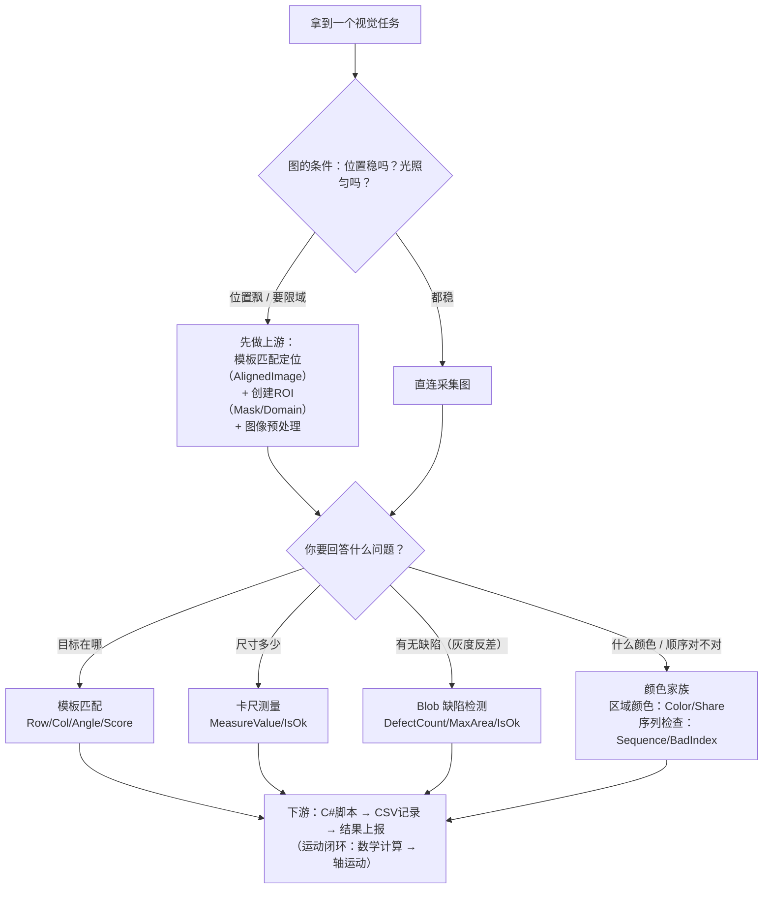

# 00 · 总选型地图 —— 六本手册的封面页

> **一句话**：拿到视觉任务，先用这张图决定「用哪个算子、读哪本手册」。
> 本页是六本手册（ROI / 卡尺 / 匹配 / 颜色 / Blob / 标定与坐标变换，同目录）的总入口：决策图 → 分工总表 → 导读顺序 → 系列戒律。

---

## 一、任务 → 算子 决策图

## 二、四兄弟分工总表（含前置件）

| 你要回答的问题 | 用哪个算子 | 关键输出 | 手册 |
|---|---|---|---|
| 目标**在哪**（定位） | 模板匹配 | `Row/Column/Angle`、`AlignedImage` | [匹配手册](模板匹配插件手册/模板匹配插件手册.html) |
| 尺寸**多少**（计量） | 卡尺测量 | `MeasureValue/Deviation/IsOk` | [卡尺手册](卡尺测量插件手册/卡尺测量插件手册.html) |
| 有没有**缺陷**（灰度反差） | Blob 缺陷检测 | `DefectCount/MaxArea/IsOk` | [Blob 手册](Blob缺陷检测插件手册/Blob缺陷检测插件手册.html) |
| **什么颜色**（一块区域） | 区域颜色检查 | `Color/Share/Result` | [颜色手册](颜色检测插件手册/颜色检测插件手册.html) |
| 颜色**顺序对不对**（一排/一条） | 颜色序列检查 | `Sequence/BadIndex/Result` | 同上（合册） |
| 像素**换算成 mm/机械坐标** | 标定 | `Transform/MmPerPixel/残差` | [标定与坐标变换手册](标定与坐标变换插件手册/标定与坐标变换插件手册.html) |
| 机械坐标**换算/检测区跟随** | 坐标变换 | `MechanicalX/Y/θ`、`FollowedRegion` | 同上（合册） |
| ——前置：**圈范围** | 创建 ROI | `MaskRegion/Domain_x/Crop_x` | [ROI 手册](区域创建ROI插件手册/区域创建ROI插件手册.html) |
| ——前置：**洗图** | 图像预处理 | `Image` | `docs/图像预处理/` |
| ——后置：**记数据/上报** | CSV / Excel / 结果上报 | — | `docs/数据记录/` 等 |

> **同一张图可以多路并列**：模板匹配管定位、Blob 管缺陷、卡尺管尺寸、颜色管色——各答各的问题，互不抢活。

## 三、五册导读与推荐阅读顺序

| 序 | 册 | 学什么 | 为什么排这里 |
|---|---|---|---|
| 1 | [ROI 手册](区域创建ROI插件手册/区域创建ROI插件手册.html) | 框架协作范式：端口、动态端口、单一数据源、所有权 | 一切插件的地基；坐标系/四大对象也是视觉入门 |
| 2 | [卡尺手册](卡尺测量插件手册/卡尺测量插件手册.html) | 计量思维：亚像素、阵列抗噪、"必须全部检出" | L1/L2 与 ROI 矩形同源，顺势衔接 |
| 3 | [匹配手册](模板匹配插件手册/模板匹配插件手册.html) | 定位：两阶段、参数指纹、原点锚定 | 需要 ROI 的 Domain 限域知识 |
| 4 | [颜色手册](颜色检测插件手册/颜色检测插件手册.html) | 颜色词、投票、自适应找线 | 需要 AlignedImage 上游概念 |
| 5 | [Blob 手册](Blob缺陷检测插件手册/Blob缺陷检测插件手册.html) | 二值化、连通域、筛选≠判定 | 综合运用前四册的所有限制意识 |
| 6 | [标定与坐标变换手册](标定与坐标变换插件手册/标定与坐标变换插件手册.html) | 像素→mm/机械坐标、残差判读、T 与 T⁻¹ | 毕业深化：给全系列供"尺子"，需要前五册的概念全到位 |

## 四、系列戒律汇总（五册反复出现的同一批价值观）

1. **「错误但不出错」是计量最危险的失败** —— 卡尺必须全部检出 / Blob 筛选≠判定 / 匹配角度双转换要可测；
2. **配置问题按配置问题报** —— 零容忍默认、期望为空报错、配方缺失停流程；
3. **区分「用户真实操作」与「程序回灌」** —— 防抖、播种守卫、RestoreSmear 直写字段；
4. **同一数据只能有一个存储口径** —— 匹配掩膜指纹事故；
5. **HALCON .NET 引用计数语义** —— 源对象与包装对象都要 Dispose（500 次约漏 160MB 的三处同款教训）；
6. **真值以实测为准** —— 探针裁决几何约定（均布向量）、合成图像做断言真值、`dump_window_image` 取帧缓冲。

## 五、这套教材怎么维护

- `.md` 是**源**（编辑/勾进度），`.html` 是**阅读版**（图片 base64 内嵌，双击即看）；
- 改完 md 后运行 `学习笔记\_md2html.py` 一键重生成全部 HTML；
- 手册里的 🖼️ HDevelop 截图位等你跑完脚本贴实测图——真值以实测为准。

---

*总选型地图 · 2026-10-11 · 配套六册：ROI / 卡尺 / 匹配 / 颜色 / Blob / 标定与坐标变换。仓库演进后以代码与官方文档为准。*
