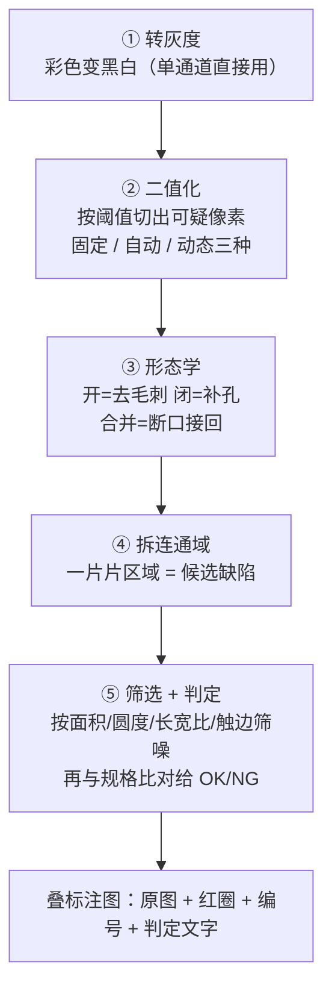
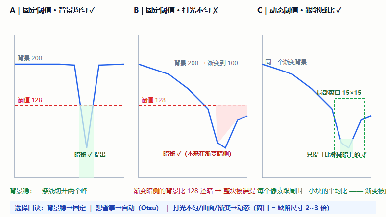
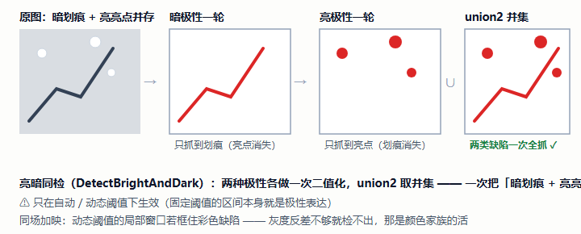
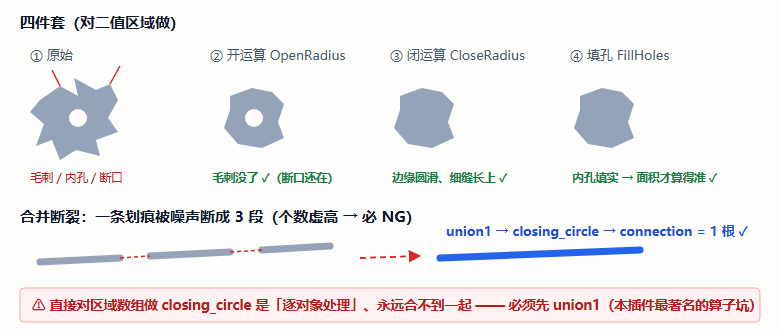
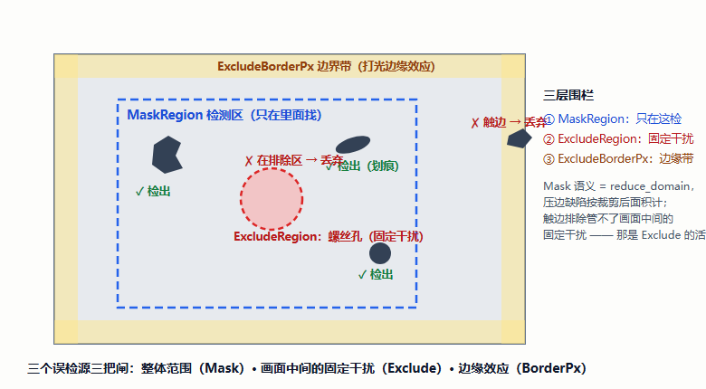
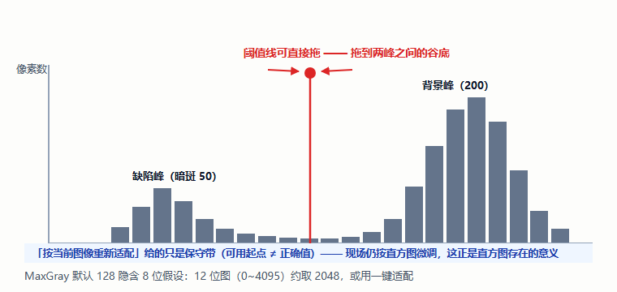
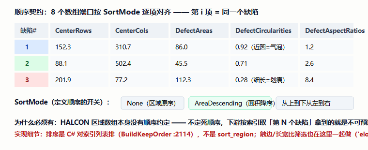
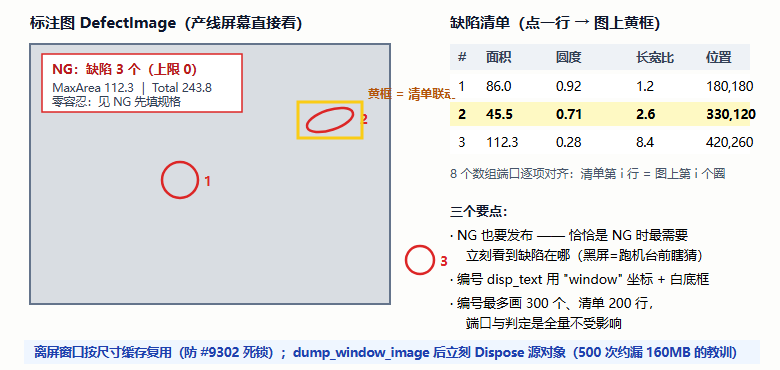
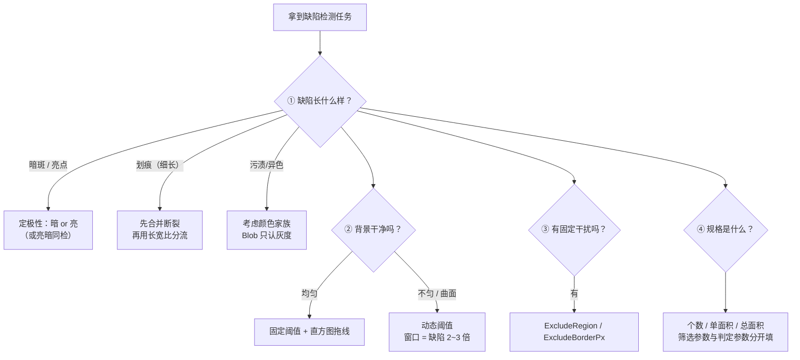

# Blob 缺陷检测插件手册 —— 零基础学习版 v1.0

> **这本手册为谁而写**：不了解视觉算子、不了解设计思路，想通过「Blob 缺陷检测」学会"视觉怎么找缺陷"以及"检测类插件最容易踩的计量坑"的人。
> **依据**：官方文档 `docs/缺陷检测/Blob缺陷检测插件.md`（812 行，唯一文档）逐节交叉校验，行号引自其源码索引（`BlobDetectPlugin.cs`，2233 行）。
> **版本**：v1.1（2026-10-11）。v1.1：新增**标注图与清单联动**插图、补齐三处正文图引用（直方图/亮暗同检/顺序契约）；v1.0：初版。同系列模板：SVG 真值图 + HDevelop 截图位 + 应用实例篇 + 单文件 HTML。

---

## 目录

- **第一部分 预备知识**：第 1 章 二值化与连通域 ｜ 第 2 章 这个插件是干什么的
- **第二部分 视觉算子原理**：第 3 章 算子卡片集（7 组 · 配 SVG 真值图与 HDevelop 截图位）
- **第三部分 设计思路**：第 4 章 八个设计决策（筛选≠判定是全书之眼）
- **第四部分 源码走读**：第 5 章 代码地图（DetectBlob 十步链）
- **第五部分 操作与排障**：第 6 章 上手六步 + 直方图 + FAQ
- **第六部分 验收**：第 7 章 自检十二题 + 审查记录
- **第七部分 应用实例篇**：第 8 章 拿到检测任务怎么想（暗斑 / 曲面 / 划痕 / 存在性）
- **第八部分 扩展篇**：第 9 章 接进知识链
- 附录 A 术语表 ｜ 附录 B 延伸阅读 ｜ 附录 C 学习进度追踪

---

## 阅读地图

| 你的目的 | 走这条路 |
|---|---|
| 只想会用：检出缺陷判 OK/NG | 直接读 **第 6 章**，卡住再回头查 |
| 想懂原理：二值化/连通域/形态学 | **第 1 → 2 → 3 章** |
| 想懂设计：为什么"筛选 ≠ 判定"是生死线 | **第 4 章**（每条都有真实事故佐证） |
| 想读懂源码 | **第 5 章**（DetectBlob 十步链） |
| 检验学没学会 | **第 7 章**（自检十二题） |
| 想学「拿到任务怎么想」 | **第 8 章 应用实例篇** |
| 想继续进阶：接进知识链 | **第 9 章**（扩展篇） |

---

# 第一部分 预备知识

## 第 1 章 二值化与连通域：Blob 的物理基础

### 1.1 Blob 是什么

**Blob** = Binary Large Object，这里指"二值图里连成一片的区域"——一块连通的异常区域就是一个 Blob。

> 比喻：白纸上洒了墨点，要做三件事——① 墨点和白纸**分开**（二值化）；② 数有几个、每个**多大**（连通域 + 面积）；③ 按规矩判**合格不合格**（判定）。Blob 做的就是这三件事。

### 1.2 五步流水线（一切 Blob 检测的骨架）



### 1.3 直方图：定阈值的"眼睛"

直方图横轴灰度（0~255）、纵轴像素数。**背景一个峰、缺陷一个峰，阈值切在两峰之间的谷底**就是最佳分割。本插件把直方图画进配置界面，阈值线**可以直接拖**——"阈值该切在哪"从看着调变拖着调。

---

## 第 2 章 这个插件是干什么的

### 2.1 四兄弟总分工（到这本凑齐了）

| 算子 | 回答的问题 |
|---|---|
| 模板匹配 | 目标**在哪** |
| 卡尺 | 尺寸**多少** |
| **Blob 缺陷检测** | 有没有缺陷、**几个、多大**、合不合格 |
| 颜色家族 | **什么颜色**、顺不对 |

### 2.2 ★ 五种阈值方式怎么选（新手最容易卡的地方）

| 方式 | 原理 | 什么时候用 | 要调的参数 |
|---|---|---|---|
| **固定阈值** | 灰度落在 `[MinGray, MaxGray]` 全要 | 背景干净、明暗稳定 | MinGray / MaxGray |
| **自动阈值** | `binary_threshold` 的 **Otsu 法**自动找"最能分开两类"的灰度 | 想省事、换型不想重调 | 只需选亮/暗极性 |
| **动态阈值** | `var_threshold`：每个像素跟**周围一小块**的平均比 | **明暗不均**（打光不匀/曲面/渐变） | 局部窗口、标准差权重、绝对偏移 |



> 打光不匀是现场最常见的问题——固定阈值在这种图上"一头判死一头漏检"，这时就该换**动态阈值**。
> **亮暗同检**（`DetectBrightAndDark`）只在自动/动态下生效：两种极性各做一次二值化再**取并集**，一次把"暗划痕 + 亮亮点"都检出来。



### 2.3 能力清单

- ✅ 检测区（`MaskRegion`）+ 排除区（`ExcludeRegion`）+ 触边排除（`ExcludeBorderPx`）三层围栏
- ✅ 亮暗同检、形态学四件套（开/闭/填孔/合并）
- ✅ 16 个输出端口：逐缺陷面积/长宽/圆度/长宽比/方向（**8 数组逐项对齐**）
- ✅ 排序契约（不排序/面积降序/位置序）、mm² 附加输出（判定恒按像素）
- ✅ 灰度直方图可拖阈值线 + 一键"按当前图像重新适配"（**可用起点**，不是正确值）

---

# 第二部分 视觉算子原理

## 第 3 章 算子卡片集

### 3.1 转灰度与限域（一步半）

```
count_channels → 1通道:copy_image / 3通道:rgb1_to_gray / 4通道:取前3转灰
reduce_domain  → 有 MaskRegion 时把计算域缩到 ROI
```

- **易错点**：单通道图**不要再 `rgb1_to_gray`**（会报错）；4 通道取前 3 再转（丢 alpha）。
- **源码**：`TryToGrayImage()`，`BlobDetectPlugin.cs:1499`（算法/直方图/自适应三处共用）。

### 3.2 ★ 二值化三方式：threshold / binary_threshold / var_threshold

- **固定**：`threshold(Gray, Region, MinGray, MaxGray)`——`MaxGray` 默认 128 = 8 位中位数，是"不针对任何产品"的起点。⚠️ 这是**绝对灰度、隐含 8 位假设**：12 位图（0~4095）要按位深换算（约 2048）。
- **自动**：`binary_threshold`（`max_separability` = Otsu 大津法）。
- **动态**：`var_threshold`——每个像素跟**周围一小块**（`VarMaskWidth/Height`，默认 15×15）的平均比，比背景暗/亮 `StdDevScale×标准差 + AbsThreshold` 就提出来。**窗口经验：缺陷尺寸的 2~3 倍**——太小把缺陷自己算进背景，太大跟不上渐变。
- **亮暗同检**：两种极性各做一次，`union2` 取并集。
- **源码**：`DetectBlob()` 第 2 步，`:1544`。

> 🖼️ **HDevelop 截图位**（官方文档附录 C 案例 1/2）：
>
> ```hdevelop
> rgb1_to_gray (Image, Gray)
> threshold (Gray, Region, 0, 128)          * 固定
> var_threshold (Gray, RegionD, 15, 15, 0.4, 2, 'dark')   * 动态
> ```

### 3.3 形态学四件套：开 / 闭 / 填孔 / 合并

| 配置 | 算子 | 干什么 |
|---|---|---|
| `OpenRadius` | `opening_circle` | 去毛刺、断细桥 |
| `CloseRadius` | `closing_circle` | 补孔、连断口 |
| `FillHoles` | `fill_up` | 填孔（缺陷里有洞导致面积偏小时勾） |
| `MergeRadius` | `union1 → closing_circle → connection` | 合并断裂（一条划痕断成 3 段 → 个数虚高 → 必 NG） |

- **⚠️ 本插件最著名的算子坑**：合并**必须先 `union1`**——直接对区域数组做 `closing_circle`，HALCON 是**逐对象处理**、永远合不到一起。
- **源码**：`DetectBlob()` 第 3~6 步。



> 🖼️ **HDevelop 截图位**（官方文档附录 C 案例 3）：
>
> ```hdevelop
> * 一条划痕被噪声断成 3 段 → 先 union1 再闭运算再重新拆
> union1 (Defects, Union)
> closing_circle (Union, Closed, 2.5)
> connection (Closed, Merged)      * ← 现在才是 1 个
> ```

### 3.4 拆连通域 + 筛选：★★ "筛选 ≠ 判定"（全书之眼）

```
connection → 拆连通域（一片 = 一个候选）
select_shape → 按 area（+可选 circularity）筛选
```

| 概念 | 问的问题 | 参数 | 超了的后果 |
|---|---|---|---|
| **筛选** | "这个东西**算不算缺陷**？" | MinArea / MaxBlobArea / MinCircularity / MaxAspectRatio / ExcludeBorderPx | 不计数，**等于没看见** |
| **判定** | "这个缺陷**合不合格**？" | MaxDefectCount / MinDefectCount / MaxSingleArea / MaxTotalArea | 判 **NG** |

> **真实 P0 事故**：早期版本把两者合一，筛选上限写死 `1e7`——大画幅（>1000 万像素）上整块背景被静默滤掉：既不计数也不 NG，**漏检还报 OK**。这是检测类插件能犯的最严重错误。修法：拆成筛选/判定两个参数，`select_shape` 上限改为图像像素总数。
> 配套 P0：`MinArea` 填得比上限还大 → `select_shape` 抛 `#1304` 炸流程 → 进算子前**静默夹取**。


> 🖼️ **HDevelop 截图位**（官方文档附录 C 案例 1 后半）：
>
> ```hdevelop
> connection (Opened, Connected)
> select_shape (Connected, Defects, 'area', 'and', 30, 100000000)
> count_obj (Defects, Number)
> area_center (Defects, Areas, Rows, Cols)
> ```

### 3.5 特征测量与触边：自算长宽比 + 三层围栏

- **长宽比**：`smallest_rectangle1` 自算 `max(W,H)/max(1,min(W,H))`——**别用 `'elongation'`**，本仓库 HALCON 23.05 不认识（`#3101`），连脚本模板都教错了。
- **触边排除 `ExcludeBorderPx`**：缺陷外接矩形碰到最外 N 像素就丢弃——打光边缘效应是固定误检源，而上游 ROI 只能整体裁形状、没法"往里缩一圈"。
- **三层围栏**：`MaskRegion`（只在这检，语义=reduce_domain，压边缺陷按裁剪后面积计）→ `ExcludeRegion`（螺丝孔/二维码这类"位置固定、永远不该报"的干扰——触边排除管不了画面中间的固定干扰）→ `ExcludeBorderPx`（边缘带）。



> 🖼️ **HDevelop 截图位**（官方文档附录 C 案例 4/5）：长宽比自算 + 触边判据（`R1 < N | C1 < N | R2 >= ImgH-N | C2 >= ImgW-N`）。

### 3.6 16 位图：截断 vs 拉伸（一行的差距就是整片死白）

- **坑**：`convert_image_type(..., 'byte')` 是**截断**不是缩放——uint2 的灰度 1632 转出来就是 255，标注底图**整片死白**。
- **修法**：先按**实际灰度范围**（`min_max_gray`，不按像素类型硬编码）`scale_image` 线性拉伸到 0~255 再转 byte。

> 🖼️ **HDevelop 截图位**（官方文档附录 C 案例 6）：贴"错误截断 vs 正确拉伸"的两张底图对比。

### 3.7 直方图与自适应：可用起点 ≠ 正确值

- `gray_histo` / `gray_histo_range` 出直方图；「按当前图像重新适配」按实际灰度范围取**最暗/最亮的 25% 作保守带**、面积按画幅比例放大——给的是"可用起点"，**现场仍要按直方图微调**。
- ⚠️ 自适应的守卫细节（真实 P1）：`DetectTarget` 切换后要补一次适配——否则阈值停在暗侧、与意图相反。



---

# 第三部分 设计思路

## 第 4 章 八个设计决策（每条都有真实事故佐证）

### 4.1 ★ 筛选 ≠ 判定（1e7 事故，检测类插件的第一戒律）

两套参数两套语义（3.4 节表格）。把"算不算缺陷"的上限写死 1e7，等于在大画幅上把"整块背景"静默扔掉——**漏检还报 OK**。这与卡尺手册的"必须全部检出"、颜色手册的"配方缺失报错"是同一族戒律：**计量最危险的失败模式是"错误但不出错"**。

### 4.2 静默夹取：配置坏了不炸流程

`NormalizedParameters()`（`:2004`）把所有越界值夹回合法区间（`MinArea ≤ 上限`、`Sigma ≥ 0.4` 等）——`select_shape` 的 `#1304` 再也炸不到流程。

### 4.3 配置态守卫：参数不会"自己变"

`_isConfigInstance`（`:780`）守住预览与**自动适配**。真实 P0：运行实例也跑配置态 → ① 产线每帧白烧 CPU；② 运行实例**按首帧图像静默改写阈值/面积参数**，现场表现为"参数自己变了"——工业软件里这比"参数不理想"严重得多。

### 4.4 非 IDisposable 端口开轮重置（镜像 bug）

基类轮首回收只管 `IDisposable`（HImage/HRegion），`int/bool/double/HTuple` 的上一轮值会原样留下——本轮失败，下游读到上一轮的 `DefectCount/IsOk`（脏数据放行）。修法：`RunAlgorithm` 开轮显式重置。（卡尺手册 4.7 节同款镜像 bug——**写检测/计量类插件必查这一条**。）

### 4.5 源对象泄漏：500 次约 160MB

`dump_window_image` 产出的 `shot` 是"源对象"，`new HImage(shot)` 是独立句柄——HALCON .NET 是**引用计数语义**，不释放源对象就漏。修法：包装后立刻 `shot.Dispose()`。（与卡尺/匹配手册同一教训。）

### 4.6 预览后台化 + 两级缓存 + 轮次号

大图调参不卡窗口的三件套：① 检测/直方图/渲染全在**后台线程**（UI 只拷图+适配）；② **参数指纹 + 源图 hash** 做缓存键，参数没变直接复用 `DetectPack`；③ 后台结果回来对不上**轮次号 = 过期**，只释放不回填（连点刷新不会旧图盖新图）。
配套真实 P1：`DispatcherTimer` 在后台线程创建 → 寄生在永不泵消息的 Dispatcher 上，`Tick` 永不触发——**预览静默失效且无日志**。修法：显式绑定 UI 线程 Dispatcher。

### 4.7 16 位图：截断 vs 拉伸

见 3.6 节。一行代码的差距 = 整片死白。

### 4.8 内联 Style 顶掉隐式样式：预览空白且无日志（WPF 深坑）

视图给 `h:ImageReadOnly` 挂了**无 `BasedOn` 的内联 Style** → 显式 Style **顶掉**资源查找链里的隐式样式 → 控件没有模板 → `RenderAll()` 因 `hWindow == null` **静默返回**。症状极其迷惑：信息栏有结果文字、主界面能收到标注图，**唯独预览区空白**——不报错、无日志。修法：可见性触发器移到外层包装 Grid；回归闸：静态扫描"不给 h: 控件挂内联 Style"。

> 附一个特性坑：HALCON 23.05 不认识 `'elongation'`（`#3101`）——连仓库脚本模板都教错了（`ScriptTemplates.cs:238` 至今未同步修，**已知边界**）。还有 `disp_text` 必须 `"window"` 坐标 + `'box','true'`（无显示会话里 `"image"` 画不出来）。

---

# 第四部分 源码走读

## 第 5 章 代码地图

### 5.1 文件清单（`Plugins/Plugin.BlobDetect/`）

| 文件 | 职责 |
|---|---|
| `BlobDetectPlugin.cs` | **核心**（2233 行）：端口、配置、算法、预览、判定、渲染调度 |
| `ColorCheck 式三件套之外` | `AnnotationRenderer`（标注渲染）/ `GrayHistogram` + `HistogramPlot`（可拖线直方图） |
| `BlobDetectView.xaml` | 配置界面（833 行，左参数右预览两页签） |

### 5.2 DetectBlob 十步链（`:1544`）

```
① 转灰度（1/3/4 通道）→ 1.5 reduce_domain（有 MaskRegion）
② 二值化（固定/自动/动态，亮暗同检 union2）→ 2.5 difference（减排除区）
③ opening / closing → ④ connection → ⑤ union1+closing+connection（合并）
⑥ fill_up → ⑦ select_shape（面积/圆度筛选）→ ⑧ area_center + smallest_rectangle1
```

阶段二 `ArrangeJudgeRender()`（`:1742`）：`count_obj` → `region_features`（circularity/phi）→ `tuple_max/sum` → 排序（`BuildKeepOrder` :2114，C# 对索引列表排序，**不是** `sort_region`）→ 判定 → 标注渲染（`disp_text` 用 `"window"` 坐标）。

### 5.3 关键方法索引

| 方法 | 位置 | 一句话 |
|---|---|---|
| `RunAlgorithm()` | :1341 | 开轮重置非 IDisposable 端口 → 检测 → 端口赋值 → 发布 |
| `DetectBlob()` / `ArrangeJudgeRender()` | :1544 / :1742 | 阶段一检测链 / 阶段二排序判定渲染 |
| `RefreshPreview()` / `PreviewRunCore()` | :863 / :964 | 预览入口（UI 拷图→后台跑→回填）/ 两阶段后台 |
| `TryAdaptCore()` | :1201 | 按当前图像自适应（保守带） |
| `NormalizedParameters()` | :2004 | 静默夹取 |
| `BuildKeepOrder()` | :2114 | 长宽比/触边筛选 + 排序（顺序契约的定义处） |
| `MarkAsConfigInstance()` / `SchedulePreview()` | :780 / :794 | 配置态守卫 / 200ms 防抖 |

### 5.4 端口与顺序契约

入 4：`SrcImage` / `MaskRegion` / `ExcludeRegion` / `MmPerPixel`（直连标定，上游无效→明确失败）。
出 16：原始 7（`DefectImage/Defects/DefectCount/MaxArea/IsOk/CenterRows/CenterCols`）+ 面积 6（`DefectAreas/Widths/Heights/TotalArea/MaxAreaMm2/TotalAreaMm2`）+ 形状 3（`DefectCircularities/AspectRatios/Phis`）。
**顺序契约**：HALCON 区域数组本无顺序 → 插件定死 `SortMode` 并保证 **8 个数组端口逐项对齐**（`CenterRows[i]` 与 `DefectCircularities[i]` 指同一个缺陷）——下游"第 N 个缺陷"才有意义。



---

# 第五部分 操作与排障

## 第 6 章 上手六步 + 直方图 + FAQ

界面：左参数（①二值化 ②特征筛选 ③形态学 ④判定规格 ⑤输出），右预览两页签（图像视图=标注图 / 数据输出=缺陷清单+直方图），清单点一行 → 图上黄框联动。

1. **接图**：前级图像连 `SrcImage`；
2. **选阈值方式**：干净稳定→固定；省事→自动；**打光不匀/曲面→动态**；
3. **看直方图定阈值**：「数据输出」页签，**拖标记线**到两峰之间的谷底；
4. **设筛选**：`MinArea`（默认 30，噪声多调大）+ 需要时 `ExcludeBorderPx`；
5. **设判定规格**：默认零容忍（`MaxDefectCount=0`）——看到 NG 是提醒你填规格；
6. **看标注图**：红圈圈对了没有。



**检测/排除区**：只检某区域 → 接 `MaskRegion`；忽略螺丝孔/二维码 → 接 `ExcludeRegion`；边缘误检 → `ExcludeBorderPx`。

**排障速查**：

| 现象 | 排查 |
|---|---|
| 一个都没检出 | ① 阈值没覆盖（看直方图）② MinArea 太大 ③ 极性选反 |
| 检到一大片背景 | 阈值太宽；确认不是旧版 1e7 行为 |
| 个数虚高 | `MergeRadius` 合并断裂 / `OpenRadius` 去毛刺 / MinArea 调大 |
| 打光不匀一头漏一头死 | 换**动态阈值**，窗口取缺陷尺寸 2~3 倍 |
| 边缘总误报 | `ExcludeBorderPx` / `ExcludeRegion` |
| 参数自己变了 / 预览不刷新 | 已修（配置态守卫 / Dispatcher 绑 UI）；确认新版本 |
| 大画幅漏检还报 OK | 已修（1e7 → 图像像素总数） |
| 标注图没编号 | 已修（`disp_text` 用 `"window"` 坐标） |

---

# 第六部分 验收

## 第 7 章 自检十二题 + 审查记录

**自检**（答案指向章节）：

1. 五步流水线是哪五步？（1.2）
2. 打光不匀该用哪种阈值？窗口取多大？（2.2 / 3.2）
3. "筛选"和"判定"各问什么问题？混在一起出过什么 P0 事故？（3.4 / 4.1）
4. 合并断裂划痕为什么要先 `union1`？（3.3）
5. `'elongation'` 在本仓库能用吗？长宽比怎么算？（3.5）
6. 触边排除和 ExcludeRegion 分别处理哪类干扰？（3.5）
7. 16 位图直接 `convert_image_type` 转 byte 会怎样？（3.6 / 4.7）
8. `MaxGray=128` 隐含什么假设？12 位图怎么办？（3.2）
9. 运行实例跑配置态预览，现场会看到什么怪现象？（4.3——参数自己变）
10. 哪些端口轮首要显式重置？为什么基类不管？（4.4）
11. 预览"静默失效且无日志"是什么坑？（4.6——DispatcherTimer 后台线程）
12. 8 个数组端口为什么必须有顺序契约？（1.5 / 5.4）

**审查记录**：断言全部用**现场合成确定性图像**（200×200、背景 200、暗斑 50），零外部样图依赖；最近全量冒烟 **644 通过 / 15 失败，Blob 段零失败**。已知边界：无"警告"档分级；判定恒按像素（mm² 只是输出）；`ScriptTemplates.cs:238` 的 `'elongation'` 模板**仍未同步修**；缺陷编号恒开；圆度/方向特征算不出时降级丢列不影响判定。

---

# 第七部分 应用实例篇：拿到检测任务怎么想

## 第 8 章 应用实例：从需求到验收

### 8.0 思路框架：先问四个问题



### 8.1 实例一：金属件表面暗斑（最短路径）

**任务**：亮面上有随机暗斑，≥1 个即 NG。

**思路链**：① 极性=暗缺陷；② 背景均匀 → 固定阈值，看直方图把线拖到谷底；③ `MinArea=30` 起步，噪声多就调大；④ 规格：`MaxDefectCount=1`、`MaxSingleArea=100`；⑤ 验收：拿良品 + 人为做 3 档缺陷（临界/超标/严重）各拍 10 张——判定翻转的位置就是你的真实精度。

### 8.2 实例二 ★：曲面/打光不匀（动态阈值的战场）

**任务**：弧面零件上的划痕，打光一头亮一头暗。

**思路链**：固定阈值"一头判死一头漏检" → 换**动态阈值**；窗口 = 划痕宽度的 2~3 倍起步；`StdDevScale` 越大越严（只提对比强的），提不出就调小。**验收特征**：同一缺陷放在画面亮端和暗端，检出的面积应大体一致——不一致说明窗口太大跟不上渐变。

### 8.3 实例三：划痕计数 + 气泡/划痕分流（形态学与特征的后半场）

**任务**：划痕常断成几段（个数虚高），且要区分划痕（长条）与气泡（圆斑）。

**思路链**：① `MergeRadius` 或 `CloseRadius` 把断口接回（**先 `union1`**）；② 分流不在筛选里做死——把 `DefectCircularities`/`DefectAspectRatios` 输出给 **C# 脚本**：圆度 ≈1 → 气泡，长宽比 >5 → 划痕（官方文档附录 A 接线③）。**为什么输出特征而不是筛掉**：分拣要的是"每个缺陷是什么"，筛掉就没了——这又回到"筛选 ≠ 判定"的边界意识。

### 8.4 实例四：存在性检测（`MinDefectCount` 的用武之地）

**任务**：工件上必须有一个激光标记，没打标 = 不良。

**思路链**：检标记的 Blob；此时"一个都没检到"恰恰是坏消息——只用上限的话 0 个判 OK。**解法**：`MinDefectCount=1`（少于即 NG）。**验收**：无标记件必须 NG、有标记件必须 OK——存在性检测两条都要验。

### 8.5 实例篇自检四题

1. 任务是"亮亮点 + 暗划痕同时检"，怎么配？（自动/动态 + `DetectBrightAndDark`，两种极性 union2）
2. 检出个数虚高 3 倍，先查什么？（断裂 → `MergeRadius`/`CloseRadius`；再查噪声 → MinArea/OpenRadius）
3. 螺丝孔总被当成缺陷，触边排除能救吗？（不能——位置在画面中间，用 `ExcludeRegion`）
4. 判定要用 mm² 吗？（**判定恒按像素**；mm² 只是附加输出——防止"改当量就改判定"的隐式耦合）

---

# 第八部分 扩展篇：接进知识链

## 第 9 章 Blob 在整条流程里的位置

### 9.1 上游三件套

- **ROI**：`MaskRegion` 限域 + `ExcludeRegion` 排除（Blob 的端口就是为它们设计的）；
- **预处理**：洗图让二值化更稳；
- **模板匹配**：产品会动 → `AlignedImage` 归一化图喂 `SrcImage`（下游固定坐标零改动）。

### 9.2 下游三件套

`IsOk/DefectCount/MaxArea` → CSV/上报；`DefectCircularities/AspectRatios` → C# 脚本**分流**（气泡 vs 划痕）；`DefectImage` 存档留证。

### 9.3 与其它算子的边界

划痕/暗斑（灰度反差）→ Blob；颜色异常（灰度接近但颜色不同）→ 颜色家族；尺寸超差 → 卡尺。**同一张图可以四路并列**——各答各的问题。

### 9.4 扩展篇自检三题

1. 缺陷是"红色污渍"，背景也是浅灰，Blob 能检吗？（灰度反差不够——换颜色家族）
2. 产品位置飘，检测区跟着飘，怎么办？（模板匹配 AlignedImage 先归一化）
3. mm² 判定为什么被禁？（4.x——判定恒按像素，防隐式耦合）

### 9.5 仓库落点与延伸

- 官方文档：`docs/缺陷检测/Blob缺陷检测插件.md`（附录 C 案例 1~6、附录 E 断言清单、4.3 节 ⑪ 内联 Style 深坑）
- 姊妹手册：ROI / 卡尺 / 匹配 / 颜色（同目录）

---

## 附录 A 术语表

| 术语 | 一句话 |
|---|---|
| Blob | 二值图里连成一片的区域 |
| 二值化 | 按阈值把可疑像素切成 0/255 |
| 连通域 | 相互连通的一片 = 一个候选缺陷 |
| 形态学 | 开=去毛刺，闭=补孔；合并必须先 `union1` |
| Otsu（大津法） | 自动找"最能分开两类"的阈值 |
| var_threshold | 动态阈值：跟周围一小块比 |
| 筛选 vs 判定 | "算不算缺陷" vs "合不合格"——两套参数两套语义 |
| 触边排除 | 碰到最外 N 像素的缺陷丢弃 |
| 顺序契约 | 8 个数组端口按 SortMode 逐项对齐 |
| 可用起点 | 自适应给的保守值，不是正确值 |
| 零容忍默认 | 规格默认 0，见 NG = 提醒填规格 |
| 静默夹取 | 越界参数夹回合法区间 |

## 附录 B 延伸阅读

- 官方完整文档：`docs/缺陷检测/Blob缺陷检测插件.md`（第 4 章 P0/P1 详解、4.3 ⑪ 内联 Style 深坑、附录 C 案例 1~6、附录 E 断言）
- 姊妹手册：ROI（Mask/Exclude 的来源）、卡尺（同一族计量戒律）、匹配（AlignedImage 上游）、颜色（灰度不够时换颜色）

## 附录 C 学习进度追踪

**📖 阅读进度**

- [ ] 第 1 章 五步流水线
- [ ] 第 2 章 阈值方式选择 ★
- [ ] 第 3 章 算子卡片 3.1~3.3（灰度 / 二值化 / 形态学）
- [ ] 第 3 章 3.4 筛选 ≠ 判定 ★全书之眼
- [ ] 第 3 章 3.5~3.7（围栏 / 16 位 / 直方图）
- [ ] 第 4 章 八个设计决策
- [ ] 第 5 章 源码走读（十步链）
- [ ] 第 6 章 上手 + 直方图
- [ ] 第 8 章 应用实例篇

**🖼️ HDevelop 截图**

- [ ] 3.2 固定/动态阈值 ｜ [ ] 3.3 union1 合并 ｜ [ ] 3.4 筛选与统计
- [ ] 3.5 长宽比自算 ｜ [ ] 3.6 16 位拉伸对比

**🎓 毕业验收**

- [ ] 自检十二题 ≥ 9 ｜ [ ] 实例篇四题全对
- [ ] 动手：搭「采集→预处理→Blob」检出人造缺陷，直方图拖线 + 三档缺陷验收

**版本记录**

| 版本 | 变更 |
|---|---|
| v1.0 | 初版：六部分 + 应用实例篇 + 自检十二题 + SVG/PNG/HTML 全管线 |

---

*本手册为学习用重排版（v1.0，2026-10-11），与官方文档冲突时以官方文档与源码为准。内嵌 7 张示意图（PNG，源 SVG 保留）+ 1 张 mermaid 流程图 + 5 处 HDevelop 截图位。*
