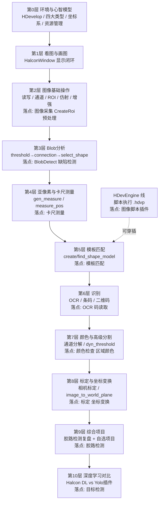
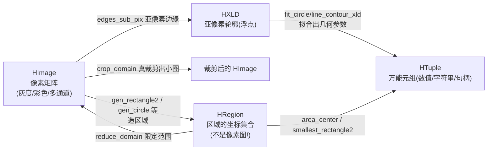
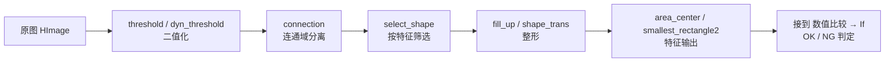

# Halcon 学习思路图（VisionMaster 工程实践版）

> 定位：这是《学习路线图.md》**阶段 1（视觉线）的地基课**——先把 Halcon 本身学扎实，再回到插件源码会有"豁然开朗"的对照感。
> 整理日期：2026-10-11。
> 原则：**每学一层，都要在 VisionMaster 里找到落点**（哪个插件在用、对应哪份文档），学完当天动手做一张卡片。

---

## 0. 这张图怎么用：学习四循环

每一层都跑同一个循环，缺一步都不算学完：

```
① HDevelop 里试算子（交互式，立刻看见结果）
        ↓
② 查算子手册（Operator Reference：每个参数为什么存在）
        ↓
③ 翻译成 C#（在仓库里找对应插件源码对照）
        ↓
④ 动手：改一个小 demo / 写进自己的插件 → 记一张「算子卡片」
```

> 工具准备：装 HDevelop（和仓库引用的 HalconDotNet 版本一致，看 `DLL/` 或 `.csproj` 引用）；HDevelop 的 **Operator Reference（F1）** 是最好的教材，没有之一。

---

## 1. 全景思路图（总路线）



**为什么这么排序**（多想几遍后的取舍，见文末 §9 完整说明）：先建类型与坐标心智模型 → 先"看见"再"算"（显示层前置）→ Blob 最短反馈链打底 → 卡尺引入亚像素 → 匹配需要 ROI/仿射基础 → 标定最抽象放后面 → 深度学习最后用传统视觉做对照。

---

## 2. 心智模型：四大类型 + 一套坐标系

这是整份路线图里**最重要的一节**，所有算子 API 都围绕这四个类型转：



**必须刻进脑子的四件事**：

| # | 概念 | 要点 |
|---|---|---|
| 1 | **坐标系** | 原点在**左上角**；`Row`（行）在前、`Column`（列）在后——即 **(y, x) 而不是 (x, y)**！这是新手第一大错误源 |
| 2 | **Region ≠ 像素图** | Region 是"哪些坐标"的集合，与分辨率无关；`reduce_domain` 只是"限定处理范围"（不省内存不省时间到像素级），`crop_domain` 才真正裁出一张小图 |
| 3 | **像素精度 vs 亚像素精度** | 整数边缘用 threshold 系列；精密测量用 `edges_sub_pix` / measure 系列（浮点级边缘） |
| 4 | **一切皆可 Dispose** | `HImage/HRegion/HXLD/HObject` 都是**非托管资源的包装**，用完必须释放（详见 §5 资源纪律） |

**动手**：在 HDevelop 里分别 `gen_circle` 一个 Region、`reduce_domain`、`crop_domain`、`count_obj`、`area_center`，把每步的图形窗口截图贴进笔记——亲眼看到"region 是坐标集合、crop 才是真裁剪"。

**自检**：
- [ ] `gen_rectangle2(Row, Column, Phi, Length1, Length2)` 五个参数各是什么？（中心行/列、角度、半长、半宽——注意是"半"！）
- [ ] 为什么 `reduce_domain` 后图像尺寸不变？
- [ ] `HTuple` 怎么取值？（`.I` 整数 / `.D` 浮点 / `.S` 字符串 / 索引取元素）

---

## 3. 分层详解

### 第 1 层：看图与画图（显示闭环）

**学什么**：
- HDevelop 图形窗口：`dev_display`、`dev_set_color`、`dev_set_draw('margin'/'fill')`、`dev_set_line_width`
- C# 侧：`HSmartWindowControlWPF`、`HWindow`：`SetPart`（缩放视野）、`DispObj`、`DispText`、`SetColor`

**仓库落点**：
- `Services/Core.Halcon/Controls/`——仓库自己封装的 Halcon 显示控件（学它怎么把 HWindow 包成 WPF 控件）
- VisionMaster 图像视图 1~9 分屏 + 插件 `PublishPreview` 推图机制（`docs/软件手册.md` §4.5）

**自检**：
- [ ] `SetPart` 和 `zoom_image_size` 的区别？（前者改视野不改数据，后者真改像素）
- [ ] 仓库的图像视图为什么设计成"插件推图 + 窗口号筛选"？（解耦：算法不依赖 UI）

---

### 第 2 层：图像基础操作

**学什么**（算子族清单）：

| 族 | 算子 | 一句话 |
|---|---|---|
| 读写 | `read_image` / `write_image` / `get_image_size` | 万事起点 |
| 通道 | `decompose3` / `compose3` / `rgb1_to_gray` / `trans_from_rgb` / `access_channel` | 彩色↔灰度、通道拆合 |
| ROI | `gen_rectangle1/2`、`gen_circle`、`gen_ellipse`、`union2`、`intersection`、`difference` + `reduce_domain`、`crop_domain` | 造区域、用区域 |
| 几何变换 | `vector_angle_to_rigid`、`hom_mat2d_rotate/translate/scale`、`affine_trans_image`、`mirror_image`、`zoom_image_size` | 仿射变换三板斧 |
| 增强 | `emphasize`、`mean_image`、`gauss_filter`、`median_image`、`equ_histo_image`、`scale_image_max`、`invert_image`、`sub_image` | 预处理主力 |

**仓库落点**（这一层就能把三个插件读透）：
- `Plugins/Plugin.ImageAcquisition/ImageAcquisitionPlugin.cs`：像素 → `HImage` 的唯一转换点（灰度走 `gen_image1`、彩色按 BGR 交错走 `gen_image_interleaved`）——**理解 Halcon 的图像内存布局**就看它
- `Plugins/Plugin.CreateRoi/CreateRoiPlugin.cs`：`gen_rectangle2/gen_circle/gen_ellipse` → `reduce_domain` → `crop_domain` 全链路，还有 `DisposeOldOutputs` 的资源管理示范
- `docs/图像预处理/图像预处理插件.md` + 插件源码：增强算子族的工程化封装

**动手**：用 HDevelop 复刻 CreateRoi 的核心三步（造区域→限定→裁剪），再读源码对照差异。

**自检**：
- [ ] 彩色图进 `gen_image_interleaved` 时通道顺序是什么约定？仓库为什么选 BGR？（去读 `ToHImage` 注释）
- [ ] 旋转 ROI 为什么要用 `gen_rectangle2` 而不是 `gen_rectangle1`？
- [ ] `affine_trans_image` 前为什么要先构造齐次矩阵？`vector_angle_to_rigid` 帮你省了什么？

---

### 第 3 层：Blob 分析（区域处理三件套）

**标准流水线**（背下来，工业缺陷检测 80% 长这样）：



**学什么**：
- 分割：`threshold`（灰度区间）、`var_threshold`（局部自适应）、`dyn_threshold`（与均值图比，找缺陷神器）
- 连通：`connection`（一句话：把粘连的区域拆成独立个体）
- 特征筛选：`select_shape`（`area`、`width/height`、`circularity`、`rectangularity`、`compactness`…）——**学特征就是学"怎么描述一个缺陷"**
- 形态学：`erosion_circle` / `dilation_circle` / `opening_circle` / `closing_circle`（及 rectangle 版），作用：去噪点/填小孔/断开粘连
- 特征提取：`area_center`、`smallest_rectangle1/2`、`elliptic_axis`、`count_obj`

**仓库落点**：
- `Plugins/Plugin.BlobDetect/` + `docs/缺陷检测/`——重点看它怎么把"特征筛选参数"暴露成端口、`IsOk`/`DefectCount` 结果端口怎么设计
- 接到工具集：`select_shape` 的结果 → 数值比较 → 条件分支（`docs/工具集/工具插件集.md` 附录 A 接线图）

**动手**：拍一张带黑点的工件图，在 HDevelop 里从 threshold 调到 select_shape，筛出所有缺陷并输出个数/面积——这一晚的成就感会撑你走完全程。

**自检**：
- [ ] `connection` 前不加 `threshold` 会怎样？`threshold` 为什么要传 Min/Max 两个值？
- [ ] `opening` 和 `erosion` 后接 `dilation` 等价吗？（等价！这正是 opening 的定义——但工程上直接用 opening 少一步）
- [ ] `select_shape` 想筛"面积 100~500 且圆度 >0.9"怎么传参？（特征名可以用 'area' 或组合逻辑 and/or）

---

### 第 4 层：亚像素与卡尺测量

**学什么**：
- 卡尺模型：`gen_measure_rectangle2`（中心/角度/长宽/平滑/阈值）→ `measure_pos`（边缘位置+幅度+间距）→ `close_measure`
- 成对测量：`measure_pairs`（找一对正负边缘，测宽度就是它！）
- 模糊卡尺：`fuzzy_measure_pos`（按边缘质量筛选，抗干扰）
- 轮廓式亚像素：`edges_sub_pix` + `select_shape_xld` + `fit_circle_contour_xld` / `fit_line_contour_xld`（圆/线拟合 → 半径/直线参数）
- 距离计算：`distance_pp`、`distance_pl`

**仓库落点**：
- `Plugins/Plugin.CaliperMeasure/` + `docs/卡尺测量/卡尺测量插件.md`（含实施记录，看真实迭代过程）
- `MeasureValue` 输出端口 → 数学计算算补偿 → 运动控制：这就是"视觉引导"的起点

**自检**：
- [ ] 卡尺矩形的 `Length1`/`Length2` 各沿什么方向？（Length1 沿测量方向，Length2 是卡尺宽度）
- [ ] `measure_pos` 返回的 `Distance` 是相邻边缘间距——怎么用它测"料宽"？
- [ ] 为什么精密测量不用 threshold 而用亚像素？（阈值法量化误差 ±0.5px，亚像素能到 1/20 px 级）

---

### 第 5 层：模板匹配

**学什么**：
- 核心五步：`create_shape_model`（金字塔层数/角度范围/对比度）→ `find_shape_model`（MinScore/最大重叠/贪心度）→ `get_shape_model_contours`（取模板轮廓画框）→ `vector_angle_to_rigid`（构造位姿变换）→ `affine_trans_contour_xld`（把模板轮廓搬到目标位置——这就是"定位框"）
- 调参神器：`inspect_shape_model`（看金字塔各层长什么样，选层数全靠它）
- 变体：`create_ncc_model`（光照鲁棒、速度快但不带旋转）、`create_aniso_shape_model`（各向异性缩放）、`create_deformable_model`（形变匹配）
- 关键参数语义：**极性（polarity）**=边缘明暗方向、**Greediness**（贪心=速度/漏检权衡）、**MinScore**（分数门槛）

**仓库落点**：
- `Plugins/Plugin.Matching/` + `docs/模板匹配/`——这里有**三份文档**：《模板匹配插件-新手入门手册.md》（就是这个思路图的"层内版"）、插件.md、说明书.md，全读完
- 输出：位置+角度 → 下游做 ROI 跟随（产品位置不固定时，先匹配再按位姿放 ROI）

**自检**：
- [ ] 金字塔层数怎么选？（`inspect_shape_model` 看最顶层还能不能认出目标；层数越多搜索越快但可能丢失细节）
- [ ] 找到的 `Angle` 是什么坐标系？怎么和 `vector_angle_to_rigid` 配合把 ROI 转到目标上？
- [ ] 什么场景选 NCC 而不是 ShapeModel？（打光不稳但无旋转需求）

---

### 第 6 层：识别（OCR / 条码 / 二维码）

**学什么**：
- OCR：字符分割（`threshold` + `connection` + `select_shape` 按字符尺寸筛）→ 预训练分类器 `read_ocr_class_mlp/cnn`（如 Industrial 字体库）→ `do_ocr_single_class_mlp` / `do_ocr_multi_class_cnn`；文本行级用 TextModel（`create_text_model` + `find_text`）
- 一维码：`set_bar_code_param`（抗扰参数）→ `find_bar_code`（'auto' 或指定码制）→ `get_bar_code_result`
- 二维码：`find_data_code_2d`（DataMatrix/QR 模型）→ `get_data_code_2d_results`（内容+位姿）

**仓库落点**：
- `Plugins/Plugin.Ocr/` + `docs/OCR/`；`Plugins/Plugin.CodeReader/` + `docs/码读取/`
- 典型下游：`Text` → 变量赋值 → 结果上报/MES（`docs/工具集/工具插件集.md` 接线④）

**自检**：
- [ ] OCR 前的字符分割为什么要"按字符尺寸筛 region"？（滤掉噪声/边框）
- [ ] 二维码找不到时先查什么？（对比度、模块尺寸参数、静区；用 `get_data_code_2d_results` 的 candidate 结果看它"以为"在哪）

---

### 第 7 层：颜色与高级分割

**学什么**：
- 通道策略：`decompose3` → 对单一通道 `threshold`（比转灰度再分更稳）；`trans_from_rgb`（HSV：色相 H 抗光照变化）
- 区域颜色统计：在 Region 内统计通道均值（`intensity`、`select_region_point` 等组合）
- 高级缺陷分割：`dyn_threshold`（和局部均值比）、`local_threshold`、`var_threshold`——**缺陷检测进阶必修**
- （选修）`variation_model`：标准图训练 + 比对，产品一致性好时的缺陷检测利器

**仓库落点**：
- `Plugins/Plugin.ColorCheck/`、`Plugins/Plugin.ColorRegion/` + `docs/颜色检查/`（含区域颜色检查插件.md）
- 注意仓库踩过的坑：`RoiShape` 枚举经方案序列化往返会炸 → 改 string（读源码时留意注释）

**自检**：
- [ ] 为什么颜色检查常在 HSV 的 H 通道做阈值而不是 RGB？（亮度分量被分离，色相相对抗光照）
- [ ] `dyn_threshold` 的 `Offset` 调大/调小分别什么效果？

---

### 第 8 层：标定与坐标变换

**学什么**：
- 概念链：相机内参（focus/kappa/sx/sy…）→ 畸变模型（division/polynomial）→ 标定板（`gen_caltab` 生成描述文件）→ `find_caltab` + `find_marks_and_pose` → `calibrate_cameras` → 位姿 `Pose`
- 应用：`image_to_world_plane`（图像矫正成真实尺寸平面图）、`image_points_to_world_plane`（像素坐标→毫米坐标，**像素当量**）、`contour_to_world_plane_xld`
- 手眼标定（进阶，接运动控制）：9 点标定/`set_origin_pose`，视觉结果怎么变成机械坐标

**仓库落点**：
- `Plugins/Plugin.Calibration/` + `docs/标定插件/`；`Plugins/Plugin.PoseTransform/` + `docs/坐标变换插件/`
- 这是"视觉 × 运动"联动的数学基础——阶段 3 毕业课题的前置

**自检**：
- [ ] 像素当量怎么得到？（标定后 `image_points_to_world_plane` 两点距离 / 原像素距离）
- [ ] 为什么要 `set_origin_pose` 把 Z 设为工件面高度？（测量平面必须在工件表面，否则比例错）

---

### 第 9 层：综合项目（毕业）

**必做**：精读 `Plugins/Plugin.BeadInspect/` + `docs/胶路检测/胶路检测插件方案说明书.md`——胶路检测是"ROI 沿线采样 + 卡尺/宽度分析 + 多特征判定"的综合体，是仓库里最接近真实交付的案例。

**自选**（任选一个从零做完整插件）：
1. 螺丝机缺料检测：匹配定位 + dyn_threshold + Blob 计数
2. 连接器针脚检测：卡尺 measure_pairs 测间距 + 容差判定
3. 铭牌 OCR + 上报：OCR → 变量 → Excel/结果上报插件

**自检**：
- [ ] 能独立画出"采集→定位→检测→判定→输出"五段式流程，并说清每段的端口类型？
- [ ] 检测失败时 `Success=false` + `ErrorMessage` + return 短路，写对了吗？

---

### 第 10 层：深度学习对比（开阔视野）

- Halcon 自带 DL：`read_dl_model` → `preprocess_dl_dataset` → `train_dl_model_batch` → `apply_dl_model`（分类/检测/分割三大任务）
- 对照：仓库 `Plugins/Plugin.Yolo/`（`docs/目标检测/`）走的是独立 ONNX 推理路线——**对比两条路线的工程取舍**（模型格式、依赖、部署、速度）
- 结论性思考：什么时候传统视觉够用（打光可控+特征明确），什么时候必须上 DL（外观多变/缺陷难描述）？

---

### HDevEngine 线（可与第 5 层并行穿插）

- 是什么：不写 C# 算子调用，直接在 HDevelop 里写 `.hdvp` 过程脚本，运行时由 **HDevEngine** 执行——算法同事和程序同事分工的桥梁
- 仓库落点：`Plugins/Plugin.ImageScript/`（`docs/图像脚本/`）——重点读三个工程化设计：**HDevEngine 静态单例、JIT 编译、按 SHA256 内容指纹缓存**（`docs/软件手册.md` §4.5）
- 学习价值：理解"脚本过程"的输入输出变量怎么和 InputPort/OutputPort 对接（InputVars/OutputVars 动态端口）

---

## 4. HDevelop → C# 翻译规则（背下来省一半时间）

| HDevelop | C#（HalconDotNet） | 示例 |
|---|---|---|
| `snake_case` 算子名 | `HOperatorSet.PascalCase(...)` | `gen_circle` → `HOperatorSet.GenCircle(...)` |
| 输出参数 | `out` / `HTuple` / `HObject` | `threshold(Image, Region, 0, 128)` → `HOperatorSet.Threshold(image, out region, 0, 128)` |
| 数值/字符串/句柄 | 统一 `HTuple`（隐式转换） | `(HTuple)128`、`tuple.D`、`tuple.I`、`tuple.S` |
| 图形对象 | `HObject`（弱类型）或 `HImage/HRegion`（强类型类） | 强类型优先，编译期防呆 |
| 多对象（元组对象） | 一个 `HObject` 里含多个对象 + `count_obj` | `connection` 的结果就是多对象 |

**偷师技巧**：HDevelop 里 **File → Export → C#**，把交互脚本导出成 C# 源码，逐行对照——这是最快的语法迁移路径。

**仓库对照**：读 `Plugins/Plugin.CreateRoi/CreateRoiPlugin.cs` 时把每个 Halcon 调用在 HDevelop 里跑一遍，你就同时学会了"算子语义 + C# 语法 + 工程封装"三层。

---

## 5. 资源管理纪律（Halcon 版）

1. **谁创建谁释放**：`HImage/HRegion/HXLD/HObject` 用完 `Dispose()`；插件里输出端口持有的图像由**下一轮 `DisposeOldOutputs`** 或 `CompiledFlow.Dispose` 统一收（仓库契约：编译产物是插件属主）。
2. **禁止共享引用改内容**：HImage 传引用零拷贝是性能优点，但别在两个插件里同时改同一张图——下游引用会被污染。
3. **临时区域/轮廓用完即释**：循环里造的 Region 记得 `Dispose`，大图高频流程会积累成百上千句柄。
4. **图像变量不落盘**：仓库的图像全局变量只存定义不存值（HALCON `#4056` 教训，见 `docs/工具集/工具插件集.md` §4.2④）。

---

## 6. 常见坑速查表

| # | 坑 | 症状 | 正解 |
|---|---|---|---|
| 1 | Row/Col 顺序 | 画的框永远"横竖颠倒" | 记死：**先 Row(y) 后 Column(x)** |
| 2 | `gen_rectangle2` 传全长 | 框大了一倍 | 参数是**半长/半宽** |
| 3 | 忘 Dispose | 内存涨、句柄数涨、跑一晚卡死 | try/finally + using + `DisposeOldOutputs` |
| 4 | `reduce_domain` 当裁剪用 | "怎么图没变小、也没变快多少" | 限范围用 reduce，出小图用 `crop_domain` |
| 5 | HTuple 强转 | 运行期类型异常 | 用 `.I/.D/.S` 显式取，或 `tuple[0]` 索引 |
| 6 | 彩色图直接 threshold | 报错或结果诡异 | 先 `decompose3`/`rgb1_to_gray` |
| 7 | 匹配极性设错 | 分数永远上不去 | 边缘明暗方向（light-dark/dark-light）与模板不一致 |
| 8 | 跨线程乱传 HObject | 偶发崩溃/句柄错乱 | Halcon 对象跨线程传引用可以，但生命周期要单一属主（仓库用端口+属主模型解决） |
| 9 | License 不匹配 | 部署机跑不了算子 | 开发版/运行时版权限不同，按部署环境核对 |
| 10 | 拿整数边缘做精密测量 | 重复精度差 | 换 measure / edges_sub_pix 亚像素族 |

---

## 7. 算子卡片模板（每学一族填一张，存本目录）

```markdown
### 卡片：threshold（阈值分割）  [第3层 Blob]
- 作用：按灰度区间提取区域
- 签名：threshold(Image : Region : Min, Max : )
- 关键参数：Min/Max——灰度闭区间；先看灰度直方图再定
- 输入→输出：HImage → HRegion
- 兄弟算子：var_threshold(局部自适应) / dyn_threshold(与均值图比)
- 典型坑：彩色图要先 decompose3；区间写反得到背景
- 仓库落点：Plugin.BlobDetect
- 我跑通的 demo：（贴 HDevelop 截图/参数）
```

---

## 8. 时间表（与《学习路线图.md》阶段 1 对齐）

| 周 | Halcon 层 | 同步读的仓库代码 | 产出 |
|---|---|---|---|
| 1 | 第 0/1/2 层 | ImageAcquisition、CreateRoi | 四类型卡片 + 复刻 ROI 裁剪 |
| 2 | 第 3 层 Blob | BlobDetect + 缺陷检测文档 | 缺陷计数 demo + 流水线图 |
| 3 | 第 4 层 卡尺 | CaliperMeasure | 测宽 demo（亚像素重复精度实测） |
| 4 | 第 5 层 匹配 | Matching + 新手入门手册 | 定位跟随 demo（匹配→ROI 跟随） |
| 5 | 第 6 层 识别 | Ocr / CodeReader | 读码 demo |
| 6 | 第 7 层 颜色 | ColorCheck / ColorRegion | 颜色判定 demo |
| 7 | 第 8 层 标定 | Calibration / PoseTransform | 像素当量换算 demo |
| 8 | 第 9 层 综合 | BeadInspect + 自选项目 | 完整插件（毕业） |

> HDevEngine 线在第 4 周穿插；第 10 层 DL 按兴趣选修。

---

## 9. 排序设计取舍说明（为什么"多想几遍"后是这个顺序）

1. **类型/坐标系放最前**：Halcon 90% 的新手 bug 源于 Row/Col 与 Region 心智错位，先打疫苗比事后 debug 便宜。
2. **显示层前置**：视觉是"看"的学科，每个算子都要在图形窗口里眼见为实；同时它解释了仓库"插件推图→分屏显示"的解耦设计。
3. **Blob 先于卡尺/匹配**：threshold→connection→select_shape 反馈链最短、一晚见效，先建立"我学得动"的正反馈；且形态学/特征概念是后面一切的地基。
4. **卡尺在匹配前**：measure 族参数少、语义直白，借它引入"亚像素"这个贯穿后面所有精密测量的概念；匹配参数爆炸（金字塔/极性/贪心），需要前面攒下的直觉兜底。
5. **标定押后**：它最抽象（内参/位姿/手眼），且价值要在"测量结果换算成机械坐标"时才兑现——放在运动线联动前刚刚好。
6. **DL 放最后**：没有传统视觉的对照，DL 只是黑盒；学完十层再回头看 Yolo 插件，能说清两条路线的工程边界。
7. **每层都挂仓库落点**：学 Halcon 不是背算子书，而是"算子→工程封装→框架协作"三层贯通——这正是你选这个仓库当教材的最大红利。

---

*本文档与《学习路线图.md》配套使用；Halcon 算子细节以本机 HDevelop 的 Operator Reference 为准，仓库落点以源码为准。*
