# 区域创建（ROI）插件手册 —— 零基础学习版

> **这本手册为谁而写**：不了解视觉算子、不了解软件设计思路，但想通过「区域创建」这个插件同时学会两件事的人。
> **依据**：插件源码 `Plugins/Plugin.CreateRoi/CreateRoiPlugin.cs`（895 行）+ `Models/RoiItem.cs`（207 行），行号以 2026-10-11 源码核对为准；官方文档 `docs/创建ROI/创建ROI插件.md` 交叉校验；扩展篇以 `docs/坐标变换插件/坐标变换插件.md` 交叉校验。
> **版本**：v1.6（2026-10-11）。v1.6：新增**涂擦交互图**（画笔/擦除/RLE 持久化，配套 §5.8 设计决策）；完整版本历史见**附录 C**。

---

## 目录

- **第一部分 预备知识**：第 1 章 数字图像入门 ｜ 第 2 章 这个插件是干什么的
- **第二部分 视觉算子原理**：第 3 章 算子卡片集（8 组 · 配 SVG 真值图与 HDevelop 截图位）
- **第三部分 设计思路**：第 4 章 插件的一生 ｜ 第 5 章 八个设计决策
- **第四部分 源码走读**：第 6 章 代码地图
- **第五部分 操作与排障**：第 7 章 上手六步 ｜ 第 8 章 FAQ 与排障
- **第六部分 验收与延伸**：第 9 章 自检十题 ｜ 第 10 章 审查记录
- **第七部分 扩展篇**：第 11 章 仿射变换与 ROI 跟随
- 附录 A 术语表 ｜ 附录 B 延伸阅读 ｜ **附录 C 学习进度追踪与版本记录**

---

## 阅读地图（先选你的路线）

| 你的目的 | 走这条路 |
|---|---|
| 只想会用：把它拖进流程跑起来 | 直接读 **第 7 章**，卡住再回头查 |
| 想懂原理：每个算子在图像上到底干了什么 | **第 1 → 2 → 3 章**（预备知识 + 算子逐个讲） |
| 想懂设计：为什么代码要这么写 | **第 4 → 5 章**（插件的一生 + 八个设计决策） |
| 想读懂源码 | **第 6 章**（代码地图 + 主流程逐段走读） |
| 检验学没学会 | **第 9 章**（自检十题） |
| 想边学边动手（推荐） | 每张算子卡片末尾的 🖼️ 截图位：跑 HDevelop 脚本 → 贴实测图，从 **3.1** 开始 |
| 想继续进阶：ROI 学完接什么 | **第 11 章**（扩展篇：仿射变换与 ROI 跟随） |

---

# 第一部分 预备知识

## 第 1 章 数字图像入门（不懂视觉先读这章）

### 1.1 图像 = 一张数字网格

把一张灰度图想象成**方格纸**：每个格子（**像素**）里填一个 0~255 的数字，表示亮度——0 是纯黑，255 是纯白，128 是中灰。所谓图像处理，本质就是**对这些数字做数学运算**。

彩色图更简单：每个格子填**三个**数字（红、绿、蓝各一个），称为 **3 通道**；灰度图是 **1 通道**。

| 术语 | 意思 | 比喻 |
|---|---|---|
| 像素 (Pixel) | 图像的最小单元 | 方格纸上的一个格子 |
| 灰度值 | 0~255 的亮度 | 格子里填的数 |
| 通道 (Channel) | 每个格子存几个数 | 1=黑白照，3=彩照 |

### 1.2 坐标系：新手第一大坑

Halcon 的图像坐标系与数学课不同：

- **原点在左上角**（不是左下角）；
- 横着往右是**列 (Column)**，竖着往下是**行 (Row)**；
- 所以点的写法是 **(Row, Column)**，即 **(y, x) 而不是 (x, y)**！

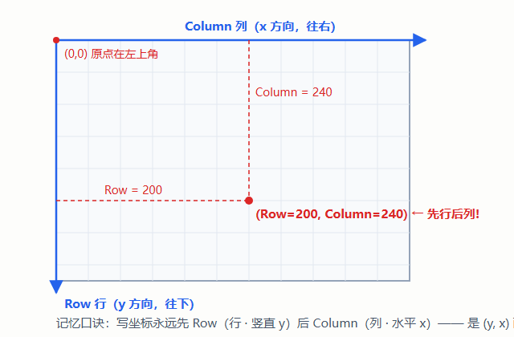

> ⚠️ 本插件里所有"中心行/中心列"参数都遵循这个顺序。画出来的框"横竖颠倒"，九成是 Row/Col 写反了。

### 1.3 一张图记住四个核心对象

这是整个 Halcon 世界的心智模型，本插件只用到了前三个：

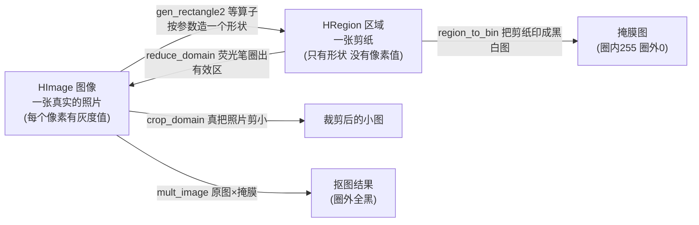

| 对象 | 是什么 | 比喻 | 关键特性 |
|---|---|---|---|
| **HImage** | 有像素值的图 | 一张照片 | 占内存，用完要 Dispose |
| **HRegion** | 只有形状的坐标集合 | 一张剪纸 | **没有像素值**，与分辨率无关；标记"哪些位置" |
| **Domain（域）** | 图像自带的"有效区标记" | 荧光笔在照片上圈的范围 | 圈外像素还在，只是算子不处理 |
| **HTuple** | 万能数值容器 | 一个能装数字/字符串的袋子 | C# 与 Halcon 传参数用 |

> 最容易混的一对：**Region 是"形状"**（剪纸），**Domain 是"照片上的荧光笔圈"**（依附于某张图）。剪纸可以到处盖，荧光笔圈只属于这张照片。

### 1.4 Halcon 与 HDevelop 是什么

- **Halcon**：德国 MVTec 公司的工业视觉算法库，内置几千个现成算子（找边、匹配、测量…）。本仓库通过它的 .NET 封装 `HalconDotNet.dll` 调用。
- **HDevelop**：Halcon 自带的交互式开发软件，像"视觉界的 MATLAB"——写一行算子立刻看到图像效果。学习阶段强烈建议装一个对照玩。
- 本仓库的做法：C# 插件直接调 `HalconDotNet` 的算子函数（如 `HOperatorSet.GenCircle(...)`）。

---

## 第 2 章 这个插件是干什么的

### 2.1 一句话 + 比喻

**在图像上画一个或几个"框"，告诉后续步骤"只看框里的，框外的别管"。**

> 比喻：一张全班合影，你只关心第三排的三个同学。用手指把那块圈出来——这就是 **ROI（Region of Interest，感兴趣区域）**。之后所有分析只在这个圈里做，圈外的背景路人统统忽略。

### 2.2 它在流程里的位置

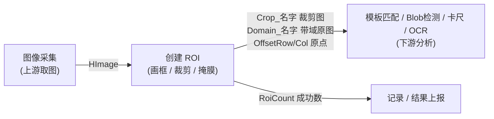

它自己**不做任何检测**——它是"搬运工+导游"：把图按你画的框分头整理好，指给下游看。

### 2.3 与模板匹配的分工（最容易混的一对）

| | 创建 ROI | 模板匹配 |
|---|---|---|
| 回答的问题 | "看**哪里**？" | "目标**在哪**？" |
| 框怎么来 | **人画的**（配置时定死） | 算法每帧**找出来的** |
| 有无学习 | 无 | 有（create_shape_model） |
| 一句话 | **静态的框** | **动态的框** |

产线上常配合：先用 ROI 圈出工位区域，再在区域内做模板匹配——搜得更快、更不会认错背景。

### 2.4 功能能力清单

- ✅ 三种形状：可旋转矩形、圆、椭圆（右键画布新建）
- ✅ 想画几个画几个，每个独立管理、参数可数值微调
- ✅ **涂抹**（画笔补充不规则区域）/ **擦除**（挖掉不要的区域）
- ✅ **排除模式**（MaskInvert）：圈内变黑、圈外保留
- ✅ 四类输出：裁剪图 / 带域原图 / 合并区域 / 二值掩膜（详见 6.4 节端口总表）
- ✅ 全部配置随方案（.vms 文件）保存，重开不丢

---

# 第二部分 视觉算子原理（逐个讲）

> 读法：按"运行时一条数据的旅程"排序。每个算子一张小卡片：**签名 → 直觉 → 在源码哪里 → 易错点**。
>
> 💡 **没有 HDevelop 开发许可？** 把同样的代码贴进仓库的「图像脚本」插件（走 HDevEngine）也能跑——顺便把插件的用法也练了。

## 第 3 章 算子卡片集

### 3.1 造区域三兄弟：gen_rectangle2 / gen_circle / gen_ellipse

**卡片：gen_rectangle2（可旋转矩形）**

```
gen_rectangle2(Region, Row, Column, Phi, Length1, Length2)
```

- **直觉**：先定中心点 (Row, Column)，再把一把"筷子"（长 L1）按角度 Phi 摆好，宽度方向取 L2。
- **易错点 ①**：Length1/Length2 是**半长/半宽**（从中心到边的距离），不是全长！矩形实际面积 = 4 × L1 × L2。
- **易错点 ②**：角度 Phi 是**弧度**不是度（90° ≈ 1.5708 弧度）。
- **源码**：`BuildRegion()`，`CreateRoiPlugin.cs:873`——`region.GenRectangle2(Params[0..4])`，五个参数一一对应。

**卡片：gen_circle（圆）**

```
gen_circle(Region, Row, Column, Radius)   // 圆心 + 半径，3 个参数
```

**卡片：gen_ellipse（椭圆）**

```
gen_ellipse(Region, Row, Column, Phi, Radius1, Radius2)   // 旋转角 + 长半轴 + 短半轴
```

> 三种形状参数个数不同（5 / 3 / 5），所以源码里 `RoiItem.Params` 只存"实际个数"，不补位——这是"存配方"设计的直接体现（见 5.1 节）。

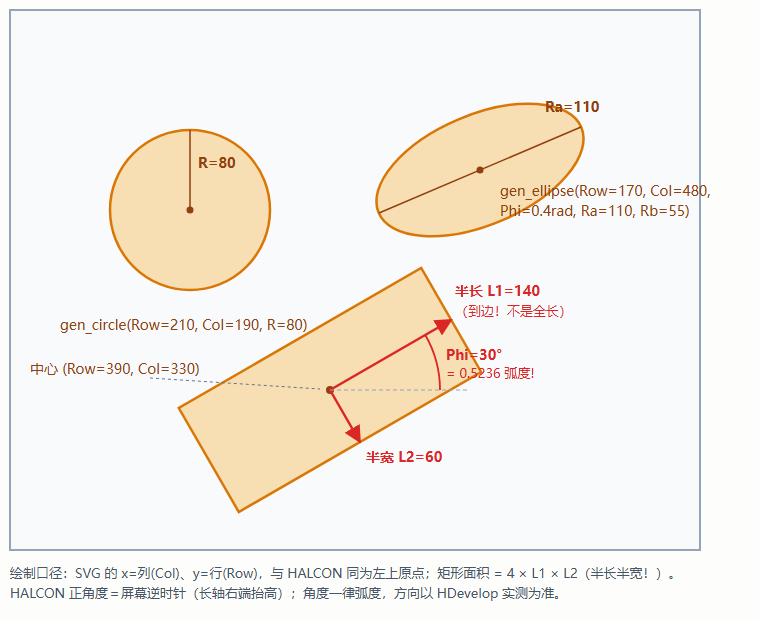

> 🖼️ **HDevelop 截图位**：跑下面的脚本，把图形窗口截图贴到这里——亲眼核对「半长不是全长、角度是弧度」。
>
> ```hdevelop
> * 三种形状（对照上图核对：L1 是半长、Phi 是弧度）
> gen_rectangle2 (Rect, 390, 330, 0.5236, 140, 60)
> gen_circle (Circ, 210, 190, 80)
> gen_ellipse (Ell, 170, 480, 0.4, 110, 55)
> dev_display (Rect)
> dev_display (Circ)
> dev_display (Ell)
> ```

### 3.2 区域的拼与挖：union2 / difference / GenEmptyRegion

- **union2（并集 ∪）**：两张剪纸叠在一起，圈的总范围。合并多个 ROI 就靠它。
- **difference（差集 −）**：从剪纸 A 上把 B 盖住的部分**挖掉**。擦除功能就靠它。
- **GenEmptyRegion（空区域）**：⚠️ **高频坑**——`new HRegion()` 只创建了一个"未初始化"对象（相当于拿到一张白纸但什么都没画，甚至纸还没裁），后续算子遇到它会**抛异常**。必须显式 `GenEmptyRegion()` 造一个"真正的空区域"。
- **源码**：`BuildMergedRegion()`，`CreateRoiPlugin.cs:614-656`。合并口径一条铁律：

```
合并有效区域 = (所有ROI ∪ 涂抹) − 擦除
```

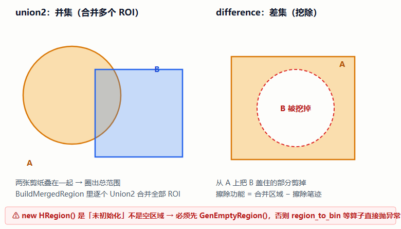

> 🖼️ **HDevelop 截图位**：
>
> ```hdevelop
> gen_circle (A, 200, 200, 120)
> gen_rectangle1 (B, 260, 260, 420, 480)
> union2 (A, B, U)
> gen_circle (E, 320, 300, 60)
> difference (U, E, Final)      * 把 E 挖掉
> dev_display (Final)
> * 防爆对照：AreaE 应为 0
> gen_empty_region (Empty)
> area_center (Empty, AreaE, RC, CC)
> ```

### 3.3 裁剪原点从哪来：smallest_rectangle1

```
smallest_rectangle1(Region, Row1, Column1, Row2, Column2)
```

- **直觉**：给剪纸找一个**横平竖直**（不旋转）的最小外接矩形，返回左上角 (Row1, Col1) 和右下角。
- **用途**：裁剪图的原点就是它——`crop_domain` 裁掉的就是这个外接矩形。
- **源码**：`CreateRoiPlugin.cs:466-469`，取 (r1, c1) 作为 `OffsetRow/OffsetCol` 输出。

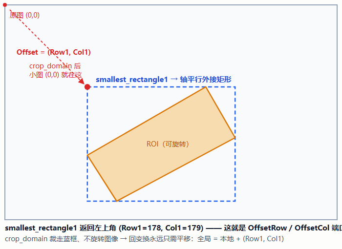

> 🖼️ **HDevelop 截图位**：
>
> ```hdevelop
> gen_rectangle2 (R, 300, 330, 0.5236, 140, 60)
> smallest_rectangle1 (R, Row1, Col1, Row2, Col2)
> * 变量区看 Row1/Col1 —— 就是 OffsetRow/OffsetCol 端口的值
> ```

### 3.4 ★ 全插件最核心的对比：reduce_domain vs crop_domain

这是"看 ROI"的两种姿势，也是本插件给下游两类输出的根本原因：

| | **reduce_domain（限域）** | **crop_domain（裁剪）** |
|---|---|---|
| 图像大小 | **不变**（原尺寸） | **变小**（外接矩形） |
| 内存 | 不省（像素都在） | 省 |
| 坐标系 | **不变（全局坐标）** | **变了**（原点搬到框左上角） |
| 下游算子行为 | 只在圈内干活，圈外直接不碰 | 拿到的就是小图 |
| 需要换算吗 | **不用** | 要：`全局 = 本地 + Offset` |
| 漏换算的后果 | 无 | **坐标静默错**（不报错！） |

一张图，两条路（看懂这张图就懂 3.4 节）：

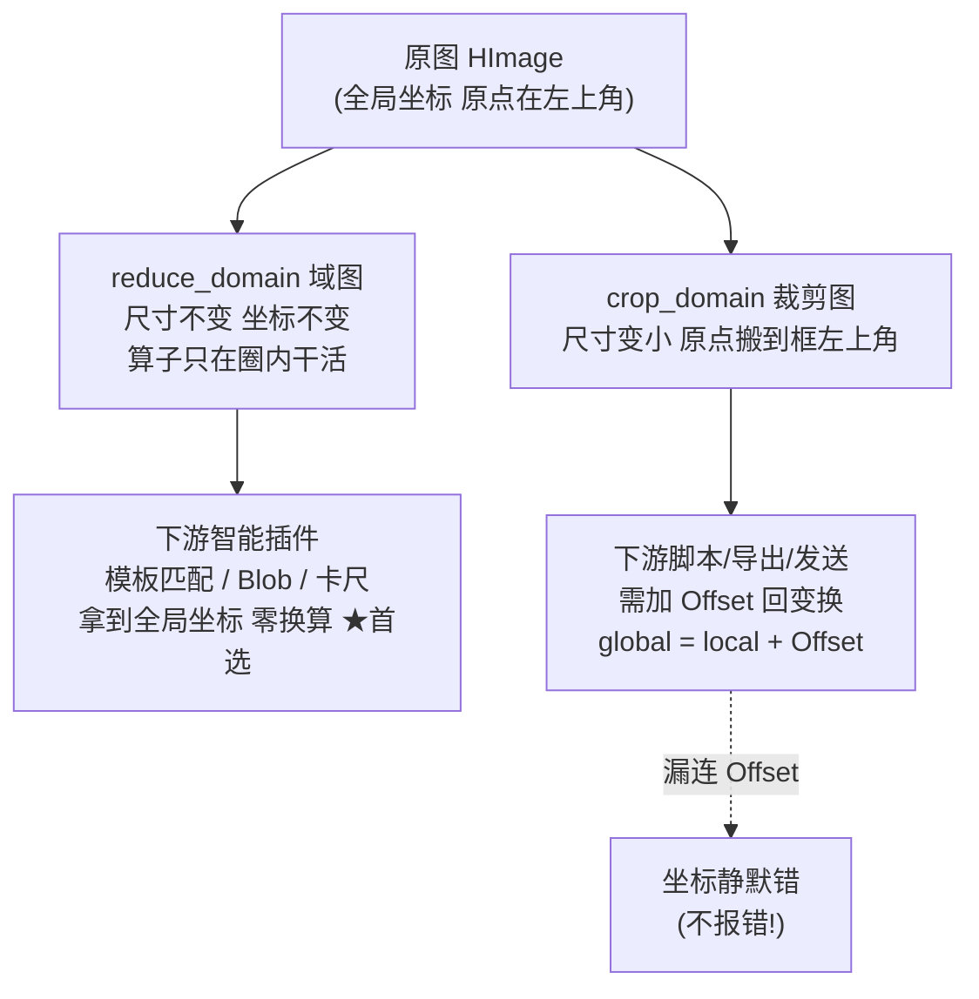

像素视角再看一眼（左：域图；右：裁剪图）：

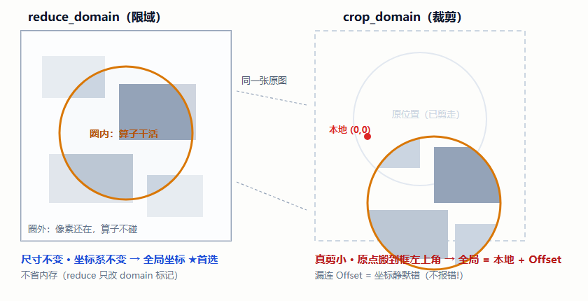

> 🖼️ **HDevelop 截图位**：
>
> ```hdevelop
> read_image (Image, 'fabrik')
> gen_rectangle2 (R, 250, 350, 0.4, 200, 120)
> reduce_domain (Image, R, ImageDomain)
> crop_domain (ImageDomain, ImageCrop)
> get_image_size (Image, W, H)
> get_image_size (ImageCrop, WC, HC)   * WC < W：真剪小了
> ```

> **实测结论**（源码注释 :540-546）：模板匹配 `find_shape_model` 在域图上搜索，命中返回的**仍是全局坐标**，域外目标直接不命中。所以下游"智能"插件（模板匹配/Blob/卡尺）接域图，**一个都不用改**。
>
> **怎么选**：下游是智能插件 → 用 `Domain_名字`（零换算）；下游是脚本/导出/发送这类"只管手里这张图"的 → 用 `Crop_名字` + `OffsetRow/Col_名字`。

**源码**：`RunAlgorithm()` 内 `CreateRoiPlugin.cs:471-489`——先 `ReduceDomain` 出域图，再 `CropDomain` 出裁剪图，两条路同时给。

### 3.5 掩膜二值化：region_to_bin

```
region_to_bin(Region, Image, ForegroundGray, BackgroundGray, Width, Height)
```

- **直觉**：把剪纸盖在一张与原图同尺寸的白纸上，喷漆——圈内喷 255（白），圈外喷 0（黑）。得到一张只有两种灰度的**掩膜图**。
- **源码**：`BuildMaskAndResult()`，`CreateRoiPlugin.cs:834`——正常模式内 255 外 0；勾了排除模式（MaskInvert）就反过来。

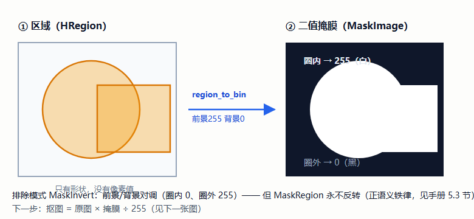

> 🖼️ **HDevelop 截图位**：
>
> ```hdevelop
> read_image (Image, 'fabrik')
> get_image_size (Image, Width, Height)
> gen_circle (R, Height/2, Width/2, 150)
> region_to_bin (R, Mask, 255, 0, Width, Height)
> * 排除模式对照：把前景/背景对调再跑一次
> region_to_bin (R, MaskInv, 0, 255, Width, Height)
> ```

### 3.6 抠图乘法：mult_image（含一个经典坑）

**抠图原理就是乘法**：

```
结果 = 原图 × 掩膜 ÷ 255
像素 182 × 255 ÷ 255 = 182   ← 圈内保留
像素  90 ×   0 ÷ 255 =   0   ← 圈外变黑
```

数据流长这样：

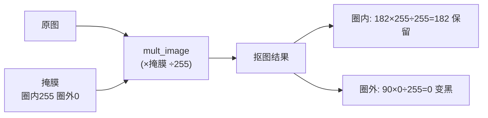

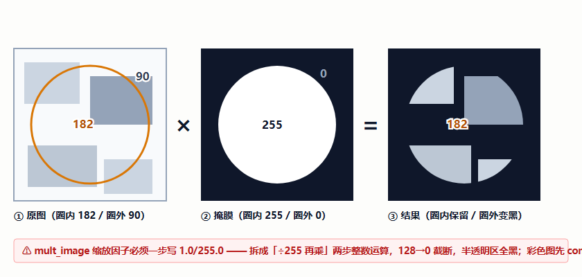

> 🖼️ **HDevelop 截图位**：
>
> ```hdevelop
> read_image (Image, 'fabrik')
> get_image_size (Image, Width, Height)
> gen_circle (R, Height/2, Width/2, 150)
> region_to_bin (R, Mask, 255, 0, Width, Height)
> mult_image (Image, Mask, Masked, 1.0/255.0, 0.0)   * 一步浮点乘！
> ```

- **易错点**（源码注释 :837 特意写死）：`mult_image` 的缩放因子必须**一步写成浮点 `1.0/255.0`**。如果拆成"先 ÷255 再乘"两步整数运算，中间灰度 128 ÷ 255 = **0**（整数截断），半透明区域全变黑。
- **彩色图特例**：掩膜是单通道，彩色图是 3 通道，不能直接乘。先 `count_channels` 问通道数，3 通道就用 `compose3` 把掩膜复制成 3 份再乘。
- **源码**：`CreateRoiPlugin.cs:838-857`。

### 3.7 游程编码：get_region_runs / gen_region_runs

- **直觉**：区域是"每行哪些列被选中"——记录成 `"行号,起列,止列"` 的文本，一行只要 3 个数。比如第 100 行第 10~20 列被选中就是 `100,10,20`。这叫**游程编码（RLE）**，无损、可读、天然适合存文件。
- **用途**：涂抹/擦除区域要随方案保存，就是用它转成文本；加载方案时 `gen_region_runs` 反向还原。
- **本插件加的料**：文本超 4KB 自动 GZip 压缩 + base64（`gz:` 前缀），两代格式互认（源码 :749-797）。

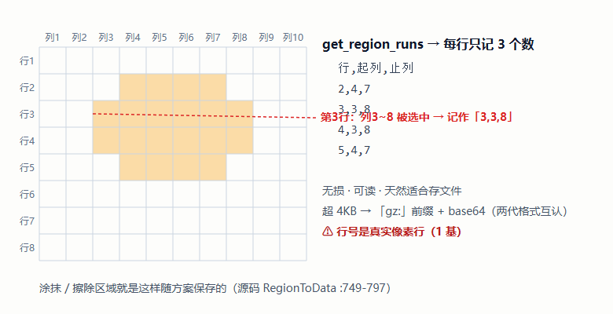

> 🖼️ **HDevelop 截图位**：
>
> ```hdevelop
> gen_circle (R, 200, 200, 120)
> get_region_runs (R, Rows, ColStart, ColEnd)
> * 变量区：每行 3 个数（行, 起列, 止列）—— 涂擦区域就这么存进方案
> ```

### 3.8 特征读取：area_center / get_image_size

- **area_center**：算区域面积和质心。本插件用它**判空**——`area <= 0` 说明区域被擦除了，跳过裁剪（:457-462）。比 `IsInitialized()` 更彻底。
- **get_image_size**：问图像多大（宽高），造掩膜图时要用。

> 🖼️ **HDevelop 截图位**：
>
> ```hdevelop
> gen_circle (R, 200, 200, 120)
> area_center (R, Area, RowC, ColC)
> gen_empty_region (E)
> area_center (E, AreaE, RC, CC)   * AreaE=0 → 判空认准 area<=0
> ```

---

# 第三部分 设计思路（逐个讲）

## 第 4 章 插件的一生：框架怎么调它

先看全景，后面每个设计决策都发生在某一步上：

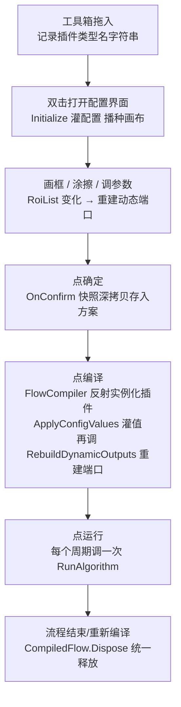

**关键认知**：你配置时画的框，**运行时并不复用那个界面里的对象**——方案里存的只是参数（数字数组），编译时按参数**重新**生成一切。配置态（编辑）与运行态（执行）彻底分离。

### 4.1 端口即数据成员

插件和外界交换数据全靠**端口**（Port）：输入端口等上游喂数据，输出端口向下游供数据。本插件声明方式（:56-64）：

```csharp
public InputPort<HImage>  SrcImage   { get; } = new();          // 入：待处理图
public OutputPort<int>    RoiCount   { get; } = new();          // 出：成功裁剪数
public OutputPort<HRegion> MaskRegion { get; } = new(...);      // 出：合并有效区域
public OutputPort<HImage>  MaskImage  { get; } = new(...);      // 出：二值掩膜
```

框架靠**反射**自动发现这些 public 属性，画布上就出现对应的端口点。写插件不需要注册表、不需要配置文件——声明即生效。

### 4.2 动态端口：为什么"画 3 个框就冒出 12 个输出口"

模板匹配的输出端口编译期就定死了（Score、Row、Col…）。但 ROI 是用户**配置时画的**——画 3 个框就该有 3 个裁剪输出，画 10 个就该 10 个。**端口数量运行期才知道**，这就是"动态端口"：

- 实现 `IDynamicOutputProvider` 接口，框架在合适的时机调 `RebuildDynamicOutputs()`（源码 :518-588）；
- **每个 ROI 自动生成 4 个端口**：`Crop_名字`、`Domain_名字`、`OffsetRow_名字`、`OffsetCol_名字`；
- 同时把端口定义（名字+类型）**快照**写进 `StepData.OutputPortDefinitions`——因为编译出来的运行实例是另一个对象，它靠这份快照重建端口，画布上才有东西可连。

> 教学点：**"动态的部分必须自己负责同步快照"**——这是所有动态端口插件的通用契约。

### 4.3 配置怎么存：[StepConfig]

打上 `[StepConfig]` 的属性会随方案序列化保存（:35-51）：`DisplayViewIndex`（发布到主界面哪个窗口）、`MaskInvert`（排除模式）、`RoiList`（整个 ROI 列表）、`SmearDrawData/SmearEraseData`（涂擦的游程文本）。

### 4.4 一次运行的时序图（框架 ↔ 插件 ↔ Halcon ↔ 下游）

把"每个周期"放大看，数据是怎么在四方之间流动的：

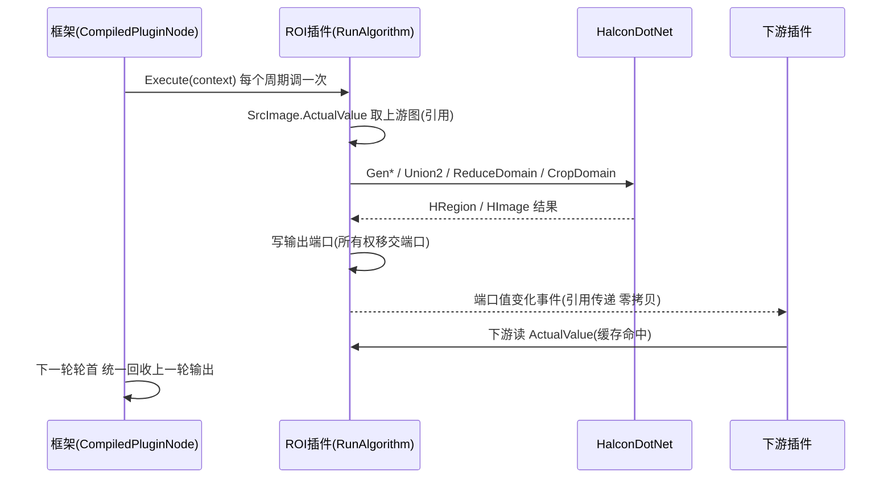

- 读法：**写端口 = 把所有权交给框架的回收机制**；下游读到的始终是"本轮最新值"。
- 与 4.2 节呼应：动态端口在编译时由快照重建，运行期就是上面这个循环。

## 第 5 章 八个值得学的设计决策

每个都按「问题 → 方案 → 为什么」讲，且都有真实 bug 佐证（出自官方文档第 4 章的修复记录）。

### 5.1 存"配方"，不存"成品"

- **问题**：用户画的框要随方案保存。HRegion 是内存对象，进不了 JSON。
- **方案**：`RoiItem.Params` 只存一串数字——矩形 `[中心行, 中心列, 角度, 半长, 半宽]`、圆 `[圆心行, 圆心列, 半径]`（RoiItem.cs:14-17 注释写明与 Gen* 算子参数一一对应）。运行时按参数重建区域（每种形状就一条 Gen 调用，见 3.1 节）。
- **为什么**：数字天然可序列化、跨机器一致、可人工检查。"存配方不存成品"是视觉软件行业的通用做法。

### 5.2 三件套输出：Crop + Domain + Offset，不替用户做选择题

- **问题**：下游有的"聪明"（认 domain，全局坐标），有的"憨"（只管手里这张图）。只给裁剪图，聪明插件得加无谓的坐标换算；只给域图，憨插件拿不到小图。
- **方案**：三类端口全给（每个 ROI 四个口），下游按需选（选型表见 3.4 节）。
- **为什么**：插件不预判下游能力，但把每条路的**路标**立好——连 Offset 都拆成两个 double 而不是一个 HTuple，就是为了让下游脚本/变量能当普通标量连线，还保住编译期类型检查（:556-561 注释）。

### 5.3 单一事实来源：正语义不反转

- **问题**：勾了"排除模式"，掩膜要反转（圈内黑圈外白）。那 `MaskRegion`（区域）要不要跟着反转？
- **方案**：**永不反转**（:60 注释写死）。区域永远是"哪里有效"的正语义；反转只发生在二值图那一层。
- **为什么**：如果区域也反转，下游拿到"排除后的区域"再反转一次，语义就乱套了。**一个概念只在一处反转**——反转是"视图"，不是"数据"。

### 5.4 单一数据源：画布、列表、数值框互不直接对话

- **问题**：界面上有三个地方显示/编辑同一个 ROI（左侧列表、中间画布、右下数值框），两两同步会变成蜘蛛网。
- **方案**：三方全部只读写 `RoiList`（画布集合 `CanvasRois` 变化 → 回写 RoiList :185-227；数值框编辑 → `NotifyParamEdited` → 写画布句柄 :244-250）。

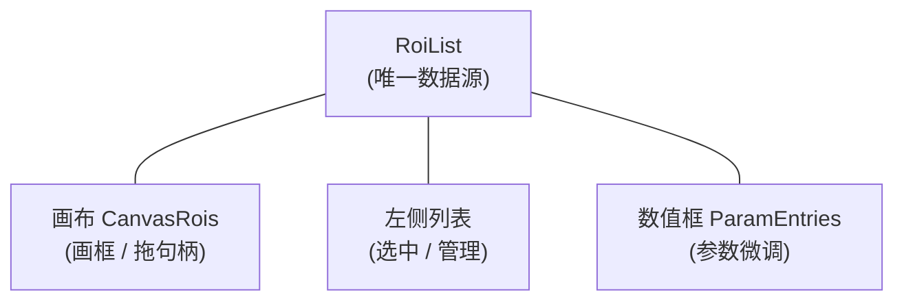

- **为什么**：MVVM 的"单一数据源"。三个视图都是 RoiList 的投影，改一处、广播全场，永远不会互相打架。

### 5.5 双向绑定要"断环"，退订必须"先判变化"

- **问题**：列表选中 ROI ↔ 画布激活 ROI 要双向同步，两个 setter 互相写对方会**无限循环**。
- **方案**：两边 setter 都先判断"值真的变了吗"再继续（:87、:117）。
- **真实 bug 佐证**（官方文档 4.2①，一度"时好时坏"）：旧代码**先无条件退订事件、再判断变化**。列表选中会引发同值重入——第二次进 setter 时订阅被摘走，同值路径短路后**永远没机会补回**，参数微调从此断链。
- **教训**：事件退订/订阅必须放在"确认要换"**之后**，不能放在"可能短路"**之前**。

### 5.6 所有权移交：到底谁负责 Dispose

- **问题**：把 HImage 写进端口后，是调用方释放还是端口释放？搞错就是内存泄漏或提前释放。
- **方案**：`SetImagePort()` 返回 bool（:596-602）——true 表示"端口接管了所有权"，调用方就把本地引用置 null 不再碰；false 表示"端口没接（不存在/类型不符）"，调用方在 finally 里自己释放（:475-477、:496-500）。
- **背景**：运行期每个输出的图像由基类在下一轮开始时统一回收（:401 注释），所以"移交"是这套插件体系的通用语言。

### 5.7 重名三层防御：端口冲突是静默事故

- **问题**：控件命名序号每开一次配置界面就归零，重开配置再画必然撞上历史名字（已有 `ROI_0`，新建又叫 `ROI_0`）。动态端口重名会被**静默去重**——两个 ROI 写同一个端口：输出互相覆盖、旧图每轮泄漏、按名查找歧义，且**没有任何报错**。
- **方案**（三层防御）：
  1. 画布新建时 `NextFreeName()` 强制唯一名并回写控件标签（:196-198）；
  2. 打开配置播种时对历史方案的重名统一去重（:309-321）；
  3. 运行期重名只输出第一个端口兜底（:431）。
- **为什么单独讲**：这是"**静默故障比崩溃更可怕**"的典型案例——崩溃当场暴露，静默覆盖流到下游才炸，还查不出因。

### 5.8 恢复要走"字段"，不能走"setter"

- **问题**：涂抹/擦除区域重开配置界面就丢，且方案数据被**静默抹掉**。
- **原因**：恢复时代码逐个走了 `SmearDraw` 的 setter，而 setter 里的 `SyncSmearData()` 会把**另一边**还没恢复的快照重新编码——用"尚未恢复的 null"把好数据覆盖成空（:720-733 注释详述）。
- **修法**：`RestoreSmear()` 直接写字段、最后一次性通知（:727-733）。
- **教训**：**批量初始化走字段，联动逻辑只该在"用户真实操作"路径上**。（4.1 节的 200ms 防抖、5.5 节的同值短路，都是"区分用户操作与程序回灌"的同类思想。）

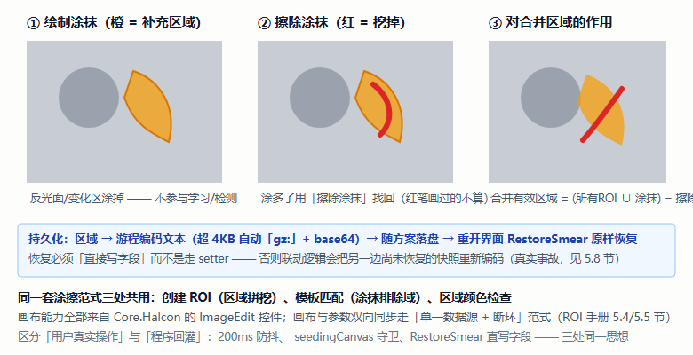

> 附两个小设计：掩膜预览拖拽时 200ms 防抖重算（:144，全图像素运算不节流会卡）；类上标了 `[ParallelSafe]`（:30，纯视觉计算，为二期真并行做的标记）。

---

# 第四部分 源码走读

## 第 6 章 代码地图

### 6.1 文件与行数

| 文件 | 行数 | 职责 |
|---|---|---|
| `Plugins/Plugin.CreateRoi/CreateRoiPlugin.cs` | 895 | 核心：配置、端口、画布同步、涂擦、掩膜、运行裁剪 |
| `Plugins/Plugin.CreateRoi/Models/RoiItem.cs` | 207 | ROI 数据模型 + 参数微调行包装 |
| `Plugins/Plugin.CreateRoi/CreateRoiView.xaml` | — | 配置界面布局 |
| `FlowCanvasChecks/CreateRoiChecks.cs` | — | 回归断言（47~48 条），改完跑它验收 |

### 6.2 源码分区结构

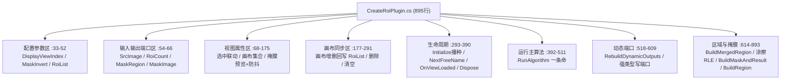

### 6.3 RunAlgorithm 主流程逐段走读（:392-507）

每个运行周期执行一次，按顺序五步：

1. **验输入**（:394-399）：`SrcImage.ActualValue` 取上游图（注意：输入端读真实生效值只能用 `ActualValue`，读 `TypedValue` 拿到的是没连线的旧值——端口系统最著名的陷阱）。空图 → `Fail("输入图像为空或未初始化")` 并 return。
2. **算合并区域**（:410-411）：`BuildMergedRegion()` 按 3.2 节铁律合并，所有权移交 `MaskRegion` 端口。
3. **造掩膜与合成图**（:414-416）：`BuildMaskAndResult()` 出二值掩膜（移交 `MaskImage`）和"无效区置黑"的合成图（留给自己，发布主界面用）。
4. **发布主界面**（:422-423）：`DisplayViewIndex` 1~9 才发布、窗口号**直传**（历史上多写 `+1` 导致选窗口 1 投进第 2 格的 bug）。
5. **逐 ROI 裁剪**（:425-504）：对每个 ROI——先清零偏移端口（:436-437，防止读到上一轮残留值）→ `BuildRegion` 造区域 → 擦除修正 → `area_center` 判空 → `SmallestRectangle1` 取原点 → `ReduceDomain` 出域图（移交 `Domain_` 端口）→ 写 Offset → `CropDomain` 出裁剪图（移交 `Crop_` 端口）。**单个失败不阻断整体**，但必须留警告日志（:442）。最后 `RoiCount = 实际成功数`（:504）——下游按它循环取数才不越界。

五步的流程全景：

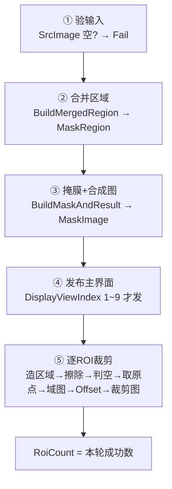

**失败路径一览**（每条都留痕、不阻断整体）：

| 失败点 | 行为 | 代码 |
|---|---|---|
| 输入图空/未初始化 | `Fail` 并 return（整轮失败） | :394-399 |
| 形状参数无效 | 跳过该 ROI + Warn | :439-444 |
| 有效区被擦除殆尽（area≤0） | 跳过 + Warn | :457-462 |
| 单个 ROI 裁剪异常 | 捕获 + Warn，继续下一个 | :491-494 |

**端口读写三句话**（出处：`docs/新插件端口速查.md`）：

| 角色 | 用什么 | 反例 |
|---|---|---|
| 上游写输出 | `TypedValue` / `Set()` | — |
| 下游读输入 | **`ActualValue`**（链接值优先） | 读 `TypedValue` 拿到没连线的旧值 |
| 配置界面绑定 | `Value`（手动值） | 业务代码别读它 |

### 6.4 端口总表

**固定端口（4 个）**：

| 端口 | 方向 | 类型 | 说明 |
|---|---|---|---|
| `SrcImage` | 入 | HImage | 待处理图像，不填直接 Fail |
| `RoiCount` | 出 | int | **本轮实际成功数**（≠配置数） |
| `MaskRegion` | 出 | HRegion | 合并有效区域（永远正语义） |
| `MaskImage` | 出 | HImage | 二值掩膜（排除模式下反转） |

**动态端口（每个 ROI × 4）**：

| 端口名 | 类型 | 内容与坑 |
|---|---|---|
| `Crop_名字` | HImage | 裁剪图（局部坐标，**不连 Offset 就是静默错**） |
| `Domain_名字` | HImage | 带域原图（全局坐标，下游零改动，**首选**） |
| `OffsetRow_名字` | double | `全局行 = 本地行 + 本值` |
| `OffsetCol_名字` | double | 列同理 |

### 6.5 RoiItem.cs：一张"框的档案卡"与它的翻译层

- **RoiItem**（:19-130）：`Name`（唯一键，下游按名引用端口）+ `ShapeType`（矩形/圆/椭圆）+ `Params`（double[]）。
- **RoiParamEntry**（:135-206）：数值框的"翻译层"。为什么需要它？`Params` 是数组，**数组元素没法做属性变更通知**（WPF 界面不会刷新）——于是每个参数包成行对象，`Value` setter 读写 `Params[i]` 并上抛编辑事件。三个细节值得学：角度参数显示 4 位小数其余 1 位（:151）；非法输入按当前值还原而不是崩（:174）；拖拽高频时数组整体替换**不重建集合**、只通知每行刷新（`RaiseWithValue` :201），否则界面跟不上拖拽。

### 6.6 关键方法行号索引

| 方法 | 行号 | 一句话 |
|---|---|---|
| `Initialize()` | :300 | 灌配置 + 播种画布 + 重名去重 + 恢复涂擦 |
| `NextFreeName()` | :331 | 唯一命名（`ROI_0/ROI_2` 在场 → 给 `ROI_3`） |
| `RunAlgorithm()` | :392 | 每帧主流程（6.3 节） |
| `RebuildDynamicOutputs()` | :518 | 动态端口 + 快照同步 |
| `BuildMergedRegion()` | :614 | 合并区域 + 涂擦修正 + 空区域防爆 |
| `BuildMaskAndResult()` | :822 | 二值掩膜 + 1/255.0 抠图 |
| `BuildRegion()` | :863 | 按参数造区域（非法参数返 null） |
| `RegionToData()` / `DataToRegion()` | :749 / :769 | 涂擦 RLE 存 / 取（gz 互认） |
| `SetImagePort()` | :596 | 所有权移交式写端口 |

---

# 第五部分 操作与排障

## 第 7 章 上手六步

先认路——配置界面四大区（对照官方文档 3.2 节）：

```
┌──────────────────────────────────────────────────┐
│ [原图预览 ○] [掩膜预览 ○]      ← 右上角切换        │
├──────────┬──────────────────────────┬───────────┤
│ ROI 列表  │  ImageEdit 画布（中）     │ 参数微调    │
│ （左）    │  右键新建矩形/圆/椭圆      │ （右下）    │
│ 选中联动  │  拖句柄改大小/角度         │ 数值框      │
│          │  涂抹(橙)/擦除(红)/清除    │            │
├──────────┴──────────────────────────┴───────────┤
│ 显示窗口选择（0=不发布，1~9=主界面窗口号）            │
└──────────────────────────────────────────────────┘
```

1. **搭流程**：拖「图像采集」和「ROI」（常用工具分组），把采集的图像输出连到 ROI 的 `SrcImage`；
2. **弄图进界面**：试运行一次，上游图自动出现在配置画布；也可以直接填一张**本地图片路径**载入；
3. **画框**：画布上**右键 → 新建矩形/圆/椭圆**，拖句柄调整；
4. **微调**：选中后用数值框精调（中心行/列、角度、半长/半宽），与画布实时同步；
5. **选输出**：下游是模板匹配/Blob/卡尺 → 连 `Domain_名字`；是脚本/导出 → 连 `Crop_名字` + 两个 Offset；
6. **保存**：显示窗口选 1~9（0=不发布），点确定。

> 编译插件前先关掉正在运行的 VisionMaster（进程锁着 DLL）；改了源码必须重建插件工程，只重建宿主跑的还是旧 DLL（仓库红线）。

## 第 8 章 FAQ 与排障精选（完整版见官方文档 3.8/3.9 节）

| 现象 | 原因与处理 |
|---|---|
| 下游坐标整体偏了一个"框左上角"的距离 | 用了 `Crop_` 却没连 `Offset`——静默错不报错。换 `Domain_` 或补连偏移 |
| `RoiCount` 比画的框少 | 正常：参数无效的 ROI 被跳过并留警告日志，它是"成功数"不是"配置数" |
| 域图显示外面一圈黑 | 不是坏图。domain 外不参与运算，显示为黑是直观表达 |
| 重开方案 ROI/涂擦还在吗 | 在。RoiList 整体序列化，涂擦走游程编码（超 4KB 自动 gz） |
| 半透明掩膜区域全黑 | 历史坑已修：`mult_image` 缩放因子必须一步 `1.0/255.0` |
| 改了 ROI 下游接不上线 | 动态端口靠快照重建，重新编译一次流程即可 |

---

# 第六部分 验收与延伸

## 第 9 章 自检十题（答案指向对应章节）

1. Row/Col 谁在前？原点在图像哪个角？（1.2）
2. HRegion 和 Domain 的区别？剪纸和荧光笔圈分别对应谁？（1.3）
3. `gen_rectangle2` 的 Length1 是全长还是半长？角度单位？（3.1）
4. 一个 ROI 都没画时，为什么不能直接 `new HRegion()` 接着用？（3.2）
5. `reduce_domain` 省内存吗？为什么模板匹配在域图上返回的还是全局坐标？（3.4）
6. 掩膜抠图的缩放因子为什么必须写 `1.0/255.0`？（3.6）
7. 为什么存 `double[] Params` 而不是把 HRegion 序列化进方案？（5.1）
8. 画了 3 个 ROI，这个插件一共暴露几个输出端口？（4.2 + 6.4）
9. 排除模式下 `MaskRegion` 会反转吗？为什么？（5.3）
10. "先退订再判变化"引发过什么真实 bug？正确顺序是什么？（5.5）

## 第 10 章 审查记录与已知边界

**审查方式**：通读 `CreateRoiPlugin.cs`（895 行）与 `RoiItem.cs`（207 行）全文，与官方文档 `docs/创建ROI/创建ROI插件.md`（793 行）逐节交叉校验；文中行号以 2026-10-11 源码实测为准（官方文档个别行号有 ±2 偏移，以本手册为准）。

**已知边界与待办**（源码/文档注明，学习时心中有数）：

- `Region_{名字}`（显式 HRegion 输出）尚未提供，需要区域对象的场景暂时拿不到；
- **不是所有算子都认 domain**：主流算子（find_shape_model/threshold）已实测认可，第三方/自写算子需逐一验证；
- 域图**不省内存**（像素都还在），要省内存/传输仍需 `Crop_` + `Offset_`；
- ROI 名称目前不能在界面手动重命名（只保证唯一）；
- `MaskRegion`/`MaskImage` 是较新的端口，旧方案不会自动接线，需手动连。

**质量佐证**：本插件配有 47~48 条回归断言（`FlowCanvasChecks/CreateRoiChecks.cs`），其中两条"核心断言"很漂亮——同一个目标分别喂域图与裁剪图给模板匹配，**两条路都必须回到同一个全局真值**。学习时可以把它当作"什么是好的测试"的范例。

---

# 第七部分 扩展篇：ROI × 仿射变换

> 审阅意见补入。学完前面的 ROI，你手里只有"**静态的框**"（2.3 节）；产线上目标会挪、会转，框必须"**跟着走**"。让框跟着走的技术就是**仿射变换**——这是 ROI 最强关联的扩展，也是本仓库「坐标变换」插件存在的全部理由。

## 第 11 章 仿射变换与 ROI 跟随

### 11.1 为什么 ROI 学完必须接仿射变换

把知识链补完整：

```
创建 ROI（本插件）      —— 画"基准框"（静态）
模板匹配               —— 每帧找出"目标现在在哪、转了多少"（Row/Column/Angle）
仿射变换               —— 把基准框按位姿搬运过去（动态跟随）★本章
坐标变换插件            —— 把上面三步封装成开箱即用的插件
```

仓库落点：`Plugins/Plugin.PoseTransform/`（分组「定位」），官方文档 `docs/坐标变换插件/坐标变换插件.md`。**它直接消费本插件的 `MaskRegion` 输出**——你在模板图上画的基准 ROI，就是跟随的起点。

### 11.2 仿射变换 5 分钟直觉

- **是什么**：对坐标做线性变换——旋转、平移、缩放、错切，全部能用一个 2×3 矩阵（HALCON 里叫 `HomMat2D`）表达。几何保证：直线变完还是直线、平行线还平行（不含透视那种"近大远小"）。
- **视觉里最常用的是刚体变换**：只旋转 + 平移，形状不变——传送带上的工件挪了位置、转了角度，但它本身没变形。
- **单位坑**（坐标变换文档 1.3 原则③）：HALCON 算子一律收**弧度**；本仓库插件侧（Matching 的 Angle 输出、坐标变换插件）一律用**度**。换算：`弧度 = 度 × π ÷ 180`。跨层传角度先问自己"现在是度还是弧度"。

### 11.3 三个算子卡片

**卡片：hom_mat2d_*（拼装矩阵的乐高）**

```
hom_mat2d_identity → 从"什么都不做"的恒等矩阵开始
hom_mat2d_translate / rotate / scale → 依次叠加平移/旋转/缩放
```

- **直觉**：矩阵是"动作的累积"，乐高一样一块块拼。
- **易错点**：**拼接顺序敏感**——先旋转再平移 ≠ 先平移再旋转（转轴不同，结果差很远）。

**卡片：vector_angle_to_rigid（两句话造出刚体矩阵）★ 最高频**

```
vector_angle_to_rigid(Row1, Col1, Angle1, Row2, Col2, Angle2 : HomMat2D)
```

- **直觉**：给两个位姿（各含"位置两点 + 角度"），它直接算出"从位姿 1 变到位姿 2"的刚体矩阵——不用自己拼 translate/rotate。
- **本插件生态的标准公式**（坐标变换文档 1.1，与仓库脚本模板一字不差）：

```
vector_angle_to_rigid(模板参考点, 0°, 当前Row, 当前Col, 当前Angle) → HomMat2D
affine_trans_region(基准ROI, HomMat2D) → 跟随ROI（当前坐标系）
```

一步一图：

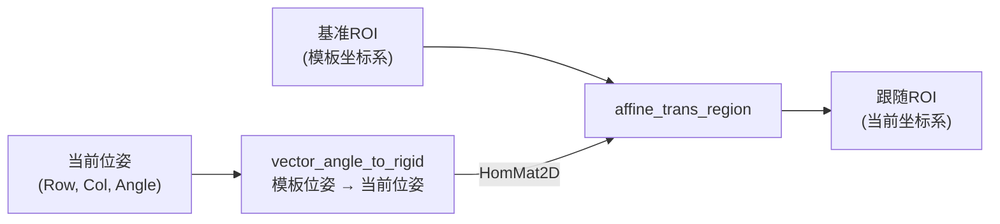

- **内置验收**：当位姿=参考点且角度 0（目标就在学习位置）时，矩阵是恒等变换——跟随 ROI 必须与基准 ROI **完全重合**。坐标变换插件把这条写成了回归断言。

**卡片：affine_trans_*（把矩阵作用到对象上）**

| 算子 | 作用对象 | 有没有损失 |
|---|---|---|
| `affine_trans_region` | 区域（剪纸） | **无**——只搬坐标，不碰像素 |
| `affine_trans_image` | 图像 | **有**——重采样（插值损失 + 内存拷贝） |
| `affine_trans_contour_xld` | 亚像素轮廓 | 无——模板轮廓"画框"搬到命中位置 |

### 11.4 三个典型场景（ROI 视角串起来）

**场景 A：裁剪回变换 = 纯平移**（3.3/3.4 节讲过，此处归位）

`crop_domain` 裁的是外接矩形、**不旋转图像**，所以回变换永远只是加偏移：`全局 = 本地 + (OffsetRow, OffsetCol)`。这是仿射变换里最平凡的特例——本插件替你把这条最常走的路修成了高速公路。

**场景 B：匹配跟随（本仓库标准接线）**——目标会挪会转，检测区跟着走：

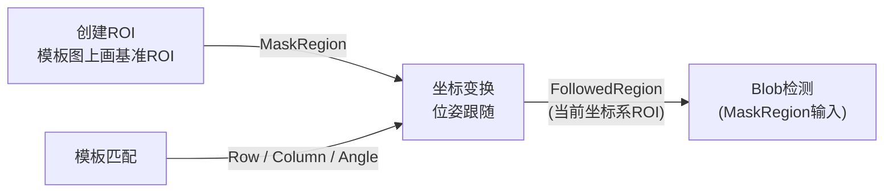

原理：基准 ROI 是模板坐标系下的剪纸；`HomMat2D` 是"模板位姿 → 当前位姿"的刚体变换；作用一下，ROI 就到了目标现在待的地方。

**场景 C：对齐图 vs 跟随区域怎么选**（坐标变换文档 1.2 的选型表，选错绕远路）：

| | Matching.`AlignedImage` | 坐标变换·位姿跟随 |
|---|---|---|
| 做什么 | 把目标**重采样**成标准位姿的**新图** | **保留原图坐标**，只变换 ROI/点 |
| 代价 | 每帧一次图像重采样（插值损失+拷贝） | 只搬剪纸，很轻 |
| 适合 | 内部 ROI 固定的算子：卡尺/颜色/OCR（它们只能吃对齐后的图） | `BlobDetect.MaskRegion`、机器人引导、多特征测量 |

> 记忆钩子：**"傻"算子（内部框固定）喂对齐图；"聪明"算子（认 MaskRegion 输入）喂跟随区域。**

### 11.5 回看本插件：其实你早就在用仿射思维了

- `gen_rectangle2` 的第 3 个参数 **Phi 就是旋转角**——可旋转矩形本身就是"带一个旋转自由度"的形状描述（3.1 节的易错点②在仿射语境下终于有了归宿）；
- 6.3 节 RunAlgorithm 里"擦除修正 → 外接矩形 → 裁剪"那套，是仿射家族里"零旋转"的简化版——理解了本章，再回头看源码注释里"**不旋转图像，所以回变换只需平移**"（:464-465）这句，会有"原来如此"的感觉。

### 11.6 扩展篇自检三题

1. `vector_angle_to_rigid` 的六个参数各是什么？（答：两个位姿，各"行、列、角度"）
2. 为什么 `affine_trans_image` 有插值损失，`affine_trans_region` 没有？（答：前者重采样像素，后者只搬坐标）
3. 传送带上目标每次偏转 ±5°，Blob 的检测区要跟着走——喂 `AlignedImage` 还是 `FollowedRegion`？为什么？（答：FollowedRegion；Blob 认 MaskRegion 输入，且跟随零重采样损失）

### 11.7 仓库落点与延伸

- 官方文档：`docs/坐标变换插件/坐标变换插件.md`（547 行，本节内容与它交叉校验）
- 源码亮点：`Plugins/Plugin.PoseTransform/` 分层干净——数学层 `PoseTransformMath` 纯托管（可用手算常量逐条断言），HALCON 只在两个函数里管区域/图像；"失配必须明确失败，绝不用旧标定默默算错"是它的第一原则
- 下一步衔接：`docs/标定插件/`（像素→机械坐标的前置）、`docs/模板匹配/`（位姿的来源）

---

## 附录 A 术语表（精选）

| 术语 | 一句话 |
|---|---|
| ROI | 感兴趣区域——"圈出来只分析这块" |
| HRegion | 剪纸：只有形状的坐标集合，没有像素值 |
| Domain | 照片上的荧光笔圈：依附于图的有效区标记，圈外算子不处理 |
| 裁剪 (crop) | 真把图剪小，原点会搬走 |
| 掩膜 (Mask) | 0/255 二值图，乘法抠图用 |
| 游程编码 (RLE) | 区域存成"行,起列,止列"文本，无损紧凑 |
| 动态端口 | 端口数量由配置决定（每个 ROI ×4），配快照重建机制 |
| 所有权移交 | 写入端口 = 把释放责任交给端口，返回值决定调用方还要不要自己 Dispose |
| 实际值 (ActualValue) | 输入端口"真实生效值"的唯一读入口（`TypedValue` 在输入端只是手动值） |
| 防抖 (Debounce) | 高频操作只在停顿后执行一次（本插件 200ms） |
| 仿射变换 | 用一个矩阵（HomMat2D）对坐标做旋转/平移/缩放；刚体变换=只旋转+平移（第 11 章） |
| 位姿 (Pose) | "位置 + 角度"三件套 (Row, Column, Angle)——目标"在哪、转了多少"（第 11 章） |

## 附录 B 延伸阅读

- 官方完整文档：`docs/创建ROI/创建ROI插件.md`（第 4 章修复记录、第 5 章附录含 HDevelop 实战案例 6 则）
- 端口系统权威：`docs/新插件端口速查.md`（ActualValue vs TypedValue 陷阱的出处）
- 宏观框架：`docs/设计思想.md` 第 9 章（图纸→编译→运行）
- 下一站建议：`docs/模板匹配/模板匹配插件-新手入门手册.md`——ROI 与模板匹配是天然搭档，学完本手册顺势衔接
- 再下一站：`docs/坐标变换插件/坐标变换插件.md`——第 11 章扩展篇的完整版（位姿跟随 / 像素→机械坐标）

## 附录 C 学习进度追踪（做完一项勾一项）

**📖 阅读进度**

- [ ] 第 1 章 数字图像入门（四大类型 + 坐标系）
- [ ] 第 2 章 插件是干什么的（分工表 + 能力清单）
- [ ] 第 3 章 算子卡片 3.1~3.4（造形状 → 拼挖 → 原点 → 两种姿势）★核心
- [ ] 第 3 章 算子卡片 3.5~3.8（掩膜 → 抠图 → RLE → 特征）
- [ ] 第 4~5 章 设计思路（插件的一生 + 八个决策）
- [ ] 第 6 章 源码走读（RunAlgorithm 五步）
- [ ] 第 7~8 章 上手操作 + 排障
- [ ] 第 11 章 扩展篇（仿射变换与 ROI 跟随）

**🖼️ HDevelop 截图（8 张，跑一张勾一张）**

- [ ] 3.1 三种形状（验证：半长 / 弧度 / 先行后列）
- [ ] 3.2 并集与差集（验证：GenEmptyRegion 防爆）
- [ ] 3.3 外接矩形原点（验证：Row1/Col1 = Offset）
- [ ] 3.4 限域 vs 裁剪（验证：WC < W）
- [ ] 3.5 掩膜二值化（验证：排除模式对调）
- [ ] 3.6 抠图乘法（验证：1.0/255.0 一步浮点）
- [ ] 3.7 游程编码（验证：每行 3 个数）
- [ ] 3.8 area_center 判空（验证：AreaE=0）

**🎓 毕业验收**

- [ ] 自检十题（第 9 章）答对 ≥ 8
- [ ] 扩展篇自检三题（11.6）全对
- [ ] 动手：在 VisionMaster 里搭一条「图像采集 → 创建ROI → 模板匹配（Domain 路线）」并跑通

**版本记录**

| 版本 | 变更 |
|---|---|
| v1.0 | 初版：六部分 + 自检十题 + 审查记录 |
| v1.1 | 按审阅意见新增第七部分扩展篇（仿射变换与 ROI 跟随） |
| v1.2 | 新增 8 张 mermaid 图 + 目录 + 界面布局示意 + 失败路径一览 + 端口读写三句话 |
| v1.3 | 新增 8 张 SVG 真值图（`images/`）+ 8 处 HDevelop 截图位 |
| v1.4 | 终检：新增本附录（进度追踪 + 版本记录）、§7 补本地图片载入、§10 标题修正、§3.8/§5.1 行文修正 |
| v1.5 | 图片兼容性：8 张示意图**渲染为 PNG**（`images/` 同名 `.png`，SVG 源保留），适配 ima 等阅读器 |
| v1.6 | 新增 SVG 09（涂擦交互：画笔/擦除/RLE 持久化，配套 §5.8） |

---

*本手册为学习用重排版（v1.5，2026-10-11），与官方文档冲突时以官方文档与源码为准。内嵌 11 张 mermaid 图 + 8 张示意图（**已渲染为 PNG**，`images/` 目录同名 `.png`，SVG 源文件保留可再改，任何阅读器无差别显示）+ 8 处 HDevelop 截图位（跑完脚本贴图，进度见附录 C）。欢迎反馈：哪章太浅/太深、截图贴好后要不要我帮你排版、要不要给每个算子加练习题。*
