# 卡尺测量插件手册 —— 零基础学习版

> **这本手册为谁而写**：不了解视觉算子、不了解设计思路，想通过「卡尺测量」学会"视觉怎么量尺寸"以及"计量类插件该怎么设计"的人。
> **依据**：官方文档 `docs/卡尺测量/卡尺测量插件.md`（801 行，唯一文档）逐节交叉校验；行号引自其源码索引（`CaliperMeasurePlugin.cs`，1936 行）。
> **版本**：v1.2（2026-10-11）。v1.2：新增两张关键插图——**均布向量对比**（把 P0 事故画出来）与**角度归一化**（补角歧义）；v1.1：新增**第七部分应用实例篇**——思路框架（先问四个问题）+ 四个实例（缝隙宽度 / 孔径 / **涂胶检测★** / 测量引导）；v1.0：初版。

---

## 目录

- **第一部分 预备知识**：第 1 章 边缘与亚像素 ｜ 第 2 章 这个插件是干什么的
- **第二部分 视觉算子原理**：第 3 章 算子卡片集（7 组 · 配 SVG 真值图与 HDevelop 截图位）
- **第三部分 设计思路**：第 4 章 六个设计决策（每条都有真实 bug 佐证）
- **第四部分 源码走读**：第 5 章 代码地图与均布数学
- **第五部分 操作与排障**：第 6 章 上手七步 + FAQ
- **第六部分 验收**：第 7 章 自检十题 + 审查记录
- **第七部分 应用实例篇**：第 8 章 拿到任务怎么想（缝隙 / 孔径 / **涂胶★** / 引导）
- **第八部分 扩展篇**：第 9 章 从一次测量到一套测量系统
- 附录 A 术语表 ｜ 附录 B 延伸阅读 ｜ 附录 C 学习进度追踪与版本记录

---

## 阅读地图

| 你的目的 | 走这条路 |
|---|---|
| 只想会用：量出一个宽度 | 直接读 **第 6 章**，卡住再回头查 |
| 想懂原理：卡尺凭什么能量到亚像素 | **第 1 → 2 → 3 章** |
| 想懂设计：计量插件为什么这么多"死规矩" | **第 4 章**（每条都有真实事故佐证） |
| 想读懂源码 | **第 5 章**（均布数学是精华） |
| 检验学没学会 | **第 7 章**（自检十题） |
| 想学「拿到任务怎么想」 | **第 8 章 应用实例篇**（四个实例：缝隙 / 孔径 / 涂胶★ / 引导） |
| 想继续进阶：量完之后呢 | **第 9 章**（扩展篇：标定直连 / 定位测量链） |

---

# 第一部分 预备知识

## 第 1 章 边缘与亚像素：卡尺的物理基础

### 1.1 边缘 = 灰度的"跳变"

拿一条线穿过图像，把线上每个像素的灰度值画成曲线——**曲线陡起陡落的地方就是边缘**。卡尺的全部工作就是：沿一条线扫描，找"灰度跳变最陡的那个点"。

### 1.2 亚像素：真实边缘在两个像素之间

相机把连续的世界切成一格一格的像素，真实边缘的位置往往**落在两个像素之间**（比如 150.6）。卡尺用灰度插值把这个小数位置算出来——这就是**亚像素**。

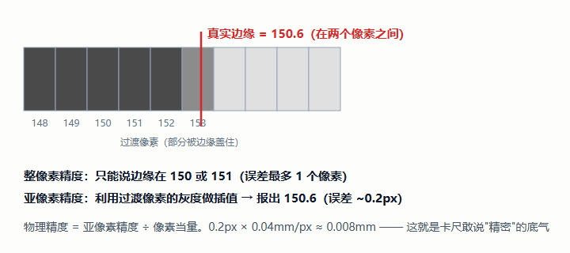

> 精度换算：**物理精度 = 亚像素精度 ÷ 像素当量**。亚像素能做到 0.2px；视野 100mm ÷ 2448px ≈ 0.04mm/px 时，物理精度约 0.008mm——足够大部分工业测量。

### 1.3 像素当量：从"像素"到"毫米"

卡尺量出来先是**像素值**，要变成物理尺寸得乘**像素当量**（mm/px）。本插件有两条路：手填 `PixelSizeMm`，或**直连「标定」插件的 `MmPerPixel` 输出**（推荐，见 8.1 节）。

### 1.4 卡尺比喻

真实车间里工人拿游标卡尺卡住零件读数；视觉里的卡尺是一条**沿某方向扫描的线**，扫过时记下灰度跳变点。本插件更进一步——是**阵列式卡尺**：一个搜索区内自动均布 N 把（默认 5 把），每把找一个边缘点，最后**取平均**抗噪。

---

## 第 2 章 这个插件是干什么的

### 2.1 一句话

**在图像上"拿尺子量尺寸"，量到亚像素精度，并按规格判定 OK/NG。**

### 2.2 ★ 全插件最关键的几何：L1 与 L2

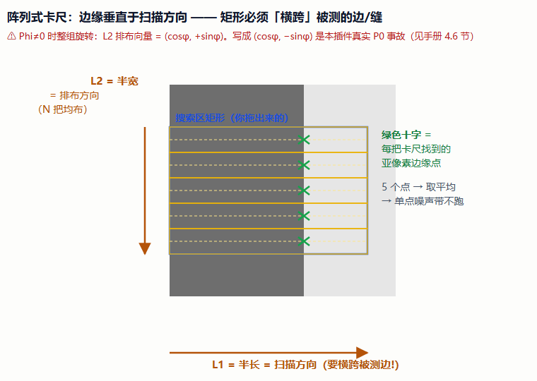

| 方向 | 半轴 | 是什么 | 摆错了会怎样 |
|---|---|---|---|
| **L1（Phi 方向）** | 半长 | **扫描方向**——每把卡尺沿此方向扫描，检出的边缘**垂直于**它 | 扫不到边 |
| **L2（垂直 Phi）** | 半宽 | **卡尺阵列排布方向**——N 把卡尺沿此方向均布 | 每把扫到不同位置，结果是错的 |

> **记忆口诀：矩形要"横跨"被测的边/缝**——L1 与边垂直，L2 沿边方向。实测佐证：`Phi=0` 时把 `L1=100/L2=10` 放在竖直亮带上能测出宽度；把 L1 缩到 10 或把 Phi 转 90° 都检不到边。

### 2.3 五种测量类型

| 类型 | 搜索区 | 算法 | 典型场景 |
|---|---|---|---|
| **宽度/间隙** | 1 个矩形 | `measure_pairs` 直接给双边距离 | 缝隙、线宽、料厚 |
| **两点距** | 2 个矩形 | 各找代表点 → `distance_pp` | 特征间距 |
| **点到线距** | 2 个矩形 | 区2 拟合直线 → `distance_pl` | 垂直度、位置度 |
| **圆直径** | 1 个**圆** | 圆周**径向**均布卡尺 → `fit_circle_contour_xld` | 孔、轴径 |
| **角度** | 2 个矩形 | 各拟合直线 → `angle_ll` → 归一化 0~180° | 夹角、V 形槽 |

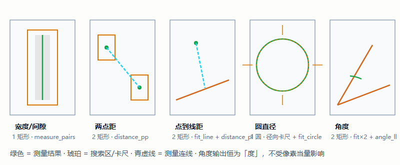

### 2.4 三兄弟分工

| 算子 | 回答的问题 |
|---|---|
| 模板匹配 | "目标**在哪**？"（定位） |
| Blob 检测 | "有没有**缺陷**？"（有无） |
| **卡尺测量** | "这个尺寸**是多少、合不合格**？"（计量） |

---

# 第二部分 视觉算子原理

> 读法：按一次测量的数据旅程排序。每张卡片：**签名 → 直觉 → 源码哪里 → 易错点**，配 SVG 与 HDevelop 截图位。

## 第 3 章 算子卡片集

### 3.1 ★ 核心中的核心：gen_measure_rectangle2

```
gen_measure_rectangle2(Row, Column, Phi, Length1, Length2,
                       Width, Height, Interpolation : MeasureHandle)
```

- **直觉**：把 `[中心行, 中心列, 角度, 半长, 半宽]` + 图像尺寸 + 插值方式，打包成一个**测量句柄**——后面所有找边算子都拿着它干活。
- **易错点 ①**：L1 是**扫描方向**、L2 是**排布方向**（见 2.2 节，本插件最贵的一条经验）。
- **易错点 ②**：中心在图外会抛 `#3022`（英文报错说"滤波核尺寸非法"，人话翻译不了）——插件在进 HALCON 前就用中文报"哪个区、中心在哪、图多大"。
- **源码**：`CreateMeasureHandle()`，`CaliperMeasurePlugin.cs:1371`（phi 约定经探针实证：画布矩形参数**可直接喂给测量算子，无需换算**）。

> 🖼️ **HDevelop 截图位**：
>
> ```hdevelop
> read_image (Image, 'fabrik')
> get_image_size (Image, Width, Height)
> * 矩形横跨一条竖直边缘：L1 沿水平（扫描），L2 沿竖直（排布）
> gen_measure_rectangle2 (250, 350, 0, 100, 60, Width, Height, 'bilinear', Handle)
> * 句柄建好了——下一步拿它找边（见 3.2）
> ```

### 3.2 measure_pos：单边缘找边

```
measure_pos(Image, MeasureHandle, Sigma, Threshold, Transition, Select :
            RowEdge, ColumnEdge, Amplitude, Distance)
```

- **直觉**：沿句柄的扫描方向取一条**灰度剖面**，轻度平滑（Sigma）后，找出所有"跳变幅度超过阈值"的位置——每个位置就是一个**亚像素边缘点**，`Amplitude` 是跳变幅度。

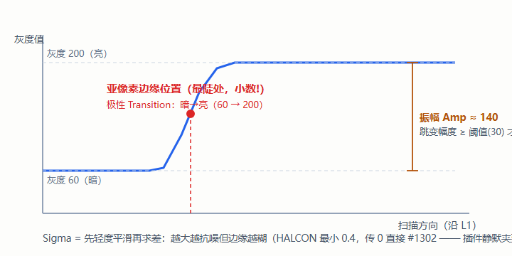

- **参数直觉**：`Sigma` 大=更平滑（抗噪但边缘变糊，**不允许 0**，会抛 `#1302`）；`Threshold` 大=只认明显的边；`Transition` = 极性（暗→亮/亮→暗/全部）；`Select` = 多条边时取第一条/最后一条/全部。
- **源码**：`MeasurePosWithRetry()`，`:1387`——**首跑空结果重试最多 4 次**（HALCON 偶发首跑空，同参第二跑正常；真没边时重试后仍空、仍判失败，语义不变）。

> 🖼️ **HDevelop 截图位**：
>
> ```hdevelop
> read_image (Image, 'fabrik')
> get_image_size (Image, Width, Height)
> gen_measure_rectangle2 (250, 350, 0, 100, 60, Width, Height, 'bilinear', Handle)
> measure_pos (Image, Handle, 1.0, 30, 'all', 'first', RowE, ColE, Amp, Dist)
> * 变量区看 RowE/ColE：小数！这就是亚像素
> close_measure (Handle)
> ```

### 3.3 measure_pairs：成对边缘（测宽度的正解）

```
measure_pairs(Image, MeasureHandle, Sigma, Threshold, Transition, Select :
              Row1, Col1, Amplitude1, Row2, Col2, Amplitude2,
              IntraDistance, InterDistance)
```

- **直觉**：把扫到的边按"第一条+第二条"**配对**——`IntraDistance`（对内间距）就是**缝宽**，`InterDistance` 是相邻两对的间距。
- **与 measure_pos 的分工**：`pos` 找**单边**（两点距/拟合的点来源）；`pairs` 找**对**（宽度/间隙一把卡尺直接出缝宽）。
- **源码**：插件统一取第一条配对的 `intra[0]`；`MeasurePairsWithRetry()`，`:1401`。

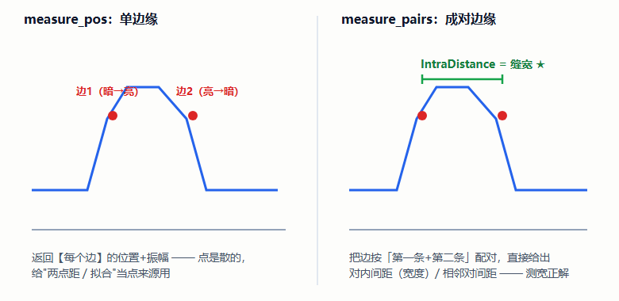

> 🖼️ **HDevelop 截图位**：
>
> ```hdevelop
> read_image (Image, 'fabrik')
> get_image_size (Image, Width, Height)
> gen_measure_rectangle2 (250, 350, 0, 100, 20, Width, Height, 'bilinear', Handle)
> measure_pairs (Image, Handle, 1.0, 30, 'all', 'all',
>                R1, C1, A1, R2, C2, A2, IntraDist, InterDist)
> * IntraDist[0] = 缝宽（像素）
> close_measure (Handle)
> ```

### 3.4 鲁棒拟合：fit_line_contour_xld / fit_circle_contour_xld

- **直觉**：N 把卡尺给出 N 个边缘点，用一条直线/一个圆去"最贴合"它们。**毛刺会产生离群点**——最小二乘会被一个坏点拽歪整条线，所以默认 **Tukey**（对残差超限的点大幅降权）。
- **实测对比**：12px 毛刺下 `tukey=196.5`（真值 196.5）vs `regression=191.092`。

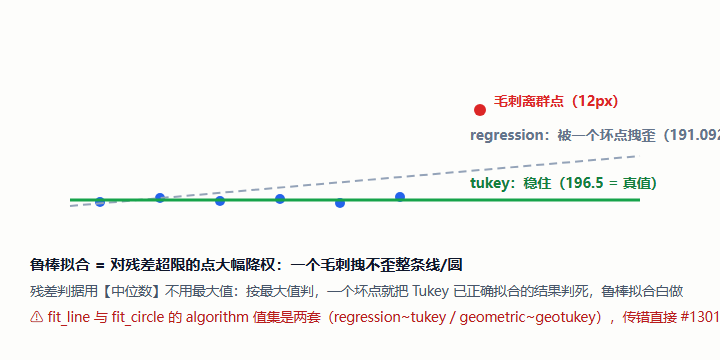

- **⚠️ 高频坑（两套值集）**：

| 算子 | algorithm 合法值 |
|---|---|
| `fit_line_contour_xld` | `regression` / `huber` / `tukey` |
| `fit_circle_contour_xld` | `geometric` / `geohuber` / `geotukey` |

  传错直接 `#1301`（真实 P1 事故，已按语义映射修复）。
- **残差判据用中位数不用最大值**：按最大值检查，一个毛刺就把 Tukey 已正确拟合的结果判死，鲁棒拟合白做。
- **源码**：`TryFitLine()` / `TryFitCircle()`，`:1503` / `:1610`。

> 🖼️ **HDevelop 截图位**：
>
> ```hdevelop
> * 造一列带一个离群点的边缘点，对比两种拟合
> gen_contour_polygon_xld (Poly, [100,120,140,160,180, 200+12], [200,200,200,200,200, 200])
> fit_line_contour_xld (Poly, 'regression', -1, 0, 5, 2.0, RB1, CB1, RE1, CE1, N1, NC1, D1)
> fit_line_contour_xld (Poly, 'tukey',     -1, 0, 5, 2.0, RB2, CB2, RE2, CE2, N2, NC2, D2)
> * 对比两条线的角度——regression 被拽歪了
> ```

### 3.5 圆直径：径向均布卡尺 + 退化判据

- **直觉**：沿圆周均布 N 把卡尺，**每把的扫描方向 = 该点的径向**；扫出的点拟合成圆，直径 = 2×半径。
- **环宽 `AnnulusWidth`**（默认 30px）：每把卡尺沿半径方向扫描的总宽度（±15px 容差）——圆心位置有误差时靠它兜住。
- **几何陷阱**：圆周上角 a 处的点 = `(R + r·sin a, C + r·cos a)`，径向向量 `(sin a, cos a)`，而 HALCON 长轴 = `(−sinφ, cosφ)` → **要 φ = −a**（官方文档案例 4）。
- **退化判据**（真实 P1 事故）：3 个共线点配鲁棒算法会**不报错**地收敛到一个"贴住少数点的小圆"（实测 r≈31px）。插件判据：**拟合圆直径 < 点集跨度的 60% → 判退化报错**。

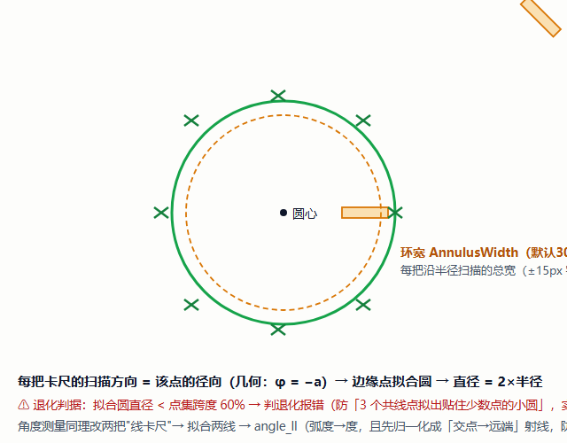

- **源码**：`CollectCircleEdgePoints()`，`:1446`。

> 🖼️ **HDevelop 截图位**：跑官方文档附录 C 案例 4（`gen_measure_rectangle2(row, col, -a, ...)` 循环 + `fit_circle_contour_xld(..., 'geotukey', ...)`），贴运行结果。

### 3.6 三个几何量算子：distance_pp / distance_pl / angle_ll

- `distance_pp`：两点距（两点距测量用）。
- `distance_pl`：点到线距（垂距；区1 代表点到区2 拟合直线）。
- `angle_ll`：两线夹角——**返回弧度**，代码 ×180/π；且要先把两条线**归一化为"交点→远端"射线**再求角，否则会把 150° 报成 −30°（补角歧义，已修：实测 30°/90°/150° → 29.91°/90°/150.1°）。
- **角度不受像素当量影响**（量纲无关量，单位是度）——这条区分容易写错。

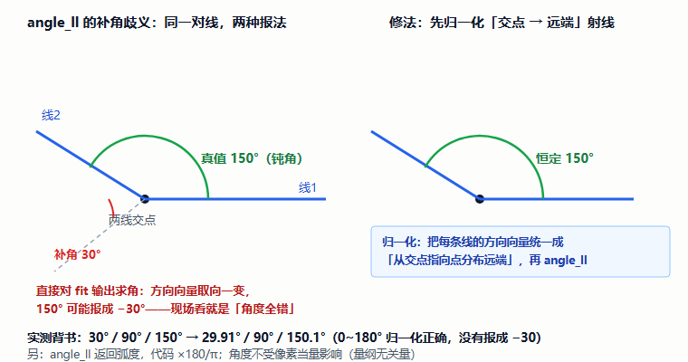

> 🖼️ **HDevelop 截图位**：
>
> ```hdevelop
> angle_ll (100, 100, 200, 100,   100, 100, 200, 200, AngleRad)
> AngleDeg := abs(AngleRad) * 180.0 / 3.14159265358979
> * AngleDeg 应为 90 —— 直接对 fit 输出求角可能得 -30，先归一化再求
> ```

### 3.7 close_measure：句柄的"还尺子"

- ⚠️ **算子名是 `close_measure`，不存在 `clear_measure`**——写错直接编译/运行报错（官方踩坑汇编 #5）。
- HALCON 的 measure 句柄、XLD、图像都是**非托管资源**：不释放 = 泄漏。本插件实测教训：`gen_*_contour_xld` 产出的**源对象**不释放，500 次约漏 160MB（HALCON .NET 是引用计数语义，包装成 `HXLDCont` 后要立刻释放源对象）。

---

# 第三部分 设计思路

## 第 4 章 六个设计决策（每条都有真实事故佐证）

> 卡尺是**计量**插件，它的设计规矩比别的插件更"死"——因为计量的第一戒律是：**宁可报错，不可给一个错误但看起来合理的数**。

### 4.1 阵列取平均：单点噪声带不跑结果

一个搜索区内自动均布 N 把卡尺（默认 5），每把各找一个边缘点取平均。均布数学（源码 `DistributeCalipers()`，`:1316`）：

```
spacing   = 2·L2 / N                     —— 把整段 L2 等分 N 份
halfWidth = max(spacing/2, 0.5)          —— 每把半宽，正好铺满不重叠
第 i 把中心 = 中心 + t·(cosφ, +sinφ)，t = −L2 + spacing·(i+0.5)
```

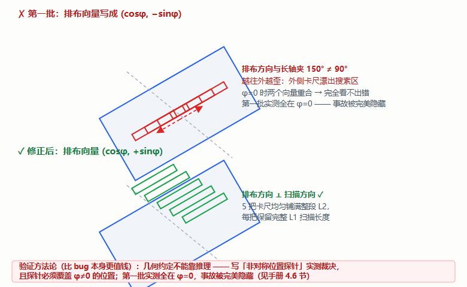

### 4.2 必须全部检出：杜绝"错误但不出错"

**只要有一把卡尺找不到边就判失败**，不把检到的几把平均出个"看似合理"的数。官方文档原话：把错误结果平均得"看似合理"是**计量最危险的失败模式**（错误但不出错）。宁可报错让用户调参数。

### 4.3 静默夹取 + 中文报错：配置坏了不炸流程

所有越界参数进 HALCON 前**静默夹取**（`NormalizedParameters()`，`:1763`）：`Sigma` 夹到 0.4~100（0 会抛 `#1302`）、阈值 1~255、卡尺数 1~1000、公差 ±1e9……同时搜索区越界不再抛英文 `#3022`，而是提前**中文报出"哪个搜索区、中心在哪、图多大"**。原则：**配置坏了最多结果不对，绝不炸流程；报错必须能指导操作。**

### 4.4 零容忍默认：安全侧默认，宁严勿松

`StandardValue/UpperTolerance/LowerTolerance` 默认全 0——通用平台算子**不该假装知道产品规格**。用户看到默认即 NG，立刻意识到"该填标准值与公差了"。（与 BlobDetect 的 `MaxDefectCount=0` 同一风格。）

### 4.5 配置态守卫：预览只在配置态跑

宿主会给"打开配置界面"和"正式运行"各造一个实例，`_isConfigInstance`（`MarkAsConfigInstance()`，`:692`）把预览限制在配置态。历史 P0：运行实例也跑预览 → ① 产线每帧白烧 CPU（N 把卡尺+拟合+离屏渲染）；② 流程线程与 UI 线程互抢同一扇离屏渲染窗口；③ 每帧 new 一张标注图随即丢弃，内存抖动。

### 4.6 真实事故：L2 均布向量算错（最隐蔽的几何 bug）

第一批把卡尺排布方向的单位向量写成 `(cosφ, −sinφ)`——它与真实长轴 `(−sinφ, cosφ)` 的点积 = `−2sinφcosφ ≠ 0`，**φ≠0 时排布方向根本不垂直于扫描方向**。第一批实测全在 `Phi=0`，暴露不出来；第二批用"非对称位置探针"裁决后改为 `(cosφ, +sinφ)`。

> **教训（写进了官方文档）**：几何约定不能靠推理，必须写**探针实测**来裁决，且探针要覆盖 `φ≠0` 的非对称位置。

### 4.7 附：标量端口的"镜像 bug"

基类的轮首回收只处理 `IDisposable`（HImage/HXLD），`double`/`bool` 端口的上一轮值会**原样留下**——本轮失败时下游读到上一轮的 `MeasureValue/IsOk`。修法：`RunAlgorithm` 开轮显式重置三个标量端口。**极易漏的镜像 bug**，写自己的插件时记得这一条。

---

# 第四部分 源码走读

## 第 5 章 代码地图

### 5.1 文件清单（`Plugins/Plugin.CaliperMeasure/`）

| 文件 | 职责 |
|---|---|
| `CaliperMeasurePlugin.cs` | **核心**（1936 行）：端口、配置、算法、预览、判定 |
| `CaliperEnums.cs` | 5 个枚举 + `StatusLevel` |
| `AnnotationRenderer.cs` | 离屏窗口标注渲染（黄=卡尺、青=连线、品红=拟合、绿=边缘点） |
| `Models/CaliperRegion.cs` | 搜索区模型 + 参数微调行 |
| `CaliperMeasureView.xaml` | 配置界面（537 行，左参数右画布） |

### 5.2 关键方法索引

| 方法 | 位置 | 一句话 |
|---|---|---|
| `RunAlgorithm()` | :833 | 开轮重置标量端口 → 测量 → 端口赋值 |
| `ExecuteMeasureCore()` | :977 | **算法核心**：五种测量分派 + 渲染 + finally 释放 |
| `DistributeCalipers()` | :1316 | 卡尺沿 L2 轴均布（P0 修正点） |
| `CreateMeasureHandle()` | :1371 | 建测量句柄（phi 约定探针实证） |
| `MeasurePosWithRetry()` / `MeasurePairsWithRetry()` | :1387 / :1401 | 找边 + 首跑空重试 |
| `CollectCircleEdgePoints()` | :1446 | 圆周径向均布卡尺 |
| `TryFitLine()` / `TryFitCircle()` | :1503 / :1610 | 拟合（含退化判据） |
| `NormalizedParameters()` | :1763 | 静默夹取 |
| `EnsureRequiredRegions()` | :562 | 搜索区"只增不减"补齐 |
| `MarkAsConfigInstance()` / `RefreshPreview()` | :692 / :749 | 配置态守卫 / 预览与运行共用核心 |

### 5.3 一次测量的完整链路

```
RunAlgorithm (:833)
  ├─ 开轮重置 MeasureValue/Deviation/IsOk（防脏值）
  ├─ ExecuteMeasureCore (:977)
  │    ├─ NormalizedParameters (:1763)   静默夹取
  │    ├─ 按 MeasureKind 分派五种测量
  │    │    ├─ 宽度: measure_pairs → intra[0]
  │    │    ├─ 两点距: pos×2 → 代表点 → distance_pp
  │    │    ├─ 点线距: 拟合直线 → distance_pl
  │    │    ├─ 圆直径: 径向卡尺 → fit_circle → ×2
  │    │    └─ 角度: 拟合两线 → 归一化 → angle_ll
  │    ├─ 任一卡尺未检出 → 整体失败（必须全部检出）
  │    └─ AnnotationRenderer 出标注图（离屏窗口缓存+加锁）
  └─ finally 统一释放（源对象引用计数）
```

### 5.4 端口总表

| 端口 | 方向 | 类型 | 说明 |
|---|---|---|---|
| `SrcImage` | 入 | HImage | 待测图 |
| `MmPerPixel` | 入 | double | **像素当量直连口**（接标定插件；上游无效 → 明确失败，不静默回退） |
| `MeasureValue` | 出 | double | 测量值（已乘当量） |
| `Deviation` | 出 | double | 偏差（带符号） |
| `IsOk` | 出 | bool | 判定（NG **不算**执行失败） |
| `MeasureImage` | 出 | HImage | 标注图 |
| `FittedGeometry` / `EdgePoints` | 出 | HXLD | 拟合几何 / 边缘点十字 |

> N 把卡尺**不生成 N 个端口**：合成一个 HXLD 对象集交出去——端口数量恒定，改卡尺数不会弄断下游连线。

---

# 第五部分 操作与排障

## 第 6 章 上手七步 + FAQ

界面两列：左参数（①测量类型 ②搜索区与卡尺 ③找边 ④拟合 ⑤判定与标定）、右标注图（同时是拖拽画布）。

1. **接图**：上游图像连 `SrcImage`；
2. **选类型**：左栏①（下方灰字提示需要几个搜索区）；
3. **摆搜索区**（最关键）：右键新建矩形，**横跨**被测边/缝（L1 ⊥ 边，L2 沿边）；
4. **调卡尺数**：默认 5，求稳调大、省时调小；
5. **调找边**：默认 `Sigma=1.0 / Threshold=30 / 极性=全部`；
6. **填规格**：标准值 + 上下公差（可负数做非对称公差）+ 像素当量（有标定就直连）；
7. **看标注图**：黄卡尺 / 绿十字边点 / 青测量连线 / 品红拟合几何，左上角三行文字。

**排障速查**（完整见官方文档 3.4/3.6 节）：

| 现象 | 排查 |
|---|---|
| 报"某卡尺未检出边缘" | ① L1 没横跨边 ② 阈值太大 ③ 极性反了 ④ 那里真没边 |
| 结果抖动 | 调大 CaliperCount / Sigma |
| 拟合被毛刺带歪 | 确认 FitAlgorithm=Tukey，调大 FitMaxError |
| 圆测成奇怪小圆 | 点集退化——卡尺数调多、搜索区压准圆周 |
| 角度报 −30° | 已修（0~180° 归一化）；确认两区压在**相交**的边上 |
| 默认一上来就 NG | 正常！零容忍默认在提醒你填规格 |

---

# 第六部分 验收

## 第 7 章 自检十题 + 审查记录

**自检**（答案指向章节）：

1. L1 和 L2 各是什么方向？摆反了会怎样？（2.2）
2. 为什么边缘位置能是 150.6 这样的数？（1.2）
3. `measure_pos` 和 `measure_pairs` 各返回什么、各用在哪？（3.2/3.3）
4. `Sigma=0` 会发生什么？插件怎么处理？（3.2 / 4.3）
5. 为什么拟合默认 Tukey 而不是最小二乘？残差判据为什么用中位数？（3.4）
6. 为什么有一把卡尺找不到边就整体失败，而不是平均剩下的？（4.2）
7. 默认规格全 0 是 bug 吗？为什么这么设计？（4.4）
8. `fit_circle_contour_xld` 的算法值集和 `fit_line` 一样吗？（3.4）
9. 角度测量要乘像素当量吗？为什么？（3.6）
10. 释放测量句柄的算子叫什么？（3.7）

**审查记录与已知边界**：

- ⚠️ **`FlowCanvasChecks/` 没有卡尺断言文件**（官方文档明确记录：验证靠仓库外临时控制台完成、已删除不可复现）。官方建议把真值固化成断言：宽度 40.0 / 两点距 220.0 / 点线距 196.5 / 圆直径 200 / 角度 30-90-150——**这是本手册读者将来可以练手贡献的第一件事**；
- 搜索区只支持矩形（圆直径用圆），其它形状运行期报错；
- 拟合参数区仅拟合类显示；环宽仅圆直径有意义；
- 角度恒输出"度"，不受当量影响。

---

# 第七部分 应用实例篇：拿到任务怎么想

> 前面学的是"算子怎么用"，这一章学"工程师怎么想"。四个实例按真实工作流展开，重点看每一步的**为什么**——参数可以查表，思路只能长在脑子里。

## 第 8 章 应用实例：从需求到验收

### 8.0 思路框架：先问四个问题

拿到任何测量任务，**先别拖卡尺**，先回答——答案会自动把你引到正确的算子和配置上：

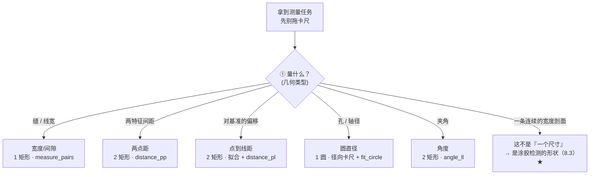

| 问题 | 决定什么 | 去哪找依据 |
|---|---|---|
| **① 量什么？** | 测量类型 + 搜索区数量 | 2.3 节五类型 |
| **② 多准？** | 公差 ÷ (4~10) = 允许的像素当量 → 镜头/视野/要不要标定 | 9.1 节 |
| **③ 动不动？** | 产品位置角度稳不稳 → 要不要先定位（匹配/跟随） | 9.2 节 |
| **④ 判什么？** | 标准值/公差/NG 后干什么 → 判定配置 + 下游接线 | 4.4 节 |

### 8.1 实例一：测垫片缝隙宽度（最短路径，先跑通一遍全流程）

**任务**：缝隙宽 2.00±0.05mm，节拍 200ms/件。

**思路链（每一步一个"为什么"）**：

1. **量什么** → 宽度 → `measure_pairs` 一把卡尺直接出 `IntraDistance`，连拟合都不用；
2. **多准** → 公差 ±0.05mm → 当量做到**公差的 1/4~1/10 ≈ 0.005~0.012mm/px**。查镜头：视野 100mm ÷ 2448px ≈ 0.04mm/px → **不够！** 把视野收窄到 20mm → 2448px → 0.008mm/px ✓（这就是"先算精度预算再选镜头"，反过来先拍完再算当量是新手最贵的返工）；
3. **动不动** → 工位有定位销、位置稳 → **不做定位**，固定搜索区（省掉一整个模板匹配节点——过度设计也是设计错误）；
4. **判什么** → `StandardValue=2.00`、公差 ±0.05、当量直连标定插件（9.1 节）；
5. **摆卡尺** → L1 ⊥ 缝（横跨）、L2 沿缝、N=5；
6. **打光先想** → 缝底反光会淹没边缘 → 低角度光让"缝=暗线、面=亮背景"，把跳变幅度拉满（阈值才有余量）。

**失败模式预演**（上线前自己先问一遍）：边缘太弱（Threshold ↓）／极性选反（明确成单向）／毛刺干扰（pairs 不走拟合——靠极性和 Select 过滤）／节拍不够（CaliperCount ↓，但**别**牺牲"必须全部检出"）。

**验收三步**（做完才叫"能上线"）：标准件实测对真值 → 重复 20 次看 σ（重复精度）→ 上/下公差边界各测一次看判定翻转。

### 8.2 实例二：测孔径（圆直径的坑位清单）

**思路链**：圆环搜索区**压在孔边缘**上（圆心估计误差必须 ≤ 环宽/2，否则部分卡尺扫不到边）→ 卡尺数 12~16（圆周均布，抗局部脏污）→ 极性按孔的明暗定 → `geotukey` 拟合 → 直径 = 2R。

**专属坑位**：

| 坑 | 现象 | 解法 |
|---|---|---|
| 圆心估计偏出环宽 | 报"某卡尺未检出" | 环宽加大或圆心摆准——**不是**关掉"必须全部检出" |
| 点集退化（共线/过扁） | 拟出一个贴住少数点的小圆 | 插件判据拦截（直径 < 跨度 60%）→ 保证卡尺数、压准圆周 |
| 孔口倒角/毛刺 | 一把卡尺扫出两条边 | `Select` 选对的那条 + 极性过滤 |
| 孔贴近视场边缘 | 报错 | 拖离边缘 / 缩小半径 / 减环宽 |

**验收**：标准环规（已知直径）实测 → 换 3 个方位摆圆环看结果一致性。

### 8.3 实例三 ★：涂胶检测——把"宽度"用成"一条剖面"

**任务**：胶路三连问——**断没断（no bead）？宽窄合格吗（too thin / too thick）？在槽里吗（incorrect position）？**

**思路推演（本章灵魂，慢慢读）**：

1. 胶路是一条**连续曲线**——"量一个尺寸"不够用了。换个视角：把它看成**一列宽度**——沿胶路**法线方向**、每隔 d mm 摆一把卡尺，得到**宽度序列** w₁…w_N；
2. **断胶** = 序列里某处宽度≈0 或无边缘 → 不但知道"断了"，还知道**断在第几毫米**（Blob 只能说"有缺陷"，序列能说"断在 37mm 处"）；
3. **宽窄** = 每个 wᵢ 是否落在 [2.0±0.2]mm → 逐点判定；
4. **偏移** = 每把卡尺扫出的胶**中心点**连成线，与槽中心基准线比 → 逐点 `distance_pl`；
5. **采样间距 d 由需求倒推**：要检出最小 0.8mm 的断胶 → d ≤ 0.4mm → 卡尺数 = 胶长 ÷ d（30mm 胶路要 75 把！）。

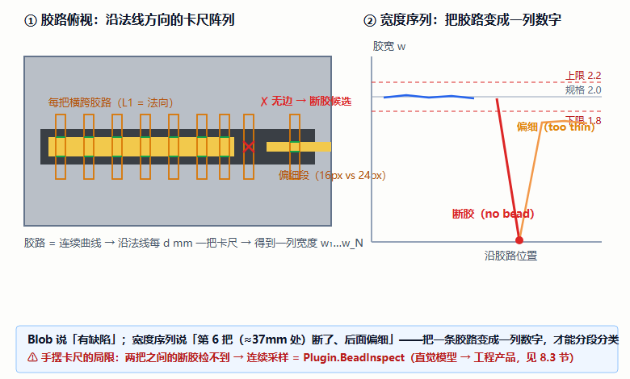

**推演到这里会撞一堵墙（重要的工程边界，值得停下来体会）**：手摆 75 把卡尺不现实，而且**两把卡尺之间的断胶根本检不到**——这正是仓库另做 `Plugin.BeadInspect`（胶路检测）的原因：给一条**参考路径曲线**，让算法沿整条线**连续采样**，直接输出分段分类（`no bead / too thin / too thick / incorrect position`）。

> **直觉模型 → 工程产品**：卡尺序列是理解涂胶检测的**心智模型**，BeadInspect 是它的**连续版产品化**（HALCON `create/apply_bead_inspection_model`；极性只能 dark/light 二选一；且要求图像先与参考位姿**对齐**——对齐是前置职责）。学完思路再读 `docs/胶路检测/胶路检测插件方案说明书.md`，会发现它的方案论证第一段就是在讲"卡尺范式为什么不够用"——你会全程眼熟。

**和 Blob 的分工**（涂胶检测的核心区分）：Blob 给"有无/面积/位置"——胶断成两段它能数出 2 个区域，但"**细而未断**"它看不见；宽度序列逐点量化，**能区分"细"和"断"**。

### 8.4 实例四：测量引导（量偏移 → 补偿运动）

**任务**：来料位置飘 ±2mm，机构要对准产品特征。

**思路链**：`模板匹配` 粗定位（Row/Column/Angle）→ 数学计算算偏移 Δ = 实测 − 标准 → 变量赋值 → 轴运动。**卡尺的角色**：匹配精度不够时的**二次精测**——对特征边再做一次亚像素测量，把偏移量从"匹配级精度"提到"测量级精度"。接线范式见《工具插件集》附录 A 接线②；位姿从哪来见《模板匹配手册》第 8 章。

### 8.5 实例篇自检四题

1. 公差 ±0.02mm，当量该做到多少？（公差的 1/4~1/10 → ≤0.002~0.005mm/px——先算预算再选镜头）
2. 涂胶检测为什么用"宽度序列"而不用 Blob 面积？（能区分"细"和"断"、能报断点位置）
3. 最小要检出 0.8mm 的断胶，采样间距怎么定？（≤0.4mm；卡尺数 = 胶长 ÷ 间距）
4. 圆测量报"某卡尺未检出"，除了调参数还可能是什么？（圆心估计偏出环宽 / 局部脏污——**不是**关"必须全部检出"）

---

# 第八部分 扩展篇：从一次测量到一套测量系统

## 第 9 章 量完之后呢

### 9.1 像素当量的正解：直连标定

手填 `PixelSizeMm` 是兜底；正解是把「标定」插件的 `MmPerPixel` 输出**直连**本步骤 `MmPerPixel` 端口——免手抄、随标定自动更新，且**标定失败时本步骤明确失败**（不拿旧值硬算——又是"错误但不出错"戒律的体现）。衔接：`docs/标定插件/`。

### 9.2 先定位再测量

产品位置不固定时：`模板匹配.Row/Column/Angle` → ROI 跟随 / `AlignedImage` 归一化图 → 卡尺 `SrcImage`。两条路线的选型（原始坐标 / 归一化图 / 跟随区域）见《模板匹配插件手册》扩展篇。

### 9.3 两条找边路线对比

| | measure 句柄族（本插件） | edges_sub_pix 轮廓族 |
|---|---|---|
| 模型 | 沿矩形/圆环**定向扫描** | 全图提取亚像素轮廓再筛选 |
| 强项 | 参数少、方向可控、配对测距顺手 | 任意形状边缘、可后续拟合任意几何 |
| 本插件选择 | ✅ 全部走句柄式 | 明确未使用（官方文档 2.5 节列明） |

### 9.4 自检三题

1. 标定失败时卡尺为什么"明确失败"而不是用上次当量？（9.1 + 4.2 同一戒律）
2. 一个零件要量 3 个尺寸，怎么搭？（3 个卡尺节点——一个步骤测一个尺寸）
3. `edges_sub_pix` 什么场景比 measure 族合适？（9.3）

### 9.5 仓库落点与延伸

- 官方文档：`docs/卡尺测量/卡尺测量插件.md`（附录 C 有 6 个可跑的 HDevelop 案例）
- 上游：`docs/图像预处理/`（洗图让边缘更稳）、`docs/创建ROI/`（限域）
- 搭档：`docs/标定插件/`（当量）、`docs/模板匹配/`（定位）

---

## 附录 A 术语表

| 术语 | 一句话 |
|---|---|
| 卡尺 | 沿某方向扫描检测灰度跳变的"尺子" |
| 亚像素 | 比一个像素更细的精度（靠灰度插值） |
| L1 / L2 | 扫描方向 / 卡尺阵列排布方向（**本插件第一坑**） |
| 极性 | 边是"暗→亮"还是"亮→暗" |
| 像素当量 | mm/px，像素换物理尺寸的系数 |
| 鲁棒拟合 | 对离群点降权（Tukey/Huber），防一个坏点拽歪结果 |
| IntraDistance | measure_pairs 的对内间距 = 缝宽 |
| 环宽 | 圆直径测量时每把卡尺沿半径扫描的总宽 |
| 零容忍默认 | 规格默认 0，见 NG = 提醒填规格 |
| 静默夹取 | 越界参数夹回合法区间，配置坏了不炸流程 |
| 配置态/运行态 | 预览只在前者跑（`_isConfigInstance`） |
| measure 句柄 | gen_measure_rectangle2 的产物，用完 `close_measure` |

## 附录 B 延伸阅读

- 官方完整文档：`docs/卡尺测量/卡尺测量插件.md`（第 4 章 13 条真实修复、附录 C 六个 HDevelop 案例、5.5 节实测真值表）
- 前置：《区域创建ROI插件手册》（同目录——L1/L2/Phi 与 ROI 的矩形同源）
- 搭档：`docs/标定插件/`、`docs/模板匹配/`、`docs/图像预处理/`

## 附录 C 学习进度追踪

**📖 阅读进度**

- [ ] 第 1 章 边缘与亚像素
- [ ] 第 2 章 卡尺几何（L1/L2 ★）
- [ ] 第 3 章 算子卡片 3.1~3.4（句柄 → 找边 → 配对 → 拟合）
- [ ] 第 3 章 3.5~3.7（圆直径 / 几何量 / 释放）
- [ ] 第 4 章 六个设计决策
- [ ] 第 5 章 源码走读（均布数学）
- [ ] 第 6 章 上手 + 排障
- [ ] 第 8 章 应用实例篇（思路框架 + 涂胶思路★）
- [ ] 第 9 章 扩展篇

**🖼️ HDevelop 截图**

- [ ] 3.1 建句柄 ｜ [ ] 3.2 measure_pos 亚像素 ｜ [ ] 3.3 measure_pairs 缝宽
- [ ] 3.4 Tukey vs regression ｜ [ ] 3.5 径向卡尺拟合圆 ｜ [ ] 3.6 角度 90° ｜ [ ] 3.7 close_measure

**🎓 毕业验收**

- [ ] 自检十题 ≥ 8 ｜ [ ] 实例篇四题 + 扩展篇三题全对 ｜ [ ] 动手：在 VisionMaster 搭「采集→卡尺(宽度)」测出标准件宽度

**版本记录**

| 版本 | 变更 |
|---|---|
| v1.0 | 初版：六部分 + 自检十题 + 审查记录（按 ROI 手册 v1.4 模板） |
| v1.1 | 新增**第七部分应用实例篇**（思路框架 + 缝隙/孔径/涂胶★/引导四实例 + SVG 08）；原扩展篇顺延为第八部分/第 9 章 |
| v1.2 | 新增 SVG 09（均布向量对比：P0 事故可视化）与 SVG 10（角度归一化） |

---

*本手册为学习用重排版（v1.1，2026-10-11），与官方文档冲突时以官方文档与源码为准。内嵌 8 张示意图——**已渲染为 PNG**（`images/` 目录同名 `.png`，SVG 源文件保留可再改）+ 7 处 HDevelop 截图位；涂胶实例与仓库 `Plugin.BeadInspect` 方案说明书（`docs/胶路检测/`）交叉校验。*
