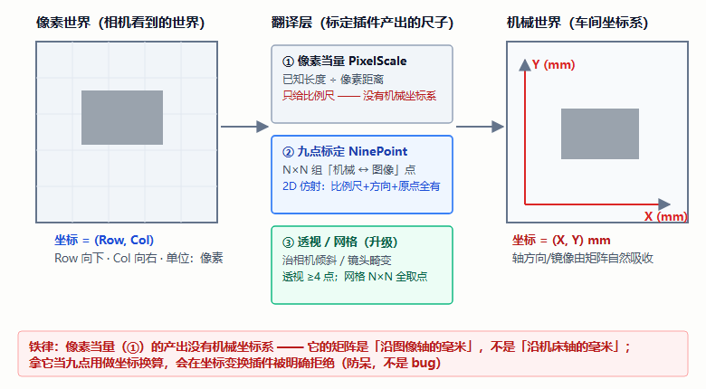
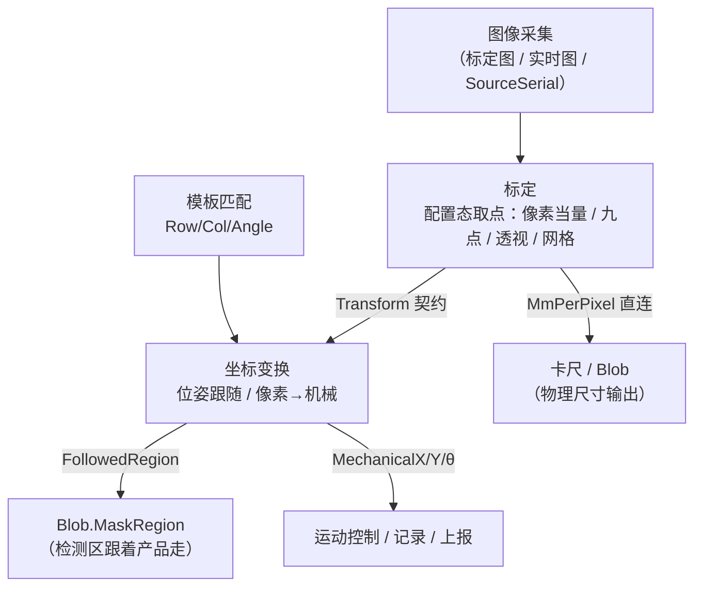
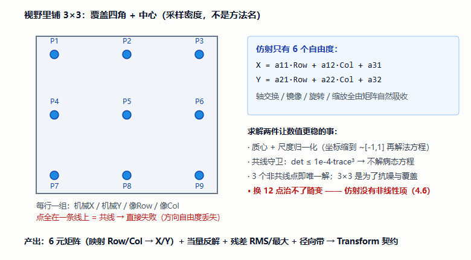
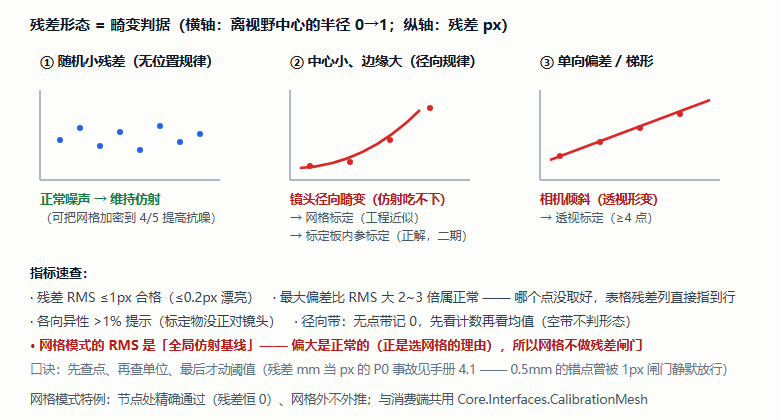
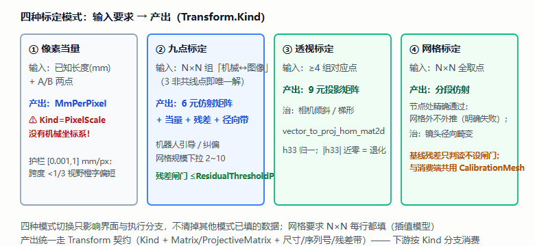
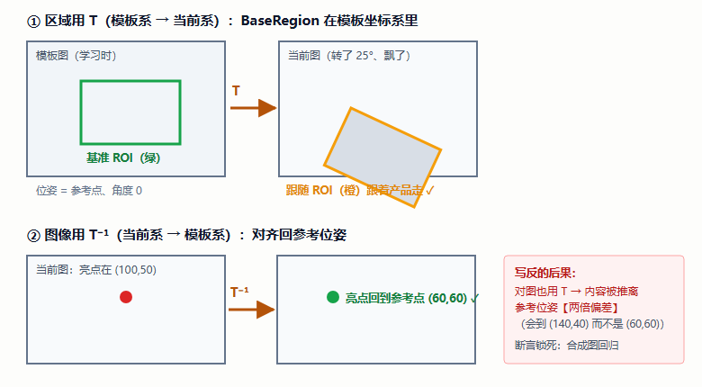
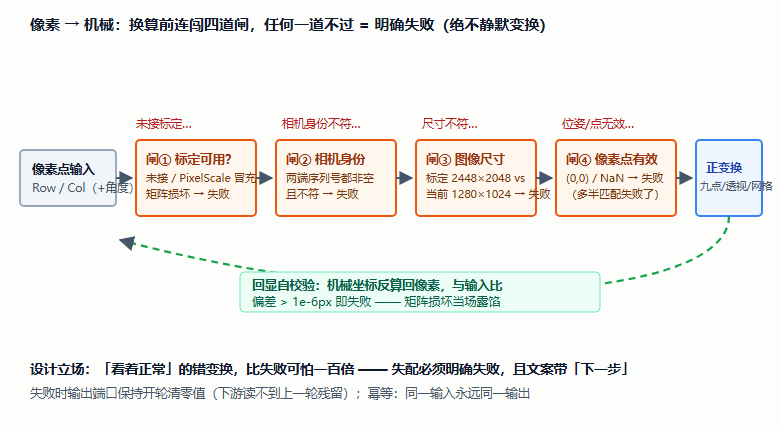
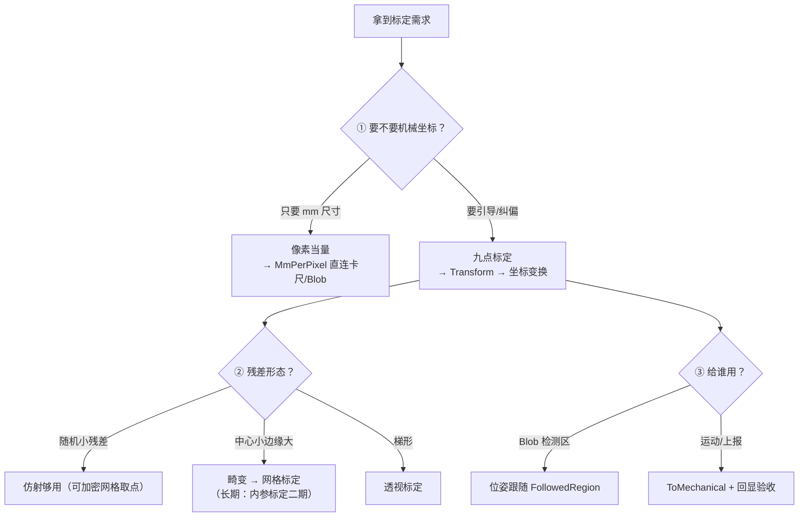
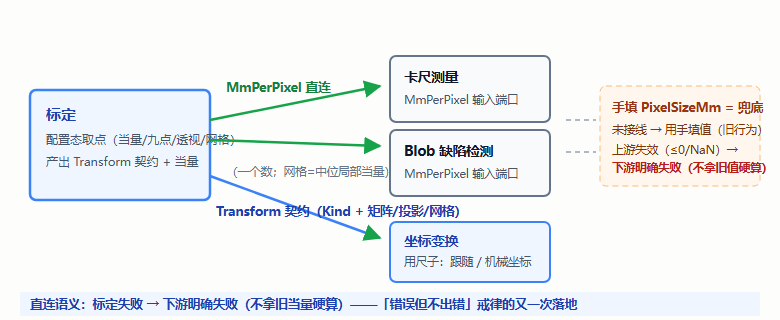

# 标定与坐标变换插件手册 —— 零基础学习版（标定 × 坐标变换）

> **这本手册为谁而写**：不了解视觉算子、不了解设计思路，想通过「标定 + 坐标变换」这对搭档学会"像素怎么翻译成毫米/机械坐标"以及"为什么标定插件对'失败'这么偏执"的人。
> **覆盖插件**：`Plugin.Calibration`（标定）与 `Plugin.PoseTransform`（坐标变换）——前者**造尺子**（产出 `Transform` 契约），后者**用尺子**（消费 Transform 变出机械坐标/跟随 ROI）。
> **依据**：官方文档 `docs/标定插件/标定插件.md`（767 行）与 `docs/坐标变换插件/坐标变换插件.md`（547 行）逐节交叉校验，行号引自其源码索引。断言：`[CAL]` 57 条 + `[PT]` 62 条。
> **版本**：v1.0（2026-10-11）。同系列模板：SVG 真值图 + HDevelop 截图位 + 应用实例篇 + 单文件 HTML。

---

## 目录

- **第一部分 预备知识**：第 1 章 为什么要标定 ｜ 第 2 章 两个插件怎么分工
- **第二部分 视觉算子原理**：第 3 章 算子卡片集（7 组 · 配 SVG 真值图与 HDevelop 截图位）
- **第三部分 设计思路**：第 4 章 八个设计决策
- **第四部分 源码走读**：第 5 章 代码地图与共享契约
- **第五部分 操作与排障**：第 6 章 上手 + 现场三步验收
- **第六部分 验收**：第 7 章 自检十二题 + 审查记录
- **第七部分 应用实例篇**：第 8 章 拿到标定任务怎么想（当量 / 引导★ / 跟随 / 畸变排障）
- **第八部分 扩展篇**：第 9 章 接进知识链
- 附录 A 术语表 ｜ 附录 B 延伸阅读 ｜ 附录 C 学习进度追踪

---

## 阅读地图

| 你的目的 | 走这条路 |
|---|---|
| 只想会用：标个当量 / 做一次九点 | 直接读 **第 6 章**，卡住再回头查 |
| 想懂原理：仿射/残差/畸变升级路线 | **第 1 → 2 → 3 章** |
| 想懂设计：为什么标定对"失败"这么偏执 | **第 4 章**（残差 mm 当 px 的 P0 是全书之眼） |
| 想读懂源码 | **第 5 章**（共享契约 CalibrationTransform / CalibrationMesh） |
| 检验学没学会 | **第 7 章**（自检十二题） |
| 想学「拿到任务怎么想」 | **第 8 章 应用实例篇**（当量 / 引导★ / 跟随 / 排障） |
| 想继续进阶 | **第 9 章**（扩展篇：接进知识链 + 内参标定二期） |

---

# 第一部分 预备知识

## 第 1 章 为什么要标定：两个世界的翻译官

### 1.1 像素世界 vs 机械世界

相机看到的世界以**像素**计（Row 向下、Col 向右），机械手生活的世界以**毫米**计（X/Y，轴方向随意摆）。中间隔着一层翻译：**比例尺 + 旋转 + 平移（+ 畸变）**。

> 比喻：地图上的距离是"手指几厘米"，实际是"几公里"——中间要有**比例尺**；要让机械手去地图上某点抓东西，还得知道地图的"北"对着车间哪边、地图原点对应机床哪个坐标。**标定就是量这把尺子；坐标变换就是用这把尺子翻译。**

### 1.2 三条翻译路线（按需求升级）

| 路线 | 你要准备什么 | 得到什么 | 能回答 |
|---|---|---|---|
| **像素当量**（PixelScale） | 一张图 + 一段已知长度 | `mm/px`（一个数） | "这个缺陷有几毫米大" |
| **九点标定**（NinePoint，2D 仿射） | N×N 组「机械坐标 ↔ 图像点」 | 6 元矩阵（含当量/方向/原点） | "这个像素点在机械系哪里"——机器人引导 |
| **透视 / 网格**（升级路线） | 透视 ≥4 点；网格 N×N 全取点 | 投影矩阵 / 分段仿射 | 相机倾斜 / 镜头畸变 |



### 1.3 一条铁律先记住

**PixelScale 的产出没有机械坐标系**（它的矩阵是"沿图像轴的毫米"，不是"沿机床轴的毫米"）——拿它当九点用，会在下游坐标变换被**明确拒绝**（这不是 bug，是防呆）。

---

## 第 2 章 两个插件怎么分工

### 2.1 一句话

**标定 = 造尺子**（配置态取点 → 产出 `Transform` 契约 + `MmPerPixel`）；**坐标变换 = 用尺子**（运行期拿位姿/像素点，翻译成跟随 ROI 或机械坐标）。

### 2.2 全链数据流



### 2.3 端口速览

**标定**（5 入 4 出）：入 `SourceImagePath / SourceImage / SourceSerial / SourcePointRow/Col`；出 `Transform`（契约）/ `MmPerPixel` / `ResidualRmsPx` / `ResidualMaxPx`。
**坐标变换**（12 入 7 出）：入 `SrcImage / BaseRegion / TemplateRefRow·Col / PoseRow·Col·Angle / Transform / SourceSerial / PixelPointRow·Col / PixelAngle`；出 `FollowedRegion / FollowedImage / MechanicalX / Y / MechanicalAngle / PixelEchoRow·Col`。

---

# 第二部分 视觉算子原理

## 第 3 章 算子卡片集

### 3.1 像素当量：两点定尺（5 分钟的事，但有讲究）

```
当量 = 已知长度(mm) ÷ A–B 像素距离
```

- **标定物长度尽量跨越视野 1/3 以上**——短线相对误差大（跨度 < 1/3 界面橙字"偏短"）；
- **当量护栏 [0.001, 1] mm/px**：填出 0.00002 说明 µm 当 mm 填了 / 长度少写一位——护栏直接拦下；
- **A/B 未取全 = 明确失败**（不用 (0,0) 兜底——0 是合法坐标，"没填"用留空表达）；
- **源码**：`TryPixelScale`，`CalibrationMath.cs:46`。

> 🖼️ **HDevelop 截图位**（官方文档案例 1）：100mm 量块平放视野中央偏对角 → 拖 A/B → 读数 0.0198 mm/px。贴图。

### 3.2 ★ 九点标定：最小二乘求 2D 仿射

```
X = a11·Row + a12·Col + a31
Y = a21·Row + a22·Col + a32        ← 6 个自由度
```

- **直觉**：9 点不是"方法名"，是**采样密度**——仿射 6 个自由度，**3 个非共线点即唯一解**；用 3×3 是为了覆盖视野四角+中心、把测量噪声平均掉（网格 2~10 可配）。
- **求解两件让数值更稳的事**：**质心+尺度归一化**（坐标缩到 ~[-1,1] 再解法方程）+ **共线守卫**（`det ≤ 1e-4·trace³` → 判共线失败，不解病态方程）。
- **轴交换/镜像/旋转全部由矩阵自然吸收**——现场机械轴对着图像哪一边，不用手动"校正"。
- **源码**：`TrySolveAffine`，`CalibrationMath.cs:94`。



> 🖼️ **HDevelop 截图位**（官方文档案例 2）：机械走 3×3 九位 → 匹配取 Row/Col → 示教器读 X/Y → 9 行粘贴 → 残差 0.31px 通过。贴质量区截图。

### 3.3 残差：标定质量的"体检报告"

| 指标 | 含义 | 建议阈值 |
|---|---|---|
| 残差 RMS | 所有点"拟合−实测"的均方根（px） | ≤1px 合格；≤0.2px 漂亮 |
| 最大偏差 | 单点最差——**哪个点没取好看它**（表格残差列指到行） | 比 RMS 大 2~3 倍正常 |
| 各向异性 | 横/纵当量差 % | >1% 提示（标定物没正对镜头） |
| 径向带 | 残差随半径的形态 → **畸变判据**（无点带记 0，先看计数） | 边缘 ≫ 中心 → 畸变 |



> 🖼️ **HDevelop 截图位**（官方文档案例 3）："残差 2.7px"排障——表格残差列指到 P1/P3/P7/P9 四角、径向带"边缘 2.9px ≈ 中心 0.4px 的 7 倍" → 判畸变。贴图。

### 3.4 畸变升级路线：透视 与 网格

- **透视标定**：`vector_to_proj_hom_mat2d`（≥4 点），治"相机倾斜/梯形"；
- **网格标定**（分段仿射）：N×N 节点**全取点**、三角化后逐格仿射——**节点处精确通过、网格外不外推**；与消费端共用 `Core.Interfaces.CalibrationMesh`（杜绝两端规则分叉）；
- ⚠️ **网格模式的质量数字口径不同**：节点残差恒 0 没有信息量——界面显示的 RMS/径向带是"全局仿射基线"的拟合质量，**它偏大是正常的**（正是你选网格的理由），所以网格**不做残差闸门**；
- 换 12 点治畸变？**不能**——12 点仍是仿射，畸变是位置相关的非线性误差，加多少点都吃不进去（见 4.6）。



> 🖼️ **HDevelop 截图位**：网格模式标定后看基线残差与"网格外失败"提示。

### 3.5 ★ 坐标变换·位姿跟随：T 与 T⁻¹（方向勘误，务必看懂）

**区域在模板坐标系，图在当前坐标系**——"同一变换"对两者方向**互逆**：

| 对象 | 用哪个方向 | 为什么 |
|---|---|---|
| `BaseRegion`（画在模板图上） | **T**（模板→当前） | 区域坐标本来就是模板系的，正变换把它"搬到"当前 |
| `SrcImage`（当前拍到的图） | **T⁻¹**（当前→模板） | "对齐回参考位姿"= 把当前图**反向**搬回去 |

- **写反的后果**：对图也用 T，内容被推离参考位姿**两倍偏差**——"看着像跟反了"。回归断言用合成图锁死：亮点 (100,50)、参考点 (60,60)，对齐后必须回 (60,60)（写反会到 (140,40)）；
- **模板态自洽自检**：位姿=参考点、角度 0 → 跟随 ROI 与基准**完全重合**；
- **源码**：`PoseTransformHalcon.cs` 的 `FollowRegion`(:21)/`FollowImageBack`(:44)——HALCON 只出现在这一层。



> 🖼️ **HDevelop 截图位**：模板态自洽（绿框橙框重合）+ 90° 位姿（外接框 41×21 → 21×41）。

### 3.6 坐标变换·像素→机械：四类失配闸门 + 回显自校验

**换算前连闯四道闸**（任何一道不过 → 明确失败，**绝不静默变换**）：

1. **未接标定 / 拿 PixelScale 当九点用 / 矩阵损坏** → 失败（"坐标换算请用九点/透视/网格"）；
2. **相机身份不符**：标定记录的序列号 vs 当前图像 `SourceSerial`，都非空且不符 → 失败（多相机防拿错标定）；
3. **图像尺寸失配**：标定时 2448×2048、当前 1280×1024 → 失败（换分辨率忘重标，当场抓住）;
4. **像素点 (0,0)/NaN** → 失败（多半是匹配失败——静默变换会产出"看起来正常"的错坐标）。

**回显自校验**：换出的机械坐标**自动反算回像素**，与输入比，偏差 > 1e-6px 即失败——"矩阵损坏"当场露馅，而不是等机器人抓偏了才发现。



> 🖼️ **HDevelop 截图位**：试运行看 `MechanicalX/Y` 与 `PixelEchoRow/Col`——**回显必须回到原点**。

### 3.7 角度：手性翻转是数学事实

标定含镜像/轴交换（手性翻转）时，转角符号会翻转（像素角 30° → 机械角 −30°）——**由矩阵自然吸收，不要在配置里"校正"**；要验证就用回算比对示教器。角度归一化到 (−180, 180]。

---

# 第三部分 设计思路

## 第 4 章 八个设计决策（每条都有真实事故佐证）

### 4.1 ★ 残差 mm 当 px（最阴的 P0）

**现象**：断言「给 1 个点加 0.5mm（当量 0.02 → ≈25px）→ 必须超 1px 阈值失败」**未通过**——错标定被静默放行。**根因**：残差在机械系算的是 **mm**，而闸门/字段全是**像素**口径——0.5 被当成 0.5"像素"混过 1px 闸门。**修法**：矩阵解出后按当量**除一次**（mm→px）再统计。修后同一断言给出 `残差 7.86px 超过阈值 1px`，与手算吻合。

> **教训**：单位/坐标系这类"数值看着合理"的错，只有**反证式断言**（故意注入超差量、要求必须失败）能抓到。

### 4.2 超阈值 = 业务失败，绝不静默放行

残差 RMS 超 `ResidualThresholdPx`（默认 1px）→ 步骤**失败**，不是警告。理由：错标定污染整条产线判定。但**闸门未过时质量数字保留**（红字显示差多少）——失败也要让人看到"差多少"（与匹配"失败也出标注图"同族）。现场确需放宽 → **显式调大阈值**，可解释可追溯。

### 4.3 唯一一份计算：配置态所见 = 运行期所得

质量数字与运行期矩阵走**同一个函数** `ComputeCalibration`（`CalibrationPlugin.cs:613`）——不存在"界面说能跑、一跑就失败"的裂缝。且**运行期每轮重算**（微秒级）："改了表格忘重标"的不一致**结构上不可能发生**。

### 4.4 契约零 HALCON：算法纯托管

`CalibrationMath` 只吃 `double[]`：① 断言可完整覆盖（合成仿射精确还原到 1e-13）；② 没有 HALCON 的机器上插件照常加载（"构造期 new HImage"的历史教训）。HALCON 只在配置态读图预览一处。

### 4.5 0 是合法坐标，"没填"用留空表达

机械回零位、工件原点、图像边缘都可能取到 0——**0 哨兵**改成 `double?`（null=未填）；**半填行报错**（静默忽略会把"漏填的一行"变成"标定悄悄算歪"）；旧方案四值全 0 的行载入时自动还原空行（迁移不丢点）。

### 4.6 点数 = 采样密度，不是模型

9 点不是方法名是采样密度（3 点即唯一解）；**12 点治不了畸变**（仿射没有非线性项）——"该不该升级"交给**残差形态**说话：随机→维持；中心小边缘大→网格/内参；梯形→透视（3.3 节判读图）。

### 4.7 坐标变换：失配必须明确失败 + 多相机身份

四类失配闸门（3.6 节）+ `SourceSerial` 两端核对（都非空且不符→失败；任一为空不查——单相机/离线不打扰）。设计立场：**"看着正常"的错变换比失败可怕一百倍**。

### 4.8 回显自校验：让损坏当场露馅

机械坐标反算回像素、偏差 >1e-6px 失败——把"矩阵损坏/实现写错"从"机器人抓偏了才发现"提前到"当轮失败"。配套断言：正反互逆 <1e-9。

> 附：坐标变换的 `Success/ErrorMessage` 直调残留修复（轮首重置）——与卡尺/Blob 的"标量端口开轮清零"同族镜像 bug；`affine_trans_image` 参数顺序 `(HomMat2D, Interpolate, AdaptImageSize)` 写反报 `#3147`。

---

# 第四部分 源码走读

## 第 5 章 代码地图

### 5.1 文件清单

| 工程 | 文件 | 职责 |
|---|---|---|
| Plugin.Calibration | `CalibrationPlugin.cs` | 端口/配置/画布取点/执行核心/视图状态 |
| | `CalibrationMath.cs` | **纯托管算法**（求解/当量/诊断/正反变换） |
| | `Models/CalibPointRow.cs` | 标定表行（IsEmpty/IsPartial/IsFilled） |
| Plugin.PoseTransform | `PoseTransformPlugin.cs` | 两模式执行/配置态叠加预览 |
| | `PoseTransformMath.cs` | **纯托管数学**（失配判定/正反变换/角度） |
| | `PoseTransformHalcon.cs` | HALCON 层（**仅区域/图像变换一处**） |
| 共享契约 | `Core.Interfaces.CalibrationTransform` / `CalibrationMesh` | 标定产出与消费端**同一份**实现 |

### 5.2 关键方法索引（行号以官方文档为准，漂移以方法名为准）

| 方法 | 位置 | 一句话 |
|---|---|---|
| Calibration `ComputeCalibration` | :613 | **唯一一份计算**（配置态=运行期） |
| Calibration `TrySolveAffine` | Math:94 | 归一化+共线守卫+求解+残差 |
| Calibration `DiagnoseRadialBands` | Math:271 | 畸变形态判读 |
| Calibration `CollectPoints` | Plugin:771 | null 语义收集（半填/NaN 按行指名） |
| Calibration `NormalizedParameters`→夹取 / `ApplyRowResiduals` | :843 | 残差回写表格（像素口径） |
| PoseTransform `RunFollowRoi` / `RunToMechanical` | :359 / :448 | 跟随 / 换算（四闸门→变换→回显） |
| PoseTransform `TryMapPixelToMechanical` | Math | 九点线性 / 透视投影除法 / 网格重心插值 |
| 共享 | `CalibrationMesh` | 三角化/重心插值/局部雅可比（两侧同一份） |

### 5.4 两个模式一句话备忘

- **FollowRoi**：`BaseRegion`（模板系）经 **T** → `FollowedRegion`（当前系）→ 喂 Blob.MaskRegion；
- **ToMechanical**：`PixelPoint` 经标定矩阵 → `MechanicalX/Y`（+可选角度）→ 运动控制；**PixelScale 标定在此被拒**。

---

# 第五部分 操作与排障

## 第 6 章 上手 + 现场三步验收

**像素当量（6 步）**：备标定物（跨视野 ≥1/3）→ 载图 → 填已知长度 → 取 A/B 点（按钮/拖标记/手填三等效）→ 看质量区与跨度提示 → 需要机械坐标就升级九点。

**九点标定（9 步精简）**：模式切九点（网格默认 3×3）→ 载图 → 「把点画到图上」→ 逐行取点/拖标记/手填（**三种方式即时重算**）→ 「粘贴 N 行」批量进机械坐标 → 看质量区与径向带 → 超阈值红字按三查（一一对应/同一物理位置/畸变）→ 试运行+可锁定防误改 → `Transform` 接坐标变换。

**位姿跟随（8 步精简）**：**基准 ROI 画在模板图上**（最易错的一步）→ 模式选跟随 → 接 BaseRegion/位姿 → （可选）载预览图看绿框 → 试运行看橙框 → 模板态自检（重合）→ 看跟随面积 ±% → 接 Blob.MaskRegion。

**像素→机械（7 步精简）**：模式切换 → `Transform` ← 标定输出（**只能这样来**）→ 接像素点/角度 → 建议接 SrcImage（换分辨率当场失败）→ 核对标定信息块 → 试运行看回显 → 机械坐标接运动。

**★ 现场三步验收（交付必做）**：① 已知尺寸→当量读数一致（±0.5%）；② 九点回算误差 < 1 像素当量；③ 匹配点换机械坐标 vs 示教器读数（±0.5mm 或 ±1 当量取大者）。

**排障速查**：

| 现象 | 处置 |
|---|---|
| "当前标定只有像素当量" | 用 PixelScale 做了机械换算 → 重标九点 |
| "残差超阈值" | 先查点（表格残差列指行）→ 再查单位 → 最后才动阈值 |
| "标定与当前图像尺寸不符" | 换分辨率/相机没重标——**这正是它该失败的时候** |
| "相机身份不符" | 拿错标定 → 换该相机的标定文件 |
| 跟随 ROI 明显偏 | 基准 ROI 画在非模板图上 / 参考点不对 |
| 机械角变成 −30° | 手性翻转，数学事实——回算比对示教器，**别在配置里校正** |

---

# 第六部分 验收

## 第 7 章 自检十二题 + 审查记录

**自检**（答案指向章节）：

1. PixelScale 和 NinePoint 的产出差什么？（1.2——前者没有机械坐标系）
2. 仿射有几个自由度？为什么默认 9 点？（3.2 / 4.6）
3. 残差 RMS、最大偏差、径向带各看什么？（3.3）
4. "中心小、边缘大"的残差说明什么？两条升级路线？（3.4 / 4.6）
5. 为什么 12 点治不了畸变？（4.6）
6. 网格模式为什么不做残差闸门？（3.4——节点恒 0，看基线）
7. 位姿跟随里，区域用 T 还是 T⁻¹？图像呢？写反会怎样？（3.5）
8. 四类失配闸门是哪四类？为什么 (0,0) 位姿也算失败？（3.6 / 4.7）
9. 回显自校验验的是什么？（3.6）
10. 像素角 30° 变机械角 −30°，要在配置里校正吗？（3.7——不要，手性翻转）
11. 残差 mm 当 px 的 P0 为什么只有"反证式断言"能抓？（4.1）
12. "0" 在标定表里是什么语义？（4.5——合法坐标；没填=留空）

**审查记录**：断言 **[CAL] 57 条 + [PT] 62 条**（含网格段），全部合成真值/手算常量；`[CAL]` 的 mm→px 断言（19 条）是"反证式断言"的范本。已知边界：**标定板内参标定**（`find_calib_object`+`calibrate_cameras`，畸变正解）设计已定、**代码未实现**（二期③）；坐标变换多目标（HTuple）与"内部 ROI 算子跟随"（给卡尺/颜色加位姿口）是二期；序列号任一为空不查身份。

---

# 第七部分 应用实例篇：拿到标定任务怎么想

## 第 8 章 应用实例：从"要不要标"到"信不信"

### 8.0 思路框架：先问三个问题



### 8.1 实例一：给卡尺/Blob 供当量（最轻的标定）

**任务**：卡尺要输出毫米尺寸，Blob 面积要 mm²。

**思路链**：不需要机械坐标 → **像素当量**就够 → 100mm 量块跨视野 ≥1/3 摆放 → 取 A/B → 读当量 → **`MmPerPixel` 直连**下游输入端口（不手抄！）。**直连的语义**：未接线=手填兜底；上游失效（≤0/NaN，如标定步骤本轮失败）→ 下游**明确失败**——又是"错误但不出错"戒律。



### 8.2 实例二 ★：机器人引导抓取（全链战役）

**任务**：相机俯拍、吸盘取件，来料位置角度都飘。

**思路链**：① 机械带标定物走 3×3 → 每处匹配取 Row/Col + 示教器读 X/Y → 9 行粘贴；② 残差 ≤1px 通过（径向带看畸变形态）；③ `Transform` → 坐标变换（ToMechanical）；④ 匹配目标中心 → `MechanicalX/Y/θ` → 运动控制。**验收=现场三步**（6 章）：当量比对 / 九点回算 / 示教器比对 3 个随机点（±0.5mm）。**角色分工**：标定造尺、匹配找点、坐标变换翻译、运动执行——四本手册的知识在这里会师。

### 8.3 实例三：检测区跟着产品走（位姿跟随）

**任务**：连接器来料 ±15° 摆动，Blob 检测区要跟住。

**思路链**：**基准 ROI 画在模板图上**（最易错：画在别的图上=系统性偏移）→ 匹配给位姿 → 坐标变换跟随 → `FollowedRegion` → Blob.MaskRegion。**自检两板斧**：模板态重合（恒等）+ 跟随面积 ±%（正视平面应 ≈0%，明显偏离提示位姿可疑）。要给卡尺/颜色这类"内部 ROI 固定"算子用 → 勾 `EmitFollowedImage` 输出对齐图。

### 8.4 实例四：残差 2.7px 排障（畸变判读决策）

**任务**：九点标定残差 2.7px 超阈值，重取点也没用。

**思路链**：表格残差列指到 **P1/P3/P7/P9 四角** → 径向带"边缘 2.9px ≈ 中心 0.4px 的 7 倍" → **径向畸变**（仿射无法吸收）→ 决策：短期 `ResidualThresholdPx` 调到 3px 并**接受四角误差**（显式、可解释），长期上**网格标定**（已实现）或**内参标定**（二期）。**口诀：先查点、再查单位、最后才动阈值。**

### 8.5 实例篇自检四题

1. 只要 mm 尺寸不要机械坐标，标到哪一步为止？（像素当量 + MmPerPixel 直连）
2. 引导抓取的完整链路经过哪四个插件？（标定→匹配→坐标变换→运动）
3. 跟随 ROI 系统性偏移，第一查什么？（基准 ROI 是否画在模板图上）
4. 径向带"边缘 7 倍于中心"说明什么？短期与长期对策？（镜头畸变；调阈值显式接受 / 网格或内参）

---

# 第八部分 扩展篇：接进知识链

## 第 9 章 标定在五本手册里的位置

### 9.1 谁在消费标定

| 消费者 | 消费什么 |
|---|---|
| 卡尺 / Blob | `MmPerPixel`（直连；手填变兜底） |
| 坐标变换 | `Transform`（四类 Kind） |
| 数据记录 | `ResidualRmsPx/MaxPx`（标定档案） |

### 9.2 与系列手册的接口

- **ROI**：基准 ROI 画在模板图上（跟随的前提）；
- **匹配**：位姿来源（`Row/Col/Angle`）——匹配失败时坐标变换会拿 (0,0) 并**明确失败**；
- **Blob/卡尺/颜色**：`MmPerPixel` 直连；对齐图（`AlignedImage`/`FollowedImage`）服务"内部 ROI 固定"算子；
- **卡尺手册 8.2 / 匹配手册第 9 章**：三条消费路线的完整对比。

### 9.3 扩展篇自检三题

1. 多相机怎么共用机械坐标系？（每台各自九点标定——天然统一到机械系；相机间拼接才需相机间标定）
2. 换了分辨率没重标，系统会怎么表现？（ToMechanical 尺寸失配 → 明确失败——自证设计）
3. 畸变的"正解"是什么？（标定板内参标定 `find_calib_object`+`calibrate_cameras`——设计已定、代码未实现，二期③）

### 9.4 仓库落点与延伸

- 官方文档：`docs/标定插件/标定插件.md`、`docs/坐标变换插件/坐标变换插件.md`（附录 C 案例、附录 E 断言）
- 二期设计：`docs/标定插件/标定板内参标定设计（二期③）.md`
- 姊妹手册：匹配（位姿来源）/ 卡尺 & Blob（当量消费）/ ROI（基准 ROI）

---

## 附录 A 术语表

| 术语 | 一句话 |
|---|---|
| 像素当量 | 一个像素 = 多少毫米 |
| 九点标定 | N×N 组「机械↔图像」点 → 2D 仿射（6 自由度） |
| 仿射 6 元矩阵 | `X=a11·Row+a12·Col+a31`（HALCON hom_mat2d 同族） |
| 残差 RMS / 最大 | 拟合质量的均方根 / 单点最差 |
| 径向带 | 残差按"离中心多远"分三段（畸变判据） |
| 各向异性 | 横纵当量差 %（标定物没正对镜头） |
| 网格标定 | N×N 节点三角化逐格仿射（节点精确通过、不外推） |
| 基线残差 | 网格模式下"全局仿射"的拟合质量（判读用） |
| 位姿 / 模板参考点 | Row/Col/Angle 三元组 / 模板系里的"位姿原点" |
| T 与 T⁻¹ | 模板→当前 / 当前→模板（区域用 T、对齐图用 T⁻¹） |
| 回显自校验 | 机械坐标反算回像素比对（>1e-6px 失败） |
| 手性翻转 | 标定含镜像时转角符号翻转（数学事实） |
| 反证式断言 | 故意注入超差量、要求必须失败的测试写法 |

## 附录 B 延伸阅读

- 官方完整文档：`docs/标定插件/标定插件.md`（4.2 P0 详解、附录 C 三案例、5.5 断言 57 条）、`docs/坐标变换插件/坐标变换插件.md`（2.6 T⁻¹ 勘误、附录 E 断言 62 条）
- 二期设计：`docs/标定插件/标定板内参标定设计（二期③）.md`
- 姊妹手册：匹配（位姿来源）、卡尺/Blob（当量消费）、ROI（基准 ROI）

## 附录 C 学习进度追踪

**📖 阅读进度**

- [ ] 第 1 章 两个世界的翻译官
- [ ] 第 2 章 标定造尺、坐标变换用尺
- [ ] 第 3 章 算子卡片 3.1~3.4（当量 / 九点 / 残差 / 网格透视）
- [ ] 第 3 章 3.5~3.7（T 与 T⁻¹ / 失配闸门 / 手性）
- [ ] 第 4 章 八个设计决策（mm 当 px ★）
- [ ] 第 5 章 源码走读（共享契约）
- [ ] 第 6 章 上手 + 现场三步验收
- [ ] 第 8 章 应用实例篇（引导★）

**🖼️ HDevelop 截图**

- [ ] 3.1 量块当量 ｜ [ ] 3.2 九点+粘贴 ｜ [ ] 3.3 残差排障
- [ ] 3.4 网格基线 ｜ [ ] 3.5 模板态自洽 ｜ [ ] 3.6 回显回原点

**🎓 毕业验收**

- [ ] 自检十二题 ≥ 9 ｜ [ ] 实例篇四题全对
- [ ] 动手：完成一次九点标定 + 现场三步验收全过 + FollowedRegion 接 Blob 跑通

**版本记录**

| 版本 | 变更 |
|---|---|
| v1.0 | 初版：两插件合册（标定造尺 × 坐标变换用尺）+ 应用实例篇 |

---

*本手册为学习用重排版（v1.0，2026-10-11），与官方文档冲突时以官方文档与源码为准。内嵌 7 张示意图（PNG，源 SVG 保留）+ 1 张 mermaid 流程图 + 6 处 HDevelop 截图位。*
