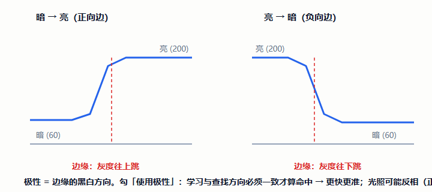
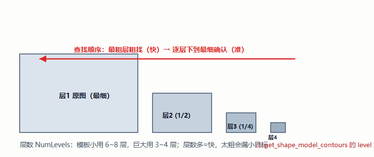
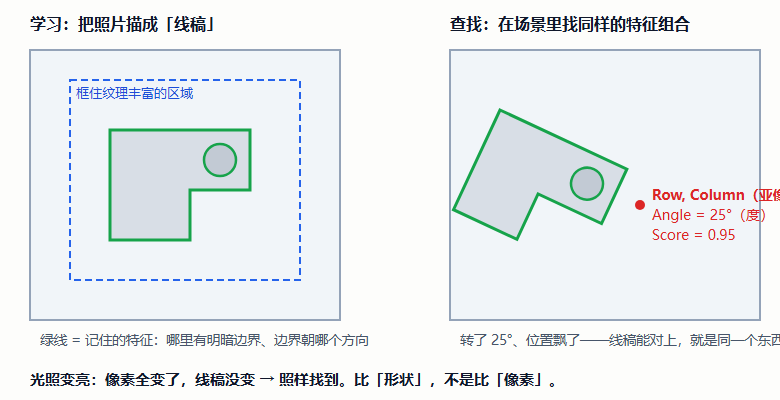
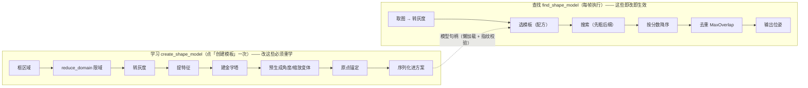
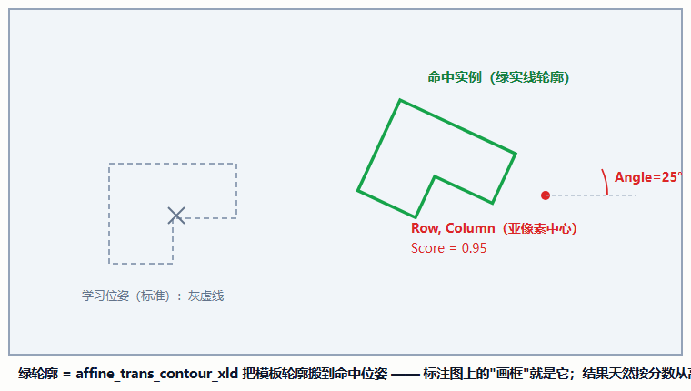
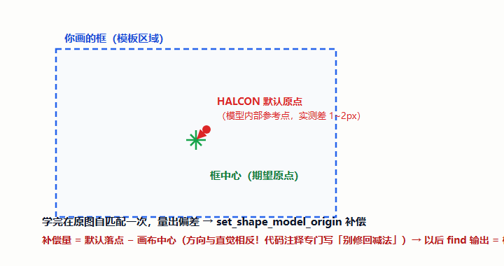
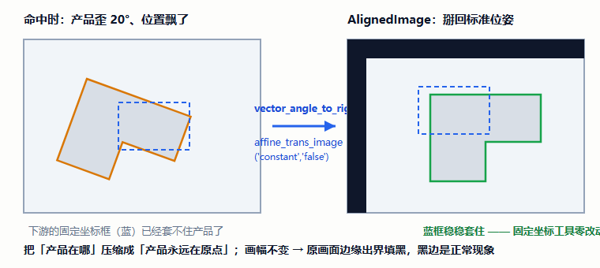
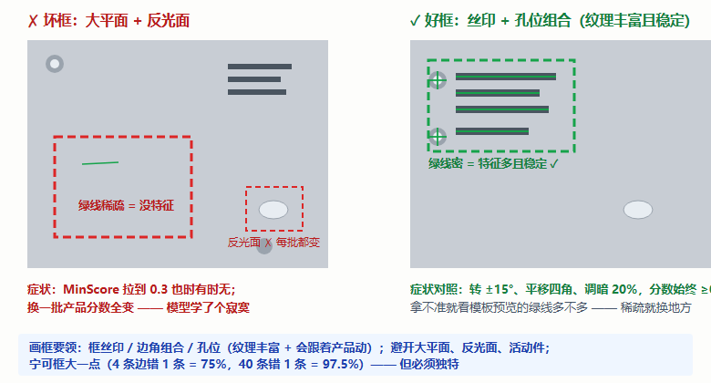

# 模板匹配插件手册 —— 零基础学习版 v1.0

> **这本手册为谁而写**：不了解视觉算子、不了解设计思路，想通过「模板匹配」学会"视觉怎么定位"以及"为什么它是几乎所有视觉方案的第一步"的人。
> **依据**：官方文档 `docs/模板匹配/模板匹配插件.md`（1364 行，唯一文档）逐节交叉校验；行号引自其源码索引（`MatchingPlugin.cs`，约 2145 行）。回归断言 44+11 条（`FlowCanvasChecks/MatchingChecks.cs`）。
> **版本**：v1.1（2026-10-11）。v1.1：新增**第七部分应用实例篇**（引导 / 跟随 / 配方 / 排查四实例）+ 两阶段心智模型转流程图 + 好框坏框对照图；与《区域创建ROI插件手册》《卡尺测量插件手册》同模板。

---

## 目录

- **第一部分 预备知识**：第 1 章 五个概念 ｜ 第 2 章 这个插件是干什么的
- **第二部分 视觉算子原理**：第 3 章 算子卡片集（7 组 · 配 SVG 真值图与 HDevelop 截图位）
- **第三部分 设计思路**：第 4 章 八个设计决策
- **第四部分 源码走读**：第 5 章 代码地图（学习九步 / 运行十二步）
- **第五部分 操作与排障**：第 6 章 学模板七步 + 打光三原则
- **第六部分 验收**：第 7 章 自检十题 + 审查记录
- **第七部分 应用实例篇**：第 8 章 拿到定位任务怎么想（引导 / 跟随 / 配方 / 排查）
- **第八部分 扩展篇**：第 9 章 位姿的下游（三条消费路线）
- 附录 A 术语表 ｜ 附录 B 延伸阅读 ｜ 附录 C 学习进度追踪与版本记录

---

## 阅读地图

| 你的目的 | 走这条路 |
|---|---|
| 只想会用：学一个模板找到产品 | 直接读 **第 6 章**（画框要领是成败关键） |
| 想懂原理：它凭什么抗光照、抗旋转 | **第 1 → 2 → 3 章** |
| 想懂设计：为什么参数分"要重学"和"立即生效"两拨 | **第 4 章** |
| 想读懂源码 | **第 5 章**（CreateTemplate 九步 / RunAlgorithm 十二步） |
| 检验学没学会 | **第 7 章**（自检十题） |
| 想学「拿到定位任务怎么想」 | **第 8 章 应用实例篇**（引导 / 跟随 / 配方 / 排查） |
| 想继续进阶：位姿拿到手给谁用 | **第 9 章**（扩展篇：三条消费路线） |

---

# 第一部分 预备知识

## 第 1 章 五个必须懂的概念

### 1.1 灰度
图像每格存一个亮度数（0 黑~255 白）。本插件**内部一律转灰度**再学再找——形状特征本质是"明暗边界"，颜色信息它不用（要颜色找「区域颜色检查」）。

### 1.2 梯度（边缘）
相邻格子亮暗差得越狠，越是条"边"。算法把边找出来当**特征**。`梯度阈值` = "多明显才算边"：调低→特征多但噪声混入；调高→精炼但不稳。**设 0 = 让算法自动定（推荐）**。

### 1.3 极性（黑白方向）
一条边是"左暗右亮"还是"左亮右暗"。勾「使用极性」= 方向必须一致才算命中（**更快更准**）；光照可能反相的场合取消（慢一点）。



### 1.4 金字塔（层数）
把图缩小 1/2、1/4、1/8……叠成塔。查找时**先在最粗层粗找（快），再逐层放大细找（准）**。小模板（几十像素）用 6~8 层；巨大模板用 3~4 层。层数多=快，但太粗会漏小目标。



### 1.5 亚像素与精度预算
位置能给出小数（150.3）。**物理精度 = 亚像素精度 ÷ 像素当量**：视野 100mm ÷ 2448px ≈ 0.04mm/px，要 ±0.05mm 精度 → 当量必须 ≤ 0.02mm——**先算预算再选镜头**。

---

## 第 2 章 这个插件是干什么的

### 2.1 一句话

**让计算机"记住"一个物体的样子（学习），然后在新图里把它找出来（查找），告诉你：中心在哪（Row/Column）、转了多少度（Angle）、多大把握（Score）。**

### 2.2 ★ 核心原理：比"形状"，不是比"像素"

本插件用的是业界标准的**形状匹配（Shape-Based Matching）**——把照片描成"线稿"（边缘特征），两张照片只要线稿能对上就是同一个东西。



| | 逐像素比对（老办法） | 形状匹配（本插件） |
|---|---|---|
| 光照变亮 | 像素全变 → 失败 | 边缘位置不变 → **照样找到** |
| 目标旋转 | 失败 | 找旋转过的特征变体 → **找到** |
| 速度 | 慢 | 快（金字塔加速） |

> 一个反直觉的要点：**特征多不等于好，但要够独特**——4 条特征边错 1 条分数掉到 75%；40 条边错 1 条还剩 97.5%。**宁可框大一点，但保证独特**。

### 2.3 两阶段心智模型（全插件最重要的一张图）



（框/涂抹/角度/缩放/步长/梯度/极性/层数 = **创建态参数**；分数下限/匹配数/重叠/激进度 = **查找态参数**。）

### 2.4 模板库 + 配方驱动

一个插件实例 = **一个模板库**（最多 20 条，每条一个产品配方）。运行期给 `RecipeName` 端口一个名字就自动切模板；`MatchedTemplate` 输出本帧实际用了哪条——**追溯用**。配方选择三级：① 端口名精确匹配（找不到→Fail 并列出库名单）② 默认条目 ③ 库里第一条。

---

# 第二部分 视觉算子原理

## 第 3 章 算子卡片集

### 3.1 ★ create_shape_model：学习模板

```
create_shape_model(Image, NumLevels, AngleStart, AngleExtent,
                   AngleStep, Optimization, Metric, Contrast, MinContrast : ModelID)
```

- **直觉**："把框内线稿 + 各角度变体全部预习一遍，装订成册"——模型里存的是**每个角度下的样子**，所以学习角度范围填 180° 意味着模型大、搜索慢。
- **易错点 ①**：`AngleExtent` 是**角度跨度**不是上限！全角度 = `AngleStart=0, AngleExtent=rad(360)`；只转 ±15° 要写 `rad(-15), rad(30)`。
- **易错点 ②**：`Metric='use_polarity'`（用极性）时黑白方向必须一致。
- **源码**：`CreateTemplate()`，`MatchingPlugin.cs:849-1130`（九步学习流程）。

> 🖼️ **HDevelop 截图位**（官方文档案例 1）：
>
> ```hdevelop
> read_image (Image, 'board-01.png')
> gen_rectangle1 (Region, 200, 300, 320, 420)
> reduce_domain (Image, Region, ImageTpl)
> create_shape_model (ImageTpl, 5, 0, rad(360), 'auto', 'auto',
>                     'use_polarity', 'auto', 'auto', ShapeModelID)
> * 变量区看 ShapeModelID —— 模型句柄（几百KB~几MB，用完必须 clear）
> ```

### 3.2 find_shape_model：查找

```
find_shape_model(Image, ModelID, AngleStart, AngleExtent, MinScore,
                 NumMatches, MaxOverlap, SubPixel, NumLevels, Greediness :
                 Row, Column, Angle, Score)
```

- **直觉**：拿着"册子"在新图里翻找，**结果天然按分数从高到低排序**——`Row[0]` 就是最高分那个。
- **铁律**：查找角度范围必须 **⊆** 学习范围（模型没预习过的角度，找也找不到）。
- **亚像素固定 `least_squares`**（最小二乘拟合）。
- **源码**：`RunAlgorithm()`，`:1427-1637`（十二步；缩放/非缩放两分支 `:1496-1544`）。



> 🖼️ **HDevelop 截图位**：
>
> ```hdevelop
> read_image (Image2, 'board-02.png')
> find_shape_model (Image2, ShapeModelID, 0, rad(360), 0.5,
>                   1, 0.3, 'least_squares', 5, 0.8,
>                   Row, Column, Angle, Score)
> * Angle 是【弧度】！显示要 ×180/π（界面端口才用度）
> ```

### 3.3 ★ set_shape_model_origin：原点锚定（方向与直觉相反！）

- **问题**：HALCON 默认原点在模型**内部参考点**，不在你画的框中心——实测差 1~2px（圆形区域 +1.5,+1.5）。
- **解法**：学完在**同一张图上自匹配一次**（自己找自己必然满分），量出默认落点与画布中心的差，喂给 `set_shape_model_origin` 补偿。



- **⚠️ 方向别搞反**：`found_after = found_default − offset`，所以**补偿量 = 默认落点 − 期望原点**（直觉会写成减法；代码里专门注释"别'修'回减法"）。
- **源码**：原点锚定段 `:973-1039`（自匹配 + 补偿量随模型序列化）。

> 🖼️ **HDevelop 截图位**（官方文档案例 2）：
>
> ```hdevelop
> * 学完后在【同一张图】自匹配一次
> find_shape_model (ImageTpl, ShapeModelID, 0, rad(360), 0.8, 1, 0.5,
>                   'least_squares', 5, 0.9, Row0, Column0, _, _)
> * 补偿：让以后 find 输出 = 框中心 (200,300)
> set_shape_model_origin (ShapeModelID, Row0 - 200, Column0 - 300)
> ```

### 3.4 get_shape_model_contours / clear_shape_model：轮廓与句柄生命周期

- `get_shape_model_contours` 取模型特征轮廓（**level 1 基，1=最细层**）——预览绿线、标注绿线都是它；
- `clear_shape_model` 释放句柄——**不 Clear = 真泄漏**（模型占几百 KB~几 MB）。插件的三处释放时机：重新学习前 / 删除条目时（摘除前先释放，否则 Dispose 遍历再也够不着它——真实 P2 泄漏）/ Dispose。
- 学习持久化：HALCON **没有内存导出接口**，只能 `write_shape_model` 落临时 `.shm` → 读文件转 base64 → 存方案。

### 3.5 vector_angle_to_rigid + affine_trans_image：AlignedImage 的原理

```
vector_angle_to_rigid(当前Row, 当前Col, 当前Angle(rad), 标准Row, 标准Col, 0 : HomMat2D)
affine_trans_image(Image2, AlignedImage, HomMat2D, 'constant', 'false')
```

- **直觉**：把目标从"当前位姿"**掰回**学习时的标准位姿——产品永远在 (200,300)、角度 0°，下游按固定坐标配置的工具**一个都不用改**。
- **参数顺序陷阱**：`affine_trans_image` 是 `(图像, out, 矩阵, 插值, 自适应幅面)`——写成 `('false','constant')` 直接报 `#3147`（真实踩坑）。
- **`'false'` = 输出同幅面**：目标转回原位后，原画面边缘出界 → **黑边是正常的**。



> 🖼️ **HDevelop 截图位**（官方文档案例 5）：把当前位姿搬回 (200,300)/0°，贴搬移前后的两张图。

### 3.6 create_scaled_shape_model / find_scaled_shape_model：带缩放（非必要不开）

- 目标远近会变才用：模型**明显更大更慢**。
- **缩放上下限不能相等**（范围退化，HALCON 拒绝创建）——插件自动撑开最小窗口兜住（真实 P3）。
- 插件默认 `ScaleEnabled=false`；输出 `Scales` 数组未启用时恒为 1，**保证五个数组端口逐项对齐**。

> 🖼️ **HDevelop 截图位**：跑官方文档案例 4（0.9~1.1 缩放学习 + 查找），贴 Row/Column/Angle/Scale/Score。

---

# 第三部分 设计思路

## 第 4 章 八个设计决策（每条都有真实事故佐证）

### 4.1 两阶段分离：橙色徽标 = 参数指纹

创建态参数（角度/缩放/步长/梯度/极性/层数/框/涂抹）**必须重学**；查找态参数（分数/数量/重叠/激进度）**改完即生效**。怎么知道你改没改？学习成功时把"区域+全部提取参数+掩膜长度"拼成**指纹字符串** `LearnedSignature` 存下来，之后一比对就知道：

```
"Rectangle|200.5,300.2,0,80,60|5|0|-180|180|0|True|False|0.8|1.2|1234"
   形状      区域(3位小数)      层 梯度 角范围 步长 极性 缩放 比例  掩膜长度
```

### 4.2 单一存储口径：指纹机制会"自己咬自己"（真实 P2）

早先学习时存"与框**求交后**的掩膜"，换条目时写回的是"**原始**掩膜"——两者 base64 长度不同，而指纹含掩膜长度 → **什么都没改也天天提示"需重新学习"**。修法：全系统统一存**原始涂抹域**。教训：**同一个数据只能有一个存储口径**。

### 4.3 原点锚定：补偿方向与直觉相反（见 3.3）

自匹配量偏差 + `set_shape_model_origin`，**补偿量 = 默认落点 − 画布中心**。方向写反，输出坐标就系统性偏 1~2px——对测量类下游是致命的。

### 4.4 失败也要出标注图

找不到目标 → 步骤 Fail（下游确实没法继续），但**照样输出 MeasureImage**（原图+红字原因）并发主界面。理由：**产线要能当场看到现场**，黑屏等于让人跑到机台前瞎猜。

### 4.5 角度单位纪律：对外一律"度"（真实 P1——测试都够不着的错误）

`find_shape_model` 输出弧度，内部曾当成"度"又乘一次 π/180 → **轮廓几乎不转**。最阴险之处：**端口数值全对，只有画出来是错的**——44 条冒烟断言全绿，因为"只有画出来才看得见"。修法：统一度口径 + 把轮廓摆放抽成 **public static** `PlaceContoursAtPoses()`（`:1646-1668`），测试用一根已知 30° 的轮廓直接断言换算。

> 教训：**"只有画出来才看得见"的错误，测试够不着——必须给它造一个可测入口。**

### 4.6 编译链路：派生状态初始化不能只挂 Initialize

宿主构造**运行实例**走 `ApplyConfigValues(model)`，**不调 Initialize**。模板库解析若只挂在 Initialize → 配置界面学得好好的，一运行就报"尚未创建模板"。修法：解析/迁移/选条目挪进两条路都经过的 `ApplyConfigValues` 重载。

> 教训：**插件的派生状态初始化永远不要只挂在 Initialize 上。**

### 4.7 句柄生命周期：摘除前先释放（真实 P2 泄漏）

`DeleteSelectedEntry()` 若只做 `Library.Remove(entry)`，条目从库里摘掉后 Dispose 遍历**再也够不着它** → 模型句柄永久泄漏。修法：摘除前先 `ReleaseEntryModel(removed)`。

### 4.8 涂抹排除：让反光面/变化区不参与学习

反光面每批亮度都变，会把模型学歪。涂掉的区域 ∩ 模板区域，从模型域里 `difference` 掉。持久化走"排除域 → PNG → base64"（本机 HALCON .NET 缺 `write_serialized_item`）——PNG 无损、版本稳，还原一行 threshold。

---

# 第四部分 源码走读

## 第 5 章 代码地图

### 5.1 文件清单（`Plugins/Plugin.Matching/`）

| 文件 | 职责 |
|---|---|
| `MatchingPlugin.cs` | **核心**（约 2145 行） |
| `MatchingTemplateEntry.cs` | 模板条目（19 属性 + 3 运行期句柄） |
| `MatchingView.xaml(.cs)` | 四张卡片 + 画布；视图仅 35 行转发（零业务逻辑） |

### 5.2 关键方法索引

| 方法 | 位置 | 一句话 |
|---|---|---|
| 13 个输出端口声明 | :194-234 | 标量=最高分；数组逐项对齐 |
| `SetStatus()` | :553 | 信息栏唯一写入口（文字颜色成对更新） |
| `DeleteSelectedEntry()` | :757-765 | 摘除前先释放句柄 |
| `CreateTemplate()` | :849-1130 | 学习九步（原点锚定 :973-1039） |
| `RunAlgorithm()` | :1427-1637 | 每帧十二步（轮首重置 11 个非图像端口） |
| `PlaceContoursAtPoses()` | :1646-1668 | **public static**，度→弧度可测 |
| `TryToGrayImage()` | :2075 | 1/3/4 通道三分支转灰 |

### 5.3 一次运行的链路（精简）

```
RunAlgorithm (:1427)
  ├─ 轮首重置 11 个非图像端口（防"幽灵结果"放行不良品）
  ├─ ResolveEntry (:1389)        配方三级选择
  ├─ EnsureModelLoaded (:1317)   懒加载（指纹比对，变了才重载）
  ├─ find_shape_model / find_scaled（:1496-1544）
  ├─ 端口赋值（标量=最高分；数组对齐）
  ├─ AlignedImage（:1575-1610，先校验 Rect.Length==5）
  ├─ 标注渲染（:1612-1637，传"度"）
  └─ 没找到 → Fail，但标注图照出（原图+红字）
```

### 5.4 端口速览

入：`Image`(HImage)、`RecipeName`(string)。出 13 个：`Score/Row/Column/Angle/MatchCount/MatchedTemplate`（标量）+ `Rows/Columns/Angles/Scores/Scales`（HTuple 数组，**逐项对齐**）+ `MeasureImage`（没找到也有）+ `AlignedImage`。

---

# 第五部分 操作与排障

## 第 6 章 学模板七步 + 打光三原则

界面四张卡片：①模板（库/配方/创建/涂抹）②提取参数（改→重学）③匹配参数（即改即生效）④输出。左上徽标三态：**灰=未创建 / 绿=已学习 / 橙=参数已改需重学**。

1. 搭流程：采集 → 匹配 `Image`；
2. 弄图进界面：试运行一次自动上画布（或填参考图路径）；
3. **框模板区域（成败关键）**：右键新建矩形——✅框丝印/边角组合/孔位等**纹理丰富且稳定**处；❌大平面/反光面/会动的区域；拿不准看**模板预览绿线多不多**；


4. （可选）涂抹：涂掉反光/变化区（橙=排除，红=擦除笔）；
5. 调提取参数：产线偏转小就 **±15°**（别偷懒 ±180°——模型大搜索慢）；不需要缩放就别勾；
6. 点「创建模板」→ 徽标变绿 + 左下角出现带绿轮廓的预览；
7. 保存方案。**上线前压力测试**：目标故意转 ±最大角度、平移到四角、光调暗 20%，都能找到才算学好。

**打光三原则**：稳而不亮（曝光固定）／漫射光（避免高光阴影）／看直方图（双峰=合格）。**盯 Score 趋势**：0.95 慢慢滑到 0.75 是光源老化的**领先指标**，等跌破 0.5 报警就晚了。

**参数速查**：找不到→MinScore ↓ 0.3~0.5；一个目标报多个→MaxOverlap ↓；只报一个→MaxMatches ↑；太慢→Greediness ↑ 或收窄角度；偶尔漏→Greediness ↓。

---

# 第六部分 验收

## 第 7 章 自检十题 + 审查记录

**自检**（答案指向章节）：

1. 形状匹配比的是什么？为什么光照变了还能找到？（2.2）
2. `AngleExtent` 是上限还是跨度？只转 ±15° 怎么写？（3.1）
3. 查找角度范围和学习范围是什么关系？（3.2）
4. 原点锚定的补偿量方向是"期望原点 − 默认落点"吗？（3.3——**不是！**）
5. 哪些参数改了必须重学？哪些即改即生效？（4.1）
6. 什么都没改却提示"需重新学习"，最可能是什么问题？（4.2——存储口径）
7. 角度双重转换事故为什么 44 条断言全绿？后来怎么让它可测？（4.5）
8. 为什么派生状态初始化不能只挂 `Initialize`？（4.6）
9. 删除模板条目时要注意什么？（4.7）
10. `AlignedImage` 边缘有黑边是坏了吗？（3.5——正常，出界填黑）

**审查记录**：本插件断言覆盖良好——`MatchingChecks.cs` **44 条基础 + 11 条回归**（P1 的测法很漂亮：用一根已知 30° 的轮廓直接断言"度→弧度"）。已知边界：端口名 `Image` 与其它插件 `SrcImage` 不统一（**不能改**——改名破坏老方案连线）；无 NCC/可变形匹配；无 `IsOk` 端口；运行实例各自持模型句柄（优化方向：进程级缓存）。

---

# 第七部分 应用实例篇：拿到定位任务怎么想

> 前面学的是"算子怎么用"，这一章学"工程师怎么想"。定位任务的思路链比检测类短，但每一步都有取舍。

## 第 8 章 应用实例：定位的四种打开方式

### 8.0 思路框架：先问三件事

1. **目标长什么样、会怎么动**（角度范围/缩放）→ 决定提取参数与模型大小；
2. **定位完给谁用**（对齐图 / 跟随区域 / 原始坐标）→ 决定消费路线（第 9 章三条路线）；
3. **现场最大的敌人是什么**（打光不稳 / 遮挡 / 相似背景）→ 决定画框位置与 MinScore 策略。

### 8.1 实例一：机器人抓取引导（原始坐标路线）

**任务**：机械手要从传送带上抓起工件。

**思路链**：模板匹配定位 → `Row/Column/Angle` → **手眼标定换算** → 数学计算算补偿 → 轴运动。

- **关键点**：位姿不能直接喂机械手——像素坐标 ≠ 机械坐标，中间必须过标定矩阵；
- 抓取精度 = 匹配亚像素精度 + 标定精度，**先算预算再选镜头**；
- 验收：目标摆在视野四角 + 转满角度范围，抓取重复精度都达标。

### 8.2 实例二：检测区跟随（跟随区域路线）

**任务**：产品位置飘 ±3mm，Blob 检测区要跟着走。

**思路链**：在**模板图**上画基准 ROI → 坐标变换插件做**位姿跟随** → `FollowedRegion` 喂 `Blob.MaskRegion`。

- 验收铁标：目标回到学习位姿时，跟随 ROI 与基准 ROI **完全重合**（恒等变换）；
- 为什么不用 AlignedImage：Blob 认 `MaskRegion` 输入（聪明算子），跟随路线**零重采样损失**。

### 8.3 实例三：多产品混线（配方路线）

**任务**：A/B 两种产品共用一个工位。

**思路链**：模板库存两条（各自学）→ 运行期给 `RecipeName` 切换 → `MatchedTemplate` 回读追溯。

- ⚠️ 两个坑：配方名**逐字符一致**（大小写空格都算）；不存在的产品名 → Fail 并列出库名单（这是**故意的**——静默用错模板更可怕）。

### 8.4 实例四：匹配"时好时坏"的排查思路（诊断实例）

**任务**：现场反馈"有时找得到有时找不到"。

**排查顺序**（从最常见到最少见，每步只改一个变量，改完跑 10 帧）：

1. **盯 Score 趋势**——0.95 滑到 0.75 是光源老化的领先指标；
2. 目标超出**学习角度范围**（最常见：改了工装没重学——找度→弧度对不对先放一边，先看范围）；
3. 框的位置**特征不足**（预览绿线稀疏）；
4. **相似背景干扰**——没限域，上 `Domain_` 试试；
5. `MinScore` 卡在 0.5~0.6 临界；
6. 反光面没涂抹盖住。

### 8.5 实例篇自检四题

1. 抓取引导的位姿直接能喂机械手吗？（不能——过手眼标定换算）
2. 检测区跟着产品走，三条路线选哪条？（C 跟随区域——Blob 认 MaskRegion 输入）
3. "有时找不到"第一查什么？（Score 趋势 / 光源——领先指标思维）
4. 为什么换工装后必须重新创建模板？（框/角度 = 创建态参数，指纹不一致会提醒你）

---

# 第八部分 扩展篇：位姿的下游（三条消费路线）

## 第 9 章 位姿拿到手，给谁用？

### 9.1 三条路线选型（配合《ROI 手册》扩展篇服用）

| 路线 | 拿到什么 | 下游要不要改 | 适用 |
|---|---|---|---|
| **A. 原始坐标** | `Row/Column/Angle`（double） | 下游自己做换算 | 算偏心量、驱动运动补偿 |
| **B. 归一化图** `AlignedImage` | 目标掰回标准位姿的图 | **零改动**（固定坐标工具直连） | 最省事，多目标别开（省一次仿射） |
| **C. 跟随区域** `FollowedRegion`（坐标变换插件） | 当前坐标系下的 ROI（HRegion） | 认 `MaskRegion` 输入的聪明插件 | 零重采样损失、机器人引导 |

> 记忆钩子（三本手册串起来了）：**"傻"算子（内部框固定：卡尺/颜色/OCR）喂 B 对齐图；"聪明"算子（认 MaskRegion：Blob）喂 C 跟随区域；要驱动运动/算补偿用 A 原始坐标（过标定换算）。**

### 9.2 与 ROI 的两种配合

- **限搜索范围**：`ROI.Domain_名字 → 匹配.Image`——提速 + 避免相似背景误匹配，**坐标仍是全局**（实测四组对照见官方文档附录 A.2）；
- **定位后裁剪**：位姿 → `vector_angle_to_rigid` → `affine_trans_region` 把基准 ROI 搬到目标上（跟随），详见《ROI 手册》第 11 章。

### 9.3 多目标：数组逐项对齐

`Rows[i]/Columns[i]/Angles[i]/Scores[i]/Scales[i]` 指同一个命中——可做"第 N 个命中 → 第 N 把卡尺"的配对测量（与 Blob/卡尺的 HTuple 输出同风格）。

### 9.4 自检三题

1. 卡尺（内部 ROI 固定）该吃 A、B 还是 C？为什么？（B——它不认 MaskRegion 输入）
2. 驱动机械手抓取，位姿直接能用吗？（还要过**手眼标定**矩阵换算成机械坐标——见坐标变换插件）
3. 为什么多目标场景建议关掉 AlignedImage？（9.1 表——省一次仿射变换）

### 9.5 仓库落点与延伸

- 官方文档：`docs/模板匹配/模板匹配插件.md`（附录 C 六个 HDevelop 案例、附录 E 断言清单）
- 下游：`docs/坐标变换插件/`（位姿跟随 / 像素→机械）、`docs/标定插件/`（手眼标定）
- 姊妹篇：《区域创建ROI插件手册》《卡尺测量插件手册》（同目录）

---

## 附录 A 术语表

| 术语 | 一句话 |
|---|---|
| 形状匹配 | 比边缘特征（线稿），不是比像素——抗光照抗旋转 |
| 梯度阈值 | 多明显才算边（0 = 自动） |
| 极性 | 边的黑白方向；勾上更快更准 |
| 金字塔 | 层层缩小先粗后细；小模板 6~8 层 |
| 两阶段 | 学习(create) 一次 / 查找(find) 每帧 |
| 参数指纹 | 判断"改没改创建态参数"的字符串 |
| 原点锚定 | 让 find 输出 = 你画的框中心（补偿方向反直觉） |
| AlignedImage | 位姿归一化图：产品永远在标准位姿 |
| 配方 | 一个产品一条模板；RecipeName 端口切换 |
| MatchedTemplate | 本帧实际用的模板名（追溯） |
| Greediness | 搜索激进度：越大越快越易漏 |
| angleExtent | 角度**跨度**不是上限 |

## 附录 B 延伸阅读

- 官方完整文档：`docs/模板匹配/模板匹配插件.md`（第 4 章 P0/P1 复盘、4.6 节 13 条 HALCON 踩坑汇编、附录 C 六案例）
- 姊妹篇：《区域创建ROI插件手册》（Domain 限域 / 跟随）、《卡尺测量插件手册》（测量下游）
- 下游：`docs/坐标变换插件/坐标变换插件.md`、`docs/标定插件/`

## 附录 C 学习进度追踪

**📖 阅读进度**

- [ ] 第 1 章 五个概念（灰度/梯度/极性/金字塔/亚像素）
- [ ] 第 2 章 形状匹配原理 + 两阶段心智模型
- [ ] 第 3 章 算子卡片 3.1~3.3（学习 / 查找 / 原点锚定）★核心
- [ ] 第 3 章 3.4~3.6（句柄生命周期 / AlignedImage / 缩放）
- [ ] 第 4 章 八个设计决策
- [ ] 第 5 章 源码走读（学习九步 / 运行十二步）
- [ ] 第 6 章 学模板七步 + 打光三原则
- [ ] 第 8 章 应用实例篇（四种打开方式）
- [ ] 第 9 章 扩展篇（三条消费路线）

**🖼️ HDevelop 截图**

- [ ] 3.1 create 学习 ｜ [ ] 3.2 find 查找 ｜ [ ] 3.3 原点锚定
- [ ] 3.5 AlignedImage 搬移前后 ｜ [ ] 3.6 带缩放查找

**🎓 毕业验收**

- [ ] 自检十题 ≥ 8 ｜ [ ] 实例篇四题 + 扩展篇三题全对
- [ ] 动手：学一个模板 → 做"转角+平移+调暗 20%"压力测试全过 → AlignedImage 接 Blob 跑通

**版本记录**

| 版本 | 变更 |
|---|---|
| v1.0 | 初版（按 ROI 手册 v1.4 模板） |
| v1.1 | 新增第七部分应用实例篇 + 两阶段流程图 + 好框坏框对照图 |

---

*本手册为学习用重排版（v1.1，2026-10-11），与官方文档冲突时以官方文档与源码为准。内嵌 7 张示意图 + 1 张两阶段流程图（**已渲染为 PNG**，`images/` 目录，SVG 源保留）+ 5 处 HDevelop 截图位。*
