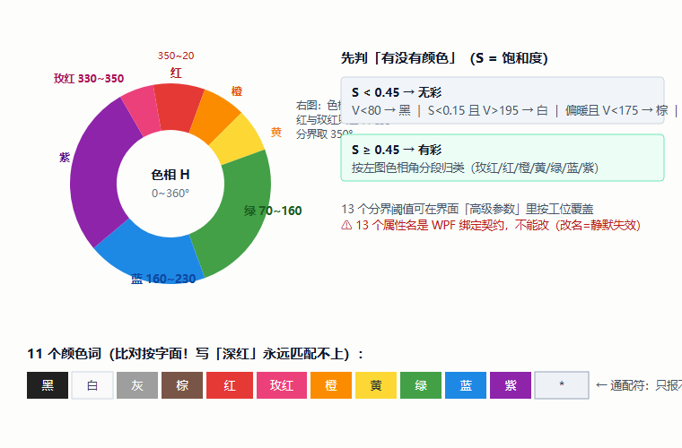
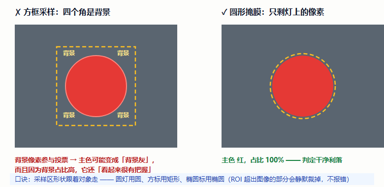
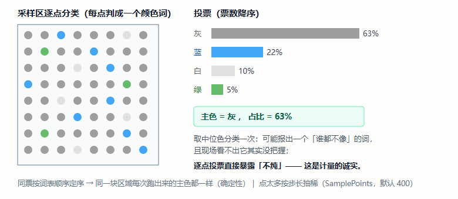
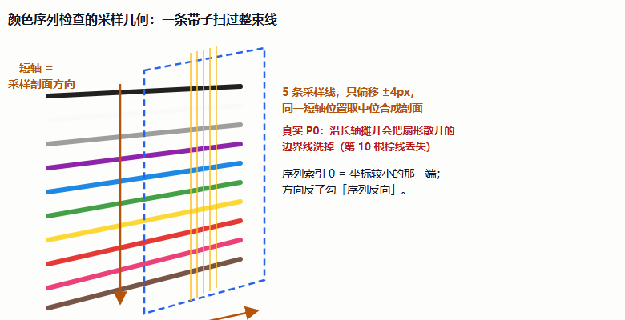
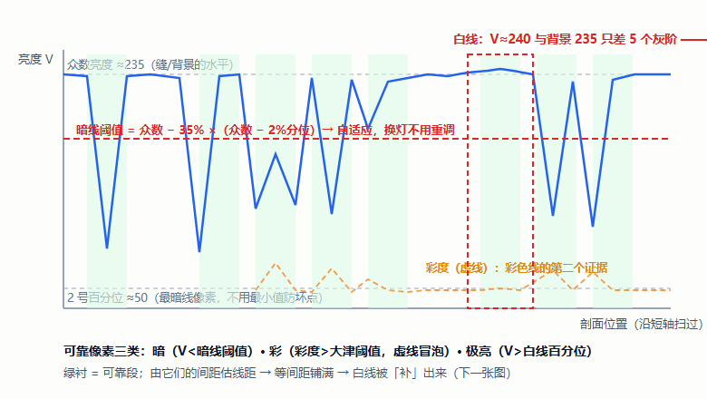
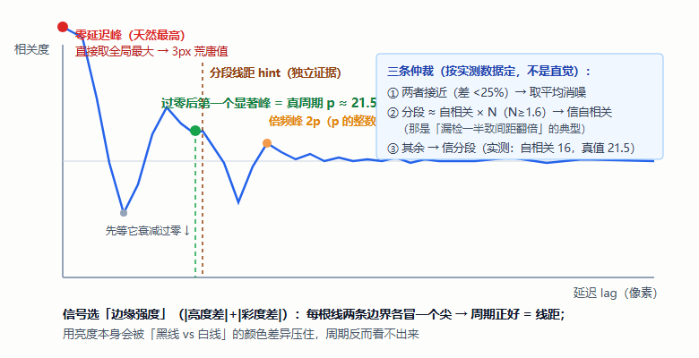
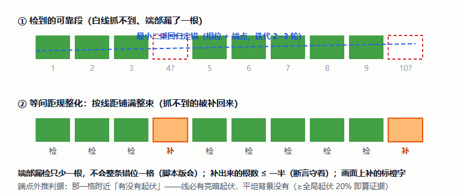
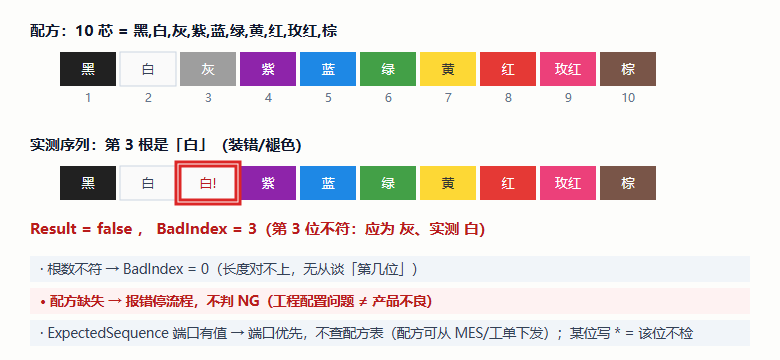
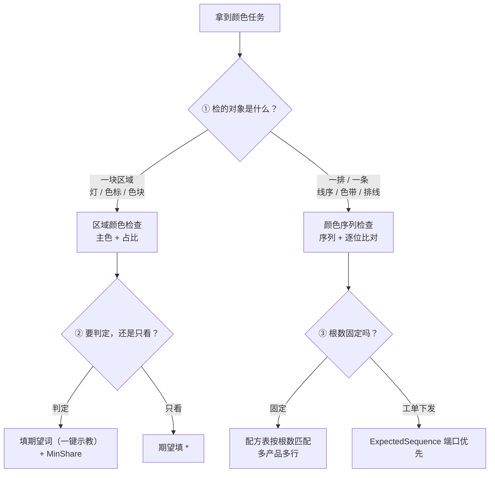

# 颜色检测插件手册 —— 零基础学习版（颜色序列检查 × 区域颜色检查）

> **这本手册为谁而写**：不了解视觉算子、不了解设计思路，想通过「颜色检查」家族学会"视觉怎么认颜色"以及"一套颜色内核怎么喂饱两个算子"的人。
> **覆盖插件**：`Plugin.ColorCheck`（颜色序列检查，985+675 行）与 `Plugin.ColorRegion`（区域颜色检查，739+163 行），共用内核 `Core.Halcon/Color/`。
> **依据**：官方文档 `docs/颜色检查/颜色序列检查插件.md`（654 行）与 `区域颜色检查插件.md`（673 行）逐节交叉校验，行号引自其源码索引。
> **版本**：v1.1（2026-10-11）。v1.1：新增**自相关找峰仲裁图**（零延迟陷阱 / 倍频峰 / 三条仲裁一图讲清，配套 §3.5）；v1.0：初版（两插件合册，共用内核视角）。

---

## 目录

- **第一部分 预备知识**：第 1 章 颜色怎么变成"词" ｜ 第 2 章 两兄弟分工
- **第二部分 视觉算子原理**：第 3 章 算子卡片集（7 组 · 配 SVG 真值图与 HDevelop 截图位）
- **第三部分 设计思路**：第 4 章 八个设计决策
- **第四部分 源码走读**：第 5 章 代码地图与共用内核
- **第五部分 操作与排障**：第 6 章 上手八步 + FAQ
- **第六部分 验收**：第 7 章 自检十二题 + 审查记录
- **第七部分 应用实例篇**：第 8 章 拿到颜色任务怎么想（指示灯 / 线序★ / 色标 / 多产品换型）
- **第八部分 扩展篇**：第 9 章 接进知识链
- 附录 A 术语表 ｜ 附录 B 延伸阅读 ｜ 附录 C 学习进度追踪

---

## 阅读地图

| 你的目的 | 走这条路 |
|---|---|
| 只想会用：判个指示灯 / 检个线序 | 直接读 **第 6 章**，卡住再回头查 |
| 想懂原理：颜色凭什么变成 11 个词 | **第 1 → 2 → 3 章** |
| 想懂设计：为什么"期望为空要报错" | **第 4 章**（每条都有真实事故佐证） |
| 想读懂源码 | **第 5 章**（共用内核是精华） |
| 检验学没学会 | **第 7 章**（自检十二题） |
| 想学「拿到任务怎么想」 | **第 8 章 应用实例篇**（四个实例） |
| 想继续进阶：接进知识链 | **第 9 章**（扩展篇） |

---

# 第一部分 预备知识

## 第 1 章 颜色怎么变成"词"

### 1.1 三个数就够了：V / S / H

对每个像素取 R、G、B，算出三个量（**HSV 式，纯 C# 计算，不调 HALCON 转换**）：

| 量 | 公式 | 直觉 |
|---|---|---|
| 明度 **V** | `max(R,G,B)` | 有多亮 |
| 饱和度 **S** | `(max−min)/max` | 有多"彩"（越低越灰） |
| 色相 **H** | 由 max 是谁的角度公式给出（0~360°） | 是哪种颜色（红≈0、黄≈60、绿≈120、蓝≈240） |

### 1.2 判据树：先判"有没有颜色"，再按色相分色系

```
无彩（S < 0.45）：
   明度 < 80            → 黑
   S < 0.15 且 V > 195  → 白
   偏暖（R 比 G/B 都高 ≥12）且 V < 175 → 棕
   其余                 → 灰

有彩（按色相角 H）：
   [330,350) → 玫红    ≥350 或 <20 → 红
   [20,45)  → 橙      [45,70)  → 黄
   [70,160) → 绿      [160,230) → 蓝
   [230,330) → 紫
```



词表：**黑 白 灰 棕 红 玫红 橙 黄 绿 蓝 紫** 共 11 个，外加通配符 `*`（只报不判）。
> ⚠️ 比对是**按字面**做的——写"深红"永远匹配不上。**用一键示教填词**，从根上避开（见 6.2 节）。

### 1.3 这套判据是"两兄弟共用"的

判据下沉在**共用内核** `Core.Halcon/Color/`（`ColorSampler` 取色 / `ColorVocabulary` 分类 / `ColorThresholds` 13 项阈值 / `ColorMarks` 投射配色）——所以"玫红"在哪个算子里答案都一样。每个算子各存一份**可覆盖的阈值副本**随方案落盘（不同工位打光不同，全局一份会变成束缚）。

---

## 第 2 章 两兄弟分工

| | **区域颜色检查**（ColorRegion） | **颜色序列检查**（ColorCheck） |
|---|---|---|
| 认什么 | **一块区域**：逐点投票取主色 + 占比 | **一个顺序**：沿采样带扫出颜色序列，逐位比 |
| 典型场景 | 指示灯什么颜色、色标对不对、纯不纯 | 线序、排线、色带、色块标签 |
| 输出重点 | `Color`（主色）、`Share`（占比） | `Sequence`（序列）、`BadIndex`（第几位不符） |
| 不看 | 不看顺序 | 不看占比 |

**三兄弟总分工**：Blob 管"有没有缺陷"，卡尺管"尺寸多少"，**颜色家族管"是什么颜色、顺不对"**。

---

# 第二部分 视觉算子原理

> 读法：3.1~3.2 是区域颜色的两步，3.3~3.6 是序列检查的四步，3.7 是两者共用的比对收尾。每张卡片：**签名/直觉 → 源码哪里 → 易错点**。

## 第 3 章 算子卡片集

### 3.1 ★ 掩膜采样：用区域形状圈住"只属于它"的像素

```
gen_rectangle2 / gen_circle / gen_ellipse → 区域
gen_rectangle1(整幅) → intersection（越界静默裁掉）
area_center（≤0 → 报"采样区与图像没有交集"）
get_region_points → 展开成逐像素点集（点太多按步长抽稀）
access_channel + 元组版 get_grayval → 一次取回整批 RGB
```

- **直觉**：用方框框圆形指示灯，**四个角是背景**——背景像素参与投票，主色可能直接变成背景色，还"看起来很有把握"。用**圆形区域**当掩膜，就只剩灯上的像素。
- **性能关键**：取色走**元组版 `get_grayval`**——一次调用拿回整批点，比逐点快两个数量级，且避开把单通道包成 HImage 管句柄的坑（真实 `#4056 object-ID is NULL` 事故）。
- **源码**：内核 `ColorSampler.cs`；`RegionColorPlugin.TryAnalyze()`，`:598`。



> 🖼️ **HDevelop 截图位**（官方文档附录 C 案例 1/2）：
>
> ```hdevelop
> gen_circle (Roi, CenterRow, CenterCol, Radius)
> get_image_size (Image, Width, Height)
> gen_rectangle1 (ImageRect, 0, 0, Height-1, Width-1)
> intersection (Roi, ImageRect, Clipped)
> area_center (Clipped, Area, _, _)
> get_region_points (Clipped, Rows, Cols)
> for ci := 0 to 2 by 1
>     access_channel (Image, ChannelObj, ci + 1)
>     get_grayval (ChannelObj, Rows, Cols, Values)
> endfor
> ```

### 3.2 逐点分类 → 投票 → 主色 + 占比

- **直觉**：每个采样点判成一个颜色词 → 统计票数 → 票数最多的词 = **主色**，它的票数占比 = **纯度**。
- **为什么不"取中位色分类一次"**：区域里一半红一半蓝时，中位色是个"谁都不像"的颜色却照样报得出词——**现场看不出它没把握**；逐点投票直接告诉你"主色红只占 41%，这是不纯，不是红"。
- **同票定序**：票数相同按词表顺序定序——同一块区域每次跑出来的主色都一样（确定性）。
- **高位深归一**：12/16 位相机的图，明度阈值（黑80/白195/棕175 按 8 位标定）会全错——实测最大值 >255 时**等比压回 8 位**。等比缩放不动色相与饱和度（它们是比值量），**颜色词的答案不变**。
- **源码**：`RegionColorAnalyzer.cs`（163 行，含 `Classify`/`Tally`）；归一 `:648`。



> 🖼️ **HDevelop 截图位**（官方文档附录 C 案例 3/4/5）：分类判据纯 C# 伪码（HSV 计算 → 无彩/有彩分支 → 投票），贴运行结果或手抄判据。

### 3.3 序列检查的采样几何：长轴 = 线束走向

```
RoiParams = [中心行, 中心列, 角度(弧度), 半长, 半宽]
```

| 方向 | 是什么 |
|---|---|
| **长轴**（半长大的那条） | **线束走向**（沿线的排开方向）——自动判，竖着画也能用 |
| **短轴** | **采样剖面方向**（扫过每根线的方向） |

- **5 条采样线只偏移 ±4px 取中位**——不是沿长轴摊开！真实 P0：线束是**扇形散开**的，摊开后按行号合并会把只在个别列明显的边界线**洗掉**（第 10 根棕线丢失、少两根）；±4px 取中位既抗单点噪声又不洗线。
- 序列索引 0 = **坐标较小的那一端**；方向反了勾「序列反向」。
- **源码**：`TryBuildProfile()`，`ColorCheckPlugin.cs:830`。



> 🖼️ **HDevelop 截图位**：画一个斜的矩形采样区，观察投射里 5 条采样线与逐根标签。

### 3.4 自适应找线：抓得到的先抓

**立意（整个算法最关键的一句）**：白线（V≈240）与浅背景（V≈235）只差几个灰阶，**颜色上根本不可分**——任何"找边界"的思路到这里都会断。所以骨架是：**抓得到的先抓（暗 / 彩 / 极亮），由它们的间距估出线距，再按等间距铺满整束**——抓不到的那根（白线）就被补回来了。

```
采样带剖面（逐点亮度和彩度）
  ↓ ① 自适应算三个阈值（暗线 / 白线 / 彩度）
  ↓ ② 找"可靠像素"连续段（暗 / 彩 / 极亮）
  ↓ ③ 由段间距 + 自相关 估出"线距"
  ↓ ④ 最小二乘回归定锚点（相位 + 端点）
  ↓ ⑤ 按等间距铺满整束（补出看不见的线）
  ↓ ⑥ 逐根取色 → 颜色词 → ⑦ 与配方逐位比对
```

**暗线阈值口径（最要紧的一条）**：缝/背景取剖面**众数**，最暗线像素取 **2 号百分位**（不用最小值——一个坏点就能拉跑尺度），判据线放两者之间往下 `DarkSpanRatio%`（默认 35）。实测两张样本图安全窗口 100~160，此口径给出 **154 与 114**，都在窗口里；脚本版写死的 150 只是**碰巧**。



- **源码**：`ColorSequenceAnalyzer.cs` 的 `Analyze`(:146)、`FindSegments`(:377)。
- **高级参数全是无量纲比例**（DarkSpanRatio 35 / BrightPercentile 92 / MinRun 4 / MaxRunRatio 0.33）——换灯换工装改的是尺度，比例不变，这正是"自适应"的意义。

> 🖼️ **HDevelop 截图位**（官方文档附录 C 案例 2）：对一条剖面按口径算暗线阈值，贴数值。

### 3.5 线距：自相关 × 分段线距，三条仲裁规则

- **自相关信号选"边缘强度"**（|亮度差|+|彩度差|）而不是亮度本身——每根线的上下两条边界都冒一个尖，信号周期正好 = 线距；亮度本身会被"黑线 vs 白线"的颜色差异压住。
- **找峰**：先等自相关**衰减过零**再取第一个显著峰（直接取全局最大会给出 **3 像素**的荒唐值——零延迟附近天然最高）；用分段线距当 hint 挑最贴近的峰（防倍频 p/2p/3p）。
- **三条仲裁**（按实测数据定的，不是直觉）：① 两者接近（<25%）→ 取平均；② 分段线距 ≈ 自相关 × N（N≥1.6）→ 信自相关（那是"漏检一半致间距翻倍"）；③ 其余 → **信分段线距**（实测自相关给 16，真值 21.5）。



> 🖼️ **HDevelop 截图位**（官方文档附录 C 案例 3）：对剖面边缘强度做自相关，贴峰位与仲裁结果。

### 3.6 回归定锚 + 等间距规整：「检」与「补」

- **回归定锚**：对可靠段中心做**最小二乘回归**（迭代 2~3 轮）定出锚点与线距——脚本版拿"第一个可靠段"当起点，端部漏检会**整条序列错位一格**；回归定锚后端部漏检只少一根。
- **端点外推判据**：那一格附近"有没有起伏"——一根线必然带来亮暗起伏，平坦背景没有（局部起伏 ≥ 全局 20% 当证据）。
- **「检」/「补」**：命中可靠段 = 检；按线距补出来 = 补（**画面上标橙字**）——一眼看出哪几根是算出来的。补出来的根数**不超过一半**（断言守着）。
- **逐根取色**：每根线区间内的中位 RGB 要**掐掉上下各 1/4**（trimmed），避开线两侧的暗缝。



> 🖼️ **HDevelop 截图位**（官方文档附录 C 案例 4/5）：贴"关规整化 vs 开规整化"的根数对照。

### 3.7 配方比对：按根数匹配 + 三类结论

```
配方格式（一行一条）：产品名 = 颜色1,颜色2,…
  # 井号开头是注释；不带等号的行 → 整行是序列，产品名自动取「N 芯」
  某一位写 * → 这一位不检
```

- **按实测根数匹配**配方（期望序列长度 = 这条配方要求几根）——5 芯图换上去自动换配方；同芯数多条取第一条并 Warn。
- **`ExpectedSequence` 端口有值 → 端口优先**，不查配方表（留给"配方从 MES/工单来"的场景）。
- **三类结论**：合格 ／ 第 N 位不符（`BadIndex`=N）／ 根数不符（`BadIndex`=0）。
- **两条铁律**：配方缺失 → **报错停流程，不判 NG**（工程配置问题 ≠ 产品不良——判成 NG 会永远把良品报坏）；期望词不在词表 → **报错**（词表外的词会悄悄把那一位判 NG）。
- **源码**：`TryJudge()`，`ColorCheckPlugin.cs:730`；`RecipeTable.cs`（140 行）。



> 🖼️ **HDevelop 截图位**（官方文档附录 C 案例 6）：配一条 10 芯配方，故意交换两位，贴 Verdict 与 BadIndex。

---

# 第三部分 设计思路

## 第 4 章 八个设计决策（每条都有真实事故佐证）

### 4.1 共用颜色内核：11 个词一套答案

判据下沉 `Core.Halcon/Color/`，两个算子 + 合成测试共三个消费者——**"只有一个消费者的内核是猜的"**，区域颜色检查是内核的第二个消费者，`ColorRegionCheck` 断言（35 条）因此有双重目的：验算子、也验内核真的通用。

### 4.2 逐点投票，不取中位色（不纯要暴露）

见 3.2 节。计量类插件的老原则又出现了：**宁可暴露"没把握"，不给一个看似有把握的错词**。

### 4.3 配置问题按配置问题报（两插件同一哲学）

- 区域颜色：期望为空 → **运行期报错**（不是默认通过）；要"只报不判"请显式写 `*`。
- 序列检查：配方缺失 → **报错停流程，不判 NG**——判成 NG 的话，一条配错的配方会**永远把良品报成 NG**，现场只会以为"这批产品有问题"。
- 期望词不在词表 → 报错并列出可用词（词表外的词会**悄悄**把那一位判 NG）。

### 4.4 圆掩膜：方框四角的背景会"很有把握地"骗你

见 3.1 节。回归断言专门有一条：**圆形框住灰线 → 主色灰 100%**（证明圆掩膜生效）。

### 4.5 白线不可分 → "先抓可靠的，再等间距铺开"

见 3.4 节。这是从"找边界"到"找周期"的**思路跃迁**：不跟不可分性硬碰，用"抓得到的邻居"把抓不到的推出来。

### 4.6 线距谁说了算：实测仲裁，不是直觉

自相关给 16、真值 21.5——所以三条仲裁规则按实测数据定（3.5 节）。配套的还有两个自相关陷阱：零延迟峰（3 像素荒唐值）与倍频（真周期的整数倍也是峰）。

### 4.7 端部漏检只少一根，不错位一格

脚本版拿"第一个可靠段"当起点 → 端部漏检整条序列错位；**最小二乘回归定锚**（3.6 节）后只少一根。配套 P0：采样线**不能沿长轴摊开**（扇形散开的线束会被洗线）→ 5 条线 ±4px 取中位。

### 4.8 高位深归一：压尺度，不动比值

12/16 位图等比压回 8 位——色相与饱和度是**比值量**，等比缩放后**颜色词答案不变**，只有明度阈值需要 8 位尺度。归一发生时把说明塞进 `Warnings`（日志可查"中位色为什么变小了"）。

### 4.9 附：两个跨插件通用坑（这对插件贡献的）

- **枚举端口经 `InputValues` 往返抛 `InvalidCastException`** → `RoiShape`/`ExpectedSequence` 都用 **string**（这个坑在"变量赋值·作用域"也踩过）；
- **WPF 绑定失败是静默的**：13 个阈值属性名靠按名绑定，**改名 = 绑不上且无报错**——属性名是契约。

---

# 第四部分 源码走读

## 第 5 章 代码地图

### 5.1 文件清单

| 工程 | 文件 | 职责 |
|---|---|---|
| Plugin.ColorCheck | `ColorCheckPlugin.cs` | 核心（985 行）：采样几何、试算、配方、判定、投射 |
| | `ColorSequenceAnalyzer.cs` | **算法内核**（675 行）：自适应阈值、分段、线距、回归、规整 |
| | `RecipeTable.cs` | 配方表解析/匹配/比对（140 行） |
| Plugin.ColorRegion | `RegionColorPlugin.cs` | 核心（739 行）：19 个 `[StepConfig]`、试算、示教、判定、投射 |
| | `RegionColorAnalyzer.cs` | 数据模型 + 逐点分类/投票（163 行） |
| 共用内核 | `Core.Halcon/Color/` | `ColorSampler` / `ColorVocabulary` / `ColorThresholds` / `ColorMarks` |

### 5.2 关键方法索引

| 方法 | 位置 | 一句话 |
|---|---|---|
| ColorCheck `RunAlgorithm` | :512 | 判空 → ROI → 通道 → 分析 → 判定 → 端口 → 投射 |
| ColorCheck `TryBuildProfile` | :830 | 采样几何：长短轴 → 5 线 → 越界 → 取色 → 归一 → 中位 |
| ColorCheck `TryJudge` | :730 | 期望来源（端口/配方表）→ 词表校验 → 逐位比对 |
| Analyzer `Analyze` / `FindSegments` | :146 / :377 | 阈值 → 可靠段 |
| Analyzer `EstimatePitchByAutocorrelation` | :436 | 自相关 + 三仲裁 |
| Analyzer `FitLineByIteration` | :510 | 回归定锚 |
| ColorRegion `RunAlgorithm` | :552 | 运行期**必须判定** |
| ColorRegion `TryPreviewAnalyze` | :495 | 试算**只分析不判定**（避免顺序死锁） |
| ColorRegion `ApplyPreviewAsExpected` | :536 | 一键示教 |
| ColorRegion `NormalizeTo8BitIfHighBitDepth` | :648 | 高位深归一 |

### 5.3 端口速览

- **区域颜色**：入 `Image`；出 `Color / Share / Rgb / Table / Result / Verdict`（⚠️ **没有标注图端口**——结果画面走 `PublishPreview` 事件总线，不是端口）。
- **序列检查**：入 `Image`、`ExpectedSequence`（可选，**端口优先于配方表**）；出 8 个：`Result / BadIndex / Verdict / Expected / Count / Sequence / Detail / Rows`。

---

# 第五部分 操作与排障

## 第 6 章 上手八步 + FAQ

两插件界面同范式（左参数右画布）：**接图 → 画区 → 试算 → 示教/存配方**。

**区域颜色（4 步）**：① 🔗 绑上游图（只有这一个图源）→ ② 右键画采样区（**圆形指示灯用圆形**）→ ③ 点「试算一下」→ ④ 点「**把主色填成期望颜色**」一键示教（或手打 11 词之一/多候选 `红,玫红` / `*` 只报不判）。

**序列检查（4 步）**：① 🔗 绑图 → ② 右键**新建矩形**框住线束（长轴自动判走向）→ ③ 试算（看根数/线距/阈值）→ ④ 点「**把试算结果存成配方**」自动生成 `10 芯 = 黑,白,灰,…`。多产品：配方表多行，运行按根数自动换。

**排障速查**：

| 现象 | 排查 |
|---|---|
| 主色判成背景色 | 采样区形状不对 → 圆形贴合（区域颜色） |
| "颜色不纯：主色只占 N%" | 框到背景/多种颜色，或 MinShare 太高 |
| 根数少了 | 勾「等间距规整化」+「端点外推」 |
| 白线检不到 | `BrightPercentile` 92 → 85 左右 |
| 序列反了 | 勾「序列反向」 |
| "认不出的词：深红" | 词表只有 11 个词 → 一键示教 |
| 12/16 位相机判色全错 | 已自动归一（看日志说明） |
| "未知产品"/配方缺失 | 报错停流程——补配方（不是判 NG） |

---

# 第六部分 验收

## 第 7 章 自检十二题 + 审查记录

**自检**（答案指向章节）：

1. V/S/H 各怎么算？（1.1）
2. 11 个颜色词是哪些？"深红"为什么匹配不上？（1.2）
3. 方框框圆灯会出什么事？（3.1 / 4.4）
4. 取色为什么走元组版 `get_grayval`？（3.1——快两个数量级 + `#4056`）
5. 一半红一半蓝的区域，"取中位色"会怎样？逐点投票好在哪？（3.2 / 4.2）
6. 12 位相机图直接判色会全错，为什么等比缩放能救？（4.8）
7. 序列检查的采样区，长轴短轴各是什么？竖着画能用吗？（3.3）
8. 白线与浅背景只差 5 个灰阶，算法怎么把它检出来？（3.4 / 4.5）
9. 自相关给出 16、分段线距 21.5，听谁的？三条仲裁是什么？（3.5）
10. 端部漏检为什么曾导致"整条序列错位一格"？怎么修的？（4.7）
11. 配方缺失为什么报错而不判 NG？（4.3）
12. `BadIndex = 0` 是什么意思？（3.7）

**审查记录**：断言覆盖**全家族且厚实**——`ColorRegionCheck`（35 条，双目的：验算子 + 验内核通用）、`ColorCheckRoiCheck`（12）、`ColorCheckSequenceCheck`（45，含黄金序列 cable1/cable2、"补不超过一半"、投射橙字）、`WireSequencePluginCheck`（端到端：主干两步、未知芯数停流程）、`ColorSyntheticChecks`（合成 8 位 PNG + 16 位 TIFF 验归一链路）。基线 **506 通过 / 0 失败**。已知边界：采样区不接上游 ROI、区域颜色无标注图端口、序列只支持矩形、13 阈值属性名不可改、配方同芯数多条取第一条。

---

# 第七部分 应用实例篇：拿到颜色任务怎么想

## 第 8 章 应用实例：从需求到验收

### 8.0 思路框架：先问三个问题



### 8.1 实例一：指示灯颜色判定（区域颜色的标准战场）

**任务**：判断指示灯是红还是绿，错位报警。

**思路链**：① 对象是一块区域 → 区域颜色检查；② **打光先想**：灯是自发光，环境光要压暗（曝光低一点），否则灯灭时反光会骗人；③ **形状跟着对象走**：圆灯用圆形采样区（4.4 节的教训）；④ 期望填 `红` 或 `绿`（多候选）——**别只填一个**，灯灭（黑）要单独处理时加一路"占比"逻辑；⑤ 验收：逐个点亮每种颜色各拍 10 张，主色与 Share 全对才算过。

### 8.2 实例二 ★：10 芯排线线序检测（序列检查的完整战役）

**任务**：10 根导线颜色依次 `黑,白,灰,紫,蓝,绿,黄,红,玫红,棕`，检顺序与根数。

**思路链**：① 对象是一排 → 序列检查；② **采样带横跨线束**：长轴沿线束、短轴扫过每根线（3.3 节）；③ **白线是最大障碍**（与浅背景差 5 个灰阶）——靠"抓可靠的 + 等间距铺开"补出来（3.4 节），所以**确认勾上「等间距规整化」**；④ 试算看三样：根数对不对、线距多少、哪些是「补」（橙字多 = 打光该改了）；⑤ 一键存配方；⑥ 验收：**黄金序列法**——拿一张已知良品图，断言根数、逐位颜色、补的根数 ≤ 一半；再故意交换两位验证 `BadIndex` 指对位置。

### 8.3 实例三：色标/标签有没有贴对（只看不判）

**任务**：产品上有个蓝色色标，贴没贴不强制，先采数据。

**思路链**：区域颜色检查 + 期望填 `*`（**显式的只报不判**，是用户写出来的"我不检"，不是忘配）→ `Color/Share` 接 CSV 记录攒数据 → 攒够了再定规格。这是"先上线采数据、后收紧判定"的渐进路线。

### 8.4 实例四：多产品换型（配方按根数自动切）

**任务**：产线混线生产 5 芯和 10 芯两种排线。

**思路链**：配方表写两行（`5 芯 = …`、`10 芯 = …`）→ 运行时**按实测根数自动匹配**（3.7 节）→ 换产品不改流程。⚠️ 两个坑：同芯数多条配方取第一条（别配重复根数）；配方缺失会**停流程**（故意的，4.3 节）。需要按工单切时走 `ExpectedSequence` 端口（MES 下发）。

### 8.5 实例篇自检四题

1. 任务是"色带上每一段颜色对不对"，用哪个算子？（序列——对象是"一条"）
2. 灯灭（黑）算不算 NG？配置上怎么表达？（多候选期望不含黑 → 主色不在词表判 NG；或单独一路区域颜色检黑）
3. 混线生产 3 种芯数，配方表怎么写？运行时怎么选？（三行；按实测根数匹配）
4. 试算时橙字很多说明什么？（大量"补"——打光/阈值不合适，先修光再调参）

---

# 第八部分 扩展篇：接进知识链

## 第 9 章 颜色检测在整条流程里的位置

### 9.1 上游三件套（老朋友了）

- **ROI**：`Domain_名字` 限域提速（坐标系不动）；
- **模板匹配**：产品会动 → `AlignedImage` 归一化图喂颜色算子（下游固定坐标零改动）；
- **打光**：颜色的第一生产力——判色不稳，八成先修光（稳而不亮、漫射、直方图双峰）。

### 9.2 下游三件套

`Result/Color/BadIndex` → C#脚本（分支/分拣）→ CSV 记录（`Sequence`/`Share` 攒数据）→ 结果上报 MES。

### 9.3 与其它算子的边界（四兄弟总表）

| 算子 | 回答的问题 |
|---|---|
| 模板匹配 | 目标**在哪** |
| 卡尺 | 尺寸**多少** |
| Blob | 有没有**缺陷** |
| 颜色家族 | **什么颜色、顺不对** |

### 9.4 扩展篇自检三题

1. 产品位置飘 ±3mm，颜色检查前面加什么？（模板匹配 AlignedImage——9.1）
2. 同一张图既要检线序又要检指示灯，搭几个节点？（两个颜色节点并列，共用一张上游图——附录 A 接线③）
3. 判色忽好忽坏，第一件事查什么？（打光稳定性，再查采样区形状/高位深归一日志）

### 9.5 仓库落点与延伸

- 官方文档：`docs/颜色检查/颜色序列检查插件.md`、`区域颜色检查插件.md`（附录 C 案例 1~6、附录 E 断言清单）
- 多产品配方分支实战：`docs/颜色检查/2026-09-25-线序检测多产品配方分支.md`
- 姊妹手册：《区域创建ROI插件手册》《模板匹配插件手册》《卡尺测量插件手册》（同目录）

---

## 附录 A 术语表

| 术语 | 一句话 |
|---|---|
| 颜色词 | 黑 白 灰 棕 红 玫红 橙 黄 绿 蓝 紫（11 个 + `*`） |
| 主色 / 占比 | 投票票数最多的词 / 它的票数比例 |
| 中位色 | 区域 R/G/B 各自中位数（排查示教用，不参与判定） |
| 色相 / 饱和度 / 明度 | H（颜色种类角）/ S（多彩）/ V（多亮） |
| 掩膜采样 | 用区域形状而非方框取点 |
| 抽稀 | 点太多按步长均匀取样 |
| 高位深归一 | 12/16 位等比压回 8 位（不动 H/S） |
| 长轴 / 短轴 | 线束走向 / 采样剖面方向 |
| 可靠像素 | 暗 / 彩 / 极亮——三种"抓得到"的像素 |
| 线距 Pitch | 相邻线的间距（自相关 × 分段仲裁） |
| 规整化 | 按线距等间距铺满整束（补出看不见的线） |
| 「检」/「补」 | 真看到的 / 按线距推的（画面橙字） |
| 配方 | 一行一条「产品名 = 颜色序列」，按根数匹配 |
| `*` 通配 | 该位/该区域只报不判 |

## 附录 B 延伸阅读

- 官方完整文档：`docs/颜色检查/颜色序列检查插件.md`、`区域颜色检查插件.md`（第 4 章真实修复、附录 C 案例 1~6、附录 E 断言）
- 多产品实战：`docs/颜色检查/2026-09-25-线序检测多产品配方分支.md`
- 姊妹手册：ROI / 模板匹配 / 卡尺（同目录）

## 附录 C 学习进度追踪

**📖 阅读进度**

- [ ] 第 1 章 V/S/H 与判据树
- [ ] 第 2 章 两兄弟分工
- [ ] 第 3 章 算子卡片 3.1~3.2（掩膜采样 / 投票）
- [ ] 第 3 章 3.3~3.6（采样几何 / 找线 / 线距 / 规整）
- [ ] 第 3 章 3.7 配方比对
- [ ] 第 4 章 八个设计决策
- [ ] 第 5 章 源码走读（共用内核）
- [ ] 第 6 章 上手 + 排障
- [ ] 第 8 章 应用实例篇（线序★）

**🖼️ HDevelop 截图**

- [ ] 3.1 掩膜采样与取色 ｜ [ ] 3.2 分类判据 ｜ [ ] 3.4 暗线阈值口径
- [ ] 3.5 自相关仲裁 ｜ [ ] 3.6 规整对照 ｜ [ ] 3.7 配方比对

**🎓 毕业验收**

- [ ] 自检十二题 ≥ 9 ｜ [ ] 实例篇四题全对
- [ ] 动手：搭「采集→颜色序列检查」检出 10 芯黄金序列；再搭一个区域颜色判指示灯

**版本记录**

| 版本 | 变更 |
|---|---|
| v1.0 | 初版：两插件合册（共用内核视角）+ 应用实例篇 + SVG/PNG 图 |

---

*本手册为学习用重排版（v1.0，2026-10-11），与官方文档冲突时以官方文档与源码为准。内嵌 7 张示意图（PNG，源 SVG 保留）+ 1 张 mermaid 流程图 + 6 处 HDevelop 截图位。*
