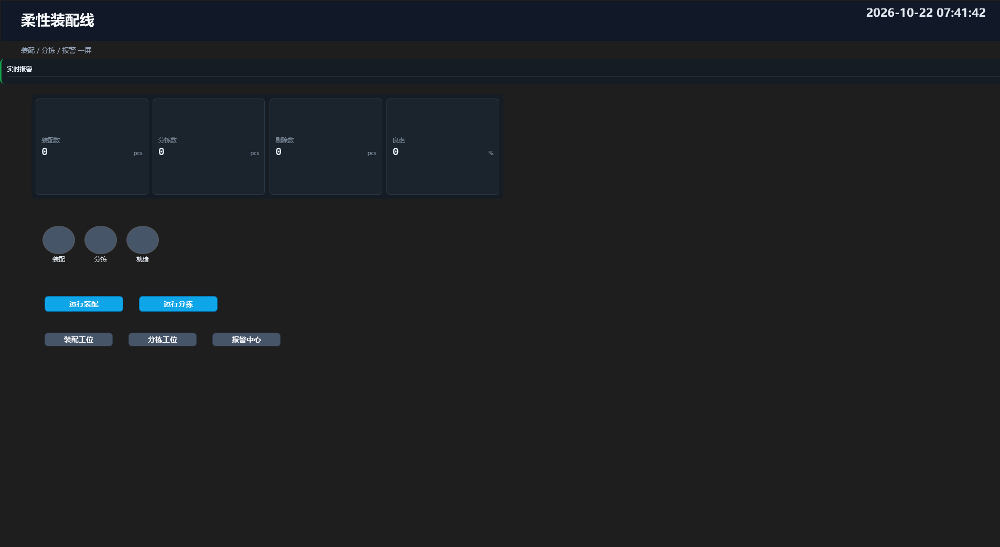
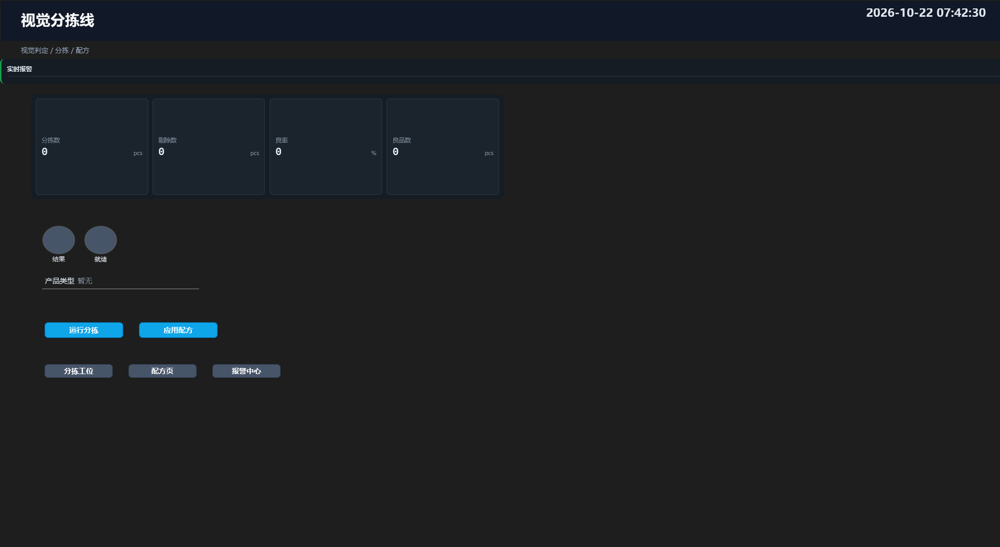
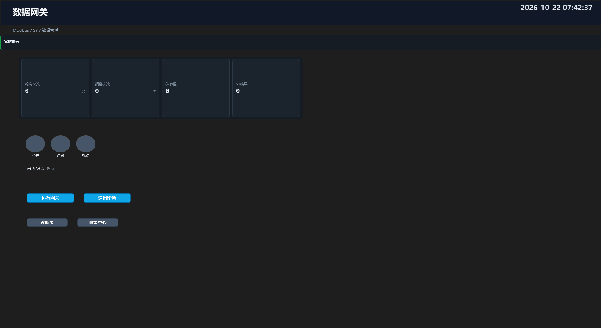

# 复杂工程三版（柔性装配线 / 视觉分拣线 / 数据网关）

> 日期：2026-10-22
> 状态：已生成、已编译、已真机 HTTP 跑通
> 来源角色：主会话（方案生成 + 宿主联调）

---

## 1. 总览

| 方案 | 流程 | 步骤 | 变量 | 组态页 | 定位 |
| --- | --- | --- | --- | --- | --- |
| `柔性装配线.vms` | 5 | 138 | 26 | 4 | 视觉检测主流程 + 装配工位 + 分拣工位 |
| `视觉分拣线.vms` | 4 | 61 | 25 | 4 | 视觉判定 → X 轴分拣 → 配方切换 |
| `数据网关.vms` | 4 | 47 | 25 | 3 | Modbus/S7 轮询 → 阈值报警 → 记录/上报 |

三版都复用同一套已验证的通讯、运动、视觉与数据插件；差异在流程编排、变量与组态页面。

---

## 2. 柔性装配线

文件：[`柔性装配线.vms`](柔性装配线.vms)

### 2.1 流程

| 流程 | 步骤 | 启用 | 作用 |
| --- | --- | --- | --- |
| Home | 11 | 否 | 轴使能 → 回零 → 待机位 → IO/PLC 就绪 |
| Main | 81 | 是 | 板卡视觉检测主流程（沿用生产版 Main） |
| Assemble | 20 | 是 | 读 PLC 触发 → X 到装配位 → 夹爪 → 回原点 → 写 PLC → 装配计数 |
| Sorting | 20 | 是 | 按 `CurrentResult` 分良品/NG → X 到对应位 → IO → 计数 |
| End | 6 | 否 | 停轴 → IO 复位 → 清 S7 心跳 → 清就绪 |

### 2.2 组态

| 页面 | 图元 | 内容 |
| --- | --- | --- |
| 装配总览 | 14 | KPI（装配/分拣/剔除/良率）、装配/分拣/就绪灯、运行装配/运行分拣按钮、导航 |
| 装配工位 | 12 | X 位置、X 使能灯、X 使能/到装配位/停止、写 PLC 结果 |
| 分拣工位 | 12 | 良品/不良/剔除数、分拣灯、X 到良品位/NG 位 |
| 报警中心 | 8 | 实时报警条、确认全部、返回总览 |



### 2.3 真机验证

- `Assemble` → **HTTP 200**
- `Sorting` → **HTTP 200**
- 运行内存约 543~553 MB

---

## 3. 视觉分拣线

文件：[`视觉分拣线.vms`](视觉分拣线.vms)

### 3.1 流程

| 流程 | 步骤 | 启用 | 作用 |
| --- | --- | --- | --- |
| Home | 11 | 否 | 回零/待机 |
| Main | 38 | 是 | 采集 → 预处理 → ROI/找圆 → 跟随ROI → Blob/OCR/QR → 综合判定 → X 轴分拣 → 计数/记录 |
| Recipe | 6 | 是 | 写 `Product_A`、清零良品/不良、良率复位、产品类型复位 |
| End | 6 | 否 | 收尾 |

### 3.2 组态

| 页面 | 图元 | 内容 |
| --- | --- | --- |
| 分拣总览 | 14 | KPI（分拣/剔除/良率/良品）、结果/就绪灯、产品类型、运行分拣/应用配方、导航 |
| 分拣工位 | 12 | 良品/不良、X 位置、分拣灯、X 到 A 位/NG 位 |
| 配方 | 9 | 配方名、产品类型、写入产品 A、返回 |
| 报警中心 | 7 | 实时报警条、返回 |



### 3.3 真机验证

- `Main` → **HTTP 200**
- `Recipe` → **HTTP 200**
- 运行内存约 420~430 MB

---

## 4. 数据网关

文件：[`数据网关.vms`](数据网关.vms)

### 4.1 流程

| 流程 | 步骤 | 启用 | 作用 |
| --- | --- | --- | --- |
| Home | 11 | 否 | 回零/待机 |
| Main | 21 | 是 | 读 PLC 触发/确认/仪表/S7 → 阈值判断 → 报警计数 → 写 PLC/S7 → CSV/Excel/上报 → 轮询节拍 |
| Diag | 9 | 是 | 写 `PLC_Trigger=1` / `S7_Result=7` → 回读比对 → 写 `GatewayOk` |
| End | 6 | 否 | 收尾 |

### 4.2 组态

| 页面 | 图元 | 内容 |
| --- | --- | --- |
| 网关总览 | 14 | KPI（轮询/报警/仪表/S7）、网关/通讯/就绪灯、最近错误、运行网关/通讯诊断、导航 |
| 通讯诊断 | 12 | PLC 触发/S7 结果/仪表、S7 心跳、写触发 1/写 S7 结果 7 |
| 报警中心 | 8 | 实时报警条、确认全部、返回 |



### 4.3 真机验证

- `Main` → **HTTP 200**
- `Diag` → **HTTP 200**
- 运行内存约 363~392 MB

---

## 5. 编译与组态验证

- `ValidateSolution` 对三版逐流程编译：**13 条流程全部 `COMPLEX-FLOW-OK`**，无连线/参数/结构错误。
- `_ScadaUiProbe --solution` 逐页离屏渲染：**11 个页面全部 `RESULT: OK`**，无 XAML 解析异常。
- 页面图元数：装配线 14/12/12/8，分拣线 14/12/9/7，网关 14/12/8。
- 三版共用 `BuildComms()` / `BuildMotionCards()`，网络变量地址与运动轴配置与生产版一致。

---

## 6. 运行方法

1. 打开对应 `.vms`。
2. 方案加载后宿主自动连接 `ZMotion_Virtual`；若日志提示失败，先确认虚拟卡已启动。
3. 组态启动页分别是「装配总览」「分拣总览」「网关总览」，点页面按钮即可。
4. 也可 HTTP 触发（流程需启用且带 HTTP 位）：

```powershell
curl.exe -s -o NUL -w "%{http_code}" --max-time 120 `
  -X POST `
  -H "Authorization: Bearer visionmaster" `
  -H "X-Image-Name: board-01.png" `
  --data-binary "@D:\C#\VM\Image\board\board-01.png" `
  http://127.0.0.1:19000/flow/Assemble
```

> 三版的 Main/工位流程均为启用状态，**不要点主界面「循环运行」**——它会把所有启用流程并发拉起；请用组态按钮或 HTTP 逐条触发。

---

## 7. 已知边界

| 项 | 说明 |
| --- | --- |
| 循环运行 | `RunAllEnabledContinuous()` 会并发跑所有启用流程；本三版都有多个启用流程，只适合逐条触发。 |
| 运动到位 | `Assemble` / `Sorting` 用 `Delay` 做节拍（虚拟卡 `InPosition` 不置位）；接真实卡后可替换为「等待到位」。 |
| 回零 | VPLC532R 被驱动标成总线型，轴 0~5 是 Step Encoder，回零可能失败/超时；Home 默认禁用。 |
| 图片路径 | 三版都使用 `D:\C#\VM\Image\...` 绝对路径，换机器需改。 |
| 上报/报表 | `Upload` 默认 `OnTrigger=false`，不发送；`Excel` 在网关 Main 中每次执行，失败不阻断。 |
| 组态预览 | 文档中的 PNG 为设计态离屏渲染，运行态数值以绑定为准。 |
