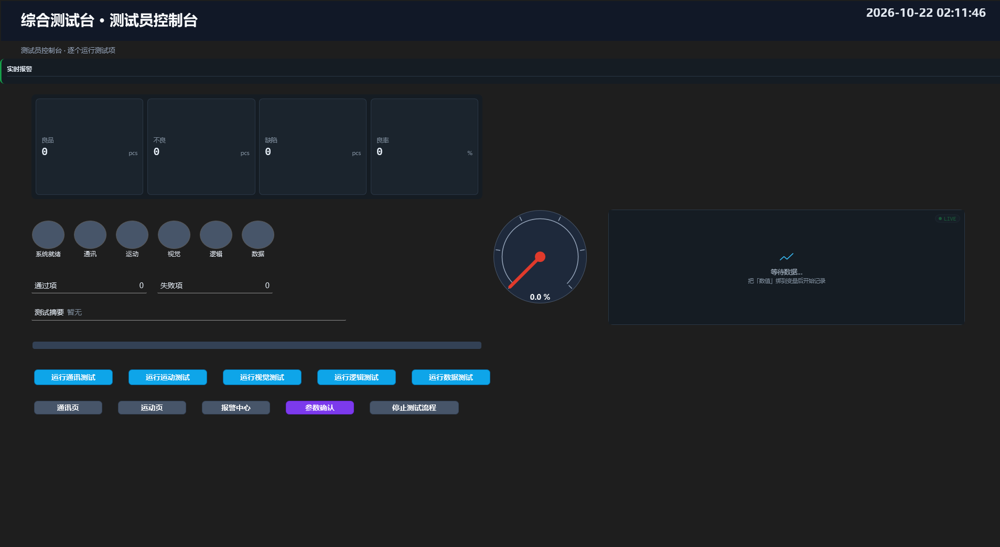
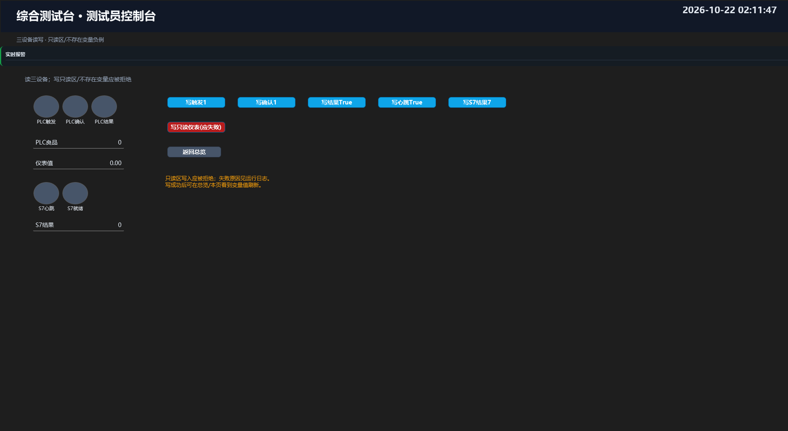
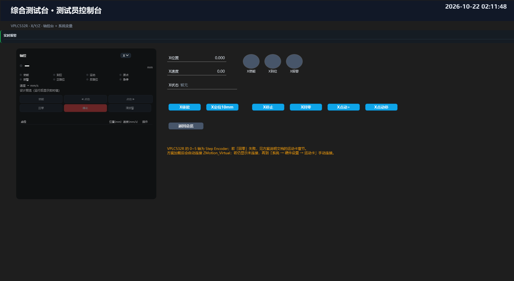
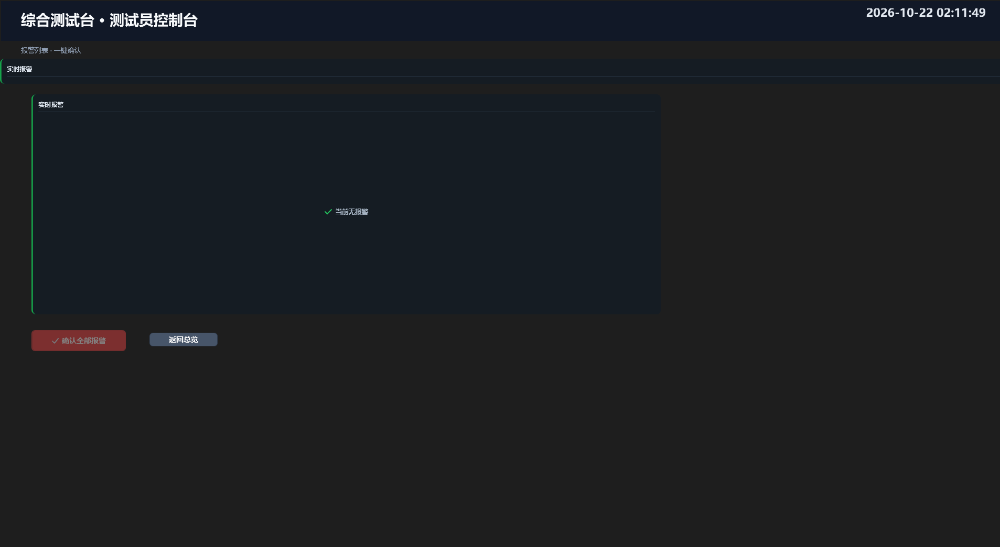
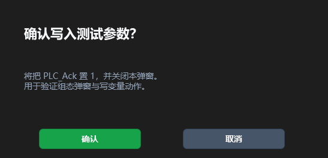

# 综合测试台（综合测试台.vms）

> 方案文件：`解决方案\综合测试台.vms`（14 条流程 / 404 个步骤 / 69 个变量 / 5 个组态页面）
> 定位：测试员版方案。把仓库里的视觉、运控、通讯、逻辑、数据五类插件拆成**可单独运行、自带负例**的测试流程，并配一套能点按钮、看状态、确认报警的组态控制台。
> 第二轮追加了 6 条边界流程（通讯类型/越界/离线、无效轴/无效 IO、坏图/卡尺 NG/错误码制、Case 无默认/嵌套循环/For 零次/并行失败、溢出/坏路径/上报不可达、结果汇总）。完整问题与证据见 [`docs\问题汇总\2026-10-22-综合测试台深度测试报告.md`](../docs/问题汇总/2026-10-22-综合测试台深度测试报告.md)。

---

## 1. 环境映射

| 资源 | 地址 | 方案里的名字 | 说明 |
| --- | --- | --- | --- |
| 正运动虚拟卡 | `127.0.0.1:502` | 运动卡 `ZMotion_Virtual` | 驱动 `Plugin.Motion.ZMotion.ZMotionCard`，VPLC532R，轴 X/Y/Z |
| Modbus TCP（ABCD） | `127.0.0.1:503` | 连接 `PLC_Modbus` | 触发/确认（保持寄存器）、结果（线圈）、良品计数 |
| Modbus TCP（CDAB） | `127.0.0.1:504` | 连接 `Meter_Modbus` | 仪表 `Meter_Value`（Float，输入寄存器，只读） |
| 西门子 S7 | `127.0.0.1:102` | 连接 `PLC_S7` | S7-1200：心跳/就绪/结果字 |
| 图片目录 | `D:\C#\VM\Image` | — | 板卡、颜色、卡尺、胶路、二维码、OCR、空白图 |

---

## 2. 流程总览

| 流程 | 角色 | 启用 | InvokeType | 步骤数 | 作用 |
| --- | --- | --- | --- | --- | --- |
| Home | 回原/回零 | 否 | 0 | 11 | 轴使能 → 回零 → 读状态 → 待机位 → IO/PLC 就绪 |
| Main | 主任务 | 是 | 0 | 2 | 测试台入口：写提示、提示从组态逐个运行 |
| Test_Comm | 普通 | 是 | 96（Subroutine+Http） | 45 | 三设备读写 + 只读区/不存在变量负例 |
| Test_Motion | 普通 | 是 | 96 | 37 | 轴使能/定位/等待/状态/IO/停止 + 失能负例 |
| Test_Vision | 普通 | 是 | 96 | 78 | 全视觉插件正例 + 缺图/无码/空 ROI/无文本负例 |
| Test_Logic | 普通 | 是 | 96 | 68 | If/Case/For/While/Parallel/Wait/Break/Continue/Return |
| Test_Data | 普通 | 是 | 96 | 23 | 变量/数学/类型转换/CSV/Excel/上报 |
| Test_CommEdge | 普通 | 是 | 96 | 18 | 类型不匹配/数值越界/离线连接 |
| Test_MotionEdge | 普通 | 是 | 96 | 31 | 无效轴/无效 IO/等待超时 |
| Test_VisionEdge | 普通 | 是 | 96 | 20 | 坏图/卡尺 NG/错误码制 |
| Test_FlowEdge | 普通 | 是 | 96 | 45 | Case 无默认/嵌套循环/For 零次/并行失败 |
| Test_DataEdge | 普通 | 是 | 96 | 18 | 转换溢出/CSV 坏路径/上报不可达 |
| Test_Report | 普通 | 是 | 96 | 7 | 把边界结果写 CSV 供报告取证 |
| End | 收尾 | 否 | 0 | 6 | 停轴 → IO 复位 → 清 S7 心跳 → 清就绪 |

> **为什么 Test_* 都是启用状态**：宿主 `RunFlow` 要求目标流程“启用 + 带 Subroutine 位”，组态按钮和 HTTP 触发都走这条路径。主界面工具栏的「循环主流程」现在只启动 `Role=Main` 的流程；测试台的 Main 是入口占位，**不会**启动 Test_*。请用总览页的五个按钮或 HTTP 逐条触发（见 §5）。

---

## 3. 测试矩阵

### 3.1 Test_Comm（通讯，45 步）

| 用例 | 操作 | 预期 | 实测 |
| --- | --- | --- | --- |
| 三设备在线 | 读 `PLC_Trigger` / `PLC_Ack` / `Meter_Value` / `S7_Heartbeat` | 连接成功，值可读 | 通过 |
| Modbus 写读回 | 写 `PLC_Trigger=1` → 读回 | 读回 1 | 通过 |
| S7 写读回 | 写 `S7_Result=7` → 读回 | 读回 7 | 通过 |
| Modbus 线圈写 | 写 `PLC_Result=true` | 写入成功 | 通过 |
| S7 心跳写 | 写 `S7_Heartbeat=true` | 写入成功 | 通过 |
| **只读区负例** | 写 `Meter_Value=1`（InputRegisters） | 本地拒绝，不发往设备 | 通过（“只读存储区…不能写入”） |
| **不存在变量负例** | 写未声明变量 | 明确失败，不崩溃 | 通过 |
| 汇总 | 上述全部为真 | `CommOk=true` | 通过 |

### 3.2 Test_Motion（运动，37 步）

| 用例 | 操作 | 预期 | 实测 |
| --- | --- | --- | --- |
| 使能 | X 轴 `MotionEnable` | 成功 | 通过 |
| 绝对定位 + 读状态 | X → 10mm，等待，读 `Position` | 10.000 ± 0.5 | 通过 |
| 反向定位 | X → -5mm，等待，读 `Position` | -5.000 ± 0.5 | 通过 |
| IO | 输出 0 = true | 成功 | 通过 |
| 停止 | 减速停 X | 成功 | 通过 |
| **失能负例** | 失能 X → 再发 0mm 移动 | 移动被拒绝，位置保持 -5 | 通过 |
| 恢复 | 重新使能 X | 成功 | 通过 |
| 汇总 | 位置/IO/停止/负例全部通过 | `MotionOk=true` | 通过 |

> 测试台的运动轴在方案里标记为 `HasAbsoluteEncoder=true`（虚拟控制器没有物理回零；**真实增量卡不要这样配**）。P1-A 后 `MotionWait` 支持 `Target`/`Tolerance`，本方案的两次等待已显式给出目标，不再依赖 `InPosition`；换真实卡时可把等待成功重新纳入 `MotionOk`。

### 3.3 Test_Vision（视觉，78 步）

**正例**

| 插件 | 输入 | 判据 | 实测 |
| --- | --- | --- | --- |
| 图像采集 / 预处理 | `board-01.png` | 采集成功，高斯+闭运算+锐化 | 通过 |
| ROI / 几何查找 | 圆检测区、小圆区 | 找到 2 个圆 | 通过 |
| 几何计算 | CircleRelation，mm/px=0.05 | 圆心距有值 | 14.38px |
| 坐标变换 | FollowRoi | 跟随成功 | 通过 |
| Blob 缺陷 | 暗目标，MaxSingle=1000，MaxTotal=5000 | `DefectCount<=10` | 7~8，通过 |
| OCR | `lot_number_01.png`，ROI `[272,320,0,170,40]` | `Count>0` | `11240B`，6 字符 |
| 颜色 | `合成颜色_8bit.png` | 12 芯线序正确；红 95%；紫 100% | 通过 |
| 卡尺 | 宽度/两点距/点线距/圆直径/角度 | 40 / 240 / 200 / 200 / 90° | 40 / 240 / 200 / 200.053 / 90° |
| 胶路 | `adhesive_bead_01.png`，31 点中心线 | 错误段 = 0 | 通过 |
| 码读取 | `qr_workpiece_01.png` | 读到 QR | `12345678901234567890` |
| 结果显示 | 缺陷/OCR/码数/结果 | 4 项上屏 | 通过 |

**负例**

| 用例 | 操作 | 预期 | 实测 |
| --- | --- | --- | --- |
| 缺图 | 读 `no_such_image.png` | 步骤失败，不崩溃 | 通过 |
| 无码图 | 对颜色图读 QR | `Count=0` | 通过 |
| 空 ROI 卡尺 | 20×20 空白区 | `IsOk=false` | 通过 |
| 无文本 OCR | 空白 `blank_1200x800.png` | `Count=0` | 通过 |
| 汇总 | 正例全真且四个负例全被识别 | `VisionOk=true` | 通过 |

### 3.4 Test_Logic（逻辑，68 步）

| 用例 | 配置 | 预期 | 实测 |
| --- | --- | --- | --- |
| If | 条件真 | 走真分支 | 通过 |
| Case | `CaseNum=2` | 命中 2 分支 | 通过 |
| For | 3 次，I=1 Continue、I=2 Break | `ForCount=3` | 通过 |
| While | `LoopCounter<3` | 循环 3 次 | 通过 |
| Parallel | 分支 A 100ms / B 200ms，5s 汇合 | 两支都完成 | 通过 |
| Wait 成功 | 条件恒真，1s 超时 | 未超时 | 通过 |
| Wait 超时 | 条件恒假，500ms 超时 | `TimedOut=true`，继续执行 | 通过 |
| Return | 流程末尾 | 正常返回 | 通过 |
| 汇总 | 上述全部为真 | `LogicOk=true` | 通过 |

### 3.5 Test_Data（数据，23 步）

| 用例 | 操作 | 预期 | 实测 |
| --- | --- | --- | --- |
| 数学计算 | 1+2 | `Result=3` | 通过 |
| 类型转换 | Double 3 → Int32 3 | 成功 | 通过 |
| 运行时变量 | 写 `CurrentResult` / `OcrText` / `DefectCount` | 不存在则创建 | 通过 |
| CSV | `CSV记录` | 文件写入 | 通过 |
| Excel | `导出Excel报表` | 执行不报错 | 通过 |
| 上报 | `上报MES(默认不触发)` | 默认不发 | 通过 |
| 汇总 | 数学/转换/记录全部通过 | `DataOk=true` | 通过 |

### 3.6 第二轮边界测试

| 流程 | 用例 | 预期 | 实测 |
| --- | --- | --- | --- |
| Test_CommEdge | Int16 变量写字符串 | 失败，提示类型无法解析 | 通过 |
| Test_CommEdge | Int16 写 40000 | 失败，提示超出 Int16 范围 | 通过 |
| Test_CommEdge | 读 `AutoStart=false` 的离线连接 | 失败，提示连接离线 | 通过 |
| Test_MotionEdge | 无效轴 Q 移动/使能/停止 | 失败，提示轴不存在 | 通过 |
| Test_MotionEdge | 读输入 0 / 读输入 999 | 前者成功；后者提示 0~23 范围 | 通过 |
| Test_MotionEdge | 未运动时等待到位 200ms | 超时失败（虚拟卡 InPosition 不置位） | 通过 |
| Test_VisionEdge | 把目录当图片读 | 失败，文件不存在 | 通过 |
| Test_VisionEdge | 卡尺期望 100、实测 40 | `IsOk=false` | 通过 |
| Test_VisionEdge | QR 图按 Data Matrix ECC 200 读 | 读到 0 个码 | 通过 |
| Test_FlowEdge | Case 判据 9、无默认分支 | 不命中，不崩溃 | 通过 |
| Test_FlowEdge | While 外层 2 次 × For 内层 3 次 | Outer=2 / Inner=6 | 通过 |
| Test_FlowEdge | For 次数 0 | 循环体不执行 | 通过 |
| Test_FlowEdge | 并行 A 转换失败、B 延时 | FailFast 取消 B，B 标记未置位 | 通过 |
| Test_DataEdge | 1e20×1e20 转 Int32 | 失败，提示超出 Int32 | 通过 |
| Test_DataEdge | CSV 目录 `Z:\NoSuchDrive` | **步骤返回成功**（入队成功），写盘错误延迟到下一次 CSV 步骤才进日志 | **未通过（语义边界）** |
| Test_DataEdge | 上报 `127.0.0.1:59998` | 500ms 超时失败 | 通过 |
| Test_Report | 汇总结果写 CSV | 第一版全局变量列为空；改为先复制到运行期变量后输出 `True,True,True,True,False` | 通过（含边界） |

---

## 4. 组态设计

启动页：**测试总览**。共 5 页、82 个图元、29 条绑定、27 个事件钩子、1 条动画、7 条报警、3 条变量事件。

| 页面 | 尺寸 | 图元 | 主要内容 |
| --- | --- | --- | --- |
| 测试总览 | 1920×1080 | 28 | KPI（良品/不良/缺陷/良率）、6 个状态灯、通过/失败计数、测试摘要、良率表、缺陷趋势、判定色带、5 个测试按钮、导航/弹窗/停止按钮 |
| 通讯测试 | 1920×1080 | 22 | 三设备状态灯、PLC 触发/确认/结果、仪表值、S7 心跳/就绪/结果、5 个写按钮、只读区负例按钮 |
| 运动测试 | 1920×1080 | 20 | `Hmi.AxisConsole`（X/Y/Z）、X 位置/速度/状态、X 使能/到位/报警灯、6 个运控按钮 |
| 报警中心 | 1920×1080 | 8 | 实时报警条（10 行）、确认全部、返回总览 |
| 参数确认 | 560×300（弹窗） | 4 | 确认写 `PLC_Ack=1` 并关闭弹窗 / 取消关闭 |

### 4.1 页面预览

> 以下为 `_ScadaUiProbe --solution` 的设计态离屏渲染（已关闭编辑网格）；运行态数值由绑定实时刷新，图中的 0 / 暂无是占位。











### 4.2 关键绑定与动作

- **总览 KPI**：`OKCount` / `NGCount` / `DefectCount` / `YieldRate`；状态灯绑 `CommOk` / `MotionOk` / `VisionOk` / `LogicOk` / `DataOk` / `SystemReady`；通过/失败计数绑 `TestPassCount` / `TestFailCount`；摘要绑 `TestSummary`。
- **五个测试按钮**：`RunFlowOnce` → `Test_Comm` / `Test_Motion` / `Test_Vision` / `Test_Logic` / `Test_Data`。
- **停止按钮**：`StopFlow` 依次停五条测试流程。
- **通讯页写按钮**：`WriteVariable` 写 `PLC_Trigger=1`、`PLC_Ack=1`、`PLC_Result=true`、`S7_Heartbeat=true`、`S7_Result=7`；红色按钮写 `Meter_Value=1`，用于验证只读区拒绝。
- **运动页按钮**：`MotionEnable` / `MotionMoveAbsolute(10mm)` / `MotionStop` / `MotionHome` / `MotionJogStart` / `MotionJogStop`，全部带确认。
- **参数确认弹窗**：确认 = 写 `PLC_Ack=1` + `ClosePopup`；取消 = `ClosePopup`。
- **报警**：通讯断线/心跳丢失、缺陷超限、不良数超限、良率过低、系统未就绪、仪表读数过高；报警中心一键确认。
- **变量事件**：`CurrentResult` 变真/假写日志；`StationOk` 变假写日志；`TestFailCount > 0` 写“有测试项失败，请查看测试摘要”。

---

## 5. 运行方法

1. 打开方案：主程序 → 文件 → 打开 → `解决方案\综合测试台.vms`。
2. 确认运动卡：方案加载后宿主会自动连接 `ZMotion_Virtual`（`ShellViewModel.ConnectMotionAutoStart`）；若日志显示连接失败，先确认虚拟卡已启动，再到「系统 → 硬件设置 → 运动卡」手动连接。
3. 打开组态运行窗口，启动页为「测试总览」。
4. 逐项点击「运行通讯测试 / 运行运动测试 / 运行视觉测试 / 运行逻辑测试 / 运行数据测试」，或走 HTTP：

```powershell
curl.exe -s -o NUL -w "%{http_code}" --max-time 90 `
  -X POST `
  -H "Authorization: Bearer visionmaster" `
  -H "X-Image-Name: board-01.png" `
  --data-binary "@D:\C#\VM\Image\board\board-01.png" `
  http://127.0.0.1:19000/flow/Test_Comm
```

> `Test_*` 的 `InvokeType=96` 同时带 Subroutine 与 Http 位，HTTP 接口才能调用；流程必须处于启用状态。

5. 看结果：总览页的状态灯、通过/失败计数、测试摘要；失败详情到「报警中心」或运行日志。

---

## 6. 验证证据（2026-10-22）

- **加载/编译**：`SolutionService` 加载成功；**14 条流程** `FlowCompiler` 全部编译通过（**404 步 / 69 个变量**）。
- **结构**：`[TEST-OK] flows=14 vars=69 pages=5 alarms=7 vevents=3`；`[TEST-SCADA] elements=82 bindings=29 hooks=27 animations=1 startup=测试总览 unresolvedVars=0 badActions=0`。
- **运行**：`VisionMaster.exe` 加载方案后，11 条可 HTTP 触发的流程全部返回 **200**；`CommOk / MotionOk / VisionOk / LogicOk` 为 **true**，`EdgeDataOk=false` 仅因 CSV 坏路径未阻断（见 §7）。
- **边界结果**（`Test_Report` CSV）：`2026-10-22 02:32:12,True,True,True,True,False`。
- **HTTP 门禁**：禁用流程 `Home` → 403；未开放 HTTP 的 `Main` → 403；未知流程 → 404；空 body → 400；GET → 404；同一流程并发两次 → **200 + 409**。
- **鉴权**：错误令牌 5 次中 **2 次 401、3 次无响应（curl 000）**；正确令牌随后仍 200。属间歇性异常，见 §7。
- **内存**：40 次连续 `Test_Vision` 从 **577.8 MB → 751.6 MB**，2 GB 内存守卫未触发；图像集默认上限 300 帧。
- **启动容错**：启动路径指向损坏 `.vms` / 不存在的 `.vms` 时进程均存活（未崩溃），但日志中没有找到对应的“加载方案失败”记录。
- **组态**：5 页离屏渲染成功（图元数 28/22/20/8/4），无 XAML 解析异常；结构校验 0 个未解析变量、0 个非法动作。

---

## 7. 本次发现并修复的问题

| 现象 | 根因 | 修法 |
| --- | --- | --- |
| 方案加载后运动卡一直“未连接” | 宿主只在启动时 `ConnectAutoStart()`，方案加载在其后 | `ShellViewModel` 在方案加载后调用 `ConnectMotionAutoStart()`（先 `EnsureSynced()` 再 `ConnectAutoStart()`） |
| 写 `Meter_Value`（InputRegisters）没有本地拦截，等到超时 | `IsReadOnlyArea` 只包含离散输入与 S7 输入映像 | 加入 `ModbusArea.InputRegisters`，写链路在发往设备前拒绝 |
| Int16 变量写 1/7 后读回 0 | 值以 Int64（8 字节）写进 Int16 地址（2 字节），低字落到了后面的寄存器 | `TryWriteCore` 在写入前按变量声明类型做标量转换（`Convert.ChangeType`，不变区域性） |
| 只读区提示漏掉“输入寄存器” | 两处文案只写了离散输入/S7 输入映像 | `NetworkVariableModel` 与 `CommWriteNowPlugin` 的文案统一为“离散输入 / 输入寄存器 / S7 输入映像 I” |
| 无效轴提示只列前 12 个轴，32 轴卡上把 X/Y/Z 截掉 | `MotionAxisRegistry.HintNames()` 用 `Take(12)` 截断 | 上限改为 64；实测提示已包含 `X、Y、Z` |

### 7.1 第二轮新发现（未全部修复）

| 现象 | 根因/影响 | 处置 |
| --- | --- | --- |
| CSV `BlockOnFailure=true` 时目录 `Z:\NoSuchDrive` 仍返回成功 | `BlockOnFailure` 只覆盖“入队被拒”；异步写盘失败不在步骤内 | 记录为语义边界；建议把写盘失败回传或明确文档 |
| CSV 写盘错误在下一次 CSV 步骤才进日志 | `RecordingHub.Logs` 只在 `DataRecordPlugin.RunAlgorithm` 开头排空 | 记录为可观测性缺口；单次运行看不到 |
| CSV `Variable` 列只读运行期变量，全局变量列全空 | `RecordColumnDef` 的 `Variable` 来源限定 `context.LocalVariables` | `Test_Report` 改为先复制到 Runtime 变量；建议文档/界面提示 |
| 错误令牌间歇性无响应（5 次中 3 次 curl 000） | Watson 鉴权失败返回路径不稳定 | 记录待查；正确令牌不受影响 |
| 重复运行内存缓慢上升 | 图像集上限 300 帧，HALCON/日志/UI 缓存叠加 | 40 次 577.8→751.6 MB；继续长跑观察 |

---

## 8. 已知边界

| 项 | 说明 |
| --- | --- |
| 循环运行 | `RunAllEnabledContinuous()` 只跑启用的 `Role=Main`；测试台 Main 是入口占位，不会启动 Test_*。测试项请用总览按钮/HTTP 逐条触发。 |
| `MotionWait` | 虚拟卡到位后 `InPosition` 位不置位，等待步骤可能超时；位置判据不受影响。 |
| 回零 | 驱动把 VPLC532R 标成总线型，`轴回零` 走 `ZAux_BusCmd_Datum`；轴 0~5 是 Step Encoder，回零可能失败/超时。需要时把该机型 `IsBusType` 改为 false，或给回零加“总线失败回退脉冲”。 |
| 仪表只读 | `Meter_Value` 位于 InputRegisters，写入按设计失败；通讯页红色按钮就是这条负例。 |
| 测试隔离 | 所有测试共用全局变量与 `TestSummary`；请逐条运行，不要并发触发两条以上。 |
| 组态预览 | 文档里的 PNG 是设计态离屏渲染（无编辑网格），数值是占位；运行态以绑定值为准。 |
| 报警 | `PLC_Trigger` 有 5 秒未刷新报警（Stale）；虚拟设备不轮询时可能触发，属于预期诊断。 |
| CSV 异步 | 写盘失败不在步骤内阻断，错误日志延迟到下一次 CSV 步骤；对“必须落盘”的场景不要只依赖 `BlockOnFailure`。 |
| HTTP 鉴权 | 错误令牌偶发无响应；客户端应把 401 与连接失败都当作鉴权失败重试/告警。 |
